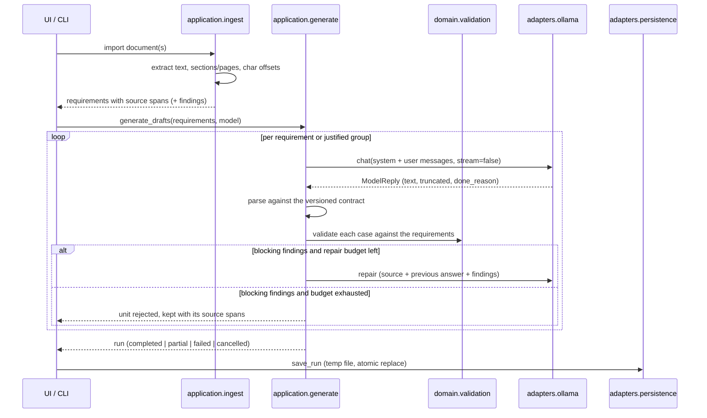

# Application Architecture

Spec2Test turns requirements from PDF, TXT and Markdown into reviewable test
drafts. The model proposes; validation, traceability and approval stay in the
application.

## Layering

Four layers with a one-way dependency rule. `tests/test_architecture.py`
enforces it by parsing the imports of every module.

| Layer | Package | Responsibility | May import |
| - | - | - | - |
| Domain | `src/spec2test/domain/` | Data model and rules | nothing but itself |
| Application | `src/spec2test/application/` | Use cases and ports | domain |
| Adapters | `src/spec2test/adapters/` | HTTP, documents, storage, fakes | domain, application |
| UI | `src/spec2test/ui/` | PySide6 views and Qt workers | application and adapters |

Everything ships inside the package; the repository root keeps only two thin
compatibility modules.

| Path | Role |
| - | - |
| `src/spec2test/ui/main_window.py` | the window: settings panel and result views |
| `src/spec2test/ui/workers.py` | `DraftTask` (the run) and `ModelListTask` (`/api/tags`) |
| `src/spec2test/ui/review_panel.py` | Review actions and the draft editor |
| `src/spec2test/ui/scope_panel.py` | Knowledge base, index state, scope, specification view |
| `src/spec2test/ui/models.py` | Qt table model over the flat export rows |
| `src/spec2test/ui/app.py` | entry point, also the `spec2test-gui` script |
| `src/spec2test/config.py` | configuration dataclasses shared by UI, worker and CLI |
| `src/spec2test/adapters/export/` | CSV and Excel writers plus the summary |
| `gui.py` (root) | launcher for running from a checkout |
| `core.py` (root) | legacy wrappers for existing scripts |

`config.CloudConfig` carries mode, host and timeouts, and the UI, the Qt worker
and the CLI all turn it into `OllamaSettings` through
`bootstrap.ollama_settings_from_config`, so the three cannot drift apart. The
same holds for the limits: `bootstrap.generation_settings_from_config` is the
only place that builds `GenerationSettings`.

`config.yml` is read at startup and never written automatically. Runtime
changes live in the window; writing them back is an explicit action in the File
menu, because the YAML writer cannot preserve the file's comments.

The window keeps the loaded file and overlays only the fields it edits
(`widget_overlay`). A setting without a widget - `model.url`,
`cloud.max_retries`, the input budget, the legacy sections - reaches the worker
unchanged instead of falling back to a default.

Without any configuration the mode is `ollama_local`: it needs no credentials.
`ollama_cloud` is always a deliberate choice.

The domain imports no Qt, HTTP, PDF, Excel or even Pydantic. Qt signals and
HTTP response objects never cross a port boundary: the application sees
`ChatMessage`, `ModelReply` and `ImportedDocument`, never a `requests.Response`.

```
          ┌────────── ui (PySide6) ──────────┐   ┌──── cli.py ────┐
          │  gui.py  workers.py  qmodels.py  │   │ example run    │
          └───────────────┬──────────────────┘   └───────┬────────┘
                          │  core.py (compatibility)     │
                          └──────────────┬───────────────┘
                                         ▼
                        ┌──── application (use cases) ────┐
                        │ ingest  generate  contracts     │
                        │ chunking  prompts  ports        │
                        └──────────────┬──────────────────┘
                                       ▼
                        ┌──────────── domain ─────────────┐
                        │ models.py      validation.py    │
                        └─────────────────────────────────┘
                                       ▲  implement the ports
          ┌────────────────────────────┴────────────────────────────┐
          │ adapters/ollama  adapters/documents  adapters/fake      │
          │ adapters/persistence                                    │
          └─────────────────────────────────────────────────────────┘
```

## Modules

### Domain — `domain/models.py`, `domain/validation.py`

`SourceDocument`, `SourceSpan`, `Requirement`, `TestCase`, `TestStep`,
`Measurement`, `OpenQuestion`, `ValidationIssue`, `GenerationAttempt`,
`GenerationUnitResult`, `GenerationRun`.

* A `TestStep` always pairs an action with its observable expectations.
  Preconditions and postconditions are steps too, so a precondition that needs
  several steps can state how each one is verified; successful execution is
  never implied.
* `Requirement` carries a stable internal ID and, if present, the external ID
  from the document. The internal ID is never presented as a document ID.
* Validation severities decide the workflow: `ERROR` blocks acceptance as a
  draft, `CLARIFICATION` allows a draft but blocks approval, `INFO` is a note.
* `RunStatus` is `completed`, `partial`, `failed` or `cancelled`. A run with no
  accepted unit is never `completed`.

### Application

| Module | Responsibility |
| - | - |
| `ports.py` | Interfaces for model, document import, run storage and export |
| `contracts.py` | Versioned strict JSON contract plus the four parse outcomes |
| `chunking.py` | Block building; every page lands in at least one block |
| `ingest.py` | Requirement capture with source spans, definitions vs. references |
| `prompts.py` | Versioned system/user messages and the repair message |
| `assembly.py` | Contract objects → domain objects; ID assignment; legacy import |
| `generate.py` | Generation, bounded repair, cancellation, run status |
| `review.py` | Revisions, clarification, accepted findings, approval |
| `knowledge.py` | Passages, their kind, and the searchable normalised text |
| `indexing.py` | Keeping the index in step with the documents |
| `specification.py` | The deliverable, derived from the project |
| `step_text.py` | The text format a reviewer edits steps in |
| `deadline.py` | Bounded runtime per job |
| `legacy.py` | Deprecated bridge for the existing GUI (removed with L2) |

### Adapters

| Module | Responsibility |
| - | - |
| `ollama/client.py` | HTTP transport, authentication, error mapping, retries |
| `ollama/models.py` | Model list from `/api/tags` and known mode capabilities |
| `documents/text_import.py` | TXT and Markdown with section and char positions |
| `documents/pdf_import.py` | PDF pages via PyMuPDF; empty pages are reported |
| `fake/model.py` | `ScriptedModel` and `RuleBasedFakeModel` for tests and CI |
| `persistence/json_store.py` | Run storage with temp file and atomic replace |
| `persistence/project_store.py` | Versioned project files, atomic write, one writer |
| `knowledge/sqlite_index.py` | Knowledge index: SQLite with FTS5 full-text search |

## Prompts

The contract rules are not negotiable. `prompts.build_system_message` always
starts from `SYSTEM_PROMPT` and appends an optional project guidance file under
a header that states the guidance has lower precedence. A guidance file can add
role, coverage wishes and terminology; it can never change the output format,
because a prompt demanding a different shape would make every answer invalid.

The files in `prompts/` are guidance only. The originals, which prescribe the
flat legacy array, live in `prompts/legacy/` and belong to
`core.generate_test_cases`.

## The model contract

Model answers use one versioned object. There are no mixed types such as
"string or list", extra fields are rejected, and the contract carries neither
IDs nor a review status — the application assigns both, so a model cannot
approve its own output.

```json
{
  "schema_version": "1.0",
  "test_cases": [
    {
      "title": "...",
      "objective": "...",
      "requirement_refs": ["RAS-SW-REQ-0001"],
      "preconditions": [{"order": 1, "action": "...", "expectations": ["..."]}],
      "steps": [
        {
          "order": 1,
          "action": "...",
          "expectations": ["..."],
          "measurements": [
            {"quantity": "...", "value": "...", "unit": "...",
             "tolerance": "...", "evidence": "quote from the requirement"}
          ]
        }
      ],
      "postconditions": [{"order": 1, "action": "...", "expectations": ["..."]}],
      "open_questions": [{"question": "...", "requirement_refs": ["..."],
                          "suggestion": "explicitly a proposal"}]
    }
  ],
  "open_questions": []
}
```

An answer is parsed into one of five outcomes, which are never collapsed into
an empty list: `OK`, `EMPTY`, `INVALID_JSON`, `SCHEMA_INVALID`, `NO_TEST_CASES`.

`max_cases_per_unit` is enforced by the application, not only asked for in the
prompt: a surplus draft is not accepted and the run records a finding, while
the raw answer keeps everything.

Ollama Cloud offers no schema-enforced structured outputs, so the `format`
parameter is not assumed and local validation is mandatory.

## Operating modes

| Mode | Host | Authentication | GPU options |
| - | - | - | - |
| `ollama_cloud` | `https://ollama.com` | `Authorization: Bearer $OLLAMA_API_KEY` | not offered |
| `ollama_local` | `http://localhost:11434` | none | `num_gpu`, `main_gpu`, `gpu_layers`, `num_thread` |

The mode is always explicit. A cloud failure never becomes a local run, and no
error path starts the local `ollama` CLI. The API key is read from the
environment, never written to `config.yml`, never logged, removed from error
messages, and sent only to the configured host — redirects are not followed.

Error mapping: 401/403 → `AuthenticationError` (no retry), 404 →
`ModelNotFoundError` (no retry), 429 → `RateLimitError` honouring `Retry-After`,
408/5xx and connection or timeout errors → bounded retries with backoff. Each
retry is logged with a note that it can cause additional usage.

A `ModelError` carries two flags. `retryable` means the same request may be
sent again after a backoff. `fatal` means a credential or host problem, which
no other requirement can get past: the run stops after the first such failure
and the remaining requirements are recorded as `NOT_STARTED` instead of
repeating the same error for each one.

The key may also come from a git-ignored `.env` file in the working directory
(`bootstrap.load_env_file`, a ~20-line parser rather than a dependency). It
returns only the variable names it set, so a caller cannot log a secret by
accident, and an already exported variable wins.

## End-to-end flow



## Configuration

`config.yml` holds the mode, host, timeouts, model name, sampling parameters,
generation limits and portable relative paths. It never holds the API key.
`bootstrap.py` reads it and wires the concrete adapters;
`config_models.py` still serves the existing GUI widgets.

## Dependencies

| Library | Used for |
| - | - |
| PySide6 | existing GUI and Qt workers |
| PyMuPDF | the single PDF text extractor |
| requests | HTTP transport in the Ollama adapter |
| pydantic | strict, versioned JSON contracts with precise error paths |
| pandas, openpyxl | CSV/Excel export |
| PyYAML | configuration |
| scikit-learn | optional, only for the legacy RAG option |

PyPDF2 was removed: PDF reading is unified on PyMuPDF.

## Definitions and references

A requirement ID at the start of a line - at most behind heading markers, a
bullet, bold markers or a label such as `Requirement:` - *defines* a
requirement. The same ID inside a sentence is a *reference* and is stored in
`Requirement.references`. Without that distinction a sentence like "as
specified in BMS-REQ-THM-0403" would cut the citing requirement in half and
invent a second one.

`ingest.reference_report()` resolves the references across all imported
documents: which requirement defines an ID, who cites it, which citations have
no target, and which IDs are defined more than once. An ambiguous ID does not
resolve. This is the deterministic first stage of retrieval - no search
involved.

## The knowledge base

All documents are cut into **passages**. A captured requirement stays one
passage; everything else is split along its headings and, when long, split
again while keeping the heading and the position in the original document. The
header block of a document is not indexed: its content is already stored as
document metadata and would match every query.

Each passage is stored twice: the **original text** unchanged, and a
**normalised copy** for searching, in which LaTeX becomes plain text
(`$50\text{ ms}$` → `50 ms`) and Markdown decoration is dropped. Underscores
survive, because signal names like `BMS_Pack_U` are the most useful search
terms this corpus has. A hit always points back to the original position.

Every passage carries a **kind** - requirement, signal, interface,
explanation or reference test - so the roles stay apart: an interface
description may name a signal, but it never supplies a missing target value.

`indexing.sync_index` compares the content hash **and** the parser version: a
file that has not changed is still read again once the importer changed.
Deleted files disappear from the index.

## Supporting context

`application/context.py` assembles the context for one generation unit.
Explicit references come first - the document states them itself - and
full-text hits from the knowledge index fill what is left, signal and
interface sections before explanations. Duplicates are dropped and both share
one budget. Only requirements the unit cites directly are followed; there is
no recursion.
Each item carries requirement ID, document, declared document ID and version,
content hash and source span, and the selection is stored verbatim in
`GenerationUnitResult.context` - IDs alone would not survive a later change to
the documents.

The prompt keeps the roles apart: requirements under test versus supporting
context that must not become a test target. What does not fit the budget is
reported, never shortened. Values that differ between a requirement and its
context are reported as a clarification; the model must not pick a source.

A value found only in the context is not treated as covered. It is reported as
`C_VALUE_FROM_CONTEXT` naming the source, so the reviewer decides whether the
attribution holds.

Specifications written in Markdown often state values as LaTeX
(`$50\text{ ms}$`). `domain.validation.normalise_math` translates that before
values are read; without it every correctly quoted value would be reported as
unsupported.

## Review workflow

A `Project` holds the original documents, the captured requirements, the
current drafts, every earlier revision, the runs and the review history. It is
stored as one versioned file (`*.s2t.json`) through a unique temporary file and
an atomic replace; a lock file marks it as open, so a second writer is reported
instead of silently winning. A damaged file is refused with a message naming
the field, never with a stack trace.

The rules live in `application/review.py`:

* every saved change creates a new revision, and the earlier one is kept;
* an approval never carries over to a new revision;
* approval re-runs the deterministic validation for that exact revision;
* a question is cleared with an answer, never deleted - the answer, the
  reviewer and the time stay on record;
* a clarification finding can be accepted with a stated reason; an error never
  can, because no justification makes a structurally broken draft usable;
* an edit clears earlier acceptances, so a new revision is judged again;
* changed or removed requirements mark the affected drafts for a fresh review
  and withdraw their approval.

`Project.rework_statistics()` records how much manual work the drafts needed -
edits per case, rejections, the revision at which a draft was approved and what
reviewers objected to. That is the measure for comparing two model or
retrieval configurations later, beyond a plain approval rate.

## The test specification

`application/specification.build_specification` derives the deliverable from
the project: requirements with their document and version, test cases with
steps and expectations, findings, open questions, the context that was used
and the review status. There is no second text generated beside the data
model, so the document and the review cannot disagree.

It distinguishes three things a reader would otherwise confuse:

* requirements **in scope** that produced a draft,
* requirements **in scope without a draft** - a real gap,
* requirements of the knowledge base that were **never in scope** - context,
  not a gap.

`adapters/export/specification.py` renders the same object as Markdown, JSON
and an Excel workbook with separate sheets for test cases, test steps,
requirement links, open questions and context sources. An action and its
expectation stay in one row. A draft export states that it is one, and the
coverage note says plainly that a linked draft is not proof of functional
coverage.

## Deliberately not in this delivery

Embeddings and semantic search, a dedicated review agent, MCP and A2A.
Model-assisted requirement segmentation, streaming, parallelisation and OCR
also remain open. The retrieval interface is kept replaceable so an embedding
index can take the place of the full-text one.
