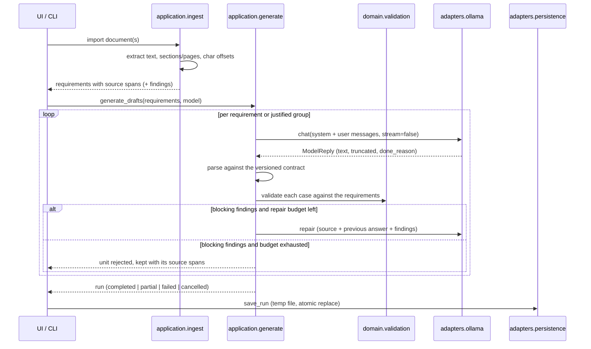

# Application Architecture

Spec2Test turns requirements from PDF, TXT and Markdown into reviewable test
drafts. The model proposes; validation, traceability and approval stay in the
application.

## Layering

Four layers with a one-way dependency rule. `tests/test_architecture.py`
enforces it by parsing the imports of every module.

| Layer | Package | Responsibility | May import |
| - | - | - | - |
| Domain | `src/spec2test/domain/` | Data model and rules | nothing but itself |
| Application | `src/spec2test/application/` | Use cases and ports | domain |
| Adapters | `src/spec2test/adapters/` | HTTP, documents, storage, fakes | domain, application |
| UI | `gui.py`, `workers.py`, `qmodels.py` | PySide6 views and Qt workers | application via `core.py` |

The domain imports no Qt, HTTP, PDF, Excel or even Pydantic. Qt signals and
HTTP response objects never cross a port boundary: the application sees
`ChatMessage`, `ModelReply` and `ImportedDocument`, never a `requests.Response`.

```
          ┌────────── ui (PySide6) ──────────┐   ┌──── cli.py ────┐
          │  gui.py  workers.py  qmodels.py  │   │ example run    │
          └───────────────┬──────────────────┘   └───────┬────────┘
                          │  core.py (compatibility)     │
                          └──────────────┬───────────────┘
                                         ▼
                        ┌──── application (use cases) ────┐
                        │ ingest  generate  contracts     │
                        │ chunking  prompts  ports        │
                        └──────────────┬──────────────────┘
                                       ▼
                        ┌──────────── domain ─────────────┐
                        │ models.py      validation.py    │
                        └─────────────────────────────────┘
                                       ▲  implement the ports
          ┌────────────────────────────┴────────────────────────────┐
          │ adapters/ollama  adapters/documents  adapters/fake      │
          │ adapters/persistence                                    │
          └─────────────────────────────────────────────────────────┘
```

## Modules

### Domain — `domain/models.py`, `domain/validation.py`

`SourceDocument`, `SourceSpan`, `Requirement`, `TestCase`, `TestStep`,
`Measurement`, `OpenQuestion`, `ValidationIssue`, `GenerationAttempt`,
`GenerationUnitResult`, `GenerationRun`.

* A `TestStep` always pairs an action with its observable expectations.
  Preconditions and postconditions are steps too, so a precondition that needs
  several steps can state how each one is verified; successful execution is
  never implied.
* `Requirement` carries a stable internal ID and, if present, the external ID
  from the document. The internal ID is never presented as a document ID.
* Validation severities decide the workflow: `ERROR` blocks acceptance as a
  draft, `CLARIFICATION` allows a draft but blocks approval, `INFO` is a note.
* `RunStatus` is `completed`, `partial`, `failed` or `cancelled`. A run with no
  accepted unit is never `completed`.

### Application

| Module | Responsibility |
| - | - |
| `ports.py` | Interfaces for model, document import, run storage and export |
| `contracts.py` | Versioned strict JSON contract plus the four parse outcomes |
| `chunking.py` | Block building; every page lands in at least one block |
| `ingest.py` | Requirement capture with source spans |
| `prompts.py` | Versioned system/user messages and the repair message |
| `assembly.py` | Contract objects → domain objects; ID assignment; legacy import |
| `generate.py` | Generation, bounded repair, cancellation, run status |
| `deadline.py` | Bounded runtime per job |
| `legacy.py` | Deprecated bridge for the existing GUI (removed with L2) |

### Adapters

| Module | Responsibility |
| - | - |
| `ollama/client.py` | HTTP transport, authentication, error mapping, retries |
| `ollama/models.py` | Model list from `/api/tags` and known mode capabilities |
| `documents/text_import.py` | TXT and Markdown with section and char positions |
| `documents/pdf_import.py` | PDF pages via PyMuPDF; empty pages are reported |
| `fake/model.py` | `ScriptedModel` and `RuleBasedFakeModel` for tests and CI |
| `persistence/json_store.py` | Run storage with temp file and atomic replace |

## The model contract

Model answers use one versioned object. There are no mixed types such as
"string or list", extra fields are rejected, and the contract carries neither
IDs nor a review status — the application assigns both, so a model cannot
approve its own output.

```json
{
  "schema_version": "1.0",
  "test_cases": [
    {
      "title": "...",
      "objective": "...",
      "requirement_refs": ["RAS-SW-REQ-0001"],
      "preconditions": [{"order": 1, "action": "...", "expectations": ["..."]}],
      "steps": [
        {
          "order": 1,
          "action": "...",
          "expectations": ["..."],
          "measurements": [
            {"quantity": "...", "value": "...", "unit": "...",
             "tolerance": "...", "evidence": "quote from the requirement"}
          ]
        }
      ],
      "postconditions": [{"order": 1, "action": "...", "expectations": ["..."]}],
      "open_questions": [{"question": "...", "requirement_refs": ["..."],
                          "suggestion": "explicitly a proposal"}]
    }
  ],
  "open_questions": []
}
```

An answer is parsed into one of five outcomes, which are never collapsed into
an empty list: `OK`, `EMPTY`, `INVALID_JSON`, `SCHEMA_INVALID`, `NO_TEST_CASES`.

Ollama Cloud offers no schema-enforced structured outputs, so the `format`
parameter is not assumed and local validation is mandatory.

## Operating modes

| Mode | Host | Authentication | GPU options |
| - | - | - | - |
| `ollama_cloud` | `https://ollama.com` | `Authorization: Bearer $OLLAMA_API_KEY` | not offered |
| `ollama_local` | `http://localhost:11434` | none | `num_gpu`, `main_gpu`, `gpu_layers`, `num_thread` |

The mode is always explicit. A cloud failure never becomes a local run, and no
error path starts the local `ollama` CLI. The API key is read from the
environment, never written to `config.yml`, never logged, removed from error
messages, and sent only to the configured host — redirects are not followed.

Error mapping: 401/403 → `AuthenticationError` (no retry), 404 →
`ModelNotFoundError` (no retry), 429 → `RateLimitError` honouring `Retry-After`,
408/5xx and connection or timeout errors → bounded retries with backoff. Each
retry is logged with a note that it can cause additional usage.

## End-to-end flow



## Configuration

`config.yml` holds the mode, host, timeouts, model name, sampling parameters,
generation limits and portable relative paths. It never holds the API key.
`bootstrap.py` reads it and wires the concrete adapters;
`config_models.py` still serves the existing GUI widgets.

## Dependencies

| Library | Used for |
| - | - |
| PySide6 | existing GUI and Qt workers |
| PyMuPDF | the single PDF text extractor |
| requests | HTTP transport in the Ollama adapter |
| pydantic | strict, versioned JSON contracts with precise error paths |
| pandas, openpyxl | CSV/Excel export |
| PyYAML | configuration |
| scikit-learn | optional, only for the legacy RAG option |

PyPDF2 was removed: PDF reading is unified on PyMuPDF.

## Deliberately not in this delivery

Model-assisted requirement segmentation, review and coverage views, project
persistence with revisions, Excel export of steps and links, streaming, RAG,
parallelisation, OCR and a GUI rebuild. See the work packages for AP 4 to AP 6.
