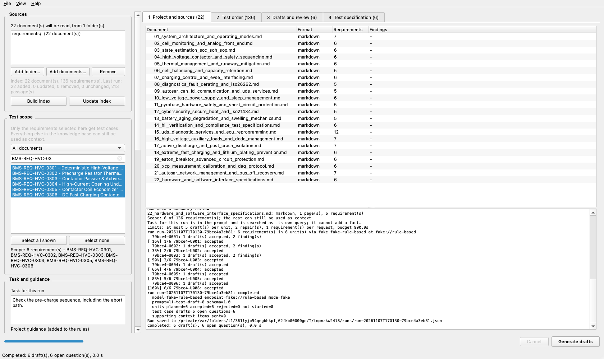
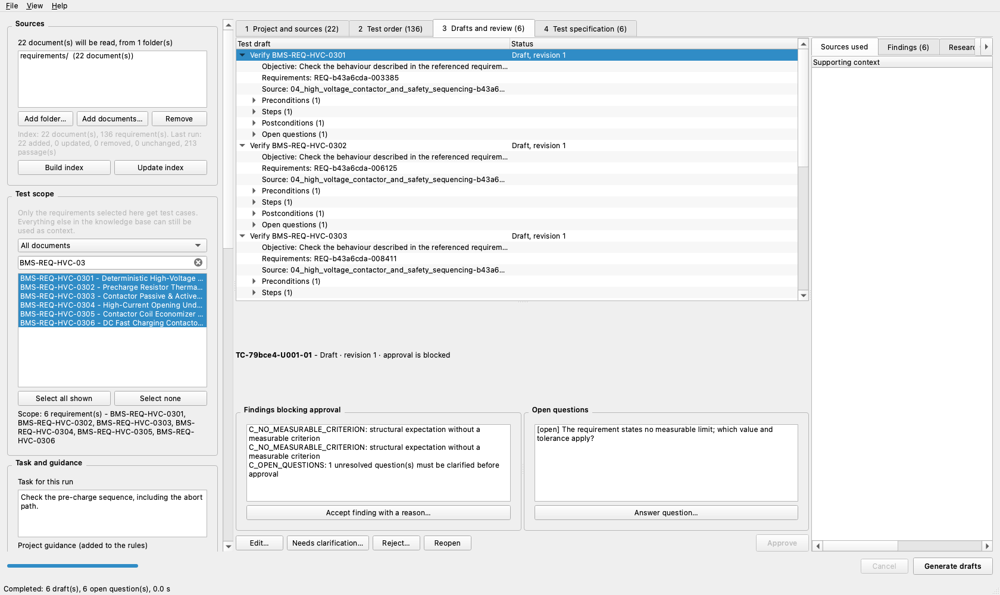
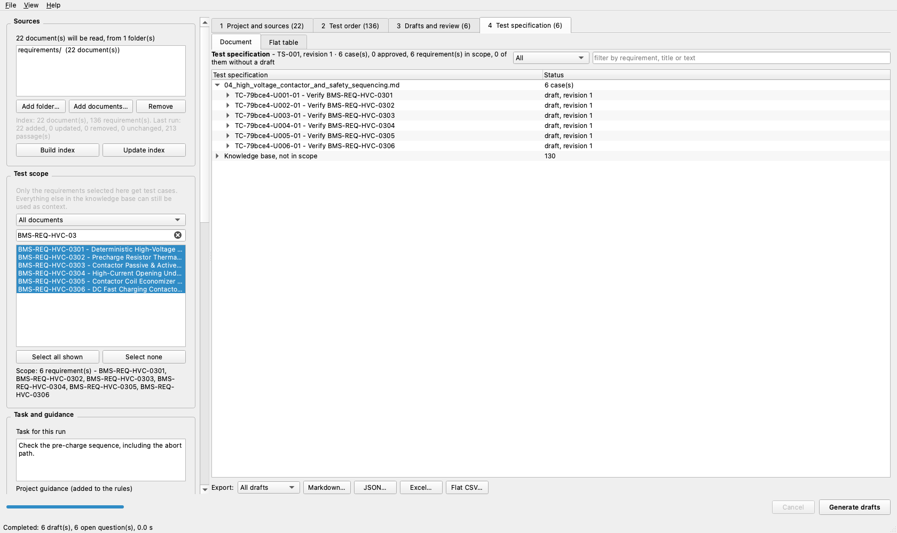
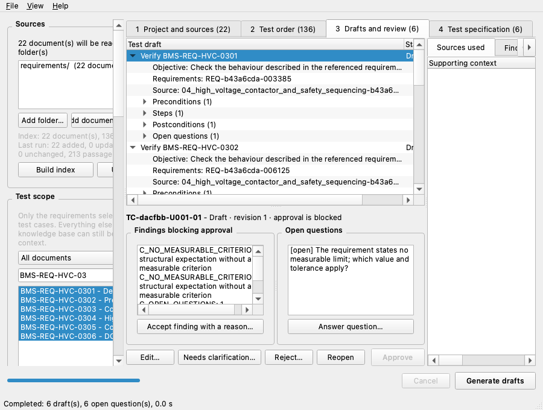
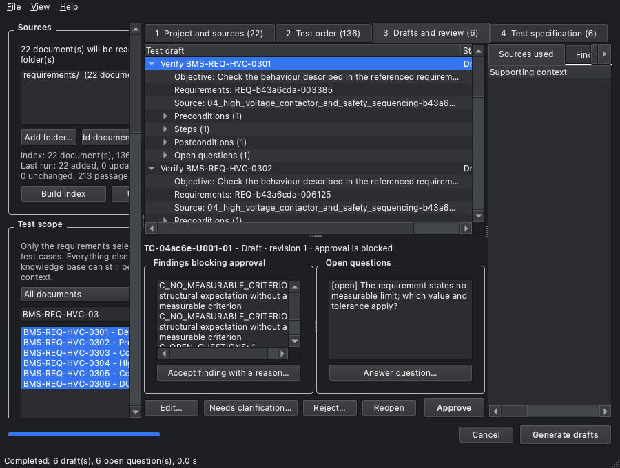

# Die Oberfläche

Vier Arbeitsbereiche, benannt nach dem Arbeitsschritt — nicht nach den
Datenstrukturen dahinter. Die sieben alten Reiter hießen „Export table",
„Context", „Log"; wer etwas suchte, musste die Pipeline kennen.

| Bereich | Inhalt |
|---|---|
| **1 Project and sources** | je Dokument: Format, gefundene Anforderungen, Importbefunde; darunter das Protokoll |
| **2 Test order** | die Anforderungen mit ihrer Quelle und ihrem Klärungsstand |
| **3 Drafts and review** | Entwürfe, Review darunter, daneben *Sources used*, *Findings* und *Research review* |
| **4 Test specification** | das Dokument, die flache Tabelle, und der Export |

Links steht die Werkbank: Quellen, Testumfang, Aufgabe und Vorgaben,
Kontext, Endpunkt, Modell, Generierung.





## Drei Fehler, die vorher da waren

**Angezeigte und verwendete Quellen gingen auseinander.** Gemessen:

```
panel shows       : Folder: .../requirements
start_run will use: ['spec_a.md']
```

Es gibt jetzt eine Liste (`ui/sources.py`). `documents()` ist genau das,
was der nächste Lauf liest; das Panel rendert dasselbe Objekt. Die
Methode, die eine zweite Liste anlegen konnte, ist entfernt.

**Kontextnutzung war unsichtbar** — die Wahl stand nur in `config.yml`.
Jetzt zwei getrennte Schalter, weil es zwei Dinge sind:

* *Follow references the documents state* — eine Anforderung, die eine
  andere per ID nennt, bekommt sie. Das ist keine Suche.
* *Additional search*: aus / lexikalisch / hybrid.

„Suche aus" liest sich deshalb nicht mehr als „kein Kontext". Nach einem
Lauf steht dort, welcher Retriever **wirklich** benutzt wurde — ein
Hybrid, der auf lexikalisch zurückgefallen ist, liest sich nicht als
Hybrid.

**Der Editor verlor Messungen und Belege**, bei einer reinen
Titeländerung. Siehe unten.

## Belege beim Bearbeiten

Ein Beleg gehört zu einem Feld (`expectations[0]`). Beim Bearbeiten:

| Was passiert | Was mit dem Beleg geschieht |
|---|---|
| nur der Titel geändert | nichts — die Schritte werden gar nicht eingereicht |
| eine Zeile **verschoben** | die Adresse wird nachgezogen, der Beleg bleibt gültig |
| der Text **geändert** | der Beleg wird als *stale* markiert und deckt seine Angabe nicht mehr |
| das Feld **gelöscht** | ebenso — er zeigt nicht auf das, was nachgerückt ist |
| eine Zeile **eingefügt** | sie erbt keinen Beleg |

Ein *stale* Beleg behält sein Zitat — ihn wegzuwerfen, weil ein
Nachbarwort sich geändert hat, hilft niemandem — aber er zählt nicht mehr
als Deckung, die Angabe erscheint wieder als unbelegt
(`C_CLAIM_WITHOUT_GROUND`), und die Freigabe ist gesperrt. Der Entwurf
bleibt speicherbar.

## Quellen und Index

Eine entfernte, hinzugefügte oder geänderte Quelle macht den Index
veraltet; das Panel sagt es. Ein Lauf mit eingeschalteter Suche fragt
dann nach, ob erst aktualisiert werden soll. **Während einer
Aktualisierung startet kein Lauf** — sonst läse er einen anderen
Quellenstand als den, der gerade indiziert wird.

## Projekt wieder öffnen

Gespeichert und wiederhergestellt werden Quellen (Ordner und einzelne
Dokumente), die Aufgabenbeschreibung und die fachlichen Vorgaben. Eine
Quelle, die seither verschoben wurde, wird als fehlend benannt, nicht
stillschweigend weggelassen. Die gespeicherten Laufkontexte bleiben
unverändert. Fehlt der lokale Index, steht das im Protokoll:

> No local index at …. The stored run context is unchanged, but a new run
> needs the index built again on this machine.

## Fachliche Vorgaben

Die Dateien unter `prompts/` sind **Projektvorgaben, keine Stufen**.
`Prompt_Expert_Test_Architect.txt` beginnt mit „Project guidance:
Rear-Axle-Steering (RAS), expert level" — in einem Batterielauf hat das
nichts verloren. Die mitgelieferte `config.yml` lädt deshalb **keine**
mehr; eine Vorgabe wird bewusst im Fenster geladen. Passt sie nicht zu den
Quellen, steht es daneben:

> The project guidance talks about Rear-Axle-Steering, which does not
> appear anywhere in the loaded sources. … It will still be sent; check
> that it belongs to this project.

Ein Hinweis, kein Veto: Vorgaben über Projekte hinweg wiederzuverwenden
kann gewollt sein.

## Tastatur

| | |
|---|---|
| Bereich 1–4 | `Ctrl/Cmd+1` … `Ctrl/Cmd+4` |
| Entwürfe erzeugen | `Ctrl/Cmd+R` |
| Projekt öffnen | `Ctrl/Cmd+Shift+O` |
| Speichern / Speichern unter | die Standardkürzel der Plattform |
| Dokumente hinzufügen | das Öffnen-Standardkürzel |
| Beenden | das Beenden-Standardkürzel, mit `QuitRole` (auf macOS im Programm-Menü) |

Speichern, Öffnen, Beenden benutzen `QKeySequence.StandardKey`, damit die
Plattform ihre eigene Belegung bestimmt. Dateidialoge sind die nativen
(`QFileDialog` ohne `DontUseNativeDialog`).

## Fenstergrößen und Darstellung

Das Fenster ließ sich nicht unter **1256 px** verkleinern. Gemessen und
behoben: die Exportleiste am unteren Rand setzte allein rund 245 px, die
Review-Gruppen nebeneinander den Rest. Die Exportsteuerung sitzt jetzt in
Bereich 4, die Review-Gruppen in einem Splitter.

| | vorher | jetzt |
|---|---:|---:|
| minimale Fensterbreite | 1256 px | **786 px** |

Geprüft auf macOS bei 1680×1000 und 900×680, hell und dunkel:




Dazu behoben: Dokumentfilter und Suchfeld teilten sich eine Zeile und
beschnitten einander auf wenige Zeichen; die Anforderungsliste scrollte
waagerecht, statt zu kürzen.

## Offene Plattformabnahme

| Plattform | Stand |
|---|---|
| macOS (Apple Silicon, Qt offscreen und sichtbar) | **geprüft**: vier Bereiche, hell/dunkel, 1680×1000 und 900×680, Tastaturwege |
| **Windows** | **offen** — hier nicht ausgeführt. Zu prüfen: native Dateidialoge, Tastenkürzel, Hochkontrast- und Dunkelmodus, Skalierung über 100 % |
| **Linux** | **offen** — nicht ausgeführt |
| Bildschirmlesegerät / Tastatur ohne Maus | **offen** — nur die Menükürzel sind geprüft, keine vollständige Fokusreihenfolge |
| echte Modellläufe aus der Oberfläche | **offen** — alle GUI-Tests laufen gegen die Attrappe |
