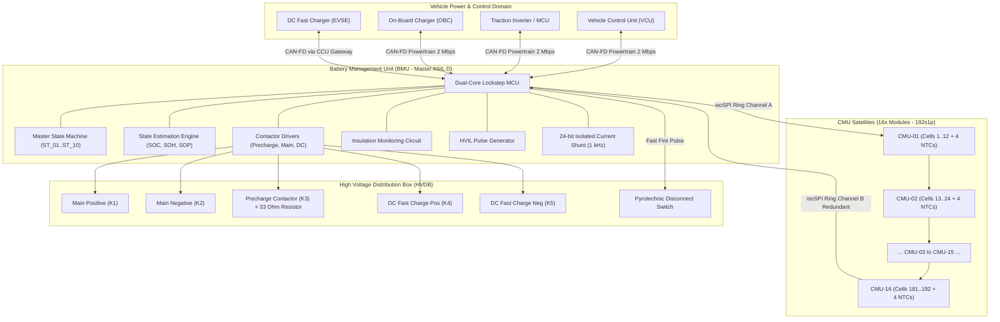
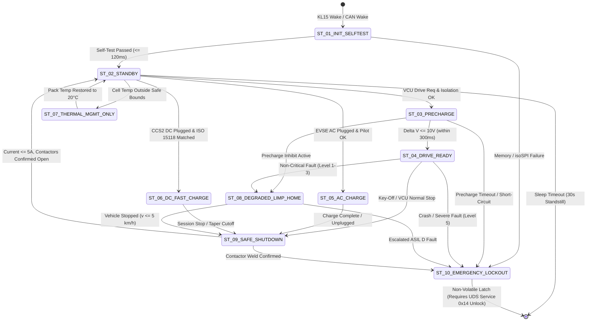

# BMS Software Requirements Specification: System Architecture & Operating Modes

**Document ID:** BMS-SRS-01-ARCH-MODES  
**Version:** 2.4.0  
**Classification:** Automotive High-Voltage Powertrain (EV)  
**Safety Compliance:** ISO 26262:2018 (up to ASIL D), UN ECE R100.03  
**Target Architecture:** Distributed Master-Slave BMS (1x BMU Master, 16x CMU Satellites, 800V Nominal, 192s1p Li-ion NMC811, 105 kWh)

---

## 1. System Scope & Architecture Overview

The High-Voltage Battery Management System (BMS) manages, monitors, and protects the traction battery pack of a battery electric passenger vehicle (BEV). The hardware topography consists of:
* **Battery Management Unit (BMU - Master):** Dual-core lockstep 32-bit automotive microcontroller (e.g., Aurix TC3xx / Traveo II), housing the high-level application software, state machines, state estimation algorithms (SOC/SOH/SOP), contactor drive controls, isolation monitoring, and vehicle gateway communication (CAN-FD).
* **Cell Monitoring Units (CMU - Satellites):** 16 slave modules linked via dual-redundant ring daisy-chain isolated SPI (isoSPI), each supervising 12 series-connected battery cells (total 192 cells in series).
* **High Voltage Distribution Box (HVDB):** Positive/Negative contactors, precharge contactor and resistor, DC fast-charging contactors, bidirectional current shunt transducer with integrated isolated $\Sigma\Delta$ modulator, Hall-effect current backup, pyro-switch safety disconnect, and chassis isolation detection.

---

## 2. Operational State Machine Definition

The BMS software shall implement a deterministic hierarchical finite state machine (FSM) conforming to ISO 26262 safe-state requirements. The principal operating states are defined as follows:

| State ID | State Name | Description | Allowed Contactor State |
| :--- | :--- | :--- | :--- |
| `ST_01` | **INIT_SELFTEST** | Power-on bootstrap, ROM/RAM checksum, BSW initialization, isoSPI CMU ring enumeration, ADC zero-offset calibration. | All Open |
| `ST_02` | **STANDBY** | 12V awake, HV contactors open, low-voltage diagnostics nominal, waiting for drive enable (`KL15_IGN_ON`) or charge plug insertion (`EVSE_CONNECTED`). | All Open |
| `ST_03` | **PRECHARGE** | Negative contactor closed, precharge contactor closed. Active monitoring of DC-link voltage slope until $\Delta V \le 10\text{ V}$. | Neg: Closed, Pre: Closed, Pos: Open |
| `ST_04` | **DRIVE_READY** | Main positive closed, precharge opened. Full bidirectional traction power delivery and regenerative braking enabled. | Neg: Closed, Pre: Open, Pos: Closed |
| `ST_05` | **AC_CHARGE** | AC charging sequence active via On-Board Charger (OBC). Precharge verified, contactors closed, thermal cooling/heating active. | Neg: Closed, Pos: Closed, Aux: Closed |
| `ST_06` | **DC_FAST_CHARGE** | DC High Power Charging (CCS2 / ISO 15118). Dedicated DC+ and DC- contactors closed directly to EVSE bus. | Neg: Closed, Pos: Closed, DC+/-: Closed |
| `ST_07` | **THERMAL_MGMT_ONLY** | Vehicle parked/off; battery heater or cooling pump active to keep pack within survival limits ($-30^\circ\text{C} \le T \le 55^\circ\text{C}$). | Dependent on HV auxiliary setup |
| `ST_08` | **DEGRADED_LIMP_HOME**| Non-critical fault present (e.g., single NTC sensor loss, minor cell imbalance). Maximum power derated to 20 kW. | Neg: Closed, Pos: Closed |
| `ST_09` | **SAFE_SHUTDOWN** | Controlled shutdown sequence requested by VCU or non-instantaneous critical fault. Ramping power down to 0 kW within 500 ms before opening contactors. | Sequencing to All Open |
| `ST_10` | **EMERGENCY_LOCKOUT** | Critical hazard detected (Crash signal, pyro trigger, thermal runaway, insulation $< 100\,\Omega/\text{V}$). Immediate hardware interrupt opening. Non-volatile DTC latch. | All Commanded Open / Pyro Blown |

---

## 3. Detailed Functional Requirements

### Requirement: BMS-REQ-SYS-0010
* **Title:** Power-On Bootstrapping and Self-Test Sequence
* **ASIL Level:** ASIL D
* **Verification Method:** Test (HiL Automated Rigorous Regression)
* **Traceability:** ISO 26262-5:2018 Clause 8; UN ECE R100.03
* **Inputs:**
  * `KL30_Voltage` (Data Type: `uint16_t`, Unit: `mV`, Range: `0..18000`, Source: Internal ADC)
  * `KL15_Ignition_State` (Data Type: `boolean`, Unit: `enum`, Values: `{OFF, ON}`, Source: Discrete Digital Input)
  * `Wakeup_Source` (Data Type: `uint8_t`, Unit: `enum`, Values: `{KL15, CAN_WAKE, RTC_ALARM, CHARGE_PLUG}`, Source: SBC Watchdog)
* **Outputs:**
  * `BMS_Boot_Status` (Data Type: `uint8_t`, Unit: `enum`, Values: `{IN_PROGRESS, PASSED, FAILED}`, Destination: Internal Bus)
  * `BMS_Operational_State` (Data Type: `uint8_t`, Unit: `enum`, Values: `ST_01..ST_10`, Destination: CAN-FD ID `0x100`)
* **Timing & Debounce:** Max execution duration $\le 120\text{ ms}$; task rate: initialization loop 1 ms.
* **Description:**  
  Upon detection of a valid wake-up signal (`KL15_Ignition_State == ON` or `Wakeup_Source != 0`), the BMS software shall transition from sleep mode into `ST_01_INIT_SELFTEST` and execute hardware diagnostic checks within $120\text{ ms}$. The self-test shall verify:
  1. Core internal Flash and RAM ECC integrity.
  2. Configuration memory CRC32 checksum match against calibrated EEPROM shadow copy.
  3. Daisy-chain isoSPI physical communication loop integrity across all 16 connected CMU devices.
  4. Redundant current sensor zero-point drift ($\le \pm 200\text{ mA}$).
  5. High-Voltage Interlock Loop (HVIL) physical continuity.  
  If all sub-tests evaluate to `PASS`, the BMS shall transition to `ST_02_STANDBY`. If any check fails, the BMS shall enter `ST_10_EMERGENCY_LOCKOUT` and log the corresponding fault DTC.
* **Rationale:** Prevents closure of high-voltage contactors under unsafe internal controller states or corrupted calibration memory.
* **Acceptance Criteria:**  
  Verification passes if and only if `BMS_Boot_Status` transitions to `PASSED` within $120.0\text{ ms}$ under nominal hardware conditions, and successfully enters `ST_10_EMERGENCY_LOCKOUT` with contactor driver lines held low when any mock memory fault or broken isoSPI harness is injected.

---

### Requirement: BMS-REQ-SYS-0020
* **Title:** Operational State Machine Transition Flow Control
* **ASIL Level:** ASIL C
* **Verification Method:** Test (HiL State Machine Model Checking)
* **Traceability:** AUTOSAR BSW State Management Spec; ISO 26262-4
* **Inputs:**
  * `VCU_HV_Request` (Data Type: `uint8_t`, Unit: `enum`, Values: `{NO_REQ, DRIVE_ENABLE, CHARGE_AC, CHARGE_DC, SHUTDOWN}`, Source: CAN-FD `0x0C0`)
  * `Pack_Isolation_Resistance` (Data Type: `uint32_t`, Unit: `kOhm`, Range: `0..10000`, Source: Insulation Monitor)
  * `Precharge_Complete_Flag` (Data Type: `boolean`, Unit: `bool`, Values: `{FALSE, TRUE}`, Source: Precharge Manager)
  * `Active_Fault_Severity` (Data Type: `uint8_t`, Unit: `enum`, Values: `{NONE, SEV_1, SEV_2, SEV_3_CRITICAL}`, Source: Diagnostic Manager)
* **Outputs:**
  * `BMS_Operational_State` (Data Type: `uint8_t`, Unit: `enum`, Values: `ST_01..ST_10`, Destination: CAN-FD ID `0x100`)
  * `HV_Contactor_Command_Group` (Data Type: `uint16_t`, Unit: `bitfield`, Destination: Low-Side / High-Side Drivers)
* **Timing & Debounce:** State evaluation cycle time: $10\text{ ms} \pm 0.5\text{ ms}$. State transition debounce time: $30\text{ ms}$.
* **Description:**  
  The BMS software shall govern transitions between operating states according to strict transition rules:
  1. `ST_02_STANDBY` to `ST_03_PRECHARGE`: Allowed if and only if `VCU_HV_Request == DRIVE_ENABLE`, `Pack_Isolation_Resistance >= 500 kOhm`, and `Active_Fault_Severity == NONE`.
  2. `ST_03_PRECHARGE` to `ST_04_DRIVE_READY`: Allowed if and only if `Precharge_Complete_Flag == TRUE` within $\le 300\text{ ms}$.
  3. `ST_04_DRIVE_READY` to `ST_09_SAFE_SHUTDOWN`: Commanded when `VCU_HV_Request == SHUTDOWN` and current magnitude $|I_{\text{pack}}| \le 5.0\text{ A}$ for $\ge 50\text{ ms}$.
  4. Any state to `ST_10_EMERGENCY_LOCKOUT`: Immediate asynchronous preemptive transition triggered within $\le 2\text{ ms}$ upon `Active_Fault_Severity == SEV_3_CRITICAL`.
* **Rationale:** Enforces predictable system behavior, preventing prohibited contactor configurations or arcing under high load currents.
* **Acceptance Criteria:**  
  The state machine must reject invalid transition triggers (e.g., transition directly from `ST_02_STANDBY` to `ST_04_DRIVE_READY` without precharge) and log an illegal transition error.

---

### Requirement: BMS-REQ-SYS-0030
* **Title:** Safe Operating Area (SOA) Envelope Supervision
* **ASIL Level:** ASIL D
* **Verification Method:** Test (SiL and HiL Boundary Stress Testing)
* **Traceability:** UN ECE R100.03 Part II; ISO 26262-5:2018
* **Inputs:**
  * `Cell_Max_Voltage` (Data Type: `uint16_t`, Unit: `mV`, Range: `0..5000`, Precision: `1 mV`, Source: CMU Aggregator)
  * `Cell_Min_Voltage` (Data Type: `uint16_t`, Unit: `mV`, Range: `0..5000`, Precision: `1 mV`, Source: CMU Aggregator)
  * `Cell_Max_Temperature` (Data Type: `int16_t`, Unit: `0.1 °C`, Range: `-400..1250`, Source: CMU Aggregator)
  * `Cell_Min_Temperature` (Data Type: `int16_t`, Unit: `0.1 °C`, Range: `-400..1250`, Source: CMU Aggregator)
  * `Pack_Current` (Data Type: `int32_t`, Unit: `mA`, Range: `-1200000..1200000`, Source: Shunt Sensor)
* **Outputs:**
  * `SOA_Violation_Flag` (Data Type: `boolean`, Unit: `bool`, Values: `{FALSE, TRUE}`, Destination: Safety Monitor)
  * `SOA_Derating_Factor` (Data Type: `uint16_t`, Unit: `0.01 %`, Range: `0..10000`, Destination: SOP Engine)
* **Timing & Debounce:** Fast check loop: $10\text{ ms}$. Debounce duration for threshold trip: $50\text{ ms}$ for voltage, $100\text{ ms}$ for temperature.
* **Description:**  
  The BMS shall continuously supervise whether cell voltage, temperature, and pack current remain strictly within the calibrated Safe Operating Area (SOA) boundaries:
  * Upper Voltage Limit ($V_{\text{cell,max}}$): $4220\text{ mV}$ (Warning at $4200\text{ mV}$)
  * Lower Voltage Limit ($V_{\text{cell,min}}$): $2700\text{ mV}$ (Warning at $2900\text{ mV}$)
  * Maximum Discharge Temperature ($T_{\text{max,dis}}$): $55.0^\circ\text{C}$ (Warning at $50.0^\circ\text{C}$)
  * Minimum Discharge Temperature ($T_{\text{min,dis}}$): $-25.0^\circ\text{C}$ (Warning at $-20.0^\circ\text{C}$)
  * Maximum Charge Temperature ($T_{\text{max,chg}}$): $45.0^\circ\text{C}$ (Warning at $42.0^\circ\text{C}$)
  * Minimum Charge Temperature ($T_{\text{min,chg}}$): $0.0^\circ\text{C}$ without pre-heating (Absolute cutoff at $-10.0^\circ\text{C}$)  
  When any parameter enters the warning zone, `SOA_Derating_Factor` shall scale inversely with delta to boundary down to $0.0\%$. If any parameter violates the hard limit for longer than the debounce threshold, `SOA_Violation_Flag` shall be set to `TRUE`, commanding transition to `ST_09` or `ST_10`.
* **Rationale:** Operating lithium-ion cells outside their chemical electrochemical stability window causes rapid dendrite growth, internal short circuits, or thermal runaway.
* **Acceptance Criteria:**  
  1. `SOA_Derating_Factor` must drop linearly to $\le 10.0\%$ when cell temperature reaches $52.0^\circ\text{C}$.  
  2. `SOA_Violation_Flag` must activate precisely within $50\text{ ms} \pm 2\text{ ms}$ when any cell voltage reaches $4225\text{ mV}$.

---

### Requirement: BMS-REQ-SYS-0040
* **Title:** High-Voltage Interlock Loop (HVIL) Continuity Supervision
* **ASIL Level:** ASIL D
* **Verification Method:** Test (HiL Disconnect Injection)
* **Traceability:** UN ECE R100.03 Section 5.1.1.5; ISO 6469-3
* **Inputs:**
  * `HVIL_Pulse_Feedback_State` (Data Type: `uint8_t`, Unit: `enum`, Values: `{CONTINUOUS, OPEN_CIRCUIT, SHORT_TO_GND, SHORT_TO_12V}`, Source: PWM Loopback Transceiver)
  * `Vehicle_Speed` (Data Type: `uint16_t`, Unit: `0.1 km/h`, Range: `0..3000`, Source: ESP CAN-FD)
* **Outputs:**
  * `HVIL_Status` (Data Type: `boolean`, Unit: `bool`, Values: `{OK, BROKEN}`, Destination: Contactor Safety Logic)
  * `DTC_HVIL_Fault` (Data Type: `uint32_t`, Value: `0x9A0113`, Destination: Dem Manager)
* **Timing & Debounce:** Diagnostic frequency: $250\text{ Hz}$ ($4\text{ ms}$ PWM pulse cycle). Disconnection debounce: $15\text{ ms}$.
* **Description:**  
  The BMS software shall generate a supervised $100\text{ Hz} \pm 5\text{ Hz}$ PWM square-wave signal with a $50\%$ duty cycle through the physical HVIL circuit routing through all high-voltage connectors (inverter, onboard charger, DC fast charge inlet, manual service disconnect).  
  The return signal shall be measured via hardware capture timer. If the loop feedback deviates from the transmitted pattern (pulse missing or static low/high) for longer than $15\text{ ms}$:
  1. If `Vehicle_Speed > 5.0 km/h`: Command VCU derating to $0\text{ kW}$ within $500\text{ ms}$, then open contactors.
  2. If `Vehicle_Speed <= 5.0 km/h` or in any charging mode: Open all high-voltage contactors immediately ($\le 20\text{ ms}$).
  3. Latch diagnostic fault code `0x9A0113` (HVIL Circuit Open).
* **Rationale:** High-voltage connectors must never be unseated while energized; an open HVIL indicates an connector has begun mechanical disengagement or physical breach.
* **Acceptance Criteria:**  
  The contactors must receive an open command in $\le 20\text{ ms}$ when HVIL is interrupted while stationary, without false trips during vehicle vibration or voltage ripples.

---

### Requirement: BMS-REQ-SYS-0050
* **Title:** Crash Signal Evaluation and Pyrotechnic Disconnect Actuation
* **ASIL Level:** ASIL D
* **Verification Method:** Test (Hardware Fault Injection & Oscilloscope Validation)
* **Traceability:** ISO 26262-4; UN ECE R100.03; FMVSS 305
* **Inputs:**
  * `Hardwired_Crash_Pin` (Data Type: `boolean`, Unit: `discrete`, Values: `{LOW_NORMAL, HIGH_CRASH}`, Source: Airbag ECU Direct Wire)
  * `CAN_Crash_Notification` (Data Type: `uint8_t`, Unit: `enum`, Values: `{NO_CRASH, LOW_IMPACT, SEVERE_CRASH}`, Source: Airbag CAN-FD `0x030` E2E Protected)
* **Outputs:**
  * `Pyrofuse_Fire_Command` (Data Type: `boolean`, Unit: `discrete`, Values: `{INACTIVE, FIRE}`, Destination: Pyrotechnic Initiator MOSFET Bridge)
  * `HV_Contactors_Emergency_Open` (Data Type: `boolean`, Unit: `discrete`, Values: `{FALSE, TRUE}`, Destination: Low-Side Drivers)
* **Timing & Debounce:** Total reaction time from crash pin high to pyrofuse pulse output: $\le 2.0\text{ ms}$.
* **Description:**  
  The BMS shall implement a dual-redundant crash detection arbitration logic. Upon confirmation of:
  * `Hardwired_Crash_Pin == HIGH_CRASH` OR
  * `CAN_Crash_Notification == SEVERE_CRASH` validated with valid CRC and Alive Counter,  
  the BMS safety software shall instantaneously:
  1. Trigger high-side and low-side fire pulses to the pyrotechnic disconnect switch (`Pyrofuse_Fire_Command = FIRE`) for a calibrated duration of $10.0\text{ ms} \pm 0.5\text{ ms}$ with minimum firing current of $1.75\text{ A}$.
  2. Force-deactivate all gate drive outputs for Main Positive, Main Negative, Precharge, and DC Fast Charge contactors (`HV_Contactors_Emergency_Open = TRUE`).
  3. Transition operating state machine into `ST_10_EMERGENCY_LOCKOUT`.
* **Rationale:** In a severe crash, mechanical deformation can breach cell casings or bridge high-voltage conductors to the chassis. Rapid galvanic isolation via pyrofuse prevents post-crash fire and emergency responder electrocution.
* **Acceptance Criteria:**  
  Measured time delta between signal rising edge on `Hardwired_Crash_Pin` and current onset in the pyro initiator bridge must not exceed $2.0\text{ ms}$ under any MCU operating load.

---

### Requirement: BMS-REQ-SYS-0060
* **Title:** Low-Power Sleep Mode and Wake-up Source Management
* **ASIL Level:** ASIL B
* **Verification Method:** Test (HiL Power Consumption Measurement)
* **Traceability:** ISO 14229-1; OEM Sleep Profile Specification
* **Inputs:**
  * `BMS_Operational_State` (Data Type: `uint8_t`, Unit: `enum`, Source: Internal FSM)
  * `All_Contactors_Confirmed_Open` (Data Type: `boolean`, Unit: `bool`, Source: Contactor Feedback Auxiliary Contacts)
  * `Cell_Balancing_Active` (Data Type: `boolean`, Unit: `bool`, Source: Balancing Manager)
  * `KL15_Ignition_State` (Data Type: `boolean`, Unit: `bool`, Source: HW Pin)
* **Outputs:**
  * `SBC_Power_Mode_Command` (Data Type: `uint8_t`, Unit: `enum`, Values: `{RUN, STANDBY, SLEEP, CYCLIC_WAKE}`, Destination: SPI SBC)
  * `Quiescent_Current_Consumption` (Data Type: `uint16_t`, Unit: `uA`, Expected: `< 150 uA`, Destination: Diagnostic Monitoring)
* **Timing & Debounce:** Standby to sleep transition timer: $30.0\text{ s} \pm 1.0\text{ s}$ after prerequisites met.
* **Description:**  
  When `BMS_Operational_State == ST_02_STANDBY`, `KL15_Ignition_State == OFF`, `All_Contactors_Confirmed_Open == TRUE`, and no diagnostic session or balancing task is active, the BMS shall write all non-volatile runtime buffers into Flash memory within $500\text{ ms}$ and command the System Basis Chip (SBC) into low-power sleep mode (`SBC_Power_Mode_Command = SLEEP`).  
  The BMS shall configure the SBC to wake up on:
  1. Rising edge on KL15 ignition input.
  2. Valid CAN wake-up frame on powertrain bus (ID filter `0x0C0` or `0x100`).
  3. Detection of charge connector proximity line impedance transition (`CP/PP` pin).
  4. Real-Time Clock (RTC) periodic timer elapsed ($3600\text{ s}$ interval) for quiescent cell voltage/temperature drift inspection.
* **Rationale:** Minimizes 12V lead-acid / LFP auxiliary battery drain during prolonged vehicle parking while maintaining autonomous surveillance.
* **Acceptance Criteria:**  
  Current draw on 12V KL30 line in sleep state must remain $\le 150\,\mu\text{A}$ across the entire automotive temperature range ($-40^\circ\text{C}$ to $+85^\circ\text{C}$).

