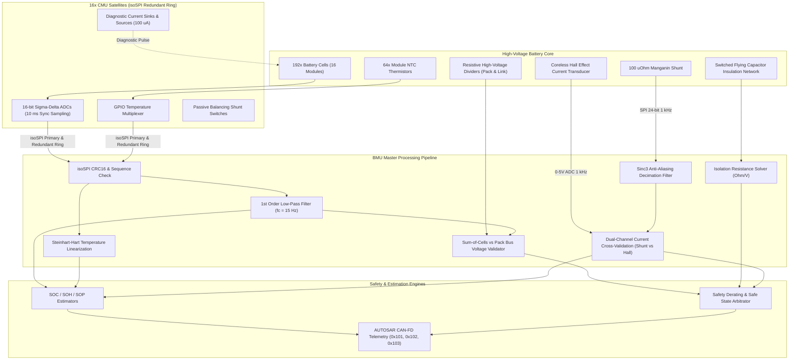
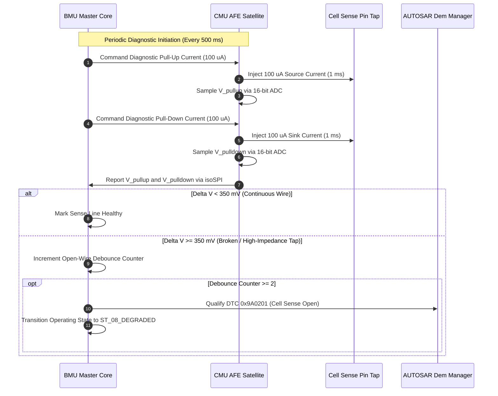

# BMS Software Requirements Specification: Cell Monitoring & Analog Front End (AFE)

**Document ID:** BMS-SRS-02-AFE-SENSING  
**Version:** 2.4.0  
**Classification:** Automotive High-Voltage Powertrain (EV)  
**Safety Compliance:** ISO 26262:2018 ASIL D, UN ECE R100.03  
**Target Architecture:** 16x CMU Satellites (192s1p configuration, 12 cells per CMU, daisy-chain isoSPI), Dual Shunt + Hall Current Sensing

---

## 1. Scope & Technical Overview

This module specifies the real-time acquisition, validation, plausibility checking, and physical diagnostics of all core sensor signals in the high-voltage battery pack:
1. **192 Individual Cell Voltages:** Acquired synchronously via 16-bit Sigma-Delta ADCs across 16 daisy-chained CMU satellite ICs.
2. **64 Module Temperatures:** NTC thermistors spaced across cells, cooling plates, and busbars (4 NTC channels per CMU module).
3. **Pack Total Voltage & Inverter Link Voltage:** High-impedance resistive dividers with galvanic isolation amplifiers.
4. **Pack Current:** Dual-channel isolated current measurement (primary: $100\,\mu\Omega$ Manganin shunt with 24-bit delta-sigma converter; secondary: coreless Hall-effect sensor for ASIL D cross-validation).
5. **Chassis Isolation Resistance:** Switched resistor divider bridge measuring galvanic insulation resistance between HV positive/negative poles and vehicle chassis ground.

---

## 2. Signal Processing & Data Flow Diagram

---

## 3. Detailed Functional Requirements

### Requirement: BMS-REQ-AFE-0101
* **Title:** Synchronous Cell Voltage Acquisition and Outlier Filtering
* **ASIL Level:** ASIL D
* **Verification Method:** Test (HiL Precision Calibrator Injection)
* **Traceability:** ISO 26262-5:2018; UN ECE R100.03 Annex 9
* **Inputs:**
  * `Raw_Cell_Voltage_Array[1..192]` (Data Type: `uint16_t[192]`, Unit: `0.1 mV`, Range: `0..50000`, Source: CMU isoSPI Telemetry)
  * `AFE_CRC_Status[1..16]` (Data Type: `boolean[16]`, Values: `{VALID, CORRUPT}`, Source: SPI Driver)
* **Outputs:**
  * `Filt_Cell_Voltage[1..192]` (Data Type: `uint16_t[192]`, Unit: `mV`, Range: `1500..4500`, Destination: State Estimation & Protection)
  * `Cell_V_Min` (Data Type: `uint16_t`, Unit: `mV`, Destination: CAN-FD `0x101`)
  * `Cell_V_Max` (Data Type: `uint16_t`, Unit: `mV`, Destination: CAN-FD `0x101`)
  * `Cell_V_Avg` (Data Type: `uint16_t`, Unit: `mV`, Destination: CAN-FD `0x101`)
  * `Cell_V_Delta` (Data Type: `uint16_t`, Unit: `mV`, Destination: Balancing Manager)
* **Timing & Debounce:** Acquisition loop: $10\text{ ms} \pm 0.2\text{ ms}$. Digital filter: 1st-order IIR low-pass ($f_c = 15\text{ Hz}$).
* **Description:**  
  The BMS software shall trigger synchronous ADC conversion across all 16 CMU satellites every $10\text{ ms}$.  
  The conversion shall satisfy the following metrics:
  1. Absolute measurement accuracy: $\le \pm 1.5\text{ mV}$ within cell operating voltage range ($2500\text{ mV}$ to $4350\text{ mV}$) across operating temperature $-30^\circ\text{C} \le T \le 65^\circ\text{C}$.
  2. The software shall discard raw frames containing CRC errors or out-of-order sequence counters and maintain the previous valid sample for a maximum of 3 consecutive frames ($30\text{ ms}$). If errors persist $\ge 40\text{ ms}$, mark data invalid and signal communication fault.
  3. The software shall compute:
     $$V_{\text{min}} = \min_{i=1}^{192} (V_i), \quad V_{\text{max}} = \max_{i=1}^{192} (V_i), \quad V_{\text{avg}} = \frac{1}{192} \sum_{i=1}^{192} V_i, \quad \Delta V = V_{\text{max}} - V_{\text{min}}$$
* **Rationale:** Cell voltage is the primary safety metric for overcharge, overdischarge, and state of charge calculation.
* **Acceptance Criteria:**  
  Voltage measurement deviation against a calibrated Fluke 8508A reference must remain within $\pm 1.5\text{ mV}$ at $3.650\text{ V}$ input across all 192 channels.

---

### Requirement: BMS-REQ-AFE-0102
* **Title:** AFE Sense Wire Open-Circuit Diagnostic Detection
* **ASIL Level:** ASIL C
* **Verification Method:** Test (HiL Automated Wire Disconnect Switch)
* **Traceability:** ISO 26262-5:2018 Clause 7; UN ECE R100.03
* **Inputs:**
  * `Cell_Voltage_Raw_PullUp[1..192]` (Data Type: `uint16_t[192]`, Unit: `mV`, Source: AFE Current Source Mode)
  * `Cell_Voltage_Raw_PullDown[1..192]` (Data Type: `uint16_t[192]`, Unit: `mV`, Source: AFE Current Sink Mode)
* **Outputs:**
  * `Open_Wire_Fault_Bitmap[1..193]` (Data Type: `uint8_t[25]`, Unit: `bitfield`, Destination: Safety Monitor)
  * `DTC_Cell_Sense_Open` (Data Type: `uint32_t`, Value: `0x9A0201`, Destination: Dem)
* **Timing & Debounce:** Diagnostic run interval: $500\text{ ms}$ (and at each state machine bootup). Debounce time: 2 consecutive failed cycles ($1000\text{ ms}$).
* **Description:**  
  The BMS shall execute an open-wire detection routine across all 193 cell tap connections (192 cells + GND tap).  
  The routine shall command the CMU AFE internal current sources to:
  1. Inject an internal test pull-up current ($I_{\text{test}} = 100\,\mu\text{A}$) for $1.0\text{ ms}$, then measure $V_{\text{pullup}}$.
  2. Inject an internal test pull-down current ($I_{\text{test}} = 100\,\mu\text{A}$) for $1.0\text{ ms}$, then measure $V_{\text{pulldown}}$.
  3. If $|V_{\text{pullup}, i} - V_{\text{pulldown}, i}| \ge 350\text{ mV}$, the software shall flag sense wire $i$ as an open-circuit fault (`Open_Wire_Fault_Bitmap[i] = 1`).
  4. Upon 2 consecutive detections, trigger safe shutdown or lockout and set DTC `0x9A0201`.
* **Rationale:** A broken sense line leaves the true cell voltage unmonitored, potentially permitting uncontrolled overcharge or thermal runaway.
* **Acceptance Criteria:**  
  Disconnecting any single cell voltage tap resistor on the HiL rig must result in `Open_Wire_Fault_Bitmap` flagging the exact channel within $\le 1200\text{ ms}$, with zero false positives on neighboring connected channels.

---

### Requirement: BMS-REQ-AFE-0103
* **Title:** Module NTC Temperature Acquisition and Plausibility Supervision
* **ASIL Level:** ASIL C
* **Verification Method:** Test (HiL Thermistor Resistance Emulation)
* **Traceability:** ISO 26262-4; UN ECE R100.03
* **Inputs:**
  * `Raw_NTC_Voltage[1..64]` (Data Type: `uint16_t[64]`, Unit: `mV`, Range: `0..3300`, Source: CMU GPIO ADC)
* **Outputs:**
  * `Module_Temperature[1..64]` (Data Type: `int16_t[64]`, Unit: `0.1 °C`, Range: `-400..1250`, Destination: Thermal Manager)
  * `Pack_T_Min` (Data Type: `int16_t`, Unit: `0.1 °C`, Destination: CAN-FD `0x102`)
  * `Pack_T_Max` (Data Type: `int16_t`, Unit: `0.1 °C`, Destination: CAN-FD `0x102`)
  * `Pack_T_Gradient_Max` (Data Type: `int16_t`, Unit: `0.1 °C/s`, Destination: Thermal Runaway Detector)
* **Timing & Debounce:** Sampling rate: $50\text{ ms} \pm 2\text{ ms}$. Plausibility fault debounce: $200\text{ ms}$.
* **Description:**  
  The software shall convert the raw NTC voltage samples into temperature readings using the Steinhart-Hart equation:
  $$\frac{1}{T} = A + B \ln(R_{\text{ntc}}) + C (\ln(R_{\text{ntc}}))^3$$
  implemented as a calibrated 64-point piecewise linear lookup table (LUT) with linear interpolation.  
  The software shall enforce the following plausibility checks:
  1. Sensor open circuit: $R_{\text{ntc}} > 500\text{ k}\Omega$ ($V_{\text{ntc}} > 3250\text{ mV}$) $\rightarrow$ Flag sensor open fault.
  2. Sensor short circuit: $R_{\text{ntc}} < 200\,\Omega$ ($V_{\text{ntc}} < 50\text{ mV}$) $\rightarrow$ Flag sensor short fault.
  3. Dynamic gradient calculation:
     $$\frac{\Delta T_j}{\Delta t} = \frac{T_j(k) - T_j(k-1)}{\Delta t}$$
     If any module sensor exhibits $\frac{\Delta T_j}{\Delta t} > 2.0^\circ\text{C/s}$ under pack current $|I| < 50\text{ A}$, mark sensor as erratic/faulty. If $|I| \ge 50\text{ A}$ and $\frac{\Delta T_j}{\Delta t} > 1.5^\circ\text{C/s}$, forward reading immediately to Thermal Runaway supervision (`BMS-REQ-THM-0403`).
* **Rationale:** NTC sensors can detach from cells or short against cooling jackets. Plausibility filters isolate physical sensor faults from chemical thermal events.
* **Acceptance Criteria:**  
  Temperature readings must match actual NTC thermal chamber temperatures within $\pm 0.5^\circ\text{C}$ between $0^\circ\text{C}$ and $60^\circ\text{C}$, and within $\pm 1.0^\circ\text{C}$ between $-30^\circ\text{C}$ and $0^\circ\text{C}$.

---

### Requirement: BMS-REQ-AFE-0104
* **Title:** Dual-Channel Bidirectional Current Measurement and Auto-Zero Offset Calibration
* **ASIL Level:** ASIL D
* **Verification Method:** Test (HiL Precision Current Source & Dynamic Step Profiling)
* **Traceability:** ISO 26262-5:2018; UN ECE R100.03
* **Inputs:**
  * `Shunt_Current_Raw` (Data Type: `int32_t`, Unit: `10 mA`, Range: `-150000..150000`, Source: 24-bit $\Sigma\Delta$ Shunt Transducer via SPI)
  * `Hall_Current_Raw` (Data Type: `int32_t`, Unit: `10 mA`, Range: `-150000..150000`, Source: Coreless Hall ADC)
  * `Contactor_All_Open_Status` (Data Type: `boolean`, Unit: `bool`, Source: Contactor FSM)
* **Outputs:**
  * `Pack_Current_Validated` (Data Type: `int32_t`, Unit: `mA`, Range: `-1500000..1500000`, Destination: State of Charge & Protection)
  * `Current_Sensor_Drift_DTC` (Data Type: `uint32_t`, Value: `0x9A0302`, Destination: Dem)
* **Timing & Debounce:** Shunt integration cycle: $1\text{ ms} \pm 0.05\text{ ms}$ (1000 Hz task). Plausibility cross-check cycle: $10\text{ ms}$.
* **Description:**  
  The BMS software shall continuously process pack current using a dual-channel diverse measurement strategy:
  1. **Primary Shunt Processing:** Filtered via 2nd-order Sinc3 decimation filter. Nominal range: $\pm 1200.0\text{ A}$, resolution: $1.0\text{ mA}$, accuracy: $\le \pm 0.1\%$ of reading $+ 50\text{ mA}$ offset.
  2. **Auto-Zero Calibration:** Whenever `Contactor_All_Open_Status == TRUE` continuously for $\ge 3000\text{ ms}$ (zero current guaranteed), the BMS shall compute the mean shunt offset over 1000 samples and calibrate the zero-point correction register in non-volatile RAM. If offset exceeds $\pm 500\text{ mA}$, set DTC `0x9A0302`.
  3. **Cross-Channel Plausibility Check:** The BMS shall compare `Shunt_Current_Raw` and `Hall_Current_Raw`. If:
     $$|I_{\text{shunt}} - I_{\text{hall}}| > \max(15.0\text{ A}, 0.05 \cdot |I_{\text{shunt}}|)$$
     for longer than $100\text{ ms}$, signal `Current_Sensor_Plausibility_Error` and transition to degraded state.
* **Rationale:** Current integration is fundamental to Coulomb counting (SOC) and overcurrent protection; single-point failure of the shunt must be caught by diverse Hall sensing.
* **Acceptance Criteria:**  
  Current measurement shall maintain $\le 0.1\%$ error when subjected to continuous $600\text{ A}$ current pulses on the test bench, and detect a forced $+20\text{ A}$ Hall divergence in $\le 100\text{ ms}$.

---

### Requirement: BMS-REQ-AFE-0105
* **Title:** Total Pack High-Voltage & DC-Link Bus Voltage Acquisition
* **ASIL Level:** ASIL C
* **Verification Method:** Test (HiL High Voltage Divider Calibration)
* **Traceability:** ISO 26262-4; ISO 6469-3
* **Inputs:**
  * `Raw_V_Pack_Terminal` (Data Type: `uint32_t`, Unit: `10 mV`, Range: `0..100000`, Source: Battery-Side Isolated Voltage Sensor)
  * `Raw_V_Link_Inverter` (Data Type: `uint32_t`, Unit: `10 mV`, Range: `0..100000`, Source: Inverter-Side Isolated Voltage Sensor)
  * `Sum_Of_Cells_Voltage` (Data Type: `uint32_t`, Unit: `mV`, Range: `0..900000`, Source: Cell Voltage Aggregator)
* **Outputs:**
  * `Pack_Voltage_Bus` (Data Type: `uint32_t`, Unit: `mV`, Destination: Precharge & VCU CAN-FD `0x103`)
  * `Link_Voltage_Bus` (Data Type: `uint32_t`, Unit: `mV`, Destination: Precharge Manager)
  * `Pack_V_Sum_Mismatch_Flag` (Data Type: `boolean`, Unit: `bool`, Destination: Safety Monitor)
* **Timing & Debounce:** Measurement cycle: $5\text{ ms}$. Mismatch qualification debounce: $50\text{ ms}$.
* **Description:**  
  The BMS software shall sample the upstream battery terminal voltage ($V_{\text{pack}}$) and the downstream DC-link inverter bus voltage ($V_{\text{link}}$) via isolated operational amplifier channels.  
  The software shall enforce the following sum-of-cells consistency check:
  $$V_{\text{sum}} = \sum_{i=1}^{192} V_{\text{cell}, i}$$
  $$|V_{\text{pack}} - V_{\text{sum}}| \le \delta_{\text{tol}}, \quad \text{where } \delta_{\text{tol}} = 0.015 \cdot V_{\text{pack}} + 2000\text{ mV}$$
  If the delta exceeds $\delta_{\text{tol}}$ continuously for $> 50\text{ ms}$ while contactors are closed and $|I| < 5\text{ A}$, set `Pack_V_Sum_Mismatch_Flag = TRUE` and log DTC `0x9A0315` (Pack Voltage Sum Inconsistency).
* **Rationale:** A mismatch between the sum of individual cell voltages and total pack voltage indicates either AFE reference drift or broken inter-module busbars.
* **Acceptance Criteria:**  
  Pack voltage measurement error must be $\le \pm 1.0\text{ V}$ at nominal $800\text{ V}$, and the sum mismatch error must trip within $50\text{ ms} \pm 5\text{ ms}$ when a simulated $20\text{ V}$ busbar drop is injected.

---

### Requirement: BMS-REQ-AFE-0106
* **Title:** Continuous Chassis Insulation Resistance Measurement
* **ASIL Level:** ASIL D
* **Verification Method:** Test (HiL Programmable Resistor Decade to Chassis Ground)
* **Traceability:** UN ECE R100.03 Clause 5.1.3; ISO 6469-1:2019
* **Inputs:**
  * `Chassis_Leakage_Positive_V` (Data Type: `uint16_t`, Unit: `mV`, Source: Insulation A/D Monitor)
  * `Chassis_Leakage_Negative_V` (Data Type: `uint16_t`, Unit: `mV`, Source: Insulation A/D Monitor)
  * `Pack_Voltage_Bus` (Data Type: `uint32_t`, Unit: `mV`, Source: Voltage Monitor)
* **Outputs:**
  * `Isolation_Resistance_kOhm` (Data Type: `uint32_t`, Unit: `kOhm`, Range: `0..50000`, Destination: CAN-FD `0x104`)
  * `Isolation_Resistance_OhmPerVolt` (Data Type: `uint32_t`, Unit: `Ohm/V`, Destination: Safety Monitor)
  * `Isolation_Status_Level` (Data Type: `uint8_t`, Unit: `enum`, Values: `{NORMAL, WARNING, FAULT_CRITICAL}`, Destination: FSM)
* **Timing & Debounce:** Measurement cycle: $1000\text{ ms}$ (switched bridge cycle). Fault debounce: 3 consecutive cycles ($3000\text{ ms}$).
* **Description:**  
  The BMS shall calculate the electrical isolation resistance between the isolated HV direct current bus and the electrical chassis ground (GND) according to ISO 6469-1.  
  1. The software shall determine:
     $$R_{\text{iso}} = \min(R_{\text{iso,pos}}, R_{\text{iso,neg}})$$
     $$\Omega/\text{V} = \frac{R_{\text{iso}}}{V_{\text{pack,nom}}} \quad (\text{where } V_{\text{pack,nom}} = 800\text{ V})$$
  2. Safety thresholds:
     * **NORMAL:** $R_{\text{iso}} \ge 500\,\Omega/\text{V}$ ($400\text{ k}\Omega$).
     * **WARNING:** $100\,\Omega/\text{V} \le R_{\text{iso}} < 500\,\Omega/\text{V}$ ($80\text{ k}\Omega \le R_{\text{iso}} < 400\text{ k}\Omega$). Broadcast warning to instrument cluster, allow completion of current drive cycle.
     * **FAULT_CRITICAL:** $R_{\text{iso}} < 100\,\Omega/\text{V}$ ($< 80\text{ k}\Omega$). Prevent contactor closure if parked; command graceful shutdown within $10\text{ s}$ if driving; log DTC `0x9A0400` (Insulation Loss ASIL D).
* **Rationale:** Insulation degradation between high voltage lines and vehicle chassis creates severe electric shock hazards for passengers and maintenance technicians.
* **Acceptance Criteria:**  
  When an external $70\text{ k}\Omega$ resistance is switched between HV+ and vehicle chassis, `Isolation_Status_Level` must transition to `FAULT_CRITICAL` within $3.0\text{ s} \pm 0.2\text{ s}$.

