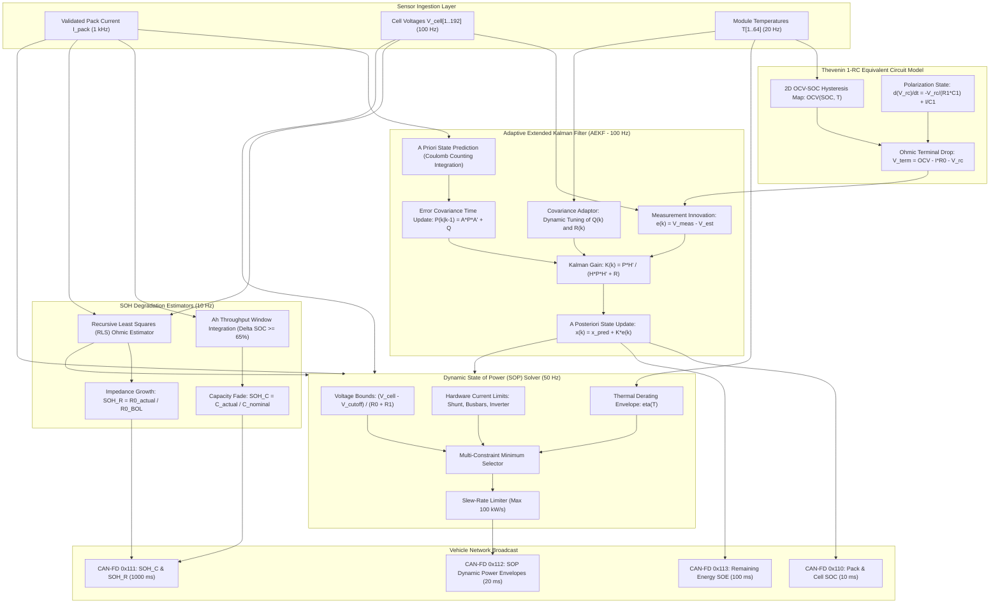

# BMS Software Requirements Specification: State Estimation (SOC, SOH, SOP, SOE)

**Document ID:** BMS-SRS-03-ESTIMATION  
**Version:** 2.4.0  
**Classification:** Automotive High-Voltage Powertrain (EV)  
**Safety Compliance:** ISO 26262:2018 ASIL C / QM  
**Algorithms:** Adaptive Extended Kalman Filter (AEKF), Recursive Least Squares (RLS), Coulomb Counting with Hysteresis Compensation, Multi-Parameter Power Limiting

---

## 1. Scope & Mathematical Overview

The state estimation software module computes the internal thermodynamic and electrochemical states of the battery pack that cannot be directly measured by physical sensors. The primary states comprise:
1. **State of Charge (SOC - $\text{SOC}_{\text{pack}}, \text{SOC}_{\text{cell}, i}$):** Ratio of available electrical charge to rated capacity ($0.0\%$ to $100.0\%$), computed using an Adaptive Extended Kalman Filter (AEKF) coupled with a first-order Thevenin equivalent circuit model (ECM).
2. **State of Health (SOH - $\text{SOH}_C, \text{SOH}_R$):** Metrics of irreversible cell degradation, including capacity loss ($\text{SOH}_C = C_{\text{actual}} / C_{\text{nominal}}$) and ohmic resistance growth ($\text{SOH}_R = R_{0, \text{BOL}} / R_{0, \text{actual}}$).
3. **State of Power (SOP - $P_{\text{dis,max}}, P_{\text{chg,max}}$):** Maximum allowable continuous, 10-second, and 2-second power envelopes that guarantee no individual cell exceeds voltage ($V_{\text{min}}, V_{\text{max}}$), current ($I_{\text{max}}$), or thermal limits.
4. **State of Energy (SOE - $E_{\text{usable}}$):** Remaining usable energy in kilowatt-hours (kWh) available to the vehicle traction system, integrated across the cell non-linear discharge curve under current temperature and load profile.

---

## 2. Detailed Functional Requirements

### Requirement: BMS-REQ-EST-0201
* **Title:** Adaptive Extended Kalman Filter (AEKF) State of Charge Estimation
* **ASIL Level:** ASIL C
* **Verification Method:** Test (HiL Standard Drive Cycles: WLTP, US06, Highway)
* **Traceability:** ISO 26262-4; SAE J1798
* **Inputs:**
  * `Pack_Current_Validated` (Data Type: `int32_t`, Unit: `mA`, Range: `-1500000..1500000`, Source: Shunt Sensor)
  * `Cell_V_Min` (Data Type: `uint16_t`, Unit: `mV`, Range: `1500..4500`, Source: AFE)
  * `Cell_V_Max` (Data Type: `uint16_t`, Unit: `mV`, Range: `1500..4500`, Source: AFE)
  * `Pack_T_Avg` (Data Type: `int16_t`, Unit: `0.1 °C`, Range: `-400..1250`, Source: Temperature Manager)
* **Outputs:**
  * `BMS_Pack_SOC` (Data Type: `uint16_t`, Unit: `0.01 %`, Range: `0..10000`, Destination: VCU CAN-FD `0x110`)
  * `BMS_Cell_SOC_Min` (Data Type: `uint16_t`, Unit: `0.01 %`, Range: `0..10000`, Destination: Protection Module)
  * `BMS_Cell_SOC_Max` (Data Type: `uint16_t`, Unit: `0.01 %`, Range: `0..10000`, Destination: Protection Module)
  * `SOC_Estimation_Variance` (Data Type: `uint16_t`, Unit: `0.0001`, Range: `0..10000`, Destination: Diagnostics)
* **Timing & Debounce:** State update execution period: $10\text{ ms} \pm 0.1\text{ ms}$ (100 Hz task).
* **Description:**  
  The BMS shall execute an Adaptive Extended Kalman Filter to estimate pack and individual cell SOC using a discrete-time state-space Thevenin model:
  $$x_k = \begin{bmatrix} \text{SOC}_k \\ V_{\text{rc}, k} \end{bmatrix} = \begin{bmatrix} 1 & 0 \\ 0 & \exp(-\Delta t / \tau) \end{bmatrix} x_{k-1} + \begin{bmatrix} -\frac{\eta \Delta t}{C_n} \\ R_1(1 - \exp(-\Delta t / \tau)) \end{bmatrix} I_{k-1} + w_{k-1}$$
  $$y_k = V_{\text{term}, k} = \text{OCV}(\text{SOC}_k, T) - I_k R_0 - V_{\text{rc}, k} + v_k$$
  where $\tau = R_1 C_1$, $\eta$ is Coulombic efficiency ($\eta = 0.998$ for charge, $1.000$ for discharge), and $C_n$ is the active cell capacity.  
  1. The filter covariance matrices $Q_k$ (process noise) and $R_k$ (measurement noise) shall adapt dynamically based on innovation covariance $e_k = y_k - \hat{y}_k$.
  2. The overall `BMS_Pack_SOC` shall be referenced to the minimum cell SOC during discharge ($\text{SOC}_{\text{pack}} = \text{SOC}_{\text{min}}$) and to the maximum cell SOC during charging ($\text{SOC}_{\text{pack}} = \text{SOC}_{\text{max}}$).
  3. SOC estimation accuracy must meet:
     * Maximum absolute error: $\le \pm 2.0\%$ under dynamic driving conditions (WLTP profile) between $10\%$ and $90\%$ SOC.
     * Maximum absolute error: $\le \pm 3.0\%$ between $0\%$ and $10\%$ SOC, and between $90\%$ and $100\%$ SOC.
* **Rationale:** Precise SOC estimation prevents unexpected vehicle stranding and protects against lithium plating during overcharge.
* **Acceptance Criteria:**  
  Under a full WLTP drive cycle executed on a HiL testbench at $25^\circ\text{C}$, the root-mean-square error (RMSE) between estimated `BMS_Pack_SOC` and true integrated reference SOC must remain $\le 1.2\%$.

---

### Requirement: BMS-REQ-EST-0202
* **Title:** OCV-SOC Standstill Relaxation Calibration & Drift Reset
* **ASIL Level:** ASIL B
* **Verification Method:** Test (HiL Prolonged Rest Simulation)
* **Traceability:** SAE J1798; ISO 26262-4
* **Inputs:**
  * `Pack_Current_Validated` (Data Type: `int32_t`, Unit: `mA`, Source: Shunt)
  * `Cell_V_Min` (Data Type: `uint16_t`, Unit: `mV`, Source: AFE)
  * `Cell_V_Max` (Data Type: `uint16_t`, Unit: `mV`, Source: AFE)
  * `Rest_Timer_Seconds` (Data Type: `uint32_t`, Unit: `s`, Range: `0..86400`, Source: OS Timer)
* **Outputs:**
  * `SOC_Recalibration_Flag` (Data Type: `boolean`, Unit: `bool`, Destination: AEKF Engine)
  * `BMS_Pack_SOC` (Data Type: `uint16_t`, Unit: `0.01 %`, Destination: Output Buffers)
* **Timing & Debounce:** Check task rate: $1000\text{ ms}$. Minimum relaxation period: $1800\text{ s}$ ($30\text{ minutes}$) under zero current.
* **Description:**  
  When the vehicle is parked and contactors are open with $|I_{\text{pack}}| \le 50\text{ mA}$ continuously for $t_{\text{rest}} \ge 1800\text{ s}$, the electrochemical cell diffusion polarization voltage ($V_{\text{rc}}$) is assumed to decay to $\le 1.0\text{ mV}$.  
  1. The BMS software shall read the terminal cell voltages and look up the direct Open-Circuit Voltage to SOC curve:
     $$\text{SOC}_{\text{calib}} = f_{\text{OCV}}^{-1}(V_{\text{cell}}, T)$$
     using a 2D temperature-compensated OCV map incorporating hysteresis ($OCV_{\text{charge}}$ vs. $OCV_{\text{discharge}}$).
  2. The software shall calculate the delta $\Delta \text{SOC} = |\text{SOC}_{\text{calib}} - \text{SOC}_{\text{estimated}}|$.
  3. If $\Delta \text{SOC} \le 8.0\%$, the AEKF state vector shall update with $\text{SOC}_{\text{calib}}$ and the covariance matrix $P_0$ reset to high confidence.
  4. If $\Delta \text{SOC} > 8.0\%$, the BMS shall limit the single-step jump to a smooth ramp rate ($\le 0.5\%/\text{minute}$) to avoid discontinuous range gauge jumps on the driver display, and flag `SOC_Excessive_Drift_Warning`.
* **Rationale:** Periodic relaxation recalibration completely eliminates cumulative Coulomb counting integration errors caused by current sensor drift.
* **Acceptance Criteria:**  
  Following an injected $+5\%$ Coulomb counting drift over a 4-hour drive, after 30 minutes of standstill rest, `BMS_Pack_SOC` must correct to within $\pm 0.5\%$ of true OCV-derived SOC.

---

### Requirement: BMS-REQ-EST-0203
* **Title:** Actual Capacity ($SOH_C$) Estimation via Qualified Delta-Charge Windows
* **ASIL Level:** ASIL B
* **Verification Method:** Test (HiL Full Charge Profile Replay)
* **Traceability:** ISO 26262-4; SAE J1798
* **Inputs:**
  * `BMS_Pack_SOC` (Data Type: `uint16_t`, Unit: `0.01 %`, Source: AEKF)
  * `Shunt_Accumulated_Ah` (Data Type: `int64_t`, Unit: `0.001 Ah`, Source: Shunt Integrator)
  * `Pack_T_Avg` (Data Type: `int16_t`, Unit: `0.1 °C`, Source: Temperature Monitor)
  * `BMS_Operational_State` (Data Type: `uint8_t`, Unit: `enum`, Source: FSM)
* **Outputs:**
  * `Pack_Capacity_Actual_Ah` (Data Type: `uint16_t`, Unit: `0.1 Ah`, Range: `0..3000`, Destination: Non-Volatile Memory)
  * `SOH_Capacity_Percent` (Data Type: `uint16_t`, Unit: `0.01 %`, Range: `0..10000`, Destination: CAN-FD `0x111`)
* **Timing & Debounce:** Calculation triggers upon completion of qualified charging session.
* **Description:**  
  The BMS software shall evaluate battery capacity retention ($\text{SOH}_C$) whenever a charging event satisfies all qualification criteria:
  1. Starting $\text{SOC}_{\text{start}} \le 20.0\%$ and ending $\text{SOC}_{\text{end}} \ge 85.0\%$ (yielding $\Delta \text{SOC} \ge 65.0\%$).
  2. Battery temperature remains between $15.0^\circ\text{C} \le T \le 40.0^\circ\text{C}$ throughout the entire charging window.
  3. No diagnostic aborts or contactor opening during the charging period.  
  Upon completion, the software shall compute:
  $$C_{\text{actual}} = \frac{\int_{t_{\text{start}}}^{t_{\text{end}}} I(t) \, dt}{\Delta \text{SOC}} = \frac{\Delta Q_{\text{shunt}}}{\frac{\text{SOC}_{\text{end}} - \text{SOC}_{\text{start}}}{100}}$$
  $$\text{SOH}_C = \frac{C_{\text{actual}}}{C_{\text{nominal}}} \times 100\% \quad (C_{\text{nominal}} = 135.0\text{ Ah})$$
  The new capacity value shall update the non-volatile battery wear profile using an exponential moving average (EMA) filter ($\alpha = 0.15$):
  $$C_{\text{stored}}(n) = (1 - \alpha) \cdot C_{\text{stored}}(n-1) + \alpha \cdot C_{\text{actual}}$$
* **Rationale:** Tracking capacity fade allows accurate range forecasting and informs the warranty management system before cell end-of-life (EOL < 70% SOH).
* **Acceptance Criteria:**  
  When tested across three full charge cycles with an aged cell model ($C_{\text{true}} = 108.0\text{ Ah}$, 80% SOH), the estimated `Pack_Capacity_Actual_Ah` must converge to $108.0\text{ Ah} \pm 1.5\text{ Ah}$.

---

### Requirement: BMS-REQ-EST-0204
* **Title:** High-Frequency Ohmic Resistance ($R_0$) and Power Fade ($SOH_R$) Tracking
* **ASIL Level:** ASIL B
* **Verification Method:** Test (HiL Pulse Current Injection)
* **Traceability:** SAE J1798
* **Inputs:**
  * `Pack_Current_Validated` (Data Type: `int32_t`, Unit: `mA`, Source: Shunt)
  * `Raw_Cell_Voltage_Array[1..192]` (Data Type: `uint16_t[192]`, Unit: `mV`, Source: AFE)
  * `Pack_T_Avg` (Data Type: `int16_t`, Unit: `0.1 °C`, Source: Temperature Monitor)
* **Outputs:**
  * `Cell_R0_Ohmic[1..192]` (Data Type: `uint16_t[192]`, Unit: `0.01 mOhm`, Range: `0..5000`, Destination: SOP Engine)
  * `SOH_Resistance_Percent` (Data Type: `uint16_t`, Unit: `0.01 %`, Range: `0..20000`, Destination: CAN-FD `0x111`)
* **Timing & Debounce:** Fast current pulse detection window: $10\text{ ms} \le \Delta t \le 50\text{ ms}$. Task rate: $20\text{ ms}$.
* **Description:**  
  The BMS shall detect fast current load transients where $|\Delta I| \ge 100.0\text{ A}$ occurs within $\Delta t \le 20\text{ ms}$ (e.g., tip-in throttle or regenerative braking onset).  
  During this transient, the software shall calculate the high-frequency ohmic resistance for each cell $i$:
  $$R_{0, i} = \frac{|V_i(t) - V_i(t - \Delta t)|}{|\Delta I|}$$
  The measured $R_{0, i}$ shall be normalized to reference temperature $25.0^\circ\text{C}$ using an Arrhenius temperature correction factor:
  $$R_{0, \text{norm}} = R_{0, \text{meas}} \cdot \exp\left[ \frac{E_a}{R} \left( \frac{1}{T_{\text{ref}}} - \frac{1}{T_{\text{meas}}} \right) \right]$$
  where $E_a / R = 4200\text{ K}$.  
  Resistance degradation shall be computed as:
  $$\text{SOH}_R = \frac{R_{0, \text{norm}}}{R_{0, \text{BOL}}} \times 100\% \quad (R_{0, \text{BOL}} = 0.55\text{ m}\Omega)$$
  If $\text{SOH}_R \ge 200\%$ ($R_0$ has doubled), log service notification DTC `0x9A0501` (Battery Internal Resistance Degraded).
* **Rationale:** Resistance growth directly causes excessive heat generation and limits peak vehicle acceleration.
* **Acceptance Criteria:**  
  Estimated $R_0$ under a $200\text{ A}$ step pulse on HiL must match true virtual cell model internal resistance within $\pm 0.05\text{ m}\Omega$.

---

### Requirement: BMS-REQ-EST-0205
* **Title:** Dynamic State of Power (SOP) Continuous and Pulse Limits Calculation
* **ASIL Level:** ASIL C
* **Verification Method:** Test (HiL Limit Stress Profile Verification)
* **Traceability:** ISO 26262-4; SAE J1798
* **Inputs:**
  * `Cell_V_Min` (Data Type: `uint16_t`, Unit: `mV`, Source: AFE)
  * `Cell_V_Max` (Data Type: `uint16_t`, Unit: `mV`, Source: AFE)
  * `Cell_R0_Max` (Data Type: `uint16_t`, Unit: `0.01 mOhm`, Source: RLS Estimator)
  * `Pack_T_Min` (Data Type: `int16_t`, Unit: `0.1 °C`, Source: Temperature Monitor)
  * `BMS_Pack_SOC` (Data Type: `uint16_t`, Unit: `0.01 %`, Source: AEKF)
* **Outputs:**
  * `BMS_Max_Discharge_Power_Cont` (Data Type: `uint16_t`, Unit: `0.1 kW`, Range: `0..5000`, Destination: VCU CAN-FD `0x112`)
  * `BMS_Max_Discharge_Power_10s` (Data Type: `uint16_t`, Unit: `0.1 kW`, Range: `0..6000`, Destination: VCU CAN-FD `0x112`)
  * `BMS_Max_Charge_Power_Cont` (Data Type: `uint16_t`, Unit: `0.1 kW`, Range: `0..4000`, Destination: VCU CAN-FD `0x112`)
  * `BMS_Max_Charge_Power_10s` (Data Type: `uint16_t`, Unit: `0.1 kW`, Range: `0..5000`, Destination: VCU CAN-FD `0x112`)
* **Timing & Debounce:** Cyclic execution: $20\text{ ms} \pm 1.0\text{ ms}$ (50 Hz). Slew-rate limiter on power drop: maximum $100\text{ kW/s}$ (unless emergency safety trip).
* **Description:**  
  The BMS shall calculate the maximum permissible discharge and regenerative charge power targets for transmission to the Vehicle Control Unit (VCU) every $20\text{ ms}$.  
  1. **Discharge Current Limit ($I_{\text{dis,lim}}$):**
     $$I_{\text{dis,volt}} = \frac{V_{\text{min,cell}} - V_{\text{cutoff,dis}}}{R_{0, \text{max}} + R_{1, \text{eff}}} \quad (V_{\text{cutoff,dis}} = 2700\text{ mV})$$
     $$I_{\text{dis,lim}} = \min(I_{\text{dis,volt}}, I_{\text{fuse,thermal}}, I_{\text{inverter,max}})$$
  2. **Charge Current Limit ($I_{\text{chg,lim}}$):**
     $$I_{\text{chg,volt}} = \frac{V_{\text{cutoff,chg}} - V_{\text{max,cell}}}{R_{0, \text{max}} + R_{1, \text{eff}}} \quad (V_{\text{cutoff,chg}} = 4220\text{ mV})$$
     $$I_{\text{chg,lim}} = \min(I_{\text{chg,volt}}, I_{\text{plating,lookup}}(T, \text{SOC}))$$
  3. **Power Conversion:**
     $$P_{\text{dis,max}} = I_{\text{dis,lim}} \cdot V_{\text{pack}} \cdot \eta_{\text{thermal}}(T)$$
     $$P_{\text{chg,max}} = I_{\text{chg,lim}} \cdot V_{\text{pack}} \cdot \eta_{\text{thermal}}(T)$$
  where $\eta_{\text{thermal}}(T)$ is a temperature derating scalar linearly decreasing to $0$ as $T \rightarrow 55^\circ\text{C}$ (discharge) or $T \rightarrow 45^\circ\text{C}$ (charge).
* **Rationale:** Over-demanding power from a depleted or cold battery drops cell voltages below chemical breakdown limits and destroys electrodes.
* **Acceptance Criteria:**  
  When cell minimum voltage reaches $2750\text{ mV}$ (50 mV above cutoff), `BMS_Max_Discharge_Power_10s` must decrease smoothly such that drawing commanded power does not drive the cell below $2700\text{ mV}$.

---

### Requirement: BMS-REQ-EST-0206
* **Title:** Usable Energy (SOE) and Remaining Range Prediction Calculation
* **ASIL Level:** ASIL B
* **Verification Method:** Test (HiL Energy Depletion Test)
* **Traceability:** SAE J1798; WLTP Regulation 2017/1151
* **Inputs:**
  * `BMS_Pack_SOC` (Data Type: `uint16_t`, Unit: `0.01 %`, Source: AEKF)
  * `Pack_Capacity_Actual_Ah` (Data Type: `uint16_t`, Unit: `0.1 Ah`, Source: SOH Manager)
  * `Cell_V_Avg` (Data Type: `uint16_t`, Unit: `mV`, Source: AFE)
  * `Recent_Wh_Per_Km` (Data Type: `uint16_t`, Unit: `0.1 Wh/km`, Range: `500..5000`, Source: VCU Trip Computer)
* **Outputs:**
  * `Remaining_Usable_Energy_kWh` (Data Type: `uint16_t`, Unit: `0.01 kWh`, Range: `0..15000`, Destination: CAN-FD `0x113`)
  * `Predicted_Distance_To_Empty_km` (Data Type: `uint16_t`, Unit: `0.1 km`, Range: `0..10000`, Destination: CAN-FD `0x113`)
* **Timing & Debounce:** Computation cycle: $100\text{ ms} \pm 5\text{ ms}$. Low-pass filter time constant $\tau = 5.0\text{ s}$ for distance smoothing.
* **Description:**  
  The BMS shall calculate the total remaining usable energy ($E_{\text{usable}}$) taking into account the non-linear discharge voltage curve, remaining SOC, and inaccessible bottom buffer:
  $$E_{\text{usable}} = \int_{\text{SOC}_{\text{cutoff}}}^{\text{SOC}_{\text{current}}} C_{\text{actual}} \cdot \text{OCV}(s) \, ds - I_{\text{avg}}^2 R_0 \Delta t$$
  $$\text{where } \text{SOC}_{\text{cutoff}} = 3.0\% \quad (\text{bricking reserve buffer})$$
  The estimated remaining driving range shall be derived as:
  $$D_{\text{empty}} = \frac{E_{\text{usable}}}{\text{Energy\_Consumption\_Rate}} \times 1000$$
  If `BMS_Pack_SOC` drops below $5.0\%$, the software shall set `Low_Range_Warning_Indicator = TRUE` and broadcast acoustic chime request to cluster.
* **Rationale:** Provides the driver with dependable, non-jumping range predictions while preserving the bottom chemical reserve buffer to prevent cell inversion.
* **Acceptance Criteria:**  
  The integrated energy discharged on the HiL until $V_{\text{cell}} = 2700\text{ mV}$ must match the predicted `Remaining_Usable_Energy_kWh` within $\pm 3.0\%$ under standard 20 kW cruising load.

