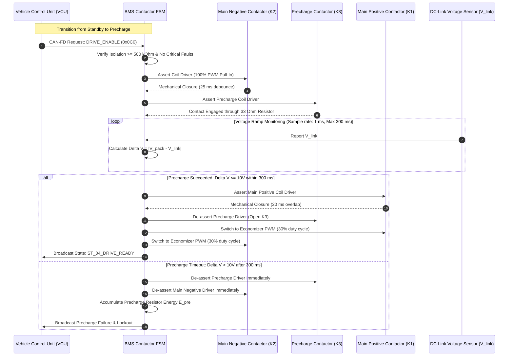

# BMS Software Requirements Specification: High-Voltage Contactor & Safety Sequencing

**Document ID:** BMS-SRS-04-CONTACTOR  
**Version:** 2.4.0  
**Classification:** Automotive High-Voltage Powertrain (EV)  
**Safety Compliance:** ISO 26262:2018 ASIL D, UN ECE R100.03  
**Hardware Elements:** Main Positive (K1), Main Negative (K2), Precharge Contactor (K3), Precharge Resistor ($33\,\Omega, 100\text{ W}$), DC+ (K4), DC- (K5), Coil High-Side/Low-Side Drivers with PWM Economizers

---

## 1. Scope & Circuit Topography

The High-Voltage Contactor Management module commands the electromechanical relays coupling the 800V nominal battery core to the vehicle DC-link capacitor ($C_{\text{link}} \approx 1200\,\mu\text{F}$ in the traction inverter) and to off-board DC fast charging stations.

```text
       Pack(+) ----[ K1: Main Pos ]-----------------------+---------> Inverter DC+
                   \                                      |
                    +--[ K3: Precharge ]---[ R_pre: 33R ]-+
                                                          |
                                                       [C_link] (1200 uF)
                                                          |
       Pack(-) ----[ K2: Main Neg ]-----------------------+---------> Inverter DC-

       Pack(+) ----[ K4: DC Charge Pos ]----------------------------> DC EVSE Inlet (+)
       Pack(-) ----[ K5: DC Charge Neg ]----------------------------> DC EVSE Inlet (-)
```

To eliminate massive capacitive inrush currents (which could exceed $25,000\text{ A}$ and instantly weld contactors), a controlled precharge cycle charges $C_{\text{link}}$ through $R_{\text{pre}}$ before closing $K_1$.

---

## 2. Precharge & Weld Diagnostic Sequence Diagram



---

## 3. Detailed Functional Requirements

### Requirement: BMS-REQ-HVC-0301
* **Title:** Deterministic High-Voltage Precharge Sequencing
* **ASIL Level:** ASIL D
* **Verification Method:** Test (HiL Automated Timing and Inrush Waveform Capture)
* **Traceability:** ISO 26262-4; ISO 6469-3
* **Inputs:**
  * `Pack_Voltage_Bus` (Data Type: `uint32_t`, Unit: `mV`, Source: Terminal Voltage Sensor)
  * `Link_Voltage_Bus` (Data Type: `uint32_t`, Unit: `mV`, Source: Inverter Bus Voltage Sensor)
  * `BMS_Operational_State` (Data Type: `uint8_t`, Unit: `enum`, Source: FSM)
* **Outputs:**
  * `Cmd_Contactor_Main_Neg` (Data Type: `boolean`, Unit: `discrete`, Destination: Low-Side Driver K2)
  * `Cmd_Contactor_Precharge` (Data Type: `boolean`, Unit: `discrete`, Destination: Low-Side Driver K3)
  * `Cmd_Contactor_Main_Pos` (Data Type: `boolean`, Unit: `discrete`, Destination: Low-Side Driver K1)
  * `Precharge_Complete_Flag` (Data Type: `boolean`, Unit: `bool`, Destination: FSM)
* **Timing & Debounce:** Precharge supervisor cycle: $2\text{ ms} \pm 0.1\text{ ms}$. Max precharge timeout: $300\text{ ms}$.
* **Description:**  
  Upon state machine entry into `ST_03_PRECHARGE`, the software shall execute the following strict temporal sequence:
  1. **Step 1 ($t = 0\text{ ms}$):** Assert `Cmd_Contactor_Main_Neg = TRUE` (close K2). Wait $25\text{ ms}$ for mechanical contact bounce cessation.
  2. **Step 2 ($t = 25\text{ ms}$):** Assert `Cmd_Contactor_Precharge = TRUE` (close K3). Begin sampling $V_{\text{link}}$ at 1 kHz.
  3. **Step 3 (Precharge Ramp Monitoring):** Calculate voltage difference:
     $$\Delta V(t) = |V_{\text{pack}}(t) - V_{\text{link}}(t)|$$
     Wait until $\Delta V(t) \le 10.0\text{ V}$ OR $V_{\text{link}}(t) \ge 0.98 \cdot V_{\text{pack}}(t)$.
  4. **Step 4 (Completion):** When the voltage condition is sustained for $\ge 10\text{ ms}$:
     * Assert `Cmd_Contactor_Main_Pos = TRUE` (close K1).
     * Wait $20\text{ ms}$ mechanical overlap time.
     * De-assert `Cmd_Contactor_Precharge = FALSE` (open K3).
     * Assert `Precharge_Complete_Flag = TRUE`.
  5. **Precharge Timeout:** If $\Delta V(t) > 10.0\text{ V}$ after $300\text{ ms}$ from Step 2, immediately open K3 and K2, set `Precharge_Complete_Flag = FALSE`, transition to `ST_08_DEGRADED` or `ST_10_LOCKOUT`, and log DTC `0x9A0601` (Precharge Timeout / Excessive Inrush Leakage).
* **Rationale:** Closing the main positive contactor with a large voltage difference produces an uncontrollable current pulse that permanently welds contactor faces or blows the internal fuse.
* **Acceptance Criteria:**  
  1. Main Positive K1 must never close if $\Delta V > 10.0\text{ V}$.  
  2. Inrush current through K1 at closure must remain $\le 30.0\text{ A}$ under nominal precharge conditions.

---

### Requirement: BMS-REQ-HVC-0302
* **Title:** Precharge Resistor Thermal Energy Accumulation & Cooldown Protection
* **ASIL Level:** ASIL C
* **Verification Method:** Test (HiL Back-to-Back Precharge Abort Injections)
* **Traceability:** ISO 26262-4
* **Inputs:**
  * `Pack_Voltage_Bus` (Data Type: `uint32_t`, Unit: `mV`, Source: Terminal Sensor)
  * `Link_Voltage_Bus` (Data Type: `uint32_t`, Unit: `mV`, Source: Bus Sensor)
  * `Cmd_Contactor_Precharge` (Data Type: `boolean`, Unit: `discrete`, Source: Precharge Driver)
* **Outputs:**
  * `Precharge_Resistor_Energy_Joules` (Data Type: `uint32_t`, Unit: `J`, Range: `0..50000`, Destination: Thermal Protection)
  * `Precharge_Inhibit_Active` (Data Type: `boolean`, Unit: `bool`, Destination: FSM)
* **Timing & Debounce:** Energy calculation task: $2\text{ ms}$. Cool-down decay task: $100\text{ ms}$.
* **Description:**  
  The BMS shall calculate the cumulative thermal energy absorbed by the physical precharge resistor ($R_{\text{pre}} = 33\,\Omega$, thermal capacity rating $E_{\text{max}} = 12000\text{ J}$):
  $$P_{\text{pre}}(t) = \frac{(V_{\text{pack}}(t) - V_{\text{link}}(t))^2}{R_{\text{pre}}}$$
  $$E_{\text{pre}}(k) = E_{\text{pre}}(k-1) \cdot \exp\left(-\frac{\Delta t}{\tau_{\text{cool}}}\right) + P_{\text{pre}}(k) \cdot \Delta t$$
  where $\tau_{\text{cool}} = 45.0\text{ s}$ (resistor thermal dissipation time constant to chassis).  
  1. If $E_{\text{pre}} \ge 8500\text{ J}$ ($70\%$ of rated threshold), the software shall set `Precharge_Inhibit_Active = TRUE`.
  2. While `Precharge_Inhibit_Active == TRUE`, all subsequent precharge requests shall be rejected and held in `ST_02_STANDBY` until exponential cooling drops $E_{\text{pre}} \le 2000\text{ J}$.
  3. If three consecutive precharge attempts fail within $180\text{ s}$, latch a mandatory 15-minute lockout timer and set DTC `0x9A0602`.
* **Rationale:** Repeated key-on cycles against an external inverter DC-link short circuit can cause the precharge resistor to explode or ignite adjacent wiring harnesses.
* **Acceptance Criteria:**  
  After two consecutive forced precharge timeouts on the HiL, a third attempt must be blocked immediately by `Precharge_Inhibit_Active = TRUE` until the calculated thermal energy drops below $2000\text{ J}$.

---

### Requirement: BMS-REQ-HVC-0303
* **Title:** Contactor Passive & Active Weld Detection
* **ASIL Level:** ASIL D
* **Verification Method:** Test (HiL Emulated Welded Contact Resistance)
* **Traceability:** UN ECE R100.03 Clause 5.1.1; ISO 26262-5:2018
* **Inputs:**
  * `Pack_Voltage_Bus` (Data Type: `uint32_t`, Unit: `mV`, Source: Pack Terminal Sensor)
  * `Link_Voltage_Bus` (Data Type: `uint32_t`, Unit: `mV`, Source: Inverter Bus Sensor)
  * `Aux_Contact_Feedback_K1` (Data Type: `boolean`, Unit: `bool`, Values: `{OPEN, CLOSED}`, Source: Auxiliary Microswitch)
  * `Aux_Contact_Feedback_K2` (Data Type: `boolean`, Unit: `bool`, Values: `{OPEN, CLOSED}`, Source: Auxiliary Microswitch)
* **Outputs:**
  * `Contactor_Weld_Status_K1` (Data Type: `uint8_t`, Unit: `enum`, Values: `{HEALTHY, WELDED}`, Destination: Safety Monitor)
  * `Contactor_Weld_Status_K2` (Data Type: `uint8_t`, Unit: `enum`, Values: `{HEALTHY, WELDED}`, Destination: Safety Monitor)
  * `DTC_Contactor_Weld` (Data Type: `uint32_t`, Value: `0x9A0610`, Destination: Dem)
* **Timing & Debounce:** Weld diagnostic test runs at every transition to `ST_09_SAFE_SHUTDOWN` and `ST_02_STANDBY`. Evaluation window: $500\text{ ms}$.
* **Description:**  
  Upon commanding contactors to open, the BMS shall perform a two-tier weld verification routine:
  1. **Tier 1 (Mechanical Microswitch Aux Feedback):** If `Cmd_Contactor_Main_Pos == FALSE` but `Aux_Contact_Feedback_K1 == CLOSED` for $> 50\text{ ms}$, flag K1 potential weld.
  2. **Tier 2 (Galvanic Voltage Decay Analysis):**
     * Command K1 OPEN while leaving K2 CLOSED for $100\text{ ms}$, then measure $V_{\text{link}}$.
     * If $V_{\text{link}}$ fails to drop and remains within $20\text{ V}$ of $V_{\text{pack}}$ after inverter bleeder activation, K1 is confirmed **WELDED**.
     * Command K2 OPEN, close K1, and measure potential between negative terminal and chassis. If voltage indicates potential continuity, K2 is confirmed **WELDED**.
  3. If either contactor is determined welded:
     * Never attempt to close the opposing healthy contactor.
     * Transition to `ST_10_EMERGENCY_LOCKOUT`.
     * Store permanent non-erasable DTC `0x9A0610` (Contactor Contact Welded Shut).
* **Rationale:** If one contactor is welded shut, high voltage remains permanently exposed at the power connector terminals. Closing the second contactor creates an uncontrolled live circuit.
* **Acceptance Criteria:**  
  When an auxiliary switch or voltage feedback simulates a welded K1 contact upon key-off, the BMS must flag `Contactor_Weld_Status_K1 = WELDED` within $\le 450\text{ ms}$ and refuse all future drive/charge transition commands until cleared by factory UDS routine.

---

### Requirement: BMS-REQ-HVC-0304
* **Title:** High-Current Opening Under Load Protection & Inverter Coordination
* **ASIL Level:** ASIL D
* **Verification Method:** Test (HiL Rapid Current Trip Test)
* **Traceability:** ISO 26262-4; ISO 6469-3
* **Inputs:**
  * `Pack_Current_Validated` (Data Type: `int32_t`, Unit: `mA`, Source: Shunt)
  * `BMS_Operational_State` (Data Type: `uint8_t`, Unit: `enum`, Source: FSM)
  * `Shutdown_Reason_Code` (Data Type: `uint8_t`, Unit: `enum`, Values: `{NORMAL, DERATE_TIMEOUT, CRITICAL_FAULT}`, Source: FSM)
* **Outputs:**
  * `VCU_Fast_Torque_Rampdown_Req` (Data Type: `boolean`, Unit: `discrete`, Destination: CAN-FD `0x100`)
  * `Inverter_Active_Discharge_Cmd` (Data Type: `boolean`, Unit: `discrete`, Destination: Hardwired Discrete Pin)
* **Timing & Debounce:** Controlled rampdown window: $400\text{ ms} \pm 20\text{ ms}$. Max hard-trip delay under non-clearing overcurrent: $10\text{ ms}$.
* **Description:**  
  Except during instantaneous catastrophic safety trips (Crash, Pyro, Hardware Short Circuit):
  1. When a normal or degraded shutdown is initiated (`Shutdown_Reason_Code != CRITICAL_FAULT`), the BMS shall broadcast `VCU_Fast_Torque_Rampdown_Req = TRUE` on CAN-FD with 2 ms cyclic frequency.
  2. The BMS shall wait up to $400\text{ ms}$ while tracking $|I_{\text{pack}}|$.
  3. Once $|I_{\text{pack}}| \le 5.0\text{ A}$, the BMS shall open Main Positive K1 and Main Negative K2 synchronously.
  4. If $|I_{\text{pack}}| > 5.0\text{ A}$ after $400\text{ ms}$ has elapsed, the BMS shall force-open the contactors under load to protect battery cells, activate `Inverter_Active_Discharge_Cmd = TRUE`, and increment the non-volatile `Contactor_Emergency_Hot_Break_Counter`.
* **Rationale:** Opening DC contactors under heavy traction load (> 300 A) generates severe plasma arcing inside the contactor chamber, eroding contact tips and reducing contactor cycle life.
* **Acceptance Criteria:**  
  In a normal key-off test, contactor open commands must not be dispatched until measured current is verified $\le 5.0\text{ A}$, unless the 400 ms guard timeout expires.

---

### Requirement: BMS-REQ-HVC-0305
* **Title:** Contactor Coil Economizer PWM Modulation and Coil Fault Diagnostics
* **ASIL Level:** ASIL C
* **Verification Method:** Test (HiL Current Probe & Oscilloscope Coil Driver Logging)
* **Traceability:** ISO 26262-5:2018
* **Inputs:**
  * `KL30_Voltage` (Data Type: `uint16_t`, Unit: `mV`, Source: ADC)
  * `Coil_Current_Sense_K1` (Data Type: `uint16_t`, Unit: `mA`, Source: Driver Feedback ADC)
  * `Coil_Current_Sense_K2` (Data Type: `uint16_t`, Unit: `mA`, Source: Driver Feedback ADC)
* **Outputs:**
  * `PWM_Duty_Cycle_K1` (Data Type: `uint8_t`, Unit: `0.1 %`, Range: `0..1000`, Destination: Driver Timer)
  * `PWM_Duty_Cycle_K2` (Data Type: `uint8_t`, Unit: `0.1 %`, Range: `0..1000`, Destination: Driver Timer)
  * `DTC_Coil_Open_K1` (Data Type: `uint32_t`, Value: `0x9A0621`, Destination: Dem)
* **Timing & Debounce:** Pull-in phase: $100\text{ ms} \pm 5\text{ ms}$ at $100\%$ duty cycle. Economizer holding phase: $20\text{ kHz}$ PWM at $25\%$ to $35\%$ duty cycle. Fault qualification: $30\text{ ms}$.
* **Description:**  
  The BMS software shall control contactor coil energization using a two-stage economizer profile:
  1. **Pull-In Phase:** Drive coil driver MOSFETs at $100\%$ duty cycle ($12\text{V}$ continuous) for exactly $100\text{ ms}$ to generate sufficient magnetic force to close the heavy armature against return spring preload.
  2. **Holding Phase:** Modulate coil drive using a $20\text{ kHz}$ PWM signal dynamically scaled vs `KL30_Voltage` to maintain a steady holding current of $350\text{ mA} \pm 30\text{ mA}$ (nominal $30\%$ duty cycle at $12.0\text{ V}$).
  3. **Diagnostic Supervision:**
     * If coil current is $< 100\text{ mA}$ during pull-in: Qualify **Coil Open-Circuit** fault (`DTC_Coil_Open_K1`).
     * If coil current exceeds $3.5\text{ A}$: Immediately disable gate drive to protect MOSFET and qualify **Coil Short-Circuit** fault (`DTC_Coil_Short_K1`).
* **Rationale:** Continuous 100% coil excitation causes extreme thermal heating in the contactor housing and consumes excessive 12V auxiliary power.
* **Acceptance Criteria:**  
  Coil driver must drop from 100% duty cycle to holding PWM within $100\text{ ms} \pm 5\text{ ms}$, maintaining coil current between $320\text{ mA}$ and $380\text{ mA}$ during prolonged drive cycles.

---

### Requirement: BMS-REQ-HVC-0306
* **Title:** DC Fast Charging Contactor Interlock and Galvanic Isolation
* **ASIL Level:** ASIL D
* **Verification Method:** Test (HiL EVSE Emulation & Plug Disconnect Stress)
* **Traceability:** ISO 15118-2; DIN 70121; UN ECE R100.03
* **Inputs:**
  * `EVSE_Pilot_State` (Data Type: `uint8_t`, Unit: `enum`, Values: `{STATE_A, STATE_B, STATE_C}`, Source: EVSE CCU)
  * `DC_Inlet_Voltage` (Data Type: `uint32_t`, Unit: `mV`, Source: Fast Charge Inlet Sensor)
  * `Pack_Voltage_Bus` (Data Type: `uint32_t`, Unit: `mV`, Source: Terminal Sensor)
* **Outputs:**
  * `Cmd_Contactor_DC_Pos` (Data Type: `boolean`, Unit: `discrete`, Destination: Driver K4)
  * `Cmd_Contactor_DC_Neg` (Data Type: `boolean`, Unit: `discrete`, Destination: Driver K5)
* **Timing & Debounce:** Pre-closure voltage match check: $|V_{\text{inlet}} - V_{\text{pack}}| \le 20\text{ V}$. Disconnection reaction time on pilot loss: $\le 15\text{ ms}$.
* **Description:**  
  The BMS software shall govern the dedicated DC Fast Charge contactors (K4, K5) independently of traction contactors:
  1. K4 and K5 shall be commanded CLOSED if and only if:
     * `EVSE_Pilot_State == STATE_C` (charging requested).
     * Communication handshake matches ISO 15118 / DIN 70121 criteria.
     * The off-board EVSE has adjusted its output voltage such that $|V_{\text{inlet}} - V_{\text{pack}}| \le 20.0\text{ V}$.
  2. K4 and K5 shall be prevented from closing if the main traction inverter contactors are active, unless vehicle architecture explicitly commands concurrent drive-and-charge (stationary preconditioning).
  3. If `EVSE_Pilot_State` drops from `STATE_C` to `STATE_A` (unplugging during active charging) or communication times out ($> 250\text{ ms}$):
     * VCU/EVSE fast stop is signaled.
     * Force K4 and K5 OPEN within $\le 15\text{ ms}$.
* **Rationale:** Opening or closing fast charging contactors with massive potential differences causes contact welding and arcing at 500 A / 800 V DC charging rates.
* **Acceptance Criteria:**  
  DC fast charge contactors must refuse closure if the EVSE terminal voltage differs from battery pack voltage by $> 20.0\text{ V}$.

