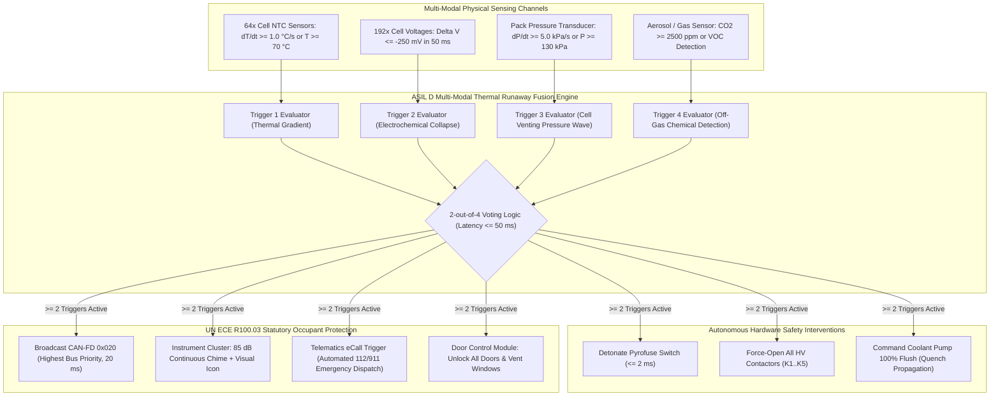
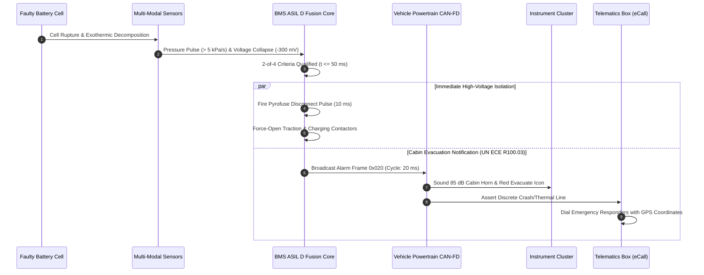

# BMS Software Requirements Specification: Thermal Management & Thermal Runaway Mitigation

**Document ID:** BMS-SRS-05-THERMAL  
**Version:** 2.4.0  
**Classification:** Automotive High-Voltage Powertrain (EV)  
**Safety Compliance:** ISO 26262:2018 ASIL D, UN ECE R100.03 Rev 3, GB 38031-2020  
**Thermal Systems:** Liquid Cooling Plate, Chiller Expansion Valve, High-Voltage PTC Coolant Heater, Enclosure Overpressure Sensor, Dual Redundant Cell NTC Array

---

## 1. Scope & Thermal Operating Boundaries

The battery thermal management software regulates the internal temperature of the 192 cells to prevent degradation, maximize fast-charging efficiency, and mitigate safety risks. The target electrochemical cell is NMC811 ($135\text{ Ah}$ prismatic).

```text
  Temperature Zone Profile:
  -30°C             0°C             15°C            35°C            45°C            55°C            60°C+
    |----------------|---------------|---------------|---------------|---------------|----------------|
       Sub-Zero         Pre-Heat         Optimal         Moderate        Heavy Derate    Critical Trip
       Cryogenic        Regime           Window          Cooling Req     (T > 45°C)      (T > 55°C)
    Charge: BLOCKED  Heating Req     Full 350kW Chg  Pumps Active    SOP -> 0 kW     Emergency Lockout
```

---

## 2. Thermal Runaway Mitigation Architecture

To fulfill UN ECE R100.03 and GB 38031, the BMS must provide at least a **5-minute advance warning** to vehicle occupants before thermal runaway smoke, toxic gases, or flames breach the passenger cabin.





---

## 3. Detailed Functional Requirements

### Requirement: BMS-REQ-THM-0401
* **Title:** Thermal Operational Envelope & Coolant Request Arbitration
* **ASIL Level:** ASIL B
* **Verification Method:** Test (HiL Environmental Chamber Simulation)
* **Traceability:** ISO 26262-4; SAE J1798
* **Inputs:**
  * `Pack_T_Max` (Data Type: `int16_t`, Unit: `0.1 °C`, Source: AFE)
  * `Pack_T_Min` (Data Type: `int16_t`, Unit: `0.1 °C`, Source: AFE)
  * `Pack_T_Avg` (Data Type: `int16_t`, Unit: `0.1 °C`, Source: AFE)
  * `Coolant_Inlet_Temp` (Data Type: `int16_t`, Unit: `0.1 °C`, Source: Cooling Loop Sensor)
* **Outputs:**
  * `Thermal_Mode_Request` (Data Type: `uint8_t`, Unit: `enum`, Values: `{OFF, HEATING, PASSIVE_COOL, ACTIVE_CHILL}`, Destination: TMS CAN-FD `0x210`)
  * `Coolant_Target_Flow_Rate` (Data Type: `uint16_t`, Unit: `0.1 L/min`, Range: `0..350`, Destination: TMS CAN-FD `0x210`)
  * `Coolant_Target_Temperature` (Data Type: `int16_t`, Unit: `0.1 °C`, Destination: TMS CAN-FD `0x210`)
* **Timing & Debounce:** Control arbitration loop: $100\text{ ms} \pm 5\text{ ms}$. Mode switching hysteresis: $\pm 2.0^\circ\text{C}$ with $30\text{ s}$ dwell timer.
* **Description:**  
  The BMS shall arbitrate thermal management requests dispatched to the vehicle Thermal Management System (TMS):
  1. **Optimal Zone ($15.0^\circ\text{C} \le T_{\text{avg}} \le 35.0^\circ\text{C}$):** Set `Thermal_Mode_Request = OFF` or `PASSIVE_COOL` (radiator loop) with minimum flow rate ($5.0\text{ L/min}$).
  2. **Active Cooling Zone ($T_{\text{max}} > 35.0^\circ\text{C}$):** Set `Thermal_Mode_Request = ACTIVE_CHILL`. Target flow rate shall scale linearly:
     $$\text{FlowRate} = \min\left(35.0, 5.0 + 3.0 \cdot (T_{\text{max}} - 35.0^\circ\text{C})\right) \text{ L/min}$$
     Target coolant inlet temperature: $18.0^\circ\text{C}$.
  3. **High-Power Charging Preconditioning:** When VCU signals navigation destination set to HPC fast charger:
     * Condition battery temperature to $28.0^\circ\text{C} \le T_{\text{avg}} \le 32.0^\circ\text{C}$ before arrival to accept peak $350\text{ kW}$ charge acceptance.
* **Rationale:** Keeping cells in the $15^\circ\text{C} - 35^\circ\text{C}$ window maximizes round-trip efficiency and minimizes solid electrolyte interphase (SEI) degradation.
* **Acceptance Criteria:**  
  When maximum cell temperature exceeds $35.0^\circ\text{C}$ on HiL, `Thermal_Mode_Request` must transition to `ACTIVE_CHILL` within $200\text{ ms}$, commanding coolant flow rate $> 10.0\text{ L/min}$.

---

### Requirement: BMS-REQ-THM-0402
* **Title:** Sub-Zero Low-Temperature Pre-Heating & Charge Inhibit
* **ASIL Level:** ASIL C
* **Verification Method:** Test (HiL Cold-Soak Simulation)
* **Traceability:** UN ECE R100.03; ISO 26262-4
* **Inputs:**
  * `Pack_T_Min` (Data Type: `int16_t`, Unit: `0.1 °C`, Source: AFE)
  * `BMS_Operational_State` (Data Type: `uint8_t`, Unit: `enum`, Source: FSM)
  * `EVSE_Connected_Status` (Data Type: `boolean`, Unit: `bool`, Source: Charge Port)
* **Outputs:**
  * `PTC_Heater_Power_Request` (Data Type: `uint16_t`, Unit: `10 W`, Range: `0..700`, Destination: TMS CAN-FD `0x210`)
  * `Max_Allowable_Charge_Current` (Data Type: `uint16_t`, Unit: `0.1 A`, Range: `0..5000`, Destination: EVSE Controller)
* **Timing & Debounce:** Evaluation cycle: $50\text{ ms}$. Temperature rising hysteresis: $+1.5^\circ\text{C}$.
* **Description:**  
  The BMS software shall protect cells against irreversible lithium plating during low temperatures:
  1. If `Pack_T_Min < 0.0 °C`:
     * The software shall set `Max_Allowable_Charge_Current = 0.0 A` (absolute charging lock).
     * If `EVSE_Connected_Status == TRUE`, the BMS shall route power drawn from the external AC/DC supply directly to the high-voltage PTC coolant heater (`PTC_Heater_Power_Request = 7000 W`) and circulate coolant without pumping charge current into the battery cells.
  2. If $0.0^\circ\text{C} \le \text{Pack\_T\_Min} < 10.0^\circ\text{C}$:
     * Allow limited charging scaled strictly as a function of temperature:
       $$I_{\text{charge,max}}(T) = I_{\text{base}} \cdot \left(\frac{\text{Pack\_T\_Min} - 0^\circ\text{C}}{10^\circ\text{C}}\right) \quad (\text{where } I_{\text{base}} = 20.0\text{ A})$$
  3. Pre-heating shall continue until `Pack_T_Min >= 15.0 °C`, at which point full nominal charging current envelopes are released.
* **Rationale:** Forcing charge current into graphite anodes below $0^\circ\text{C}$ causes metallic lithium dendrites to plate onto the anode surface, leading to severe internal short circuits and thermal runaway.
* **Acceptance Criteria:**  
  At $-5.0^\circ\text{C}$, any attempt by an external EVSE to force charging current must be rejected with $0.0\text{ A}$ limit broadcast and contactors held open or routed strictly to the PTC heater loop.

---

### Requirement: BMS-REQ-THM-0403
* **Title:** Multi-Sensor Thermal Runaway Early Detection Fusion
* **ASIL Level:** ASIL D
* **Verification Method:** Test (HiL Multi-Channel Signal Injection Replay from Physical Test Bench Explosion Data)
* **Traceability:** UN ECE R100.03 Clause 5.2.3; GB 38031-2020 Clause 5.1.4
* **Inputs:**
  * `Pack_T_Gradient_Max` (Data Type: `int16_t`, Unit: `0.1 °C/s`, Source: AFE)
  * `Cell_V_Min` (Data Type: `uint16_t`, Unit: `mV`, Source: AFE)
  * `Pack_Internal_Pressure` (Data Type: `uint16_t`, Unit: `0.1 kPa`, Range: `500..3000`, Source: Enclosure Pressure Transducer)
  * `Enclosure_CO2_PPM` (Data Type: `uint16_t`, Unit: `ppm`, Range: `0..10000`, Source: Gas Transceiver)
* **Outputs:**
  * `Thermal_Runaway_Detected_Flag` (Data Type: `boolean`, Unit: `bool`, Values: `{FALSE, TRUE}`, Destination: Safety Supervisor)
  * `Thermal_Runaway_Confidence` (Data Type: `uint8_t`, Unit: `0..100 %`, Destination: Black-box Crash Recorder)
* **Timing & Debounce:** Fast detection loop: $10\text{ ms} \pm 0.5\text{ ms}$. Latch time: permanent non-volatile until factory reset.
* **Description:**  
  The BMS shall execute a multi-modal 2-out-of-4 sensor fusion algorithm to detect the onset of cell thermal runaway:
  * **Trigger 1 (Thermal Spike):** $\frac{\Delta T_{\text{cell}}}{\Delta t} \ge 1.0^\circ\text{C/s}$ sustained for $\ge 300\text{ ms}$, OR $T_{\text{cell}} \ge 70.0^\circ\text{C}$.
  * **Trigger 2 (Cell Voltage Drop):** Sudden drop $\Delta V_{\text{cell}} \ge 250\text{ mV}$ within $50\text{ ms}$ under steady current ($|\Delta I_{\text{pack}}| < 10\text{ A}$).
  * **Trigger 3 (Enclosure Overpressure):** $\frac{\Delta P}{\Delta t} \ge 5.0\text{ kPa/s}$ OR $P_{\text{pack}} \ge 130.0\text{ kPa}$ (burst disk onset).
  * **Trigger 4 (Off-Gas Detection):** `Enclosure_CO2_PPM` $\ge 2500\text{ ppm}$ or VOC sensor threshold trip.  
  If any **TWO OR MORE** triggers evaluate to `TRUE` simultaneously:
  1. The software shall set `Thermal_Runaway_Detected_Flag = TRUE` within $\le 50\text{ ms}$.
  2. Once asserted, this flag is locked and cannot be cleared by power cycling or UDS session reset.
* **Rationale:** Relying on temperature alone is inadequate because cell core thermal runaway can take dozens of seconds to conduct to external surface NTCs. Gas release and pressure rise occur seconds before casing rupture.
* **Acceptance Criteria:**  
  Simultaneous injection of a $1.2^\circ\text{C/s}$ temperature gradient and a $300\text{ mV}$ cell drop must assert `Thermal_Runaway_Detected_Flag` within $\le 50.0\text{ ms}$.

---

### Requirement: BMS-REQ-THM-0404
* **Title:** ECE R100.03 5-Minute Passenger Cabin Evacuation Warning Protocol
* **ASIL Level:** ASIL D
* **Verification Method:** Test (HiL Emergency Protocol Compliance Verification)
* **Traceability:** UN ECE R100.03 Section 5.2.3; GB/T 38031-2020
* **Inputs:**
  * `Thermal_Runaway_Detected_Flag` (Data Type: `boolean`, Unit: `bool`, Source: Fusion Engine)
* **Outputs:**
  * `ECE_R100_Thermal_Warning_Frame` (Data Type: `uint64_t`, Value: `Broadcast 0x020`, Destination: Vehicle CAN-FD Bus)
  * `Telematics_Emergency_eCall_Req` (Data Type: `boolean`, Unit: `discrete`, Destination: T-Box / Modem)
  * `Cluster_Visual_Audio_Alarm_Req` (Data Type: `uint8_t`, Unit: `enum`, Values: `{ALARM_CRITICAL_EVACUATE}`, Destination: IC/Cluster)
* **Timing & Debounce:** Latency from detection to CAN-FD broadcast: $\le 10\text{ ms}$. Cyclic transmission rate: $20\text{ ms}$ continuous.
* **Description:**  
  Immediately upon `Thermal_Runaway_Detected_Flag == TRUE`, the BMS software shall initiate the statutory vehicle evacuation protocol:
  1. Broadcast CAN-FD ID `0x020` with maximum priority (payload: `0xFF00FF00AA55AA55`, E2E protected, cycle $20\text{ ms}$).
  2. Command the Instrument Cluster to illuminate the critical red battery warning icon and sound a continuous acoustic evacuation chime ($85\text{ dB}$ cabin tone).
  3. Dispatch high-priority hardware discrete trigger to the Telematics Control Unit (T-Box) to dial emergency services (eCall / 911 / 112) with GPS coordinates and payload indicating "High Voltage Battery Thermal Event".
  4. Command the Door Control Module (DCM) to immediately unlock all vehicle doors and lower windows by $50\text{ mm}$ for cabin pressure venting.
* **Rationale:** International regulations mandate that passengers have a minimum 5-minute guaranteed window to safely exit the vehicle before fire ingress into the cabin.
* **Acceptance Criteria:**  
  CAN-FD frame `0x020` must appear on the vehicle network within $\le 10.0\text{ ms}$ of `Thermal_Runaway_Detected_Flag` asserting on the HiL testbench.

---

### Requirement: BMS-REQ-THM-0405
* **Title:** Thermal Runaway Active Enclosure Venting & Emergency Cooling Flush
* **ASIL Level:** ASIL D
* **Verification Method:** Test (HiL Actuator Driver Signal Verification)
* **Traceability:** ISO 26262-4; UN ECE R100.03
* **Inputs:**
  * `Thermal_Runaway_Detected_Flag` (Data Type: `boolean`, Unit: `bool`, Source: Fusion Engine)
  * `Coolant_Reservoir_Level` (Data Type: `boolean`, Unit: `bool`, Source: TMS Sensor)
* **Outputs:**
  * `Emergency_Coolant_Pump_Cmd` (Data Type: `uint8_t`, Unit: `0.1 %`, Range: `0..1000`, Destination: LIN / PWM Pump Driver)
  * `HV_Contactors_Emergency_Open` (Data Type: `boolean`, Unit: `discrete`, Destination: Contactor Driver)
  * `Pyrofuse_Fire_Command` (Data Type: `boolean`, Unit: `discrete`, Destination: Pyro Bridge)
* **Timing & Debounce:** Actuation latency: $\le 5\text{ ms}$.
* **Description:**  
  Upon qualification of thermal runaway:
  1. The software shall command all high-voltage contactors to open immediately and detonate the pyrofuse (`Pyrofuse_Fire_Command = FIRE`) to cut all potential electrical ignition sources.
  2. If `Coolant_Reservoir_Level == NORMAL`, command the dedicated battery coolant pump to $100\%$ maximum throughput ($1000\text{ PWM}$) to deluge the cooling channels beneath the affected module and prevent cell-to-cell thermal propagation.
  3. If liquid coolant loop breach is detected ($P_{\text{coolant}} < 0.2\text{ bar}$), inhibit coolant pump to avoid flooding high-voltage electronics with conductive glycol mixture.
* **Rationale:** Quenching thermal propagation buys crucial evacuation time and prevents the entire pack from entering catastrophic cascade fire.
* **Acceptance Criteria:**  
  `Emergency_Coolant_Pump_Cmd` must be driven to $100.0\%$ duty cycle and contactors commanded open within $\le 5\text{ ms}$ of thermal runaway qualification.

