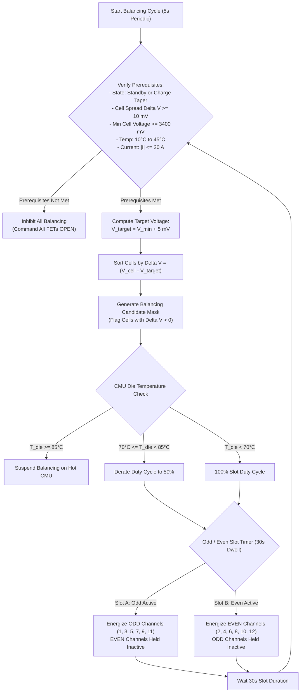

# BMS Software Requirements Specification: Cell Balancing & Capacity Retention

**Document ID:** BMS-SRS-06-BALANCING  
**Version:** 2.4.0  
**Classification:** Automotive High-Voltage Powertrain (EV)  
**Safety Compliance:** ISO 26262:2018 ASIL B / QM  
**Hardware Elements:** 192 Switched Bleed Resistors ($R_{\text{bal}} = 24\,\Omega \pm 1\%$, nominal bleed current $150\text{ mA}$), CMU Internal Balancing FETs, Die Temperature NTCs

---

## 1. Scope & Balancing Topography

In a 192-series cell string, minor variations in self-discharge rate, internal resistance, and local thermal gradients cause State of Charge (SOC) divergence over time. Because the battery pack is capacity-limited by the weakest cell during discharge and the highest cell during charging, cell balancing is mandatory to maintain maximum usable range.

```text
                  +--[ R_bal: 24R ]---[ FET_01 ]--+
                  |                               |
       Cell 01 (+)--------------------------------+---> V_cell_01
                  |
       Cell 02 (+)--------------------------------+---> V_cell_02
                  |                               |
                  +--[ R_bal: 24R ]---[ FET_02 ]--+
```

The BMS employs **Passive Dissipative Balancing**: excess energy in higher-voltage cells is dissipated as heat through switched shunt resistors.

---

## 2. Odd-Even Interleaved Thermal Management Strategy

Dissipating $150\text{ mA} \times 3.8\text{ V} \approx 0.57\text{ W}$ across 12 adjacent channels in a single CMU package would dissipate up to $6.8\text{ W}$, rapidly causing AFE thermal shutdown. The BMS therefore enforces an **Odd-Even Interleaved Duty Cycle**:



---

## 3. Detailed Functional Requirements

### Requirement: BMS-REQ-BAL-0501
* **Title:** Passive Cell Balancing Enable Prerequisites & Inhibit Criteria
* **ASIL Level:** ASIL B
* **Verification Method:** Test (HiL Precondition Invalidation Matrix)
* **Traceability:** ISO 26262-4; SAE J1798
* **Inputs:**
  * `BMS_Operational_State` (Data Type: `uint8_t`, Unit: `enum`, Source: FSM)
  * `Pack_T_Min` (Data Type: `int16_t`, Unit: `0.1 °C`, Source: AFE)
  * `Pack_T_Max` (Data Type: `int16_t`, Unit: `0.1 °C`, Source: AFE)
  * `Cell_V_Min` (Data Type: `uint16_t`, Unit: `mV`, Source: AFE)
  * `Cell_V_Delta` (Data Type: `uint16_t`, Unit: `mV`, Source: AFE)
  * `Pack_Current_Validated` (Data Type: `int32_t`, Unit: `mA`, Source: Shunt)
* **Outputs:**
  * `Balancing_Permitted_Flag` (Data Type: `boolean`, Unit: `bool`, Values: `{FALSE, TRUE}`, Destination: Balancing Engine)
  * `Balancing_Inhibit_Reason` (Data Type: `uint8_t`, Unit: `enum`, Destination: Diagnostics)
* **Timing & Debounce:** Precondition check task: $100\text{ ms} \pm 5\text{ ms}$. Inhibit response latency: $\le 20\text{ ms}$.
* **Description:**  
  The BMS software shall evaluate whether passive cell balancing is permitted. `Balancing_Permitted_Flag` shall be asserted `TRUE` if and only if **ALL** of the following conditions are simultaneously satisfied:
  1. Operating State is either:
     * `ST_05_AC_CHARGE` OR `ST_06_DC_FAST_CHARGE` (during CV taper phase where $|I_{\text{pack}}| \le 20.0\text{ A}$), OR
     * `ST_02_STANDBY` (standstill rest balancing).
  2. Operating State is **NEVER** `ST_04_DRIVE_READY` (balancing strictly prohibited while driving).
  3. Cell voltage spread $\Delta V = V_{\text{max}} - V_{\text{min}} \ge 10\text{ mV}$.
  4. Minimum cell voltage $V_{\text{min}} \ge 3400\text{ mV}$ (balancing prohibited in deep discharge flat OCV region).
  5. Pack temperature within safe window: $10.0^\circ\text{C} \le \text{Pack\_T\_Min} \le \text{Pack\_T\_Max} \le 45.0^\circ\text{C}$.
  6. No active critical safety faults or AFE communication CRC degradation.  
  If any prerequisite drops out, all balancing switches must be commanded OPEN within $\le 20\text{ ms}$.
* **Rationale:** Balancing during driving introduces artificial voltage noise into the EKF estimator. Balancing at cold temperatures risks localized heating gradients.
* **Acceptance Criteria:**  
  Balancing must instantly terminate within $20\text{ ms}$ upon simulated KL15 ignition turn-on or if cell temperature rises to $45.1^\circ\text{C}$.

---

### Requirement: BMS-REQ-BAL-0502
* **Title:** Target Voltage Selection & Shunt Resistor Scheduling
* **ASIL Level:** ASIL B
* **Verification Method:** Test (HiL Imbalance Emulation Across 192 Cells)
* **Traceability:** SAE J1798
* **Inputs:**
  * `Filt_Cell_Voltage[1..192]` (Data Type: `uint16_t[192]`, Unit: `mV`, Source: AFE)
  * `Balancing_Permitted_Flag` (Data Type: `boolean`, Unit: `bool`, Source: Supervisor)
* **Outputs:**
  * `Cell_Balancing_Candidate_Mask[1..192]` (Data Type: `uint8_t[24]`, Unit: `bitfield`, Destination: Switch Scheduler)
  * `Target_Balancing_Voltage` (Data Type: `uint16_t`, Unit: `mV`, Destination: Diagnostics)
* **Timing & Debounce:** Target voltage update period: $5.0\text{ s} \pm 0.2\text{ s}$.
* **Description:**  
  When balancing is enabled:
  1. The software shall determine the target reference voltage:
     $$V_{\text{target}} = V_{\text{min}} + V_{\text{deadband}} \quad (\text{where } V_{\text{deadband}} = 5\text{ mV})$$
  2. For every individual cell $i \in [1..192]$, the software shall evaluate:
     $$\Delta V_i = V_{\text{cell}, i} - V_{\text{target}}$$
     If $\Delta V_i > 0\text{ mV}$, cell $i$ is flagged as a candidate for discharge (`Cell_Balancing_Candidate_Mask[i] = 1`).
  3. If $\Delta V_i \le 0\text{ mV}$, cell $i$ shall remain un-switched (`Cell_Balancing_Candidate_Mask[i] = 0`).
  4. The algorithm shall sort candidates by delta magnitude, ensuring cells with the greatest capacity excess are allocated maximum balancing priority.
* **Rationale:** A deadband of 5 mV prevents hunting or endless balancing caused by ADC measurement quantization noise.
* **Acceptance Criteria:**  
  In a 192-cell pack with one cell at $3.850\text{ V}$ and 191 cells at $3.800\text{ V}$, only the single deviating cell must be flagged in `Cell_Balancing_Candidate_Mask`.

---

### Requirement: BMS-REQ-BAL-0503
* **Title:** Thermal-Aware Odd-Even Interleaved Balancing PWM Modulation
* **ASIL Level:** ASIL B
* **Verification Method:** Test (HiL AFE Die Temperature & Balancing Waveform Inspection)
* **Traceability:** ISO 26262-4
* **Inputs:**
  * `Cell_Balancing_Candidate_Mask[1..192]` (Data Type: `uint8_t[24]`, Unit: `bitfield`, Source: Scheduler)
  * `CMU_Die_Temperature[1..16]` (Data Type: `int16_t[16]`, Unit: `0.1 °C`, Source: CMU Internal Sensor)
* **Outputs:**
  * `CMU_Balancing_Command[1..16]` (Data Type: `uint16_t[16]`, Unit: `bitfield`, Destination: isoSPI Driver)
  * `Balancing_Duty_Cycle` (Data Type: `uint8_t`, Unit: `0.1 %`, Range: `0..1000`, Destination: Telemetry)
* **Timing & Debounce:** Interleaving slot swap duration: $30.0\text{ s} \pm 0.5\text{ s}$. PWM base period: $1000\text{ ms}$.
* **Description:**  
  To prevent overheating the CMU integrated circuits, the software shall execute balancing via time-sliced interleaved multiplexing:
  1. The software shall alternate between:
     * **Slot A ($30\text{ s}$ duration):** Activate only **ODD** index cells ($1, 3, 5, 7, 9, 11$) flagged in `Candidate_Mask`.
     * **Slot B ($30\text{ s}$ duration):** Activate only **EVEN** index cells ($2, 4, 6, 8, 10, 12$) flagged in `Candidate_Mask`.
  2. Adjacent cells (e.g., Cell 1 and Cell 2) shall **NEVER** discharge simultaneously on the same CMU module.
  3. **Die Temperature Throttling:**
     * If `CMU_Die_Temperature[j] < 70.0 °C`: Modulation duty cycle is $100\%$ of slot duration.
     * If $70.0^\circ\text{C} \le \text{CMU\_Die\_Temperature}[j] < 85.0^\circ\text{C}$: Derate duty cycle linearly to $50\%$.
     * If `CMU_Die_Temperature[j] >= 85.0 °C`: Inhibit all balancing on CMU $j$ until die temperature drops $\le 65.0^\circ\text{C}$.
* **Rationale:** Preventing concurrent adjacent cell discharge halves localized power dissipation on the CMU printed circuit board, avoiding PCB hot spots.
* **Acceptance Criteria:**  
  Under no condition shall both an odd and adjacent even balancing switch be simultaneously closed on the same CMU module during oscilloscope monitoring.

---

### Requirement: BMS-REQ-BAL-0504
* **Title:** Balancing Switch Diagnostic Detection (Stuck-Closed / Stuck-Open Faults)
* **ASIL Level:** ASIL C
* **Verification Method:** Test (HiL Emulated Shunt FET Short Injection)
* **Traceability:** ISO 26262-5:2018 Clause 7
* **Inputs:**
  * `Filt_Cell_Voltage[1..192]` (Data Type: `uint16_t[192]`, Unit: `mV`, Source: AFE)
  * `CMU_Balancing_Command[1..16]` (Data Type: `uint16_t[16]`, Unit: `bitfield`, Source: Driver)
* **Outputs:**
  * `DTC_Balancing_FET_Stuck_Closed[1..192]` (Data Type: `uint32_t`, Value: `0x9A0701`, Destination: Dem)
  * `DTC_Balancing_FET_Stuck_Open[1..192]` (Data Type: `uint32_t`, Value: `0x9A0702`, Destination: Dem)
* **Timing & Debounce:** Diagnostic execution: at rest transition and periodic $60\text{ s}$. Fault debounce: 3 consecutive cycles.
* **Description:**  
  The BMS software shall monitor the operational integrity of each individual balancing MOSFET:
  1. **Stuck-Closed (Short-Circuit) Diagnostic:**
     * When balancing is commanded **OFF** for cell $i$, measure voltage drop under zero current:
       $$V_{\text{drop}} = I_{\text{bleed}} \cdot R_{\text{trace}} \approx \frac{V_i}{R_{\text{bal}}} \cdot R_{\text{trace}}$$
     * Alternatively, during a 2-hour rest, calculate cell self-discharge rate:
       $$\frac{dV_i}{dt} \text{ vs. } \text{median}\left(\frac{dV}{dt}\right)$$
     * If cell $i$ discharges at $\ge 120\text{ mA}$ while balancing is commanded OFF, qualify **FET Stuck-Closed** fault (`DTC 0x9A0701`), abort sleep, and broadcast service warning.
  2. **Stuck-Open Diagnostic:**
     * When balancing is commanded **ON**, the AFE sense voltage must exhibit an instantaneous step drop of:
       $$\Delta V_{\text{step}} = I_{\text{bleed}} \cdot R_{\text{internal\_filter}} \ge 2.0\text{ mV}$$
     * If no voltage step occurs after assertion, qualify **FET Stuck-Open** fault (`DTC 0x9A0702`).
* **Rationale:** A shorted balancing FET continuously discharges the cell even when the vehicle is parked, leading to permanent bricking of that individual cell via deep overdischarge.
* **Acceptance Criteria:**  
  A simulated short across balancing FET #5 must be detected within 30 minutes of standstill parking, triggering an alert before the cell voltage drops below $3000\text{ mV}$.

---

### Requirement: BMS-REQ-BAL-0505
* **Title:** Imbalance Growth Logging & Degradation Prognostics
* **ASIL Level:** QM
* **Verification Method:** Test (HiL Long-Term Aging Emulation)
* **Traceability:** ISO 14229-1; SAE J1979
* **Inputs:**
  * `Filt_Cell_Voltage[1..192]` (Data Type: `uint16_t[192]`, Unit: `mV`, Source: AFE)
  * `BMS_Operational_State` (Data Type: `uint8_t`, Unit: `enum`, Source: FSM)
* **Outputs:**
  * `Pack_Cell_Imbalance_Severity` (Data Type: `uint8_t`, Unit: `enum`, Values: `{HEALTHY, MINOR, MODERATE, SEVERE}`, Destination: UDS DID `0x4210`)
  * `Max_Cell_Delta_mV_History` (Data Type: `uint16_t[10]`, Unit: `mV`, Destination: Non-Volatile EEPROM)
* **Timing & Debounce:** Logged once per drive-charge cycle upon transition to sleep.
* **Description:**  
  The BMS shall track long-term cell capacity spread degradation:
  1. At the conclusion of every charge cycle, record $\Delta V_{\text{end}} = V_{\text{max}} - V_{\text{min}}$.
  2. If $\Delta V_{\text{end}} > 50\text{ mV}$ after a full balancing attempt:
     * Set `Pack_Cell_Imbalance_Severity = MODERATE`.
     * Log telemetry DID `0x4210`.
  3. If $\Delta V_{\text{end}} > 100\text{ mV}$:
     * Set `Pack_Cell_Imbalance_Severity = SEVERE`.
     * Store service DTC `0x9A0710` (Irreversible Cell Imbalance / Capacity Mismatch).
* **Rationale:** Rapid growth in cell voltage delta indicates accelerated aging or localized internal degradation in a single cell, warranting pack replacement before complete field breakdown.
* **Acceptance Criteria:**  
  An injected $110\text{ mV}$ imbalance after a full charge cycle must latch `Pack_Cell_Imbalance_Severity = SEVERE` and write DID `0x4210` to non-volatile memory.

