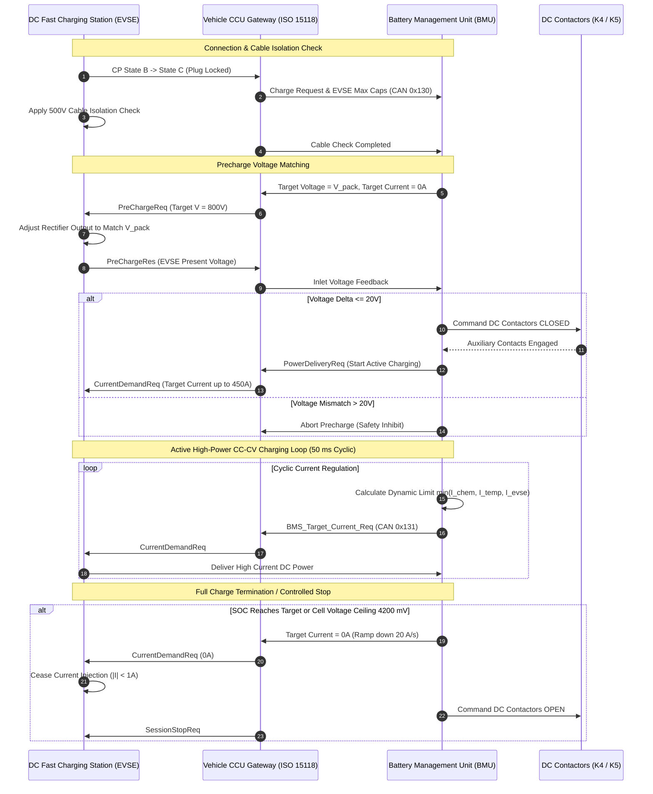

# BMS Software Requirements Specification: Charging Control & EVSE Interfacing

**Document ID:** BMS-SRS-07-CHARGING  
**Version:** 2.4.0  
**Classification:** Automotive High-Voltage Powertrain (EV)  
**Safety Compliance:** ISO 26262:2018 ASIL C / QM, ISO 15118-2/-20, DIN 70121, IEC 61851-1  
**Protocols:** CCS2 High Power Charging (HPC up to 350 kW / 800V / 500A), AC Type 2 (up to 22 kW), Bidirectional V2L/V2G

---

## 1. Scope & System Topography

The Charging Control software module governs the electrical interface, handshake, power arbitration, and safety monitoring between the vehicle BMS and off-board Electric Vehicle Supply Equipment (EVSE). Communication is managed via the On-Board Communication Controller (CCU / OBC) bridging ISO 15118 / DIN 70121 protocols to the internal BMS Powertrain CAN-FD bus.

```text
+-----------------------+              +-----------------------+              +-----------------------+
|  Off-Board DC EVSE    | <== PLC ==>  | Vehicle CCU / Gateway | <== CAN-FD==>| Battery Management    |
|  - Power Converter    | (HomePlug GP)|  - ISO 15118-2 Stack  |   (0x130)    | Unit (BMU Master)     |
|  - Isolation Check    |  DIN 70121   |  - TLS Encryption     |   (2 ms)     |  - SOA Current Solver |
|  - Emergency E-Stop   |              |  - CP / PP Detection  |              |  - DC Contactors K4/K5|
+-----------------------+              +-----------------------+              +-----------------------+
```

---

## 2. DC Fast Charging Sequence Diagram (ISO 15118 / DIN 70121)



---

## 3. Detailed Functional Requirements

### Requirement: BMS-REQ-CHG-0601
* **Title:** DC Fast Charging Target Negotiation & Dynamic Current Limits
* **ASIL Level:** ASIL C
* **Verification Method:** Test (HiL Automated CCS2 Conformance Test Suite)
* **Traceability:** ISO 15118-2:2014 Section 8.4; DIN 70121
* **Inputs:**
  * `Pack_Voltage_Bus` (Data Type: `uint32_t`, Unit: `mV`, Source: Terminal Sensor)
  * `Cell_V_Max` (Data Type: `uint16_t`, Unit: `mV`, Source: AFE)
  * `Pack_T_Min` (Data Type: `int16_t`, Unit: `0.1 °C`, Source: AFE)
  * `Pack_T_Max` (Data Type: `int16_t`, Unit: `0.1 °C`, Source: AFE)
  * `BMS_Pack_SOC` (Data Type: `uint16_t`, Unit: `0.01 %`, Source: AEKF)
  * `EVSE_Max_Current_Limit` (Data Type: `uint16_t`, Unit: `0.1 A`, Source: CCU CAN-FD `0x130`)
  * `EVSE_Max_Voltage_Limit` (Data Type: `uint32_t`, Unit: `mV`, Source: CCU CAN-FD `0x130`)
* **Outputs:**
  * `BMS_Target_Voltage_Req` (Data Type: `uint32_t`, Unit: `mV`, Destination: CCU CAN-FD `0x131`)
  * `BMS_Target_Current_Req` (Data Type: `uint16_t`, Unit: `0.1 A`, Range: `0..5000`, Destination: CCU CAN-FD `0x131`)
  * `BMS_Charging_Status` (Data Type: `uint8_t`, Unit: `enum`, Values: `{STANDBY, PRECHARGE, FAST_CHARGE, TAPER, COMPLETE}`, Destination: CCU CAN-FD `0x131`)
* **Timing & Debounce:** Broadcast cycle: $50\text{ ms} \pm 1.0\text{ ms}$ (transmitted to CCU and forwarded over HomePlug GreenPHY).
* **Description:**  
  During active DC charging (`ST_06_DC_FAST_CHARGE`), the BMS software shall continuously compute and broadcast the optimal charging current request `BMS_Target_Current_Req`:
  1. The target voltage shall be clamped to the absolute pack upper limit:
     $$V_{\text{target}} = 192 \times 4200\text{ mV} = 806.4\text{ V}$$
  2. The target current shall be determined by the multi-constraint minimum solver:
     $$I_{\text{target}} = \min(I_{\text{chem\_map}}(\text{SOC}, T), I_{\text{volt\_limit}}, I_{\text{thermal\_derate}}(T_{\text{max}}), I_{\text{evse\_limit}})$$
     where $I_{\text{chem\_map}}$ enforces the step-charging envelope designed to avoid lithium plating:
     * $\text{SOC} \le 50\%$: up to $450.0\text{ A}$ (approx. $350\text{ kW}$ peak at $800\text{ V}$)
     * $50\% < \text{SOC} \le 70\%$: derated to $300.0\text{ A}$
     * $70\% < \text{SOC} \le 80\%$: derated to $175.0\text{ A}$
     * $80\% < \text{SOC} \le 90\%$: derated to $80.0\text{ A}$
     * $\text{SOC} > 90\%$: derated to $30.0\text{ A}$
  3. Power ramp rate limit: Maximum positive current slew rate is $+20.0\text{ A/s}$ to ensure EVSE power electronics tracking stability.
* **Rationale:** Requesting current beyond the chemical acceptance capability of the cell causes immediate lithium dendrite growth and severe degradation.
* **Acceptance Criteria:**  
  When pack SOC crosses $70.0\%$ during a simulated 350 kW charge on HiL, `BMS_Target_Current_Req` must step down from $300\text{ A}$ to $175\text{ A}$ within $\le 100\text{ ms}$ without current oscillation.

---

### Requirement: BMS-REQ-CHG-0602
* **Title:** Constant-Current to Constant-Voltage (CC-CV) Charge Taper Control
* **ASIL Level:** ASIL C
* **Verification Method:** Test (HiL Top-of-Charge Saturation Profile)
* **Traceability:** ISO 26262-4; SAE J1798
* **Inputs:**
  * `Cell_V_Max` (Data Type: `uint16_t`, Unit: `mV`, Source: AFE)
  * `Pack_Current_Validated` (Data Type: `int32_t`, Unit: `mA`, Source: Shunt)
  * `BMS_Target_Current_Req` (Data Type: `uint16_t`, Unit: `0.1 A`, Source: Solver)
* **Outputs:**
  * `BMS_Target_Current_Req` (Data Type: `uint16_t`, Unit: `0.1 A`, Destination: CCU CAN-FD `0x131`)
  * `Charge_Phase_Indicator` (Data Type: `uint8_t`, Unit: `enum`, Values: `{CC_PHASE, CV_PHASE}`, Destination: Dashboard)
* **Timing & Debounce:** Control loop period: $20\text{ ms} \pm 1.0\text{ ms}$. PI controller sample time: $20\text{ ms}$.
* **Description:**  
  The BMS software shall regulate the transition between Constant Current (CC) and Constant Voltage (CV) charging modes:
  1. While $V_{\text{cell,max}} < 4200\text{ mV}$, the software operates in `CC_PHASE`.
  2. As soon as $V_{\text{cell,max}} \ge 4200\text{ mV}$, the software shall switch into `CV_PHASE` and activate a closed-loop PI current trimming regulator:
     $$e_v(k) = 4200\text{ mV} - V_{\text{cell,max}}(k)$$
     $$I_{\text{trim}}(k) = K_p \cdot e_v(k) + K_i \sum e_v(k) \Delta t \quad (K_p = 0.5\text{ A/mV}, K_i = 0.05\text{ A/mV}\cdot\text{s})$$
     $$I_{\text{target}}(k) = \min(I_{\text{chem\_map}}, I_{\text{target}}(k-1) + I_{\text{trim}}(k))$$
  3. The current request shall smoothly taper down while clamping $V_{\text{cell,max}}$ strictly at $4200\text{ mV} \pm 5\text{ mV}$.
* **Rationale:** Failing to taper current at the cell voltage ceiling causes the highest cell to exceed $4220\text{ mV}$, tripping the overvoltage safety monitor and aborting charge prematurely.
* **Acceptance Criteria:**  
  Throughout the entire CV taper phase on HiL, `Cell_V_Max` must never exceed $4205\text{ mV}$ under any simulated grid supply ripple.

---

### Requirement: BMS-REQ-CHG-0603
* **Title:** Charge Port Terminal Pin Overtemperature Supervision & Derating
* **ASIL Level:** ASIL C
* **Verification Method:** Test (HiL Thermistor Resistance Sweep on DC Inlet Pins)
* **Traceability:** IEC 62196-3; ISO 26262-4
* **Inputs:**
  * `DC_Inlet_Temp_Positive` (Data Type: `int16_t`, Unit: `0.1 °C`, Range: `-400..1500`, Source: Port PT1000 Sensor)
  * `DC_Inlet_Temp_Negative` (Data Type: `int16_t`, Unit: `0.1 °C`, Range: `-400..1500`, Source: Port PT1000 Sensor)
* **Outputs:**
  * `Inlet_Thermal_Derate_Factor` (Data Type: `uint16_t`, Unit: `0.01 %`, Range: `0..10000`, Destination: Charge Solver)
  * `DTC_Charge_Inlet_Overtemp` (Data Type: `uint32_t`, Value: `0x9A0801`, Destination: Dem)
* **Timing & Debounce:** Temperature acquisition loop: $50\text{ ms} \pm 2\text{ ms}$. Derate reaction latency: $\le 100\text{ ms}$.
* **Description:**  
  The BMS software shall continuously monitor the physical temperature of the DC+ and DC- charge port terminal pins:
  1. Let $T_{\text{inlet}} = \max(T_{\text{inlet,pos}}, T_{\text{inlet,neg}})$.
  2. **Nominal Range ($T_{\text{inlet}} \le 75.0^\circ\text{C}$):** `Inlet_Thermal_Derate_Factor = 100.0%` (no derate).
  3. **Linear Derating Range ($75.0^\circ\text{C} < T_{\text{inlet}} \le 90.0^\circ\text{C}$):**
     $$\text{DerateFactor} = 1.0 - \left(\frac{T_{\text{inlet}} - 75.0^\circ\text{C}}{90.0^\circ\text{C} - 75.0^\circ\text{C}}\right) \times 0.70$$
     (Current throttled by up to $70\%$).
  4. **Emergency Stop Threshold ($T_{\text{inlet}} > 90.0^\circ\text{C}$):**
     * Immediately command `BMS_Target_Current_Req = 0.0 A`.
     * Set `Inlet_Thermal_Derate_Factor = 0.0%`.
     * Request emergency charge stop via ISO 15118 `SessionStopReq`.
     * Log DTC `0x9A0801`.
* **Rationale:** High contact resistance in worn or corroded EVSE plug pins generates intense localized heating that can melt the charge port connector housing.
* **Acceptance Criteria:**  
  When an inlet pin reaches $76.0^\circ\text{C}$, current request must begin immediate throttling, and if temperature reaches $90.5^\circ\text{C}$, current request must fall to $0\text{ A}$ within $\le 100\text{ ms}$.

---

### Requirement: BMS-REQ-CHG-0604
* **Title:** Automatic Full-Charge Termination and User-Limit Cutoff
* **ASIL Level:** ASIL B
* **Verification Method:** Test (HiL Charge Completion Cycle)
* **Traceability:** SAE J1798; ISO 15118-2
* **Inputs:**
  * `BMS_Pack_SOC` (Data Type: `uint16_t`, Unit: `0.01 %`, Source: AEKF)
  * `User_SOC_Target_Setting` (Data Type: `uint16_t`, Unit: `0.01 %`, Range: `5000..10000`, Source: Infotainment / App)
  * `Pack_Current_Validated` (Data Type: `int32_t`, Unit: `mA`, Source: Shunt)
  * `Cell_V_Max` (Data Type: `uint16_t`, Unit: `mV`, Source: AFE)
* **Outputs:**
  * `Charge_Complete_Flag` (Data Type: `boolean`, Unit: `bool`, Values: `{FALSE, TRUE}`, Destination: FSM)
  * `BMS_Charging_Status` (Data Type: `uint8_t`, Unit: `enum`, Values: `{..., COMPLETE}`, Destination: CCU CAN-FD `0x131`)
* **Timing & Debounce:** Current taper persistence timer: $10.0\text{ s} \pm 0.5\text{ s}$.
* **Description:**  
  The BMS software shall evaluate charge termination under two distinct conditions:
  1. **User Target Reached:** If `BMS_Pack_SOC >= User_SOC_Target_Setting` (e.g., driver selected 80% limit to preserve battery longevity), initiate controlled current ramp-down to $0\text{ A}$ at $20\text{ A/s}$ and set `Charge_Complete_Flag = TRUE`.
  2. **100% Full Chemical Saturation:** If `User_SOC_Target_Setting == 100.0%`, charging shall terminate when:
     * $V_{\text{cell,max}} \ge 4200\text{ mV}$ AND
     * Charge current has tapered below $I_{\text{cutoff}} = 4.5\text{ A}$ ($C/30$ rate) sustained continuously for $\ge 10.0\text{ s}$.
  3. Upon assertion of `Charge_Complete_Flag`:
     * Broadcast zero current request.
     * Send ISO 15118 `SessionStop` command.
     * Open charging contactors once current drops below $1.0\text{ A}$.
     * Transition FSM to `ST_02_STANDBY` or `ST_07_THERMAL_MGMT`.
* **Rationale:** Preventing prolonged floating at 4.2V minimizes calendar aging and electrolyte oxidation.
* **Acceptance Criteria:**  
  Charging must terminate smoothly without contactor arcing when current drops below $4.5\text{ A}$ for $10.0\text{ s}$ during a $100\%$ charge test on HiL.

---

### Requirement: BMS-REQ-CHG-0605
* **Title:** Emergency Fast-Stop Coordination via ISO 15118 Signaling
* **ASIL Level:** ASIL D
* **Verification Method:** Test (HiL Emergency Stop Signal Injection)
* **Traceability:** ISO 15118-2; DIN 70121; IEC 61851-1
* **Inputs:**
  * `BMS_Operational_State` (Data Type: `uint8_t`, Unit: `enum`, Source: FSM)
  * `Active_Fault_Severity` (Data Type: `uint8_t`, Unit: `enum`, Source: Dem)
  * `EVSE_Emergency_Stop_Flag` (Data Type: `boolean`, Unit: `bool`, Source: CCU CAN-FD `0x130`)
* **Outputs:**
  * `BMS_Fast_Stop_Request` (Data Type: `boolean`, Unit: `discrete`, Destination: CCU CAN-FD `0x131`)
  * `Cmd_Contactor_DC_Pos` (Data Type: `boolean`, Unit: `discrete`, Destination: Driver K4)
  * `Cmd_Contactor_DC_Neg` (Data Type: `boolean`, Unit: `discrete`, Destination: Driver K5)
* **Timing & Debounce:** Emergency signal broadcast: $\le 5\text{ ms}$. Contactor mechanical separation: within $25\text{ ms}$.
* **Description:**  
  When an emergency occurs during DC fast charging (e.g., insulation fault, overvoltage trip, or EVSE e-stop button pushed):
  1. The BMS software shall assert `BMS_Fast_Stop_Request = TRUE` and zero the current request immediately ($\le 5\text{ ms}$).
  2. The software shall allow an off-board EVSE current ramp-down grace window of $20\text{ ms}$.
  3. If $|I_{\text{pack}}| > 10.0\text{ A}$ after $20\text{ ms}$ has elapsed, the BMS shall unconditionally open DC contactors K4 and K5 under load to ensure immediate physical isolation.
  4. Latch emergency shutdown state and set DTC `0x9A0815` (Charging Emergency Fast Stop Executed).
* **Rationale:** Isolating the battery instantly in an emergency prevents electrical arcing or fire escalation between station and vehicle.
* **Acceptance Criteria:**  
  `BMS_Fast_Stop_Request` must be transmitted within $\le 5\text{ ms}$ upon simulated insulation drop during a 300A charging session, with DC contactors opened within $25\text{ ms}$.

---

### Requirement: BMS-REQ-CHG-0606
* **Title:** Vehicle-to-Load (V2L) Bidirectional Discharge Envelope
* **ASIL Level:** ASIL C
* **Verification Method:** Test (HiL V2L Inverter Load Profile)
* **Traceability:** ISO 15118-20; ISO 26262-4
* **Inputs:**
  * `BMS_Pack_SOC` (Data Type: `uint16_t`, Unit: `0.01 %`, Source: AEKF)
  * `V2L_Enable_Request` (Data Type: `boolean`, Unit: `bool`, Source: OBC CAN-FD)
  * `Cell_V_Min` (Data Type: `uint16_t`, Unit: `mV`, Source: AFE)
* **Outputs:**
  * `V2L_Max_Continuous_Discharge_Power` (Data Type: `uint16_t`, Unit: `10 W`, Range: `0..360`, Destination: OBC CAN-FD `0x132`)
  * `V2L_Inhibit_Status` (Data Type: `boolean`, Unit: `bool`, Destination: OBC CAN-FD `0x132`)
* **Timing & Debounce:** Arbitration cycle: $50\text{ ms} \pm 2\text{ ms}$.
* **Description:**  
  When the vehicle is configured in Vehicle-to-Load (V2L) mode supplying 230V AC household appliances through the charge inlet:
  1. The BMS software shall authorize discharge up to $3.6\text{ kW}$ continuous (`V2L_Max_Continuous_Discharge_Power = 3600 W`).
  2. **Minimum Reserve Protection:** If `BMS_Pack_SOC` drops to the user-selected reserve limit (configurable $20.0\%$ to $50.0\%$, default $20.0\%$):
     * Set `V2L_Inhibit_Status = TRUE`.
     * Command OBC discharge shutdown within $\le 100\text{ ms}$.
     * Open auxiliary discharge contactors to prevent stranding the vehicle.
  3. If any individual cell drops below $3100\text{ mV}$, discharge shall terminate immediately regardless of remaining SOC.
* **Rationale:** Safeguards vehicle mobility by ensuring auxiliary export power never depletes the traction battery below minimum driving range.
* **Acceptance Criteria:**  
  V2L export power must cut off cleanly within $100\text{ ms}$ when pack SOC reaches the $20.0\%$ threshold on the test bench.

