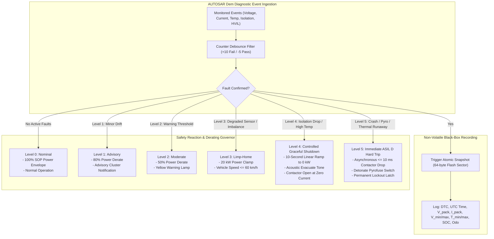

# BMS Software Requirements Specification: Diagnostics, Fault Derating & ISO 26262

**Document ID:** BMS-SRS-08-DIAG-SAFETY  
**Version:** 2.4.0  
**Classification:** Automotive High-Voltage Powertrain (EV)  
**Safety Compliance:** ISO 26262:2018 (ASIL D), AUTOSAR Classic R20-11 Dem/Dcm, SAE J2012-DA, ISO 14229-1 (UDS)  
**Safety Concept:** Fail-Safe & Fail-Operational Degradation, 5 Safety Goals, Freeze Frame Telemetry

---

## 1. ISO 26262 Functional Safety Goals & Safe State Hierarchy

The Battery Management System implements technical safety requirements derived from pack-level Hazard Analysis and Risk Assessment (HARA):

| Safety Goal ID | Description | ASIL | Fault Tolerant Time Interval (FTTI) | Safe State |
| :--- | :--- | :--- | :--- | :--- |
| **SG-01** | Prevent cell overcharge leading to thermal runaway or fire | **ASIL D** | $100\text{ ms}$ | Immediate contactor disconnect / charging lockout |
| **SG-02** | Prevent cell deep overdischarge leading to internal short circuit | **ASIL C** | $500\text{ ms}$ | Zero discharge current / contactor opening |
| **SG-03** | Prevent thermal runaway propagation / catastrophic fire | **ASIL D** | $50\text{ ms}$ | Actuate pyrofuse, emergency flush, cabin alarm |
| **SG-04** | Prevent unintended contactor opening at high speed under heavy load | **ASIL C** | $1000\text{ ms}$ | Controlled torque rampdown prior to contactor drop |
| **SG-05** | Prevent high voltage electrical shock to vehicle occupants / technicians | **ASIL D** | $200\text{ ms}$ | Galvanic isolation check, HVIL interrupt, discharge |

---

## 2. Comprehensive DTC Master Table

| DTC Hex Code | Diagnostic Name | Fault Condition | Debounce Time | Healing Criteria | Safety Reaction Level |
| :--- | :--- | :--- | :--- | :--- | :--- |
| `0x9A0113` | HVIL Circuit Interrupted | Return pulse absent | $15\text{ ms}$ | Continuous pulse for $500\text{ ms}$ | Level 4 / Level 5 |
| `0x9A0201` | Cell Voltage Sense Line Open | $|V_{\text{pullup}} - V_{\text{pulldown}}| \ge 350\text{ mV}$ | $1000\text{ ms}$ | 3 consecutive self-tests pass | Level 3 Limp Home |
| `0x9A0302` | Current Sensor Drift Out-of-Bounds | Zero-offset $> \pm 500\text{ mA}$ at rest | $3000\text{ ms}$ | Recalibration within $\pm 100\text{ mA}$ | Level 2 Moderate |
| `0x9A0315` | Total Pack Voltage Mismatch | $|V_{\text{pack}} - \sum V_{\text{cell}}| > 1.5\% + 2\text{V}$ | $50\text{ ms}$ | Match within $0.5\%$ for $1000\text{ ms}$ | Level 3 Limp Home |
| `0x9A0400` | Chassis Insulation Fault Critical | $R_{\text{iso}} < 100\,\Omega/\text{V}$ ($< 80\text{ k}\Omega$) | $3000\text{ ms}$ | $R_{\text{iso}} \ge 500\,\Omega/\text{V}$ for $10\text{ s}$ | Level 4 / Level 5 |
| `0x9A0601` | Precharge Timeout / Inrush Leakage| $\Delta V > 10\text{ V}$ after $300\text{ ms}$ | $0\text{ ms}$ (latch) | Power cycle ignition | Level 2 Inhibit |
| `0x9A0610` | Contactor Welded Shut | $V_{\text{link}} \approx V_{\text{pack}}$ upon open cmd | $450\text{ ms}$ | Non-erasable (UDS Factory Clear) | Level 5 Lockout |
| `0x9A0801` | DC Charge Port Overheat | Pin temp $> 90.0^\circ\text{C}$ | $100\text{ ms}$ | Pin temp $< 65.0^\circ\text{C}$ | Level 4 Charge Stop |
| `0x9A0901` | Cell Overvoltage Level 1 | Any $V_{\text{cell}} \ge 4220\text{ mV}$ | $50\text{ ms}$ | All $V_{\text{cell}} \le 4180\text{ mV}$ | Level 2 Derate |
| `0x9A0902` | Cell Overvoltage Level 2 Critical| Any $V_{\text{cell}} \ge 4250\text{ mV}$ | $20\text{ ms}$ | Latch until service reset | Level 5 Hard Trip |
| `0x9A0903` | Cell Undervoltage Level 1 | Any $V_{\text{cell}} \le 2700\text{ mV}$ | $50\text{ ms}$ | All $V_{\text{cell}} \ge 2900\text{ mV}$ | Level 3 Limp Home |
| `0x9A0904` | Cell Undervoltage Level 2 Critical|Any $V_{\text{cell}} \le 2300\text{ mV}$ | $20\text{ ms}$ | Latch until service reset | Level 5 Hard Trip |
| `0x9A0905` | Cell Overtemperature Critical | Any $T_{\text{cell}} \ge 60.0^\circ\text{C}$ | $100\text{ ms}$ | All $T_{\text{cell}} \le 45.0^\circ\text{C}$ | Level 4 Shutdown |
| `0x9A0906` | Thermal Runaway Multi-Sensor Trip | 2-of-4 fusion criteria asserted | $50\text{ ms}$ | Permanent Hardware Lockout | Level 5 Pyro Detonate |

---

## 3. Detailed Functional Requirements

### Requirement: BMS-REQ-DIA-0701
* **Title:** ISO 26262 ASIL Allocation and Fault Classification Engine
* **ASIL Level:** ASIL D
* **Verification Method:** Analysis & Test (HiL Fault Tree Coverage Inspection)
* **Traceability:** ISO 26262-4:2018; ISO 26262-5:2018
* **Inputs:**
  * `Dem_Event_Status_Array[1..64]` (Data Type: `uint8_t[64]`, Unit: `bitfield`, Source: AUTOSAR Dem)
* **Outputs:**
  * `Active_Fault_Severity` (Data Type: `uint8_t`, Unit: `enum`, Values: `{NONE, LEVEL_1, LEVEL_2, LEVEL_3, LEVEL_4, LEVEL_5}`, Destination: FSM & Derating Engine)
  * `ASIL_D_Safety_Trip_Line` (Data Type: `boolean`, Unit: `discrete`, Destination: Hardware Interlock Circuit)
* **Timing & Debounce:** Arbitration cycle: $5\text{ ms} \pm 0.1\text{ ms}$.
* **Description:**  
  The BMS software shall evaluate all qualified diagnostic events through a prioritized safety arbitrator:
  1. If any ASIL D critical event (e.g., `0x9A0902`, `0x9A0904`, `0x9A0906`, `0x9A0610`) is qualified:
     * Set `Active_Fault_Severity = LEVEL_5`.
     * De-assert `ASIL_D_Safety_Trip_Line = LOW` to trigger hardware-autonomous contactor disconnect.
  2. If any ASIL C shutdown event (e.g., `0x9A0400`, `0x9A0905`) is qualified:
     * Set `Active_Fault_Severity = LEVEL_4`.
     * Start the 10-second controlled shutdown countdown.
  3. If multiple events are concurrently active, `Active_Fault_Severity` shall unconditionally resolve to the highest severity level present.
* **Rationale:** A deterministic priority scheme ensures minor sensor anomalies never mask or delay immediate reaction to life-threatening safety hazards.
* **Acceptance Criteria:**  
  When an ASIL D critical fault is injected concurrently with three minor sensor faults, the output `Active_Fault_Severity` must transition to `LEVEL_5` within $\le 5\text{ ms}$.

---

### Requirement: BMS-REQ-DIA-0702
* **Title:** Multi-Tier Dynamic Power Derating Governor
* **ASIL Level:** ASIL C
* **Verification Method:** Test (HiL Power Envelope Verification Under Injected Faults)
* **Traceability:** ISO 26262-4
* **Inputs:**
  * `Active_Fault_Severity` (Data Type: `uint8_t`, Unit: `enum`, Source: Safety Engine)
  * `BMS_Max_Discharge_Power_Cont` (Data Type: `uint16_t`, Unit: `0.1 kW`, Source: SOP Engine)
  * `BMS_Max_Charge_Power_Cont` (Data Type: `uint16_t`, Unit: `0.1 kW`, Source: SOP Engine)
* **Outputs:**
  * `VCU_Allowed_Discharge_Power` (Data Type: `uint16_t`, Unit: `0.1 kW`, Range: `0..5000`, Destination: VCU CAN-FD `0x112`)
  * `VCU_Allowed_Regen_Power` (Data Type: `uint16_t`, Unit: `0.1 kW`, Range: `0..3000`, Destination: VCU CAN-FD `0x112`)
* **Timing & Debounce:** Execution rate: $10\text{ ms} \pm 0.5\text{ ms}$. Slew-rate limiter on derate application: $50\text{ kW/s}$.
* **Description:**  
  The BMS shall dynamically modulate the power limits broadcast to the vehicle inverter:
  * **LEVEL_0 (Nominal):** Broadcast full calculated SOP power ($100\%$).
  * **LEVEL_1 (Advisory):** Clamp `VCU_Allowed_Discharge_Power` to $\le 80\%$ of nominal SOP.
  * **LEVEL_2 (Moderate):** Clamp `VCU_Allowed_Discharge_Power` to $\le 50\%$ of nominal SOP; disable fast acceleration boost modes.
  * **LEVEL_3 (Limp-Home):** Clamp `VCU_Allowed_Discharge_Power` to absolute ceiling of $20.0\text{ kW}$ ($200\times 0.1\text{ kW}$); set `VCU_Allowed_Regen_Power = 0.0 kW`.
  * **LEVEL_4 (Graceful Shutdown):** Ramp power linearly from current level to $0.0\text{ kW}$ over $10.0\text{ s}$ ($10000\text{ ms}$), then command contactor open.
  * **LEVEL_5 (Hard Trip):** Immediately broadcast $0.0\text{ kW}$ power target with zero delay.
* **Rationale:** Derating provides a graceful degradation path, keeping the vehicle operational for safe deceleration rather than stranding passengers in highway traffic.
* **Acceptance Criteria:**  
  Upon injection of a Level 3 fault on HiL, `VCU_Allowed_Discharge_Power` must ramp down and cap at exactly $20.0\text{ kW}$ within $\le 400\text{ ms}$.

---

### Requirement: BMS-REQ-DIA-0703
* **Title:** AUTOSAR Dem Diagnostic Event Debouncing & Healing Filter
* **ASIL Level:** ASIL C
* **Verification Method:** Test (HiL Fault Frequency & Intermittent Glitch Injection)
* **Traceability:** AUTOSAR Classic SWS Diagnostic Event Manager R20-11
* **Inputs:**
  * `Raw_Fault_Signal` (Data Type: `boolean`, Unit: `bool`, Source: Internal Monitor)
* **Outputs:**
  * `Dem_Event_Status` (Data Type: `uint8_t`, Unit: `bitfield`, Values: `{PASSED, FAILED, PRE_FAILED, CONFIRMED}`, Destination: Dem Core)
* **Timing & Debounce:** Standard fault debounce step: $+10$ on fail, $-5$ on pass (counter range: $-128$ to $+127$).
* **Description:**  
  The BMS software shall implement time-based and counter-based debouncing conforming to AUTOSAR Dem:
  1. A fault condition must persist continuously across the specified qualification time (e.g., $50\text{ ms}$ for cell overvoltage) before the event transitions from `PRE_FAILED` to `FAILED` and sets the `testFailed` bit in the UDS status byte.
  2. An event is marked `CONFIRMED` (and logged to non-volatile memory) after remaining failed across two consecutive driving cycles or upon immediate ASIL D safety trip.
  3. **Fault Healing:** If an active fault condition ceases, the software shall execute healing debouncing. The fault status bit `testFailed` shall be cleared only after the signal remains continuously nominal for the calibrated healing duration (e.g., $10.0\text{ s}$ for insulation recovery).
* **Rationale:** Prevents intermittent electrical spikes, electromagnetic interference (EMI), or momentary sensor glitches from latching permanent diagnostic errors.
* **Acceptance Criteria:**  
  A simulated noise pulse lasting $30\text{ ms}$ on a cell overvoltage line (threshold $50\text{ ms}$) must be rejected without setting `testFailed` or storing a DTC.

---

### Requirement: BMS-REQ-DIA-0704
* **Title:** High-Voltage Freeze Frame Snapshot Data Recording
* **ASIL Level:** ASIL B
* **Verification Method:** Test (UDS Service 0x19 0x04 Freeze Frame Readout via CANoe)
* **Traceability:** ISO 14229-1:2020 Clause 11.3; SAE J1979-2
* **Inputs:**
  * `DTC_Trigger_Event` (Data Type: `uint32_t`, Source: Dem)
  * `Pack_Voltage_Bus` (Data Type: `uint32_t`, Unit: `mV`, Source: Terminal Sensor)
  * `Pack_Current_Validated` (Data Type: `int32_t`, Unit: `mA`, Source: Shunt)
  * `Cell_V_Min`, `Cell_V_Max` (Data Type: `uint16_t`, Unit: `mV`, Source: AFE)
  * `Cell_ID_Min`, `Cell_ID_Max` (Data Type: `uint8_t`, Range: `1..192`, Source: AFE)
  * `Pack_T_Min`, `Pack_T_Max` (Data Type: `int16_t`, Unit: `0.1 °C`, Source: AFE)
  * `BMS_Pack_SOC` (Data Type: `uint16_t`, Unit: `0.01 %`, Source: AEKF)
  * `Vehicle_Odometer_km` (Data Type: `uint32_t`, Unit: `km`, Source: Cluster CAN-FD)
  * `System_UTC_Timestamp` (Data Type: `uint64_t`, Unit: `ms`, Source: Real-Time Clock)
* **Outputs:**
  * `Freeze_Frame_Buffer` (Data Type: `uint8_t[64]`, Destination: Non-Volatile Flash Sector)
* **Timing & Debounce:** Capture latency: snapshot stored within $\le 10\text{ ms}$ of fault confirmation.
* **Description:**  
  Whenever a DTC is promoted to `CONFIRMED` status, the BMS shall capture an atomic 64-byte diagnostic freeze frame record containing:
  * Byte 0..3: DTC Number (Hex 3-byte code + Failure Type Byte)
  * Byte 4..11: Millisecond UTC Timestamp
  * Byte 12..15: Total Pack Voltage ($mV$)
  * Byte 16..19: Pack Current ($mA$)
  * Byte 20..21: Cell Minimum Voltage ($mV$) + Byte 22: Cell ID
  * Byte 23..24: Cell Maximum Voltage ($mV$) + Byte 25: Cell ID
  * Byte 26..27: Minimum Temperature ($0.1^\circ\text{C}$)
  * Byte 28..29: Maximum Temperature ($0.1^\circ\text{C}$)
  * Byte 30..31: Pack SOC ($0.01\%$)
  * Byte 32..35: Vehicle Odometer ($km$)
  * Byte 36..39: Isolation Resistance ($k\Omega$)
  * Byte 40..63: Reserved for manufacturer diagnostic telemetry  
  The snapshot shall be committed to non-volatile EEPROM/Flash and made readable via UDS Service `$19` Sub-function `$04`.
* **Rationale:** Detailed freeze-frame data is indispensable for field failure investigation and root-cause determination of warranty incidents.
* **Acceptance Criteria:**  
  Reading UDS Service `$19 $04` following an injected overcurrent fault must return the exact current, cell voltages, and timestamp present at the instant of fault tripping.

---

### Requirement: BMS-REQ-DIA-0705
* **Title:** Limp-Home Degraded Propulsion Mode Enforcement
* **ASIL Level:** ASIL C
* **Verification Method:** Test (HiL Vehicle Dynamometer Emulation)
* **Traceability:** ISO 26262-4; UN ECE R100.03
* **Inputs:**
  * `Active_Fault_Severity` (Data Type: `uint8_t`, Unit: `enum`, Source: Safety Engine)
  * `Vehicle_Speed` (Data Type: `uint16_t`, Unit: `0.1 km/h`, Source: ESP)
* **Outputs:**
  * `Limp_Home_Active_Flag` (Data Type: `boolean`, Unit: `bool`, Destination: VCU CAN-FD `0x100`)
  * `Max_Vehicle_Speed_Clamp` (Data Type: `uint16_t`, Unit: `0.1 km/h`, Value: `600`, Destination: VCU CAN-FD `0x100`)
* **Timing & Debounce:** Activation latency: $\le 100\text{ ms}$.
* **Description:**  
  When `Active_Fault_Severity == LEVEL_3`:
  1. The BMS software shall assert `Limp_Home_Active_Flag = TRUE`.
  2. Broadcast a speed ceiling limit request `Max_Vehicle_Speed_Clamp = 60.0 km/h` ($600\times 0.1\text{ km/h}$) to the powertrain coordinator.
  3. Restrict battery continuous output to $20.0\text{ kW}$ to prevent cell degradation while granting sufficient torque to navigate off elevated freeways or exit active intersections.
  4. Inhibit all cruise control and autonomous driving assistance functions.
* **Rationale:** Abruptly shutting down the vehicle on an active motorway poses severe hazard to occupants; Limp-Home balances electrical safety with traffic safety.
* **Acceptance Criteria:**  
  Upon qualifying a Level 3 single-NTC sensor loss, `Limp_Home_Active_Flag` must assert, limiting power to $20\text{ kW}$ and requesting a $60\text{ km/h}$ speed clamp on CAN-FD.

