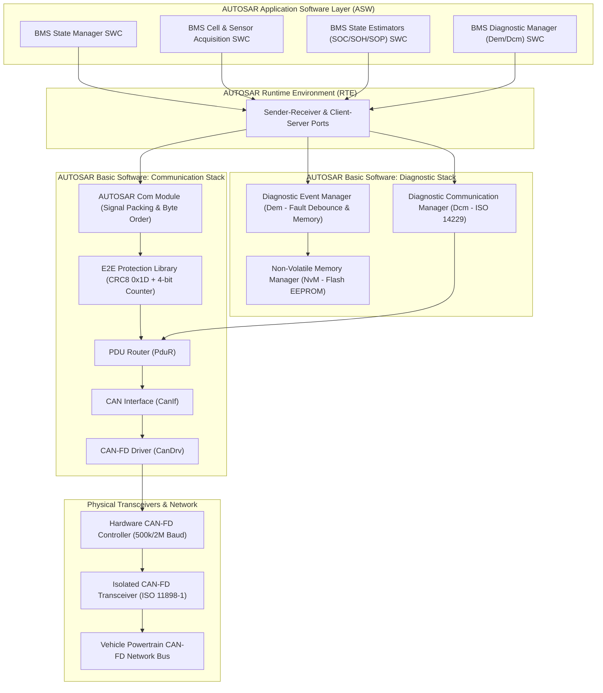
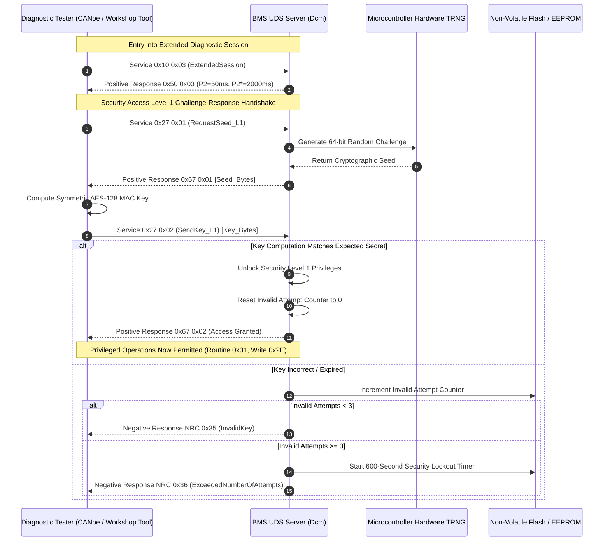

# BMS Software Requirements Specification: AUTOSAR CAN-FD Communication & UDS Diagnostics

**Document ID:** BMS-SRS-09-COM-UDS  
**Version:** 2.4.0  
**Classification:** Automotive High-Voltage Powertrain (EV)  
**Safety Compliance:** ISO 26262:2018 ASIL D (E2E Safety-Relevant Frames), ISO 14229-1:2020 (UDS), ISO 11898-1:2015 (CAN-FD), AUTOSAR Classic R20-11  
**Physical Layer:** CAN-FD (Arbitration: 500 kbps, Data: 2000 kbps, 64-byte payload)

---

## 1. Network Topography & Communication Stack

The BMS interfaces to the vehicle Powertrain Domain Controller (VCU) and Charging Gateway (CCU) via a high-speed CAN-FD bus. The communication architecture adheres to AUTOSAR Classic specifications utilizing the E2E (End-to-End) protection protocol to guarantee safety-critical transmission up to ASIL D.

---

## 2. CAN-FD Broadcast Message Matrix

| CAN ID | Frame Name | Period | DLC | E2E Protected | Signal Payload Content |
| :--- | :--- | :--- | :--- | :--- | :--- |
| `0x100` | `BMS_State_01` | $10\text{ ms}$ | 64 | Yes (Profile 1) | Operational State, Contactor Status, HVIL State, Active Fault Severity |
| `0x101` | `BMS_Cell_Voltages` | $10\text{ ms}$ | 64 | Yes (Profile 1) | $V_{\text{min}}$, $V_{\text{max}}$, $V_{\text{avg}}$, $\Delta V$, Cell ID Min/Max, Sum of Cells |
| `0x102` | `BMS_Temperatures` | $50\text{ ms}$ | 64 | No | $T_{\text{min}}$, $T_{\text{max}}$, $T_{\text{avg}}$, Gradient, NTC ID Min/Max |
| `0x103` | `BMS_Pack_HV` | $10\text{ ms}$ | 64 | Yes (Profile 1) | $V_{\text{pack}}$, $V_{\text{link}}$, Validated Current $I_{\text{pack}}$, Instantaneous Power |
| `0x104` | `BMS_Insulation` | $100\text{ ms}$| 16 | No | $R_{\text{iso}}$ ($k\Omega$), Isolation Status, Ground Fault Pole |
| `0x110` | `BMS_SOC_Report` | $10\text{ ms}$ | 64 | Yes (Profile 1) | Pack SOC, Min Cell SOC, Max Cell SOC, Variance, Inrush Limit |
| `0x111` | `BMS_SOH_Report` | $1000\text{ ms}$| 32| No | Capacity SOH ($SOH_C$), Ohmic SOH ($SOH_R$), Cycle Count, Ah Throughput |
| `0x112` | `BMS_SOP_Limits` | $20\text{ ms}$ | 64 | Yes (Profile 1) | Continuous Discharge kW, 10s Pulse Discharge kW, Continuous Regen kW |
| `0x113` | `BMS_Energy_Range` | $100\text{ ms}$| 32 | No | Remaining Usable Energy (kWh), Predicted Distance to Empty (km) |
| `0x131` | `BMS_Charging_Ctrl`| $50\text{ ms}$ | 64 | Yes (Profile 1) | Target Voltage Request (mV), Target Current Request (0.1A), Charge Phase |

---

## 3. Detailed Functional Requirements

### Requirement: BMS-REQ-COM-0801
* **Title:** Cyclic CAN-FD Telemetry Transmission & Jitter Control
* **ASIL Level:** ASIL B
* **Verification Method:** Test (HiL Protocol Analyzer & Bus Load Simulation)
* **Traceability:** ISO 11898-1:2015; AUTOSAR Classic Com SWS
* **Inputs:**
  * Internal Software Component State Buffers (SOC, SOP, Voltages, Temperatures)
* **Outputs:**
  * CAN-FD Broadcast Messages `0x100..0x131`
* **Timing & Debounce:** Transmission jitter: $\le \pm 1.0\text{ ms}$ for $10\text{ ms}$ frames. Total bus load contribution: $\le 28.5\%$ at 2 Mbps.
* **Description:**  
  The BMS software shall dispatch cyclic CAN-FD frames strictly according to the defined period matrix:
  1. Frames `0x100`, `0x101`, `0x103`, and `0x110` shall transmit with a period of $10\text{ ms} \pm 1.0\text{ ms}$.
  2. Frame `0x112` (SOP Limits) shall transmit with a period of $20\text{ ms} \pm 1.0\text{ ms}$.
  3. Frame `0x131` (Charging Control) shall transmit with a period of $50\text{ ms} \pm 2.0\text{ ms}$ when in charging states.
  4. All signals shall be encoded using Little-Endian (Intel) byte order, with calibrated scaling, physical offsets, and min/max saturation clamps.
  5. The communication stack shall guarantee zero buffer starvation under maximum bus load conditions ($80\%$ background bus traffic).
* **Rationale:** Predictable low-jitter transmission of battery states is required for stable motor inverter torque control and DC fast charging loop regulation.
* **Acceptance Criteria:**  
  Oscilloscope bus analysis must demonstrate frame cycle timing of $10.0\text{ ms} \pm 0.8\text{ ms}$ over 100,000 continuous frames without frame drops.

---

### Requirement: BMS-REQ-COM-0802
* **Title:** AUTOSAR E2E Profile Protection & Sequence Supervision
* **ASIL Level:** ASIL D
* **Verification Method:** Test (HiL Fault Injection: Injected Bit Flips, Frame Drops, Sequence Freezes)
* **Traceability:** AUTOSAR E2E Protocol Specification Profile 1 / Profile 2; ISO 26262-5:2018
* **Inputs:**
  * Safety-Critical Outgoing Signals (Contactor Cmds, SOP Limits, Voltage Extremes)
  * Safety-Critical Incoming Frames (VCU Request `0x0C0`, Airbag Crash `0x030`)
* **Outputs:**
  * `E2E_Data_ID` (Data Type: `uint16_t`, Static Unique ID per Frame)
  * `E2E_Rolling_Counter` (Data Type: `uint8_t`, Range: `0..15`, Incremented per Transmission)
  * `E2E_CRC8_Byte` (Data Type: `uint8_t`, Polynomial: `0x1D`, Init: `0xFF`)
  * `E2E_Plausibility_Status` (Data Type: `uint8_t`, Unit: `enum`, Values: `{OK, CRC_ERROR, REPEATED_COUNTER, WRONG_SEQUENCE}`)
* **Timing & Debounce:** CRC calculation latency: $\le 100\,\mu\text{s}$ per frame. Incoming fault qualification: 3 consecutive defective frames ($30\text{ ms}$).
* **Description:**  
  For all ASIL-relevant frames (`0x100`, `0x101`, `0x103`, `0x110`, `0x112`, `0x131`):
  1. The software shall place a 4-bit alive counter in bits 0..3 of Byte 0, incrementing monotonically from $0$ to $15$ and wrapping back to $0$.
  2. The software shall compute an 8-bit CRC over the data payload and a pre-shared 16-bit Data ID using polynomial $P(x) = x^8 + x^4 + x^3 + x^2 + 1$ (`0x1D`), placing the resulting check byte in Byte 1.
  3. **Incoming Frame Supervision:** For commands from VCU (`0x0C0`):
     * If CRC is invalid or rolling counter repeats $\ge 2$ consecutive times: Discard frame and maintain previous valid command for max $50\text{ ms}$.
     * If invalid frames persist $> 50\text{ ms}$: Transition to Safe State (open contactors or graceful derating) and set DTC `0x9A0A01` (E2E Communication Loss VCU).
* **Rationale:** Detects corrupted CAN transceivers, bit errors caused by traction inverter EMI, and frozen ECU tasks.
* **Acceptance Criteria:**  
  Injecting a single bit inversion into the payload of incoming frame `0x0C0` on HiL must cause `E2E_Plausibility_Status` to evaluate to `CRC_ERROR` within that cycle.

---

### Requirement: BMS-REQ-COM-0803
* **Title:** ISO 14229-1 Unified Diagnostic Services (UDS) Server Support
* **ASIL Level:** ASIL B
* **Verification Method:** Test (HiL Automated Diagnostic Tester Test Suite via CANoe.DiVa)
* **Traceability:** ISO 14229-1:2020; ISO 15765-2 (DoCAN)
* **Inputs:**
  * UDS Diagnostic Request Frames (Physical ID `0x7E0`, Functional ID `0x7DF`)
* **Outputs:**
  * UDS Diagnostic Response Frames (Physical ID `0x7E8`)
* **Timing & Debounce:** Response timing: $P2\text{Server} \le 50\text{ ms}$, $P2^*\text{Server} \le 2000\text{ ms}$ (with pending response `$78`).
* **Description:**  
  The BMS software shall implement a UDS diagnostic server supporting the mandatory service matrix:
  * **Service $10 (DiagnosticSessionControl):**
    * Sub-function `$01`: Default Session
    * Sub-function `$02`: Programming Session (bootloader transfer)
    * Sub-function `$03`: Extended Diagnostic Session
  * **Service $11 (ECUReset):**
    * Sub-function `$01`: Hard Reset (power-on restart)
    * Sub-function `$03`: Soft Reset (restart application tasks)
  * **Service $14 (ClearDiagnosticInformation):** Clear all confirmed DTCs in memory (only permitted in Extended Session).
  * **Service $19 (ReadDTCInformation):**
    * Sub-function `$01`: Number of DTCs by status mask
    * Sub-function `$02`: DTCs by status mask
    * Sub-function `$04`: Snapshot record (Freeze Frame readout)
    * Sub-function `$06`: DTC Extended Data records (aging counters, occurrence counts)
  * **Service $22 (ReadDataByIdentifier):** Read battery telemetry DIDs.
  * **Service $2E (WriteDataByIdentifier):** Write configuration parameters (secured).
  * **Service $3E (TesterPresent):** Zero-subfunction suppression support.
* **Rationale:** Provides standardized interfaces for vehicle assembly line flash programming, dealership repair diagnostics, and statutory emissions/safety inspections.
* **Acceptance Criteria:**  
  Automated CANoe.DiVa compliance test must pass 100% of test cases for positive response timings and negative response codes (NRC `$12`, `$13`, `$22`, `$31`, `$33`, `$78`).

---

### Requirement: BMS-REQ-COM-0804
* **Title:** Security Access Level 1/2 Seed-and-Key Cryptographic Authentication
* **ASIL Level:** ASIL B
* **Verification Method:** Test (Automated Cryptographic Challenge-Response Verification)
* **Traceability:** ISO 14229-1:2020 Clause 9.4; UNECE R155 Cybersecurity
* **Inputs:**
  * UDS Request `$27 $01` (Request Seed Level 1 - Service/Calibration)
  * UDS Request `$27 $03` (Request Seed Level 2 - Bootloader/Flash Write)
  * UDS Request `$27 $02 / $04` (Send Key)
* **Outputs:**
  * Cryptographic Pseudorandom Seed (64-bit entropy generated by hardware TRNG)
  * Authentication Status (`LOCKED`, `UNLOCKED`)
* **Timing & Debounce:** Anti-brute force lockout: 3 consecutive invalid keys triggers an exponential delay lockout of $600.0\text{ s}$ ($10\text{ minutes}$).
* **Description:**  
  Access to safety-critical diagnostic capabilities (contactors manual override, Flash reprogramming, safety calibration write) requires cryptographic unlock via Service `$27`:
  1. Upon receiving request `$27 $01`, the BMS shall generate a cryptographically secure 64-bit random seed using the microcontroller hardware True Random Number Generator (TRNG).
  2. The external diagnostic tester must respond with the correct 128-bit AES-CMAC signature or OEM asymmetric key response within $\le 2000\text{ ms}$.
  3. If the key matches:
     * Unlock the corresponding security level.
     * Reset the invalid attempt counter.
  4. If the key is invalid:
     * Transmit Negative Response Code `NRC 0x35` (Invalid Key).
     * Increment the invalid attempt counter.
     * If 3 consecutive incorrect attempts occur, lock Service `$27` for $600\text{ s}$ during which all `$27` requests return `NRC 0x36` (ExceededNumberOfAttempts).
* **Rationale:** Prevents unauthorized tampering with battery safety thresholds, odometer rollbacks, or malicious remote contactor overrides (ECE R155 compliance).
* **Acceptance Criteria:**  
  Submitting three consecutive incorrect security keys must enforce a strict 600-second delay timer that persists across power cycles.

---

### Requirement: BMS-REQ-COM-0805
* **Title:** Manufacturing Plant Routine Controls ($0x2F / $0x31) & End-of-Line Verification
* **ASIL Level:** ASIL C
* **Verification Method:** Test (HiL EOL Manufacturing Script Execution)
* **Traceability:** ISO 14229-1; OEM Manufacturing Spec
* **Inputs:**
  * UDS Service `$2F` InputOutputControlByIdentifier
  * UDS Service `$31` RoutineControl
* **Outputs:**
  * Physical Relay Actuation Signals
  * Routine Result DIDs
* **Timing & Debounce:** Control override timeout: Automatically revert to autonomous BMS control if tester fails to refresh within $5000\text{ ms}$.
* **Description:**  
  In Extended Diagnostic Session with Security Level 1 unlocked, the BMS shall support explicit manufacturing and servicing routines:
  1. **Routine `$31 01 0201` (Manual Contactor Cycling Test):** Sequentially closes and opens K1, K2, K3, K4 under zero-voltage conditions to verify contactor drive circuits and auxiliary contact timings.
  2. **Routine `$31 01 0202` (Insulation Monitor Self-Calibration):** Commands internal test resistor switching to calibrate isolation resistance detection circuits.
  3. **Routine `$31 01 0203` (Cell Passive Bleed Functional Checkout):** Simultaneously activates all odd balancing channels for $1000\text{ ms}$ to measure individual bleed resistor voltage drops.
  4. **Safety Interlock:** All `$2F` and `$31` overrides shall be automatically rejected with `NRC 0x22` (ConditionsNotCorrect) if `Vehicle_Speed > 0.0 km/h` or `KL15_Ignition_State == ON`.
* **Rationale:** Allows automated end-of-line (EOL) testing during vehicle assembly without allowing hazardous actuator overrides while operating on public roads.
* **Acceptance Criteria:**  
  Attempting to invoke Routine `$31 01 0201` while simulated vehicle speed is $1.0\text{ km/h}$ must immediately return Negative Response Code `0x22`.

