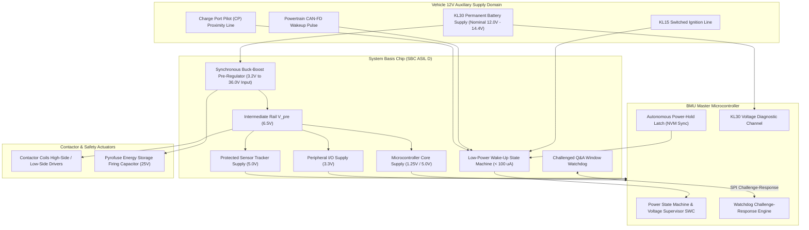
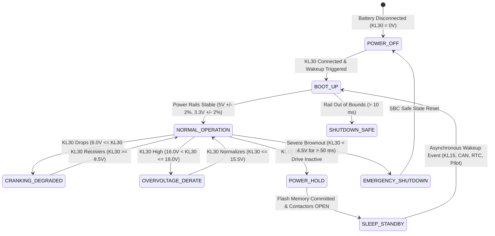

# BMS Software Requirements Specification: Low-Voltage Power Supply, Sleep & Energy Management

**Document ID:** BMS-SRS-10-POWER-SLEEP  
**Version:** 2.4.0  
**Classification:** Automotive High-Voltage Powertrain (EV)  
**Safety & Electrical Compliance:** ISO 16750-2:2012 (Electrical Loads), ISO 7637-2:2011 (Transients), ISO 26262:2018 (ASIL D / ASIL B)  
**Target Hardware:** 12V Auxiliary Supply (KL30 / KL15), Automotive System Basis Chip (SBC: NXP FS26 / Infineon TLF35584), Internal Buck-Boost Pre-Regulator, 5V Core / 3.3V I/O / 5V Sensor Trackers

---

## 1. Scope & Low-Voltage Power Tree Overview

The Battery Management Unit (BMU Master) is energized by the vehicle 12V auxiliary lead-acid or low-voltage LFP battery network (terminal KL30). The microcontroller, AFE transceivers, contactor coil gate drivers, and isolation sensing circuits require tightly regulated internal voltage rails:
1. **$V_{\text{pre}}$ ($6.5\text{V}$):** Intermediate non-isolated buck-boost pre-regulator operating continuously across severe vehicle battery voltage transients ($3.2\text{V}$ cold cranking to $36.0\text{V}$ load dump).
2. **$V_{\text{core}}$ ($1.25\text{V} / 5.0\text{V}$):** Core power for the 32-bit dual lockstep microcontroller.
3. **$V_{\text{io}}$ ($3.3\text{V}$):** General Purpose I/O and isolated SPI transceiver power.
4. **$V_{\text{trk}}$ ($5.0\text{V}$):** High-precision tracking regulators feeding off-board current shunt transceivers and pressure sensors with short-to-battery fault protection.



---

## 2. Low-Voltage Power State Machine



---

## 3. Power-Hold & Deep Sleep Sequence

```mermaid
sequenceDiagram
    autonumber
    participant VEH as Vehicle Ignition / VCU
    participant BMU as BMS Power Manager
    participant NVM as Non-Volatile Flash / EEPROM
    participant CONT as Contactor Driver Bridge
    participant SBC as System Basis Chip (SBC)

    VEH->>BMU: Ignition Off Command: KL15_State = OFF (via Hardware Pin)
    BMU->>SBC: Assert Power-Hold Latch (Keep 5V Rails Active)
    BMU->>CONT: Command All High-Voltage Contactors to OPEN
    CONT-->>BMU: Auxiliary Microswitches Confirm All Contacts Galvanically OPEN

    Note over BMU,NVM: Non-Volatile Serialization Phase (Max 500 ms)
    BMU->>NVM: Commit Cumulative SOC, SOH, Rainflow Histograms & DTC Freeze Frames
    NVM-->>BMU: Flash Commit Confirmed with Valid CRC32

    Note over BMU,SBC: Transition to Deep Sleep
    BMU->>SBC: Configure Wakeup Sources (KL15 Edge, CAN Activity, RTC Alarm = 3600s)
    BMU->>SBC: Release Power-Hold Latch (Command Sleep Mode)
    SBC->>SBC: Disable Buck-Boost Pre-Regulator & Main LDOs
    SBC->>BMU: Rails Power Down; SBC Quiescent Current Enters Low-Power State (< 100 uA)
```

---

## 4. Detailed Functional Requirements

### Requirement: BMS-REQ-PWR-0901
* **Title:** 12V KL30 Auxiliary Supply Supervision & Operating Voltage Windows
* **ASIL Level:** ASIL D
* **Verification Method:** Test (HiL Programmable DC Power Supply Voltage Sweep conforming to ISO 16750-2)
* **Traceability:** ISO 16750-2:2012 Clause 4.2; ISO 26262-5:2018
* **Inputs:**
  * `KL30_Voltage_Raw` (Data Type: `uint16_t`, Unit: `mV`, Range: `0..36000`, Source: Internal ADC via Resistor Divider)
* **Outputs:**
  * `KL30_Supply_State` (Data Type: `uint8_t`, Unit: `enum`, Values: `{UNDERVOLTAGE_SHUTDOWN, COLD_CRANKING, NORMAL, OVERVOLTAGE_WARNING, LOAD_DUMP_TRIP}`, Destination: FSM & Power Manager)
  * `KL30_Voltage_Filtered` (Data Type: `uint16_t`, Unit: `mV`, Destination: CAN-FD `0x100`)
  * `DTC_Aux_Battery_Voltage_Low` (Data Type: `uint32_t`, Value: `0x9A0F01`, Destination: Dem)
* **Timing & Debounce:** ADC conversion rate: $2\text{ ms} \pm 0.1\text{ ms}$. Voltage transition debounce: $20\text{ ms}$ (under-voltage), $5\text{ ms}$ (over-voltage).
* **Description:**  
  The BMS software shall continuously monitor the 12V auxiliary vehicle power line (KL30) and categorize the electrical supply into operational zones:
  1. **Zone 1: Severe Brownout Under-Voltage ($V_{\text{KL30}} < 6.0\text{ V}$):**
     * If sustained for $\ge 50\text{ ms}$, set `KL30_Supply_State = UNDERVOLTAGE_SHUTDOWN`.
     * Safely abort ongoing operations, command contactor drop, and qualify DTC `0x9A0F01`.
  2. **Zone 2: Severe Cold Cranking ($6.0\text{ V} \le V_{\text{KL30}} < 9.0\text{ V}$):**
     * Conforming to ISO 16750-2 Profile B (12V engine/starter crank pulse down to $6.0\text{V}$ for $100\text{ ms}$).
     * Set `KL30_Supply_State = COLD_CRANKING`. Maintain microcontroller clock, AFE communications, and critical safety supervision without resetting.
  3. **Zone 3: Nominal Operating Window ($9.0\text{ V} \le V_{\text{KL30}} \le 16.0\text{ V}$):**
     * Set `KL30_Supply_State = NORMAL`. All functions, contactor drivers, and balancing circuits fully operational.
  4. **Zone 4: Overvoltage Warning ($16.0\text{ V} < V_{\text{KL30}} \le 18.0\text{ V}$):**
     * Set `KL30_Supply_State = OVERVOLTAGE_WARNING`. Inhibit passive cell balancing to reduce auxiliary thermal dissipation.
  5. **Zone 5: Extreme Overvoltage / Load Dump ($V_{\text{KL30}} > 18.0\text{ V}$):**
     * Withstand up to $36.0\text{ V}$ for $400\text{ ms}$ (ISO 16750-2 suppressed load dump pulse).
     * If $V_{\text{KL30}} > 18.0\text{ V}$ persists for $> 50\text{ ms}$, transition to safe shutdown to protect internal linear regulators.
* **Rationale:** Automotive auxiliary networks suffer extreme dips during cold weather cranking and high voltage spikes during alternator load dumps or DC/DC converter regulation oscillations.
* **Acceptance Criteria:**  
  Subjecting the KL30 rail to an ISO 16750-2 cold crank profile dipping from $12.0\text{V}$ to $6.0\text{V}$ for $100\text{ ms}$ must produce zero microcontroller resets or memory corruptions on the HiL testbench.

---

### Requirement: BMS-REQ-PWR-0902
* **Title:** Low-Power Deep Sleep Mode & Quiescent Current Budgeting
* **ASIL Level:** ASIL B
* **Verification Method:** Test (HiL Precision High-Side Current Microammeter Measurement)
* **Traceability:** OEM Low-Power Sleep Specification; ISO 14229-1
* **Inputs:**
  * `BMS_Operational_State` (Data Type: `uint8_t`, Unit: `enum`, Source: FSM)
  * `KL15_Ignition_State` (Data Type: `boolean`, Unit: `bool`, Values: `{OFF, ON}`, Source: Discrete Hardware Pin)
  * `Active_Diagnostic_Session` (Data Type: `uint8_t`, Unit: `enum`, Source: Dcm)
  * `All_Contactors_Confirmed_Open` (Data Type: `boolean`, Unit: `bool`, Source: Contactor Drivers)
* **Outputs:**
  * `SBC_Sleep_Command` (Data Type: `uint8_t`, Destination: SBC SPI Control Register)
  * `Microcontroller_Sleep_Enable` (Data Type: `boolean`, Destination: System Clock Controller)
* **Timing & Debounce:** Sleep qualification timer: $30.0\text{ s} \pm 1.0\text{ s}$ of continuous inactivity.
* **Description:**  
  The BMS software shall govern entry into ultra-low-power deep sleep mode to prevent discharging the vehicle 12V auxiliary battery during prolonged standstill:
  1. Entry into deep sleep is authorized if and only if **ALL** of the following criteria persist for $\ge 30.0\text{ s}$:
     * `KL15_Ignition_State == OFF`
     * `BMS_Operational_State == ST_02_STANDBY`
     * `All_Contactors_Confirmed_Open == TRUE`
     * `Active_Diagnostic_Session == DEFAULT_01` (no active UDS sessions or open testers)
     * No active cell balancing routines or thermal conditioning tasks running.
  2. Upon qualification, the software shall:
     * Flush all runtime buffers to Flash via the Power-Hold mechanism (`BMS-REQ-PWR-0905`).
     * Configure SBC wake-up trigger registers.
     * Command the SBC to disable all buck-boost regulators and LDOs, leaving only the ultra-low-power sleep watchdog and wake-up comparator circuits active.
  3. **Quiescent Current Limit:**
     * Total current drawn by the BMS ECU from the 12V KL30 line while in deep sleep shall **NOT exceed $100\,\mu\text{A}$** across the operating temperature range ($-40^\circ\text{C} \le T \le +85^\circ\text{C}$).
* **Rationale:** A vehicle parked for 60 days at an airport must retain sufficient 12V battery capacity to wake up the gateway and close high-voltage contactors.
* **Acceptance Criteria:**  
  Measured quiescent current on the KL30 pin during sleep on the HiL rig must remain $\le 95\,\mu\text{A}$ at $25.0^\circ\text{C}$ and $\le 120\,\mu\text{A}$ at $+85.0^\circ\text{C}$.

---

### Requirement: BMS-REQ-PWR-0903
* **Title:** Multi-Source Asynchronous Wake-Up Event Qualification
* **ASIL Level:** ASIL B
* **Verification Method:** Test (HiL Multi-Source Wakeup Pulse Injection)
* **Traceability:** ISO 26262-4; ISO 11898-1
* **Inputs:**
  * `SBC_Wakeup_Source_Register` (Data Type: `uint8_t`, Unit: `bitfield`, Source: SBC SPI Status)
  * `KL15_Hardware_Pin` (Data Type: `boolean`, Unit: `discrete`, Source: Ignition Wire)
  * `CAN_Activity_Detected` (Data Type: `boolean`, Unit: `discrete`, Source: CAN-FD Transceiver WUF)
  * `Charge_Pilot_Proximity_State` (Data Type: `boolean`, Unit: `discrete`, Source: Inlet CP/PP Pin)
* **Outputs:**
  * `BMS_Wakeup_Reason` (Data Type: `uint8_t`, Unit: `enum`, Values: `{WAKE_KL15, WAKE_CAN_NETWORK, WAKE_CHARGER_PLUG, WAKE_RTC_CYCLIC}`, Destination: FSM & Telemetry)
* **Timing & Debounce:** Wake-up debounce filter: $15\text{ ms} \pm 2\text{ ms}$ for KL15; $3\text{ ms}$ for CAN-FD wake-up frame (WUF). Total wake-up to active application execution latency: $\le 60\text{ ms}$.
* **Description:**  
  The BMS software shall evaluate and qualify asynchronous wake-up triggers delivered by the System Basis Chip (SBC):
  1. **KL15 Ignition Wake-Up:** Rising edge on KL15 pin sustained for $\ge 15\text{ ms}$ (debouncing ignition mechanical switch chatter) $\rightarrow$ Set `BMS_Wakeup_Reason = WAKE_KL15`. Transition FSM to `ST_02_STANDBY` awaiting drive request.
  2. **CAN-FD Network Wake-Up:** Detection of a valid AUTOSAR CAN Wake-Up Frame (WUF) containing pre-configured CAN ID `0x0C0` or `0x100` $\rightarrow$ Set `BMS_Wakeup_Reason = WAKE_CAN_NETWORK`.
  3. **Charge Plug Insertion Wake-Up:** Transition of Control Pilot (CP) line from open circuit to State B ($9\text{V}$ steady or PWM) $\rightarrow$ Set `BMS_Wakeup_Reason = WAKE_CHARGER_PLUG`. Transition FSM to `ST_05_AC_CHARGE` or `ST_06_DC_FAST_CHARGE`.
  4. **Cyclic RTC Surveillance Alarm:** Expiration of internal real-time clock $3600\text{ s}$ ($1\text{ hour}$) interval $\rightarrow$ Set `BMS_Wakeup_Reason = WAKE_RTC_CYCLIC`. Execute a fast $200\text{ ms}$ cell voltage and temperature inspection; if nominal, return immediately to deep sleep.
* **Rationale:** Discerning wake-up causes ensures power is not wasted initializing the high-voltage precharge system when only a periodic health scan or diagnostic frame is needed.
* **Acceptance Criteria:**  
  Injecting a valid CAN-FD wake-up frame on the bus must wake the BMS from deep sleep into active telemetry broadcast within $\le 60.0\text{ ms}$.

---

### Requirement: BMS-REQ-PWR-0904
* **Title:** SBC Window Watchdog Service & Microcontroller Health Challenge
* **ASIL Level:** ASIL D
* **Verification Method:** Test (HiL Watchdog Challenge Inversion & Task Delay Fault Injection)
* **Traceability:** ISO 26262-5:2018 Clause 9; IEC 61508
* **Inputs:**
  * `Core_Task_Execution_Status` (Data Type: `uint8_t`, Unit: `bitfield`, Source: OS Task Scheduler)
  * `SBC_Watchdog_Question` (Data Type: `uint8_t`, Unit: `byte`, Source: SBC SPI Watchdog Port)
* **Outputs:**
  * `SBC_Watchdog_Answer` (Data Type: `uint8_t`, Unit: `byte`, Destination: SBC SPI Watchdog Port)
  * `Watchdog_Refresh_Success` (Data Type: `boolean`, Unit: `bool`, Destination: Safety Core)
* **Timing & Debounce:** Watchdog window period: Closed window $0\text{ ms}..15\text{ ms}$, Open window $15\text{ ms}..30\text{ ms}$. Service interval: exactly every $20\text{ ms} \pm 1.0\text{ ms}$.
* **Description:**  
  The BMS software shall service an external ASIL D System Basis Chip (SBC) question-and-answer (Q&A) window watchdog:
  1. The software shall execute the watchdog service routine inside the high-priority $20\text{ ms}$ periodic safety task.
  2. The routine shall verify the execution tokens of all lower-level OS tasks (AFE acquisition, current integration, state machine, and communication).
  3. If all task tokens are valid:
     * Read the 4-bit pseudo-random question generated by the SBC.
     * Calculate the mathematical answer using the calibrated non-linear polynomial mapping function:
       $$\text{Answer} = \text{LUT}_{\text{poly}}(\text{Question}) \oplus \text{SecretKey}$$
     * Transmit the answer byte strictly within the **Open Window** ($15\text{ ms} \le t \le 30\text{ ms}$).
  4. **Watchdog Failure Enforcement:**
     * If the answer is incorrect, transmitted during the closed window ($t < 15\text{ ms}$), or omitted ($t > 30\text{ ms}$):
       * The SBC hardware watchdog error counter increments by $+2$.
       * Upon reaching the error threshold (count $\ge 6$), the SBC shall de-assert its internal fail-safe pin, force-open all high-voltage contactor gate power rails, and assert a hardware reset to the microcontroller.
* **Rationale:** A simple toggle watchdog cannot detect frozen tasks or corrupted execution paths; question-answer challenge validation proves software logic integrity up to ASIL D.
* **Acceptance Criteria:**  
  Injecting an artificial $35\text{ ms}$ task freeze into the OS scheduler must cause the SBC to assert a hardware reset and de-energize contactor coils within $\le 60\text{ ms}$.

---

### Requirement: BMS-REQ-PWR-0905
* **Title:** Autonomous Power-Hold Latch for NVM Serialization & Emergency Hold
* **ASIL Level:** ASIL D
* **Verification Method:** Test (HiL Ignition Cutoff Waveform & Power-Hold Measurement)
* **Traceability:** ISO 26262-4; ISO 14229-1
* **Inputs:**
  * `KL15_Hardware_Pin` (Data Type: `boolean`, Unit: `bool`, Source: Digital Input)
  * `NVM_Write_In_Progress` (Data Type: `boolean`, Unit: `bool`, Source: AUTOSAR Fee/NvM)
  * `Thermal_Runaway_Detected_Flag` (Data Type: `boolean`, Unit: `bool`, Source: Thermal Fusion Engine)
* **Outputs:**
  * `SBC_Power_Hold_GPIO` (Data Type: `boolean`, Unit: `discrete`, Destination: SBC Power-Latch Pin)
* **Timing & Debounce:** Latch assertion latency: $\le 1.0\text{ ms}$ upon power-on. Latch release delay: maximum $800\text{ ms}$ after KL15 cut.
* **Description:**  
  The BMS software shall autonomously control the SBC Power-Hold hardware latch line:
  1. Upon power-on bootup, the software shall immediately assert `SBC_Power_Hold_GPIO = TRUE` within $\le 1.0\text{ ms}$ to maintain internal 5V and 3.3V power rails active, regardless of the subsequent state of the external KL15 ignition wire.
  2. When `KL15_Hardware_Pin` drops to `LOW` (driver turns off ignition):
     * The software shall **HOLD** `SBC_Power_Hold_GPIO = TRUE` while:
       * Non-volatile data blocks (SOC, lifetime rainflow histograms, DTC freeze frames) are being serialized into Flash memory (`NVM_Write_In_Progress == TRUE`).
       * Contactors are sequencing through the controlled opening and passive weld check phases.
  3. **Emergency Power-Hold:**
     * If `Thermal_Runaway_Detected_Flag == TRUE`, the software shall force `SBC_Power_Hold_GPIO = TRUE` indefinitely (bypassing normal sleep timeouts) to ensure continuous broadcasting of emergency CAN evacuation frames `0x020` and telematics eCall triggers until auxiliary 12V battery depletion.
  4. Once all shutdown tasks finish under nominal conditions, release `SBC_Power_Hold_GPIO = FALSE` to complete transition into low-power sleep.
* **Rationale:** Abrupt loss of power during an active Flash sector write corrupts EEPROM emulation tables, potentially bricking the ECU's calibration memory.
* **Acceptance Criteria:**  
  Cutting the KL15 ignition wire while an NVM write operation is running on HiL must maintain internal 5V power rails active for exactly $450\text{ ms} \pm 50\text{ ms}$ until the write completes cleanly.

---

### Requirement: BMS-REQ-PWR-0906
* **Title:** Severe Brownout Detection & Under-Voltage Lockout (UVLO) Safe Drop
* **ASIL Level:** ASIL D
* **Verification Method:** Test (HiL Power Rail Brownout Glitch Testing)
* **Traceability:** ISO 26262-5:2018; ISO 16750-2
* **Inputs:**
  * `V_Core_Voltage_Sense` (Data Type: `uint16_t`, Unit: `mV`, Source: SBC Internal Diagnostic ADC)
  * `V_IO_Voltage_Sense` (Data Type: `uint16_t`, Unit: `mV`, Source: SBC Internal Diagnostic ADC)
* **Outputs:**
  * `SBC_Safe_State_Trigger` (Data Type: `boolean`, Unit: `discrete`, Destination: Hardware Gate Interlock)
  * `DTC_Internal_Brownout_Fault` (Data Type: `uint32_t`, Value: `0x9A0F02`, Destination: Dem)
* **Timing & Debounce:** Brownout comparator trip latency: $\le 5\,\mu\text{s}$.
* **Description:**  
  The BMS shall implement hardware and software Under-Voltage Lockout (UVLO) supervision on internal regulated rails:
  1. Internal rails monitored:
     * $V_{\text{core}}$ ($1.25\text{V}$ nominal): Trip threshold $V_{\text{core}} < 1.10\text{ V}$ ($-12\%$)
     * $V_{\text{io}}$ ($3.30\text{V}$ nominal): Trip threshold $V_{\text{io}} < 2.97\text{ V}$ ($-10\%$)
  2. If either rail drops below its trip threshold for $\ge 5\,\mu\text{s}$:
     * Hardware comparator shall immediately force `SBC_Safe_State_Trigger = TRUE`.
     * Pull low all contactor high-side and low-side driver gate power supplies within $\le 10\,\mu\text{s}$, forcing all mechanical contactors OPEN.
     * Inhibit all Flash write operations to protect memory integrity.
     * Hold the microcontroller in reset until both rails stabilize within $\pm 2\%$ for $> 50\text{ ms}$.
  3. Upon subsequent recovery, log DTC `0x9A0F02` (Internal Power Supply Rail Brownout Detected).
* **Rationale:** A microcontroller running below minimum core voltage can execute invalid assembly opcodes or jump to arbitrary memory locations, potentially executing contactor close routines erroneously.
* **Acceptance Criteria:**  
  Injecting a $1.05\text{V}$ glitch on the 1.25V core supply rail must force all contactor driver outputs low within $\le 10\,\mu\text{s}$.

