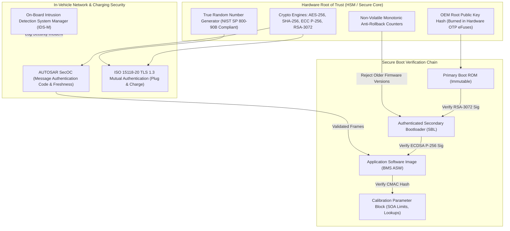
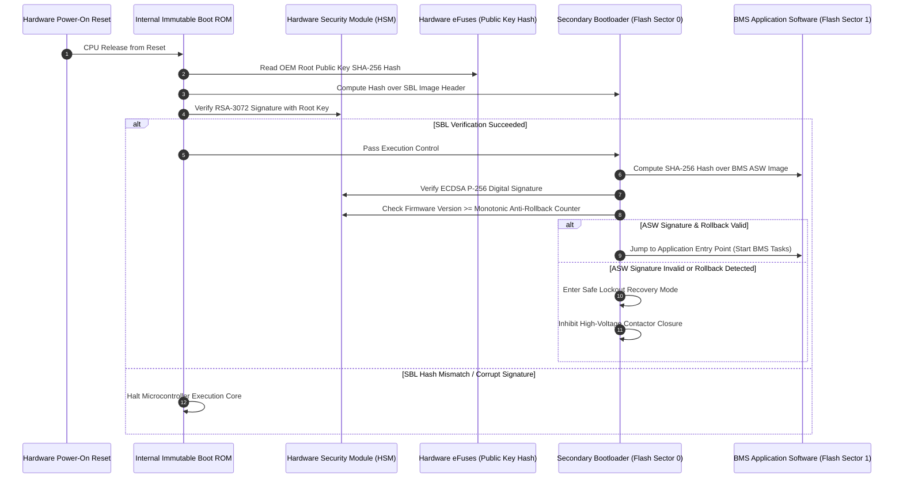

# BMS Software Requirements Specification: Cybersecurity, Secure Boot & ISO/SAE 21434

**Document ID:** BMS-SRS-12-CYBERSEC  
**Version:** 2.4.0  
**Classification:** Automotive High-Voltage Powertrain (EV)  
**Safety & Security Compliance:** ISO/SAE 21434:2021 (Road Vehicles - Cybersecurity Engineering), UNECE R155 (CSMS), UNECE R156 (SUMS), AUTOSAR Classic SecOC / Crypto Stack  
**Hardware Elements:** Microcontroller Hardware Security Module (HSM), One-Time Programmable (OTP) eFuses, Hardware TRNG, Monotonic Anti-Rollback Counters

---

## 1. Scope & Threat Mitigation Topography

The high-voltage Battery Management System is a critical automotive target for malicious cyber-physical tampering. An adversary who gains arbitrary write access to BMS firmware or modifies CAN-FD frames could maliciously alter overvoltage cutoffs, disable thermal runaway alarms, or force contactors open at high speeds.

To prevent unauthorized manipulation, the BMS implements a multi-layer cybersecurity architecture:

---

## 2. Secure Boot Authentication Sequence

---

## 3. Detailed Functional Requirements

### Requirement: BMS-REQ-SEC-1001
* **Title:** HSM Secure Boot & Firmware Authentication Chain
* **ASIL Level:** ASIL B / Security Level 3
* **Verification Method:** Test (HiL Corrupt Firmware Flashing & Signature Tampering Injection)
* **Traceability:** ISO/SAE 21434:2021 Clause 9; UNECE R156 SUMS
* **Inputs:**
  * `Reset_Vector_Asserted` (Data Type: `boolean`, Unit: `discrete`, Source: SBC)
  * `Flash_Header_Signature` (Data Type: `uint8_t[384]`, Unit: `bytes`, Source: Flash Image Metadata)
  * `Flash_Image_Payload` (Data Type: `uint8_t[]`, Unit: `bytes`, Source: Application Flash Sectors)
* **Outputs:**
  * `Secure_Boot_Result` (Data Type: `uint8_t`, Unit: `enum`, Values: `{AUTH_SUCCESS, SIGNATURE_MISMATCH, ROLLBACK_VIOLATION, OTP_CORRUPT}`, Destination: Boot Manager)
  * `Core_Execution_Authorized` (Data Type: `boolean`, Unit: `bool`, Destination: Microcontroller Clock Control)
* **Timing & Debounce:** Boot verification duration: $\le 45\text{ ms}$ for $4\text{ MB}$ Flash image at $300\text{ MHz}$ core clock.
* **Description:**  
  Upon power-on reset, the microcontroller shall execute a chained secure boot sequence orchestrated by the isolated Hardware Security Module (HSM):
  1. The immutable Boot ROM shall read the SHA-256 hash of the OEM Root Public Key burned into write-protected hardware OTP eFuses.
  2. The Boot ROM shall verify the RSA-3072 / SHA-256 digital signature of the Secondary Bootloader (SBL).
  3. The SBL shall compute the cryptographic hash of the entire active BMS application software and calibration data blocks using hardware-accelerated SHA-256.
  4. The software signature shall be validated using ECDSA with NIST Curve P-256.
  5. **Anti-Rollback Check:** The version header in the flash image must be strictly $\ge$ the hardware monotonic anti-rollback counter. If an older version is detected, reject boot and lock.
  6. If all checks succeed, assert `Core_Execution_Authorized = TRUE` and transfer control to the application entry point. If any check fails, hold microcontroller outputs in high-impedance safe state and broadcast `AUTH_FAILED` on bootloader CAN-FD interface.
* **Rationale:** Prevents adversaries from flashing modified firmware that disables safety limits, or downgrading firmware to re-introduce known security vulnerabilities.
* **Acceptance Criteria:**  
  Modifying a single bit within the 4 MB application Flash sector must cause `Secure_Boot_Result` to evaluate to `SIGNATURE_MISMATCH`, halting boot in $\le 45\text{ ms}$ with contactors held open.

---

### Requirement: BMS-REQ-SEC-1002
* **Title:** AUTOSAR SecOC Message Authentication & Freshness Counter
* **ASIL Level:** ASIL B / Security Level 3
* **Verification Method:** Test (HiL Injected Replay Attack & Unauthorized Frame Spoofing)
* **Traceability:** AUTOSAR Classic SWS Secure On-Board Communication R20-11; ISO/SAE 21434
* **Inputs:**
  * `Incoming_Secured_PDU` (Data Type: `uint8_t[64]`, Source: Powertrain CAN-FD ID `0x0C0`)
  * `PDU_Received_MAC` (Data Type: `uint8_t[8]`, Unit: `bytes`, Source: Frame Payload Bits)
  * `PDU_Received_Freshness` (Data Type: `uint16_t`, Unit: `counter`, Source: Frame Payload Bits)
* **Outputs:**
  * `SecOC_Authentication_Status` (Data Type: `uint8_t`, Unit: `enum`, Values: `{SECOC_PASS, MAC_VERIFY_FAIL, REPLAY_DETECTED}`, Destination: PduR)
  * `DTC_SecOC_Auth_Failure` (Data Type: `uint32_t`, Value: `0x9A0C01`, Destination: Dem)
* **Timing & Debounce:** MAC calculation latency: $\le 150\,\mu\text{s}$ per PDU. Replay detection threshold: $\Delta \text{Counter} \le 0$.
* **Description:**  
  The BMS software shall verify inbound safety-critical frames (such as VCU Drive Enable commands) using AUTOSAR SecOC:
  1. The software shall maintain an internal 32-bit Trip Freshness Counter synchronized with the vehicle central gateway.
  2. For every incoming secured PDU, the HSM crypto engine shall compute an AES-128 CMAC truncated to 64 bits over:
     $$\text{MAC} = \text{AES-CMAC}_{K_{\text{sym}}}(\text{PDU\_Data} \,||\, \text{Freshness\_Counter} \,||\, \text{Data\_ID})$$
  3. **Verification Rules:**
     * The received Freshness Counter must be strictly greater than the last accepted counter value ($\Delta > 0$).
     * The computed MAC must match `PDU_Received_MAC` bit-for-bit.
  4. If MAC mismatch or duplicate counter occurs:
     * Discard PDU immediately.
     * Increment `SecOC_Tamper_Counter`.
     * If 5 consecutive failures occur within $100\text{ ms}$, qualify DTC `0x9A0C01` and transition to Degraded Mode.
* **Rationale:** Replay attacks (re-transmitting recorded legitimate CAN frames) or spoofing unauthorized torque/charge requests from compromised ECUs are neutralized.
* **Acceptance Criteria:**  
  Replaying a recorded legitimate CAN frame from a prior drive cycle must be rejected with `REPLAY_DETECTED` status within $\le 150\,\mu\text{s}$.

---

### Requirement: BMS-REQ-SEC-1003
* **Title:** ISO 15118-20 Plug & Charge TLS 1.3 Mutual Authentication
* **ASIL Level:** ASIL B / Security Level 3
* **Verification Method:** Test (HiL Automated TLS Handshake Conformance with Test PKI Certificates)
* **Traceability:** ISO 15118-2:2014; ISO 15118-20:2022; V2G PKI Specification
* **Inputs:**
  * `EVSE_Server_Certificate_Chain` (Data Type: `uint8_t[]`, Source: CCU HomePlug Modem)
  * `Vehicle_Contract_Certificate` (Data Type: `uint8_t[]`, Source: BMS Secure HSM Storage)
  * `Contract_Private_Key` (Data Type: `ECC_P256_PrivateKey`, Source: HSM Write-Protected Enclave)
* **Outputs:**
  * `TLS_Session_Cipher_Suite` (Data Type: `uint16_t`, Value: `TLS_AES_128_GCM_SHA256`)
  * `V2G_Authentication_Status` (Data Type: `uint8_t`, Unit: `enum`, Values: `{AUTHENTICATED, CERT_EXPIRED, UNTRUSTED_ROOT, REVOKED}`)
* **Timing & Debounce:** Total TLS mutual handshake duration: $\le 1500\text{ ms}$.
* **Description:**  
  During high-power DC fast charging via ISO 15118 Plug & Charge:
  1. The BMS and CCU shall establish an encrypted Transport Layer Security (TLS 1.3) channel with the off-board EVSE.
  2. The BMS shall validate the EVSE Sub-CA and leaf certificate against the OEM V2G Root Certification Authority certificate stored in HSM Flash.
  3. The BMS shall verify that the EVSE certificate has not expired and is not revoked via Online Certificate Status Protocol (OCSP) stapling.
  4. The BMS shall perform ECDSA P-256 client authentication using its provisioned `Vehicle_Contract_Certificate`.
  5. High-voltage DC contactor closure (`K4`, `K5`) shall remain strictly locked until `V2G_Authentication_Status == AUTHENTICATED`.
* **Rationale:** Protects automated billing transactions and prevents unauthorized, uncertified rogue charging stations from probing the high-voltage bus.
* **Acceptance Criteria:**  
  Presenting an untrusted or expired EVSE server certificate during simulated Plug & Charge handshake must terminate the session with `UNTRUSTED_ROOT`, preventing contactor closure.

---

### Requirement: BMS-REQ-SEC-1004
* **Title:** Diagnostic Security Access Anti-Brute-Force & Rate Limiting
* **ASIL Level:** ASIL B
* **Verification Method:** Test (HiL Automated High-Speed Key Fuzzing Attack)
* **Traceability:** ISO 14229-1:2020 Clause 9.4; UNECE R155
* **Inputs:**
  * `UDS_Service_27_Request` (Data Type: `uint8_t[]`, Source: Diagnostic Port)
  * `Invalid_Key_Attempt_Counter` (Data Type: `uint8_t`, Range: `0..10`, Source: NVM Security Block)
* **Outputs:**
  * `UDS_NRC_Response` (Data Type: `uint8_t`, Hex Codes: `{0x35, 0x36, 0x37}`, Destination: Dcm)
  * `Security_Lockout_Time_Remaining` (Data Type: `uint16_t`, Unit: `s`, Range: `0..600`, Destination: Dcm)
* **Timing & Debounce:** Lockout penalty duration: $600.0\text{ s} \pm 1.0\text{ s}$ ($10\text{ minutes}$).
* **Description:**  
  The BMS shall protect UDS Security Access Service `$27` against brute-force seed-key guessing:
  1. If an incorrect cryptographic key is submitted in response to a Level 1 or Level 2 seed request:
     * Increment `Invalid_Key_Attempt_Counter`.
     * Transmit `NRC 0x35` (InvalidKey).
  2. When `Invalid_Key_Attempt_Counter == 3`:
     * Lock Service `$27` immediately for $600\text{ s}$ (`Security_Lockout_Time_Remaining = 600`).
     * All subsequent `$27` requests received during this interval shall be rejected with `NRC 0x37` (RequiredTimeDelayNotExpired).
  3. **Non-Volatile Enforcement:** The active lockout timer and attempt counter shall be preserved across 12V battery power cycles in non-volatile EEPROM/Flash. Disconnecting KL30 supply shall **NEVER** reset the 600-second penalty timer.
* **Rationale:** Brute-force attacks rely on rapidly cycling ECU power to reset retry counters; non-volatile timer enforcement renders online key search mathematically infeasible.
* **Acceptance Criteria:**  
  After three invalid key submissions, cycling 12V power off and on after 60 seconds must show the lockout still active with approximately 540 seconds remaining.

---

### Requirement: BMS-REQ-SEC-1005
* **Title:** On-Board Cybersecurity Incident Logging (IDS-M Sensor Interface)
* **ASIL Level:** ASIL B
* **Verification Method:** Test (HiL Security Event Trigger Verification)
* **Traceability:** ISO/SAE 21434:2021 Clause 13; AUTOSAR Classic SWS IdsM
* **Inputs:**
  * `Security_Event_Type` (Data Type: `uint8_t`, Unit: `enum`, Values: `{SECOC_FAIL, UDS_BRUTE_FORCE, CAN_FLOOD, MEMORY_INTEGRITY_FAIL}`, Source: Security Monitors)
* **Outputs:**
  * `Qualified_Security_Event_PDU` (Data Type: `uint8_t[32]`, Destination: Vehicle Central IDS-Host)
  * `Security_Log_Flash_Sector` (Data Type: `uint8_t[128]`, Destination: Encrypted NvM Partition)
* **Timing & Debounce:** Logging latency: $\le 10\text{ ms}$ from incident qualification.
* **Description:**  
  The BMS software shall operate as an automotive Intrusion Detection System Sensor (IDS-M Sensor):
  1. Upon qualification of any defined security violation (e.g., SecOC authentication failure, UDS brute-force lockout, or unexpected flash memory rewrite attempt):
     * Construct an atomic Security Event Record containing: Incident ID, Timestamp, Offending CAN ID/Source, Current Odometer, and Raw Payload excerpt.
     * Commit the record into a dedicated write-once, tamper-evident encrypted Flash circular buffer ($128\text{ bytes}$ per entry).
     * Transmit a high-priority security event notification to the vehicle central telematics gateway for fleet-wide Security Operations Center (VSOC) reporting.
* **Rationale:** Fulfills UNECE R155 mandatory requirements for post-production vehicle fleet monitoring and cyber incident forensics.
* **Acceptance Criteria:**  
  Deliberately generating a SecOC MAC failure must write a validated security event log into the encrypted Flash sector within $\le 10\text{ ms}$.

