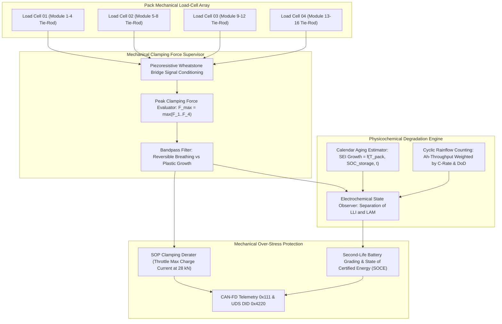
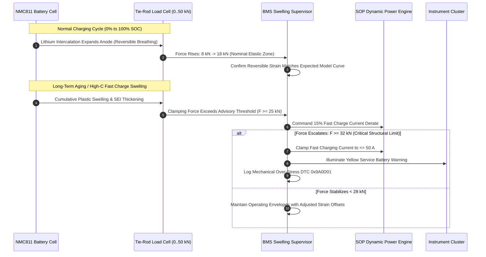

# BMS Software Requirements Specification: Battery Aging, Swelling Mechanics & Degradation Models

**Document ID:** BMS-SRS-13-AGING-MECH  
**Version:** 2.4.0  
**Classification:** Automotive High-Voltage Powertrain (EV)  
**Safety & Reliability:** ISO 26262:2018 (ASIL B / QM), SAE J1798, UN ECE R100.03  
**Target Hardware:** Piezoresistive Load-Cell Force Sensors ($0..50\text{ kN}$ on module tie-rods), 192s1p NMC811 Prismatic Cells, Non-Volatile Lifetime Histogram Flash Sectors

---

## 1. Scope & Degradation Physics Overview

Prismatic lithium-ion cells with silicon-graphite anodes and nickel-rich cathodes (NMC811) undergo mechanical volume expansion during operation:
1. **Reversible Breathing Expansion:** Lithium intercalation expands graphite/silicon crystal lattices during charging ($+4\%$ to $+7\%$ volume change), which relaxes upon discharge.
2. **Irreversible Plastic Swelling:** Continuous Solid Electrolyte Interphase (SEI) growth, transition metal dissolution, and micro-cracking cause cumulative irreversible thickness increases, exerting tremendous clamping forces against module end-plates ($> 30\text{ kN}$).
3. **Loss of Lithium Inventory (LLI) vs. Loss of Active Material (LAM):** Degradation is decomposed into consumption of cyclable lithium (LLI) and structural disintegration of active electrode host matrices (LAM).

---

## 2. Reversible vs. Irreversible Swelling Dynamics

---

## 3. Detailed Functional Requirements

### Requirement: BMS-REQ-MECH-1101
* **Title:** Module Clamping Swelling Force Acquisition & Mechanical Stress Limiting
* **ASIL Level:** ASIL B
* **Verification Method:** Test (HiL Load Cell Voltage Injection & Strain Gauge Testbed)
* **Traceability:** ISO 26262-4; SAE J1798
* **Inputs:**
  * `Tie_Rod_Force_Raw[1..4]` (Data Type: `uint16_t[4]`, Unit: `0.1 kN`, Range: `0..500`, Source: 4-Channel Piezoresistive Load Cells)
  * `BMS_Pack_SOC` (Data Type: `uint16_t`, Unit: `0.01 %`, Source: AEKF)
  * `Pack_T_Avg` (Data Type: `int16_t`, Unit: `0.1 °C`, Source: Temperature Monitor)
* **Outputs:**
  * `Pack_Peak_Clamping_Force` (Data Type: `uint16_t`, Unit: `0.1 kN`, Range: `0..500`, Destination: SOP Engine & CAN-FD `0x111`)
  * `Mechanical_Derate_Factor` (Data Type: `uint16_t`, Unit: `0.01 %`, Range: `0..10000`, Destination: SOP Engine)
  * `DTC_Pack_Mechanical_Overstress` (Data Type: `uint32_t`, Value: `0x9A0D01`, Destination: Dem)
* **Timing & Debounce:** Sampling period: $100\text{ ms} \pm 5\text{ ms}$. Force threshold debounce: $2000\text{ ms}$.
* **Description:**  
  The BMS software shall monitor the compressive mechanical clamping force exerted by the swelling cell modules against the internal pack structural tie-rods:
  1. Let $F_{\text{peak}} = \max(F_1, F_2, F_3, F_4)$.
  2. The software shall enforce the following multi-stage mechanical protection thresholds:
     * **Nominal Operational Window ($F_{\text{peak}} \le 22.0\text{ kN}$):** `Mechanical_Derate_Factor = 100.0%` (no mechanical throttling).
     * **Advisory Swelling Derate ($22.0\text{ kN} < F_{\text{peak}} \le 28.0\text{ kN}$):**
       $$\text{DerateFactor} = 1.0 - \left(\frac{F_{\text{peak}} - 22.0\text{ kN}}{28.0\text{ kN} - 22.0\text{ kN}}\right) \times 0.30$$
       (Peak charge and discharge currents throttled by up to $30\%$).
     * **Critical Structural Protection ($F_{\text{peak}} > 28.0\text{ kN}$):**
       * Clamp maximum charging current to $\le 50.0\text{ A}$.
       * Set `Mechanical_Derate_Factor = 40.0%`.
       * If $F_{\text{peak}} \ge 35.0\text{ kN}$ (risk of module endplate deformation or cell casing burst), qualify DTC `0x9A0D01` and transition to Safe State.
* **Rationale:** Excessive compressive force crushes cell separator micropores, inducing localized internal short circuits and pouch rupture.
* **Acceptance Criteria:**  
  When an emulated force of $25.0\text{ kN}$ is injected on any load-cell channel, `Mechanical_Derate_Factor` must drop to $85.0\% \pm 1.0\%$ within $\le 250\text{ ms}$.

---

### Requirement: BMS-REQ-MECH-1102
* **Title:** Separated Calendar & Cyclic Loss-of-Lithium-Inventory (LLI) Estimation
* **ASIL Level:** QM
* **Verification Method:** Analysis & Test (HiL Accelerated Degradation Replay)
* **Traceability:** SAE J1798
* **Inputs:**
  * `Pack_T_Avg` (Data Type: `int16_t`, Unit: `0.1 °C`, Source: Temperature Monitor)
  * `BMS_Pack_SOC` (Data Type: `uint16_t`, Unit: `0.01 %`, Source: AEKF)
  * `Pack_Current_Validated` (Data Type: `int32_t`, Unit: `mA`, Source: Shunt)
  * `Standstill_Rest_Duration_Hours` (Data Type: `uint32_t`, Unit: `hours`, Source: RTC)
* **Outputs:**
  * `Estimated_LLI_Percent` (Data Type: `uint16_t`, Unit: `0.01 %`, Range: `0..5000`, Destination: SOH Engine)
  * `Calendar_Aging_Share` (Data Type: `uint16_t`, Unit: `0.01 %`, Destination: UDS DID `0x4221`)
  * `Cyclic_Aging_Share` (Data Type: `uint16_t`, Unit: `0.01 %`, Destination: UDS DID `0x4221`)
* **Timing & Debounce:** Cumulative integration task: runs once per hour and committed to flash at key-off.
* **Description:**  
  The BMS software shall decompose irreversible cell degradation into distinct calendar and cyclic components:
  1. **Calendar Aging (SEI Layer Growth):**
     $$\Delta \text{LLI}_{\text{cal}} = K_{\text{cal}} \cdot \exp\left(-\frac{E_{a, \text{cal}}}{R \cdot T}\right) \cdot \exp(\beta_{\text{soc}} \cdot \text{SOC}) \cdot \sqrt{t}$$
     where $E_{a, \text{cal}} = 45.0\text{ kJ/mol}$, $\beta_{\text{soc}} = 0.85$, and $t$ is cumulative resting duration.
  2. **Cyclic Aging (Mechanical Fracture & Intercalation Stress):**
     $$\Delta \text{LLI}_{\text{cyc}} = K_{\text{cyc}} \cdot \exp\left(-\frac{E_{a, \text{cyc}}}{R \cdot T}\right) \cdot \left(\frac{I_{\text{eff}}}{C_{\text{rate}}}\right)^{\gamma} \cdot \Delta Ah$$
     where $\gamma = 0.65$ and $I_{\text{eff}}$ accounts for regenerative braking and charging peak rates.
  3. Total estimated cyclable lithium loss:
     $$\text{LLI}_{\text{total}} = \text{LLI}_{\text{cal}} + \text{LLI}_{\text{cyc}}$$
* **Rationale:** Differentiating between calendar aging (time/temperature/SOC) and cyclic aging (throughput/C-rate) enables predictive warranty analytics and smart preconditioning.
* **Acceptance Criteria:**  
  Simulating 1 year of vehicle standstill storage at $35.0^\circ\text{C}$ and $90\%$ SOC on HiL must compute a calendar degradation of $2.8\% \pm 0.3\%$ LLI.

---

### Requirement: BMS-REQ-MECH-1103
* **Title:** Loss of Active Material (LAM) Anode/Cathode Asymmetry Tracking
* **ASIL Level:** QM
* **Verification Method:** Analysis & Test (HiL Differential Voltage Analysis Replay)
* **Traceability:** SAE J1798
* **Inputs:**
  * `Filt_Cell_Voltage[1..192]` (Data Type: `uint16_t[192]`, Unit: `mV`, Source: AFE)
  * `Shunt_Accumulated_Ah` (Data Type: `int64_t`, Unit: `0.001 Ah`, Source: Shunt)
* **Outputs:**
  * `LAM_Anode_Percent` (Data Type: `uint16_t`, Unit: `0.01 %`, Range: `0..5000`, Destination: Diagnostics)
  * `LAM_Cathode_Percent` (Data Type: `uint16_t`, Unit: `0.01 %`, Range: `0..5000`, Destination: Diagnostics)
* **Timing & Debounce:** Evaluated during low-rate charging sessions ($C/10$ to $C/3$).
* **Description:**  
  The software shall execute Differential Voltage Analysis (DVA):
  $$\frac{dV}{dQ} = \frac{V(k) - V(k-1)}{Q(k) - Q(k-1)}$$
  1. The software shall track the positions and heights of characteristic peaks in the $dV/dQ$ vs. $Q$ curve corresponding to phase transitions in the graphite anode ($Peak_{\text{anode}}$ at $\sim 3.65\text{ V}$) and nickel-rich cathode ($Peak_{\text{cathode}}$ at $\sim 4.10\text{ V}$).
  2. A leftward displacement of $Peak_{\text{anode}}$ indicates **Loss of Active Anode Material ($\text{LAM}_{\text{anode}}$)**.
  3. A compression between peak spacing indicates **Loss of Active Cathode Material ($\text{LAM}_{\text{cathode}}$)**.
  4. If $\text{LAM}_{\text{anode}} > 25.0\%$, the software shall restrict regenerative braking power by $20\%$ to prevent local lithium saturation.
* **Rationale:** Anode degradation reduces graphite intercalation sites; continuing full regenerative charging against degraded anode leads directly to severe lithium plating.
* **Acceptance Criteria:**  
  DVA algorithm running on the HiL bench must identify a $10\%$ simulated anode peak shift and update `LAM_Anode_Percent` within $\pm 1.5\%$.

---

### Requirement: BMS-REQ-MECH-1104
* **Title:** Rainflow Cycle Counting & Cumulative Fatigue Damage Accrual
* **ASIL Level:** QM
* **Verification Method:** Test (HiL Standardised ASTM E1049 Rainflow Verification)
* **Traceability:** ASTM E1049-85 (Cycle Counting in Fatigue Analysis)
* **Inputs:**
  * `BMS_Pack_SOC` (Data Type: `uint16_t`, Unit: `0.01 %`, Source: AEKF)
* **Outputs:**
  * `Equivalent_Full_Cycles` (Data Type: `uint32_t`, Unit: `0.1 cycles`, Range: `0..100000`, Destination: CAN-FD `0x111`)
  * `Rainflow_DoD_Histogram[1..10]` (Data Type: `uint32_t[10]`, Destination: Non-Volatile Flash)
* **Timing & Debounce:** Rainflow peak-valley buffer evaluation: $10.0\text{ s} \pm 0.5\text{ s}$.
* **Description:**  
  The BMS shall execute the standard ASTM E1049 rainflow cycle counting algorithm on the real-time SOC trajectory:
  1. The algorithm shall extract reversal points (local minima and maxima) filtered with an amplitude threshold $\Delta \text{SOC}_{\text{min}} = 2.0\%$.
  2. Closed hysteresis loops shall be resolved into equivalent half-cycles and full-cycles categorized across 10 Depth-of-Discharge (DoD) bins:
     * Bin 1: $0\% - 10\%$ DoD
     * Bin 2: $10\% - 20\%$ DoD
     * ...
     * Bin 10: $90\% - 100\%$ DoD
  3. The equivalent full cycle count shall be accumulated as:
     $$\text{EFC} = \sum_{m=1}^{10} N_m \cdot \left(\frac{\text{DoD}_m}{100\%}\right)^{1.4}$$
  4. The cumulative histogram shall be committed to non-volatile Flash every $50\text{ km}$ of vehicle driving.
* **Rationale:** Battery lifetime is non-linearly affected by cycle depth; two 50% DoD cycles inflict less mechanical damage than one 100% DoD cycle.
* **Acceptance Criteria:**  
  A sequence of ten 30% DoD cycles followed by one 80% DoD cycle must be cataloged into the exact corresponding bins with zero missed hysteresis loops.

---

### Requirement: BMS-REQ-MECH-1105
* **Title:** Second-Life Battery Health Certification & Decommissioning Metric
* **ASIL Level:** QM
* **Verification Method:** Test (UDS Service 0x22 DID Readout of Lifetime Grading Vector)
* **Traceability:** ISO 14229-1; EU Battery Regulation 2023/1542
* **Inputs:**
  * `SOH_Capacity_Percent` (Data Type: `uint16_t`, Unit: `0.01 %`, Source: SOH Manager)
  * `SOH_Resistance_Percent` (Data Type: `uint16_t`, Unit: `0.01 %`, Source: SOH Manager)
  * `Equivalent_Full_Cycles` (Data Type: `uint32_t`, Unit: `0.1 cycles`, Source: Rainflow Counter)
  * `Pack_Peak_Clamping_Force` (Data Type: `uint16_t`, Unit: `0.1 kN`, Source: Swelling Supervisor)
* **Outputs:**
  * `State_Of_Certified_Energy_SOCE` (Data Type: `uint16_t`, Unit: `0.01 %`, Range: `0..10000`, Destination: UDS DID `0x4230`)
  * `Second_Life_Suitability_Index` (Data Type: `uint8_t`, Unit: `enum`, Values: `{GRADE_A_STATIONARY, GRADE_B_BUFFER, RECYCLE_ONLY}`, Destination: UDS DID `0x4230`)
* **Timing & Debounce:** Evaluated at vehicle end-of-life inspection or upon service trigger.
* **Description:**  
  To comply with EU Battery Passport requirements (EU 2023/1542):
  1. The BMS software shall compute the State of Certified Energy (SOCE):
     $$\text{SOCE} = \frac{\text{Usable Energy at Present State}}{\text{Certified Nominal Energy at BOL}} \times 100\%$$
  2. The software shall categorize pack second-life grade:
     * **GRADE_A_STATIONARY (Residential / Commercial Storage):** $\text{SOH}_C \ge 75.0\%$, $\text{SOH}_R \le 160\%$, and $F_{\text{peak}} \le 25.0\text{ kN}$.
     * **GRADE_B_BUFFER (Low-C Industrial Peaking Storage):** $65.0\% \le \text{SOH}_C < 75.0\%$ and $F_{\text{peak}} \le 30.0\text{ kN}$.
     * **RECYCLE_ONLY:** $\text{SOH}_C < 65.0\%$, OR $F_{\text{peak}} > 30.0\text{ kN}$, OR unrecoverable cell internal short circuit detected.
* **Rationale:** Standardized digital battery passports allow secondary stationary energy storage providers to instantly assess battery pack safety and residual commercial value.
* **Acceptance Criteria:**  
  Reading DID `0x4230` on a simulated aged pack ($78\%$ SOH, $22\text{ kN}$ force) must return `GRADE_A_STATIONARY` with verified cryptographic integrity hash.

