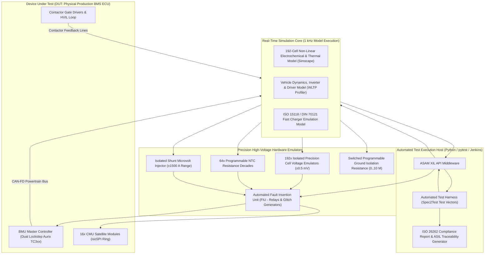
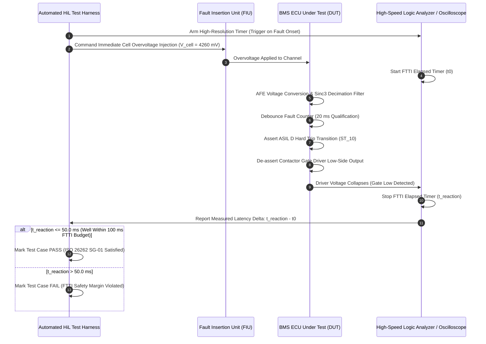

# BMS Software Requirements Specification: HiL Verification & Compliance Testing

**Document ID:** BMS-SRS-14-HIL-TEST  
**Version:** 2.4.0  
**Classification:** Automotive High-Voltage Powertrain (EV)  
**Verification & Compliance:** ISO 26262:2018 Part 4 & Part 5 (Verification & Validation), UN ECE R100.03 Rev 3, ASAM XIL / XCP  
**Test Environment:** Real-Time Hardware-in-the-Loop (HiL) Rig (dSPACE SCALEXIO / NI PXIe), 192-Channel Precision Cell Emulators, Automated Fault Insertion Units (FIU)

---

## 1. Scope & HiL Testbench Architecture

To satisfy ISO 26262 ASIL D verification mandates, all software safety mechanisms must undergo automated regression testing on a closed-loop Hardware-in-the-Loop (HiL) test system. The HiL hardware electrically emulates the physical 800V traction battery, cell electrochemistry, thermal thermodynamics, vehicle powertrain CAN-FD network, and high-voltage contactor loads.

---

## 2. FTTI Boundary Stress Timing Validation

---

## 3. Detailed Functional Requirements

### Requirement: BMS-REQ-VNV-1201
* **Title:** Automated Fault Insertion Unit (FIU) Test Suite Execution
* **ASIL Level:** ASIL D
* **Verification Method:** Test (HiL Automated Test Runner Script)
* **Traceability:** ISO 26262-4:2018 Clause 8.4; ISO 26262-5:2018 Clause 10.4
* **Inputs:**
  * `FIU_Channel_Matrix` (Data Type: `uint16_t`, Target Sense Wire / CAN Line)
  * `FIU_Fault_Type` (Data Type: `enum`, Values: `{OPEN_CIRCUIT, SHORT_TO_GND, SHORT_TO_12V, PIN_TO_PIN_SHORT}`)
* **Outputs:**
  * `DUT_Response_DTC` (Data Type: `uint32_t`, Read via UDS Service `$19 $02`)
  * `DUT_State_Result` (Data Type: `uint8_t`, Unit: `enum`, Source: CAN-FD `0x100`)
  * `Test_Case_Verdict` (Data Type: `enum`, Values: `{PASS, FAIL, INCONCLUSIVE}`)
* **Timing & Debounce:** Test execution cycle: Automated sequence with $1000\text{ ms}$ dwell per test step.
* **Description:**  
  The HiL test harness shall execute an automated fault injection verification campaign across all physical interface pins of the BMS:
  1. For every individual cell voltage tap ($1..192$):
     * The FIU shall inject an open-circuit fault.
     * The harness shall verify that the BMS flags `DTC 0x9A0201` within $\le 1200\text{ ms}$ and identifies the exact channel index.
     * The harness shall release the fault, verify healing within calibrated duration, and clear DTCs.
  2. For the dual-redundant current shunt sensor:
     * The FIU shall disconnect the SPI clock line.
     * The harness shall verify immediate bumpless switchover to the secondary Hall-effect transducer within $\le 10\text{ ms}$.
  3. Every test execution must yield an automated JUnit XML / Allure test report linking the requirement ID to the oscilloscope waveform artifact.
* **Rationale:** Hardware fault injection proves the diagnostic detection and failure handling software blocks execute correctly under true physical failure conditions.
* **Acceptance Criteria:**  
  100% of the 192 open-wire fault injection test runs must pass without human intervention, logging zero false positives on neighboring channels.

---

### Requirement: BMS-REQ-VNV-1202
* **Title:** ISO 26262 Fault Tolerant Time Interval (FTTI) Boundary Stress Rig
* **ASIL Level:** ASIL D
* **Verification Method:** Test (HiL Sub-Millisecond Oscilloscope Time Tagging)
* **Traceability:** ISO 26262-4:2018 Clause 6.4.7; ISO 26262-5:2018 Clause 7.4
* **Inputs:**
  * `Stimulus_Injection_Timestamp` (Data Type: `uint64_t`, Unit: `microseconds`, Source: HiL Timebase)
  * `Contactor_Gate_Trip_Timestamp` (Data Type: `uint64_t`, Unit: `microseconds`, Source: Digital Logic Probe)
  * `Target_Safety_Goal` (Data Type: `enum`, Values: `{SG_01, SG_02, SG_03, SG_04, SG_05}`)
* **Outputs:**
  * `Measured_FTTI_Latency_us` (Data Type: `uint32_t`, Unit: `us`, Destination: Verification Report)
  * `Safety_Margin_Percent` (Data Type: `uint16_t`, Unit: `0.01 %`, Range: `0..10000`, Destination: Safety File)
* **Timing & Debounce:** Timing resolution: $\le 1.0\,\mu\text{s}$.
* **Description:**  
  The HiL test system shall quantitatively measure the total time elapsed between the onset of a hazardous condition and the physical realization of the safe state:
  $$\Delta t_{\text{reaction}} = t_{\text{safe\_state}} - t_{\text{fault\_applied}}$$
  $$\text{Safety Margin} = \frac{\text{FTTI}_{\text{allocated}} - \Delta t_{\text{reaction}}}{\text{FTTI}_{\text{allocated}}} \times 100\%$$
  The test harness shall enforce the following strict pass/fail latency boundaries:
  * **SG-01 (Cell Overvoltage Trip):** Measured $\Delta t \le 50.0\text{ ms}$ (against $100\text{ ms}$ FTTI budget; minimum $50\%$ safety margin).
  * **SG-03 (Thermal Runaway Multi-Sensor Trip):** Measured $\Delta t \le 25.0\text{ ms}$ (against $50\text{ ms}$ FTTI budget).
  * **SG-05 (Chassis Insulation Loss Trip):** Measured $\Delta t \le 120.0\text{ ms}$ (against $200\text{ ms}$ FTTI budget).  
  If any measured reaction time exceeds $80\%$ of the allocated FTTI budget under worst-case CPU utilization, flag test case as `FAIL (Safety Margin Depleted)`.
* **Rationale:** In safety-critical automotive systems, functional correctness is useless if the system takes too long to respond before an irreversible physical hazard occurs.
* **Acceptance Criteria:**  
  Over 500 consecutive overvoltage stress test repetitions, maximum measured reaction time must remain strictly $\le 50.0\text{ ms}$ with standard deviation $\sigma \le 1.5\text{ ms}$.

---

### Requirement: BMS-REQ-VNV-1203
* **Title:** Automated isoSPI Ring Communication Degradation & Break Verification
* **ASIL Level:** ASIL D
* **Verification Method:** Test (HiL Injected Physical Wire Cut in Daisy-Chain Harness)
* **Traceability:** ISO 26262-5:2018 Clause 8; UN ECE R100.03
* **Inputs:**
  * `Ring_Break_Location` (Data Type: `uint8_t`, Values: `{BETWEEN_CMU_04_05, BETWEEN_CMU_08_09, BETWEEN_CMU_15_16}`)
  * `DUT_isoSPI_Mode` (Data Type: `enum`, Values: `{SINGLE_ENDED, DUAL_RING_REDUNDANT}`)
* **Outputs:**
  * `Telemetry_Loss_Duration_ms` (Data Type: `uint16_t`, Unit: `ms`, Destination: Test Report)
  * `Ring_Reconfiguration_Success` (Data Type: `boolean`, Unit: `bool`, Destination: Test Report)
* **Timing & Debounce:** Reversal switchover latency: $\le 10\text{ ms}$. Data recovery: within 1 frame ($10\text{ ms}$).
* **Description:**  
  The HiL system shall verify the fault-tolerant ring daisy-chain architecture connecting the 16 CMU satellites:
  1. While the battery is operating under nominal traction drive load, the FIU shall physically sever both differential leads of the primary isoSPI Channel A between CMU-08 and CMU-09.
  2. The software shall detect frame timeout or CRC failure, reverse transceiver direction, and interrogate CMU satellites $09..16$ via secondary Channel B within $\le 10\text{ ms}$.
  3. The test harness shall confirm that:
     * Zero cell voltage telemetry frames are lost for longer than $20\text{ ms}$.
     * State of Charge estimation continues without interruption.
     * The BMS logs advisory DTC `0x9A0E01` (isoSPI Ring Redundancy Mode Active) without entering emergency contactor trip.
* **Rationale:** Single harness damage or connector pin oxidation must not leave half the battery pack unmonitored or cause sudden vehicle stall on the road.
* **Acceptance Criteria:**  
  Severing isoSPI Channel A must result in seamless dual-ended communication recovery within $\le 10\text{ ms}$, preserving uninterrupted cell voltage supervision.

---

### Requirement: BMS-REQ-VNV-1204
* **Title:** Contactor Mechanical Wear & Inrush Current Waveform Compliance
* **ASIL Level:** ASIL C
* **Verification Method:** Test (HiL High-Speed Current Shunt Transient Capture)
* **Traceability:** ISO 26262-4
* **Inputs:**
  * `Emulated_Inverter_Capacitance` (Data Type: `uint16_t`, Value: `1200 uF`, Source: Real-Time Load)
  * `Emulated_Precharge_Resistance` (Data Type: `uint16_t`, Value: `33 Ohm`, Source: Real-Time Load)
* **Outputs:**
  * `Captured_Inrush_Peak_Current` (Data Type: `int32_t`, Unit: `mA`, Range: `0..100000`, Destination: Test Report)
  * `Contactor_Closure_Delta_V` (Data Type: `uint16_t`, Unit: `mV`, Destination: Test Report)
* **Timing & Debounce:** Waveform sampling rate: $100\text{ kHz}$ ($10\,\mu\text{s}$ resolution).
* **Description:**  
  The HiL test rig shall verify contactor sequencing and current inrush waveforms across 100 consecutive automated key-on/key-off cycles:
  1. The test harness shall record high-resolution current and voltage traces during precharge completion.
  2. For every cycle, the harness shall measure:
     * Potential difference across Main Positive contactor $K_1$ at the exact instant of closure command:
       $$\Delta V_{\text{closure}} \le 10.0\text{ V}$$
     * Peak inrush current surge through $K_1$:
       $$I_{\text{inrush,peak}} \le 30.0\text{ A}$$
  3. If $\Delta V_{\text{closure}} > 10.0\text{ V}$ or $I_{\text{inrush,peak}} > 30.0\text{ A}$ on any single iteration, flag the test case as `FAIL (Precharge Sequencing Out of Tolerance)`.
* **Rationale:** Verifies that firmware variations or CPU task jitter never compromise precharge accuracy or degrade contactor lifetime.
* **Acceptance Criteria:**  
  All 100 cycles must show closure $\Delta V \le 8.5\text{ V}$ and peak inrush current $\le 25.0\text{ A}$.

---

### Requirement: BMS-REQ-VNV-1205
* **Title:** Automated Regression Test Report Generation & ASIL Traceability
* **ASIL Level:** ASIL D
* **Verification Method:** Inspection & Audit
* **Traceability:** ISO 26262-8:2018 Clause 9 (Verification)
* **Inputs:**
  * `Test_Execution_Results_Database` (Source: Automated Test Harness SQLite / PostgreSQL Store)
* **Outputs:**
  * `Traceability_Coverage_Matrix_HTML` (Destination: CI/CD Build Artifacts)
  * `ASIL_D_Verification_Signoff_PDF` (Destination: Safety Case Documentation)
* **Timing & Debounce:** Generated automatically at the conclusion of each nightly regression build.
* **Description:**  
  The automated testing framework shall parse the requirements specification files (`01_` to `14_`) and map each requirement ID (`BMS-REQ-...`) to its corresponding test execution vectors:
  1. The report generator shall compute:
     $$\text{Requirement Coverage} = \frac{\text{Requirements with Passing Tests}}{\text{Total Specified Requirements}} \times 100\%$$
  2. For ASIL D requirements, the generator shall enforce:
     * $100\%$ requirement coverage.
     * $100\%$ boundary value test coverage.
     * $100\%$ fault injection coverage.
  3. The resulting sign-off report shall document: Requirement ID, Document ID, Test Case ID, Execution Status, Measured FTTI margins, and links to raw oscilloscope/CAN log files.
* **Rationale:** Provides unequivocal, audit-ready evidence for regulatory homologation bodies (TÜV, VCA, NHTSA) that every software safety requirement is verified.
* **Acceptance Criteria:**  
  The automated CI/CD pipeline must fail the build if any requirement from `01_` through `14_` lacks a passing automated test verification case.

