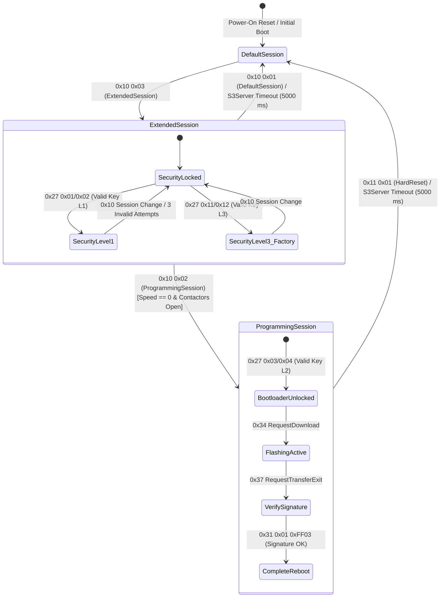
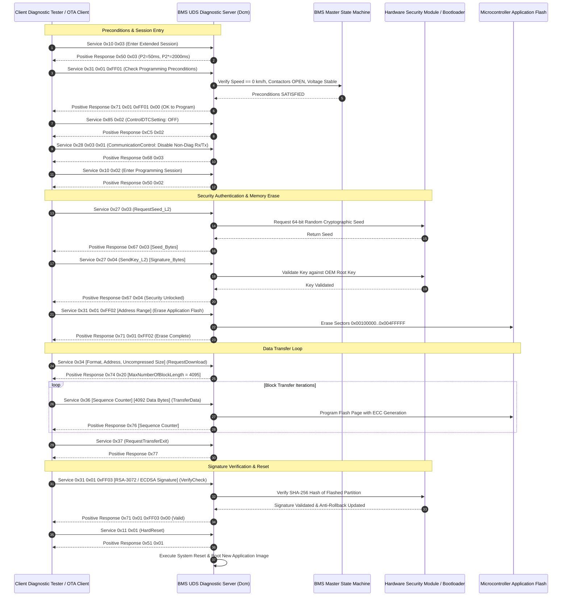
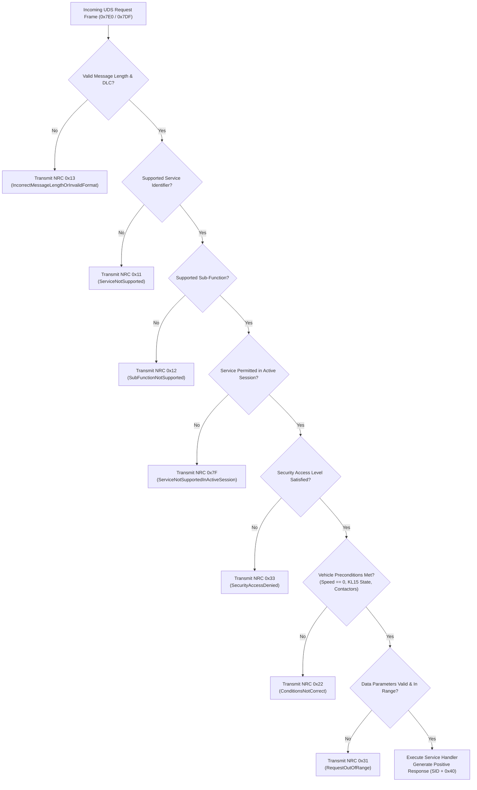

# BMS Software Requirements Specification: UDS Diagnostic Services & ECU Reprogramming

**Document ID:** BMS-SRS-15-UDS-DIAG  
**Version:** 2.4.0  
**Classification:** Automotive High-Voltage Powertrain (EV)  
**Diagnostic Compliance:** ISO 14229-1:2020 (UDS), ISO 14229-2:2021 (Session & Timing), ISO 15765-2 (DoCAN Transport Layer), ISO 11898-1 (CAN-FD), AUTOSAR Classic R20-11 Dcm / Dem  
**Addressing:** Physical Request ID `0x7E0`, Functional Broadcast ID `0x7DF`, Physical Response ID `0x7E8`

---

## 1. Scope & Diagnostic Architecture Overview

The Unified Diagnostic Services (UDS) software module implements the server side of the ISO 14229-1 standard on the Battery Management Unit (BMU Master). It provides dealership service technicians, manufacturing assembly lines, and over-the-air (OTA) update systems with standardized interfaces to:
1. Inspect live battery parameters, cell voltage spreads, and thermodynamic telemetry.
2. Read and clear Diagnostic Trouble Codes (DTCs), fault snapshot records (Freeze Frames), and extended life counters.
3. Perform end-of-line (EOL) actuator functional tests (e.g., contactor cycling, insulation self-test, bleed balancing checkout).
4. Securely reprogram application firmware, calibration datasets, and battery passport certificates via bootloader download.

---

## 2. Bootloader Flash Reprogramming Sequence

---

## 3. Negative Response Code (NRC) Decision Pipeline

---

## 4. Detailed Functional Requirements

### Requirement: BMS-REQ-UDS-1301
* **Title:** Diagnostic Session Management ($0x10) and S3Server Timeout Supervisor
* **ASIL Level:** ASIL B
* **Verification Method:** Test (HiL Automated Session Timer Inspection)
* **Traceability:** ISO 14229-1:2020 Clause 9.2; ISO 14229-2:2021
* **Inputs:**
  * `UDS_Request_Service_10` (Data Type: `uint8_t[2]`, Values: `{0x10, SubFunction}`, Source: CAN-FD `0x7E0`)
  * `Vehicle_Speed` (Data Type: `uint16_t`, Unit: `0.1 km/h`, Source: ESP CAN-FD)
  * `BMS_Operational_State` (Data Type: `uint8_t`, Unit: `enum`, Source: FSM)
* **Outputs:**
  * `Active_Diagnostic_Session` (Data Type: `uint8_t`, Unit: `enum`, Values: `{DEFAULT_01, PROGRAMMING_02, EXTENDED_03}`, Destination: Dcm Core)
  * `P2_Server_Max_ms` (Data Type: `uint16_t`, Value: `50 ms`, Destination: Response Parameter)
  * `P2_Star_Server_Max_ms` (Data Type: `uint16_t`, Value: `2000 ms`, Destination: Response Parameter)
* **Timing & Debounce:** S3Server timeout duration: $5000\text{ ms} \pm 100\text{ ms}$. P2 response time: $\le 50\text{ ms}$.
* **Description:**  
  The BMS software shall govern diagnostic session transitions conforming to ISO 14229-1:
  1. Supported sub-functions:
     * `$01`: `defaultSession`
     * `$02`: `programmingSession`
     * `$03`: `extendedDiagnosticSession`
  2. **Transition Rules & Preconditions:**
     * Transition from `defaultSession` to `extendedDiagnosticSession` is permitted in all vehicle operating states.
     * Transition to `programmingSession` shall be rejected with `NRC 0x22` (ConditionsNotCorrect) if `Vehicle_Speed > 0.0 km/h` OR any high-voltage contactor is closed (`BMS_Operational_State == ST_04_DRIVE_READY` or `ST_06_DC_FAST_CHARGE`).
  3. **S3Server Watchdog:**
     * While in any non-default session (`$02` or `$03`), the BMS shall maintain an autonomous $5000\text{ ms}$ countdown timer.
     * The timer shall reload to $5000\text{ ms}$ upon the receipt of any valid diagnostic request or `TesterPresent ($3E)`.
     * If the timer expires without message reception, the BMS shall unconditionally revert to `defaultSession`, lock all security levels, and re-enable autonomous control.
  4. Response payload on success: `0x50 [SubFunction] 0x00 0x32 0x07 0xD0` ($P2 = 50\text{ ms}, P2^* = 2000\text{ ms}$).
* **Rationale:** Prevents technician tools or unseated cables from stranding the BMS in privileged testing sessions during subsequent highway vehicle operation.
* **Acceptance Criteria:**  
  1. Attempting to enter `programmingSession` while vehicle speed is $2.0\text{ km/h}$ must return Negative Response `0x7F 0x10 0x22`.  
  2. Reverting from `extendedDiagnosticSession` to `defaultSession` must occur precisely $5000\text{ ms} \pm 100\text{ ms}$ after cessation of tester frames.

---

### Requirement: BMS-REQ-UDS-1302
* **Title:** ECU Reset ($0x11) Execution and Contactor Power-Down Synchronization
* **ASIL Level:** ASIL D
* **Verification Method:** Test (HiL Automated Reset Waveform Capture)
* **Traceability:** ISO 14229-1:2020 Clause 9.3; ISO 26262-4
* **Inputs:**
  * `UDS_Request_Service_11` (Data Type: `uint8_t[2]`, Values: `{0x11, SubFunction}`, Source: CAN-FD `0x7E0`)
  * `Pack_Current_Validated` (Data Type: `int32_t`, Unit: `mA`, Source: Shunt)
  * `All_Contactors_Confirmed_Open` (Data Type: `boolean`, Unit: `bool`, Source: Contactor Driver Feedback)
* **Outputs:**
  * `UDS_Positive_Response_11` (Payload: `{0x51, SubFunction}`)
  * `Microcontroller_Reset_Trigger` (Data Type: `boolean`, Unit: `discrete`, Destination: SBC / Watchdog Reset Line)
* **Timing & Debounce:** Positive response transmitted prior to reset execution: $P2 \le 50\text{ ms}$. Graceful power-down delay: $100\text{ ms} \pm 10\text{ ms}$.
* **Description:**  
  The BMS software shall support ECU Reset Service `$11`:
  1. Supported sub-functions:
     * `$01`: `hardReset` (full hardware power-on reboot via SBC reset pin)
     * `$02`: `keyOffOnReset` (simulated ignition toggle sequence)
     * `$03`: `softReset` (restart of application core software tasks without reinitializing hardware peripheral registers)
  2. **Safety Sequencing:**
     * If high-voltage contactors are closed when Service `$11` is received:
       * If vehicle is stationary ($v \le 0.5\text{ km/h}$): Perform controlled current rampdown to $\le 5.0\text{ A}$, open contactors within $300\text{ ms}$, transmit positive response `0x51 [SubFunction]`, wait $100\text{ ms}$ for NVM buffer commit, and assert reset.
       * If vehicle is in motion ($v > 0.5\text{ km/h}$): Reject request immediately with `NRC 0x22` (ConditionsNotCorrect) to prevent unexpected loss of propulsion.
* **Rationale:** A microcontroller reset while conducting heavy traction current can cause contactors to drop violently without arc suppression or leave gate drivers in indeterminate floating states.
* **Acceptance Criteria:**  
  Service `$11 $01` received while contactors are closed and stationary must ramp current down, open contactors, commit NVM data, and reset within $\le 450\text{ ms}$.

---

### Requirement: BMS-REQ-UDS-1303
* **Title:** Fault Memory Clear ($0x14) and Permanent DTC Protection
* **ASIL Level:** ASIL C
* **Verification Method:** Test (HiL Clear Fault Routine Verification via CANoe.DiVa)
* **Traceability:** ISO 14229-1:2020 Clause 11.2; SAE J1979-2 (OBD-on-UDS)
* **Inputs:**
  * `UDS_Request_Service_14` (Payload: `{0x14, GroupByte1, GroupByte2, GroupByte3}`, Source: CAN-FD `0x7E0`)
  * `Active_Diagnostic_Session` (Data Type: `uint8_t`, Unit: `enum`, Source: Dcm)
  * `Security_Level_Unlocked` (Data Type: `boolean`, Unit: `bool`, Source: Dcm)
* **Outputs:**
  * `Dem_Clear_Event_Command` (Destination: AUTOSAR Dem)
  * `UDS_Response_14` (Payload: `{0x54}`)
* **Timing & Debounce:** Processing latency: $\le 100\text{ ms}$ (returns `NRC 0x78` pending response if non-volatile flash sector erase requires $> 50\text{ ms}$).
* **Description:**  
  The BMS software shall process requests to clear diagnostic information:
  1. Supported group masks:
     * `0xFFFFFF`: Clear all confirmed and pending DTCs across all subsystems.
     * `0x9A0000`: Clear all High-Voltage Battery Management specific DTCs.
  2. **Access Control:**
     * Clearing DTCs is prohibited in `defaultSession`; return `NRC 0x7F` (ServiceNotSupportedInActiveSession).
     * Must require `extendedDiagnosticSession` and authenticated `SecurityLevel1` or higher; if locked, return `NRC 0x33` (SecurityAccessDenied).
  3. **Permanent DTC Immunity:**
     * Active ASIL D catastrophic faults (e.g., `0x9A0906` Thermal Runaway Multi-Sensor Trip, `0x9A0610` Contactor Weld Confirmed) are marked **NON-ERASABLE**.
     * When Service `$14` is executed, standard fault records and freeze frames shall be cleared, but non-erasable permanent DTC records shall remain locked in write-protected Flash until cleared via dedicated OEM Engineering Routine `$31` with cryptographic authorization.
* **Rationale:** Preserves critical forensic evidence following severe battery safety incidents, preventing unauthorized erasure prior to official accident investigation.
* **Acceptance Criteria:**  
  Executing Service `$14 0xFF 0xFF 0xFF` on a simulated welded contactor fault must return positive response `0x54` for standard faults, but reading Service `$19 $02` immediately after must prove `0x9A0610` remains active.

---

### Requirement: BMS-REQ-UDS-1304
* **Title:** DTC Status Mask Reporting ($0x19) and Snapshot / Extended Data Parsing
* **ASIL Level:** ASIL B
* **Verification Method:** Test (HiL Automated Service 0x19 Conformance Test Suite)
* **Traceability:** ISO 14229-1:2020 Clause 11.3; SAE J2012-DA
* **Inputs:**
  * `UDS_Request_Service_19` (Payload: `{0x19, SubFunction, ...}`, Source: CAN-FD `0x7E0`)
* **Outputs:**
  * `DTC_Status_Availability_Mask` (Value: `0xFF`, Supported: Bits 0..7)
  * `UDS_Response_19` (Payload containing matching DTC records and snapshot buffers)
* **Timing & Debounce:** Response time: $\le 50\text{ ms}$ for sub-functions `$01`, `$02`, and `$0A`; $\le 100\text{ ms}$ for `$04` and `$06`.
* **Description:**  
  The BMS shall implement UDS Service `$19` with support for the following sub-functions:
  * **Sub-Function `$01` (`reportNumberOfDTCByStatusMask`):** Returns the 1-byte DTC status availability mask (`0xFF`), the DTC format identifier (`0x04` for SAE J2012-DA), and 2-byte count of matching DTCs.
  * **Sub-Function `$02` (`reportDTCByStatusMask`):** Returns 4-byte records for all DTCs matching the requested mask:
    `[DTC_HighByte, DTC_MiddleByte, DTC_LowByte, StatusByte]`.
  * **Sub-Function `$04` (`reportDTCSnapshotRecordByDTCNumber`):** Returns the 64-byte atomic freeze-frame buffer recorded at the instant of fault confirmation:
    `[DTC_Bytes (3B), Status (1B), RecordNumber (1B=0x01), NumberOfIdentifiers (1B), DID_0x1000..0x1005 Data Blocks]`.
  * **Sub-Function `$06` (`reportDTCExtendedDataRecordByDTCNumber`):** Returns operational fault history metrics:
    * Record `$01` (Fault Aging Counter): Cycles since last failed test ($0..255$).
    * Record `$02` (Fault Occurrence Counter): Cumulative count of failure events ($0..65535$).
    * Record `$03` (Unlearning Counter): Remaining consecutive passed cycles before automatic DTC healing.
  * **Sub-Function `$0A` (`reportSupportedDTC`):** Returns all 14 supported battery diagnostic DTCs with their current status bytes.
* **Rationale:** Provides comprehensive, standards-compliant fault introspection for vehicle diagnostic scanners and fleet telematics.
* **Acceptance Criteria:**  
  Requesting Service `$19 $04 0x9A 0x01 0x13 0x01` following an injected HVIL open fault must return the complete freeze-frame record with matching pack voltage, current, and timestamp.

---

### Requirement: BMS-REQ-UDS-1305
* **Title:** Telemetry DID Read Services ($0x22) & Block Cell Serialization
* **ASIL Level:** ASIL B
* **Verification Method:** Test (HiL Automated DID Sweep via CAN-FD)
* **Traceability:** ISO 14229-1:2020 Clause 10.2; ISO 14229-2
* **Inputs:**
  * `UDS_Request_Service_22` (Payload: `{0x22, DID_HighByte, DID_LowByte}`, Source: CAN-FD `0x7E0`)
* **Outputs:**
  * `UDS_Positive_Response_22` (Payload: `{0x62, DID_HighByte, DID_LowByte, DataBytes...}`)
* **Timing & Debounce:** Multi-frame ISO-TP transmission (ISO 15765-2) with Separation Time ($ST_{\text{min}} = 0\text{ ms}$, Block Size $BS = 8$). Max latency: $\le 80\text{ ms}$ for 384-byte block.
* **Description:**  
  The BMS software shall support reading battery telemetry Data Identifiers (DIDs) via Service `$22`:
  
  | DID Hex | Data Content | Length | Resolution / Scaling | Access Control |
  | :--- | :--- | :--- | :--- | :--- |
  | `0x1000` | Pack State, Contactor Status, Active Fault Level | 8 Bytes | Bitfield & Enums | All Sessions |
  | `0x1001` | Pack Bus Voltage, DC-Link Voltage, Pack Current | 10 Bytes | $10\text{ mV/bit}$, $10\text{ mA/bit}$ | All Sessions |
  | `0x1002` | Pack SOC, Min Cell SOC, Max Cell SOC, Variance | 8 Bytes | $0.01\%/\text{bit}$ | All Sessions |
  | `0x1003` | Capacity $SOH_C$, Resistance $SOH_R$, Cycle Count | 8 Bytes | $0.01\%/\text{bit}$, $1\text{ cycle}$ | All Sessions |
  | `0x1004` | Min/Max/Avg Temp, Max Gradient, Hotspot Cell IDs | 10 Bytes | $0.1^\circ\text{C/bit}$ | All Sessions |
  | `0x1005` | Positive / Negative / Equivalent Isolation Resistance | 8 Bytes | $1\text{ k}\Omega/\text{bit}$, $1\,\Omega/\text{V}$ | All Sessions |
  | `0x1010` | Cell Voltages 1..16 (CMU 01 & 02 Block) | 32 Bytes | $1\text{ mV/bit}$ ($0..5000\text{ mV}$) | Extended Session |
  | `0x1011`..`0x101B` | Cell Voltages 17..192 (Remaining CMU Blocks) | 32 Bytes each| $1\text{ mV/bit}$ | Extended Session |
  | `0x1020` | Module Temperatures 1..32 (CMU 01..08 Sensors) | 32 Bytes | $0.1^\circ\text{C/bit}$ offset $-40^\circ\text{C}$| Extended Session |
  | `0x1021` | Module Temperatures 33..64 (CMU 09..16 Sensors)| 32 Bytes | $0.1^\circ\text{C/bit}$ offset $-40^\circ\text{C}$| Extended Session |
  | `0xF188` | Active BMS Application Software Version String | 16 Bytes | ASCII (`"BMS_APP_V2.4.0\0"`) | All Sessions |
  | `0xF190` | Vehicle Identification Number (VIN) | 17 Bytes | ASCII (17 Characters) | All Sessions |
* **Rationale:** Modular block DID access allows workshop diagnostic scan tools to interrogate specific battery modules without causing CAN-FD bus congestion.
* **Acceptance Criteria:**  
  Requesting DID `0x1002` must return pack and extreme cell SOC values with $0.01\%$ resolution within $\le 50\text{ ms}$.

---

### Requirement: BMS-REQ-UDS-1306
* **Title:** Multi-Level Security Access ($0x27) with Non-Volatile Anti-Brute-Force Penalty
* **ASIL Level:** ASIL B
* **Verification Method:** Test (HiL Automated Security Challenge-Response Script)
* **Traceability:** ISO 14229-1:2020 Clause 9.4; UNECE R155
* **Inputs:**
  * `UDS_Request_Service_27` (Payload: `{0x27, SubFunction, [KeyBytes]}`, Source: CAN-FD `0x7E0`)
* **Outputs:**
  * `Security_Access_State` (Values: `{LOCKED, LEVEL_1_UNLOCKED, LEVEL_2_UNLOCKED, LEVEL_3_UNLOCKED}`)
  * `UDS_Response_27` (Positive `{0x67, SubFunction, Seed}` or NRC `{0x35, 0x36, 0x37}`)
* **Timing & Debounce:** Seed validity window: $5000\text{ ms}$. Lockout penalty duration: $600.0\text{ s} \pm 1.0\text{ s}$ ($10\text{ minutes}$).
* **Description:**  
  The BMS shall enforce a cryptographic three-tier security access hierarchy:
  1. Supported security levels:
     * **Level 1 (Workshop Service):** Seed sub-function `$01`, Key sub-function `$02`. Unlocks clearing DTCs, reading individual cell voltage DIDs, and running non-destructive routine controls.
     * **Level 2 (Bootloader Reprogramming):** Seed sub-function `$03`, Key sub-function `$04`. Unlocks Flash erase, data download, and firmware signature commit.
     * **Level 3 (Manufacturing EOL Plant):** Seed sub-function `$11`, Key sub-function `$12`. Unlocks manual contactor override and calibration parameter writes.
  2. **Cryptographic Algorithm:**
     * The BMS Hardware Security Module (HSM) shall generate a 64-bit cryptographic pseudorandom seed using its hardware True Random Number Generator (TRNG).
     * The client key must be computed using AES-128 CMAC with the pre-shared secret key corresponding to the requested level.
  3. **Brute-Force Penalty Enforcement:**
     * If three consecutive incorrect keys are submitted, lock Service `$27` for $600\text{ s}$.
     * While locked, all Service `$27` requests return `NRC 0x37` (RequiredTimeDelayNotExpired).
     * The lockout countdown timer shall be committed to non-volatile Flash every $10\text{ s}$ and resumed across 12V battery power interruptions.
* **Rationale:** Strong cryptographic protection protects high-voltage safety configurations against unauthorized dealership tuning, intellectual property theft, and malicious cyber attacks.
* **Acceptance Criteria:**  
  1. Submitting the correct AES-128 CMAC key within 5000 ms must return positive response `0x67 $02` and unlock Level 1.  
  2. A power disconnection during an active lockout must not clear or reduce the remaining lockout time upon bootup.

---

### Requirement: BMS-REQ-UDS-1307
* **Title:** Parameter Configuration Write ($0x2E) and Session Access Gates
* **ASIL Level:** ASIL B
* **Verification Method:** Test (HiL WriteDID Compliance & Boundary Verification)
* **Traceability:** ISO 14229-1:2020 Clause 10.4
* **Inputs:**
  * `UDS_Request_Service_2E` (Payload: `{0x2E, DID_High, DID_Low, DataBytes...}`, Source: CAN-FD `0x7E0`)
* **Outputs:**
  * `UDS_Response_2E` (Positive `{0x6E, DID_High, DID_Low}` or NRC `{0x22, 0x31, 0x33, 0x7E}`)
* **Timing & Debounce:** Flash write and verification latency: $\le 120\text{ ms}$.
* **Description:**  
  The BMS software shall support writing calibrated parameters and vehicle metadata via Service `$2E`:
  * `DID 0xF190` (VIN Writing): 17-byte ASCII VIN. Permitted in `extendedDiagnosticSession` with `SecurityLevel3` unlocked.
  * `DID 0xF18C` (Pack Production Serial Number): 16-byte ASCII serial. Write-once in plant mode; locked thereafter.
  * `DID 0x2100` (Current Sensor Shunt Calibration Offset): 4-byte signed offset in $\mu\text{V}$. Valid range: $-5000\text{ uV} \le \text{offset} \le +5000\text{ uV}$.
  * `DID 0x2101` (Precharge Resistor Resistance Calibration): 2-byte value in $0.1\,\Omega$. Valid range: $250..400$ ($25.0\,\Omega$ to $40.0\,\Omega$).
  1. If any parameter value is outside its calibrated bounds, reject request with `NRC 0x31` (RequestOutOfRange).
  2. If vehicle speed is $> 0.0\text{ km/h}$, reject with `NRC 0x22` (ConditionsNotCorrect).
  3. If security access is not unlocked, reject with `NRC 0x33` (SecurityAccessDenied).
  4. Upon successful validation, the BMS shall write the new values into the non-volatile EEPROM emulation Flash sector and verify via readback CRC32.
* **Rationale:** Writing invalid calibration data (e.g., an incorrect shunt resistance) would corrupt SOC calculations and overcurrent thresholds.
* **Acceptance Criteria:**  
  Attempting to write a shunt offset of $+6000\,\mu\text{V}$ (exceeding $+5000\,\mu\text{V}$ bound) must return `NRC 0x31` without modifying non-volatile memory.

---

### Requirement: BMS-REQ-UDS-1308
* **Title:** Input/Output Control ($0x2F) with Safety Interlocks & Watchdog
* **ASIL Level:** ASIL C
* **Verification Method:** Test (HiL Contactor IO Control Override & Movement Invalidation)
* **Traceability:** ISO 14229-1:2020 Clause 12.2; ISO 26262-4
* **Inputs:**
  * `UDS_Request_Service_2F` (Payload: `{0x2F, DID_High, DID_Low, ControlOption, [State]}`, Source: CAN-FD `0x7E0`)
  * `Vehicle_Speed` (Data Type: `uint16_t`, Unit: `0.1 km/h`, Source: ESP)
  * `KL15_Ignition_State` (Data Type: `boolean`, Unit: `bool`, Source: Digital Input)
* **Outputs:**
  * `Hardware_Override_Signals` (Destination: Contactor Drivers, Pump Drivers, Bleed Resistors)
  * `UDS_Response_2F` (Positive `{0x6F, DID_High, DID_Low, ControlOption, State}`)
* **Timing & Debounce:** Control override timeout: Automatically revert to autonomous BMS control if tester fails to refresh within $5000\text{ ms} \pm 100\text{ ms}$.
* **Description:**  
  In `extendedDiagnosticSession` with `SecurityLevel3` unlocked, the BMS shall support hardware override via Service `$2F`:
  * **Supported ControlOptionRecord values:**
    * `$00`: `returnControlToECU` (release override, restore autonomous software control)
    * `$03`: `shortTermAdjustment` (force driver output to requested state)
  * **Controllable DIDs:**
    * `DID 0x3001` (Main Negative Contactor K2 Force State): `{0x00=OPEN, 0x01=CLOSED}`
    * `DID 0x3002` (Main Positive Contactor K1 Force State): `{0x00=OPEN, 0x01=CLOSED}`
    * `DID 0x3003` (Precharge Contactor K3 Force State): `{0x00=OPEN, 0x01=CLOSED}`
    * `DID 0x3004` (Battery Coolant Pump Manual PWM): `{0x00..0x64}` ($0\%$ to $100\%$)
  * **Mandatory Safety Interlocks:**
    1. Overriding contactors to `CLOSED` is permitted if and only if:
       * `Vehicle_Speed == 0.0 km/h`
       * Upstream and downstream bus voltages confirm zero-load conditions ($|I| \le 1.0\text{ A}$).
    2. If vehicle motion is detected (`Vehicle_Speed > 0.0 km/h`) OR ignition transitions to `KL15 == ON`, the BMS shall immediately abort all active `$2F` overrides, open all contactors, and return control to the autonomous state machine.
* **Rationale:** Allows automotive assembly plant technicians to cycle contactors and test coolant circuits without allowing hazardous overrides during public road operation.
* **Acceptance Criteria:**  
  A simulated vehicle speed change to $0.5\text{ km/h}$ during active manual contactor closure must immediately de-energize contactor coils and return `NRC 0x22`.

---

### Requirement: BMS-REQ-UDS-1309
* **Title:** High-Voltage Diagnostic Routine Controls ($0x31)
* **ASIL Level:** ASIL D
* **Verification Method:** Test (HiL Automated Routine Execution Suite)
* **Traceability:** ISO 14229-1:2020 Clause 12.3; ISO 26262-4
* **Inputs:**
  * `UDS_Request_Service_31` (Payload: `{0x31, SubFunction, RoutineID_High, RoutineID_Low, [Options]}`, Source: CAN-FD `0x7E0`)
* **Outputs:**
  * `UDS_Response_31` (Positive `{0x71, SubFunction, RoutineID_High, RoutineID_Low, RoutineStatus, [Results]}`)
* **Timing & Debounce:** Routine execution timeout: Max allowed execution duration specified per routine; returns `0x78` pending response if execution $> 50\text{ ms}$.
* **Description:**  
  The BMS shall execute safety-validated diagnostic routines via Service `$31` (Sub-function `$01` `startRoutine`, `$02` `stopRoutine`, `$03` `requestRoutineResults`):
  
  1. **Routine `0x0201` (Contactor Health & Welding Diagnostic Routine):**
     * Sequentially commands K2 CLOSED, measures voltage, commands K3 CLOSED, tracks $V_{\text{link}}$ slope, closes K1, verifies aux switches, then opens all and verifies complete voltage decay.
     * Duration: $800\text{ ms}$. Results byte returns: `{0x00=ALL_HEALTHY, 0x01=K1_WELD_SUSPECTED, 0x02=K2_WELD_SUSPECTED, 0x03=PRECHARGE_FAILED}`.
  2. **Routine `0x0202` (Chassis Insulation Monitor Self-Calibration Routine):**
     * Switches internal calibration resistors ($500\text{ k}\Omega$ to chassis) to verify insulation detection circuit accuracy.
     * Duration: $2500\text{ ms}$. Results byte returns measured calibration resistance in $k\Omega$.
  3. **Routine `0x0203` (Pyrofuse Squib Circuit Functional Checkout):**
     * Injects a $10.0\text{ mA}$ test current for $2.0\text{ ms}$ and computes loop impedance.
     * Duration: $10\text{ ms}$. Results byte returns squib resistance in $0.01\,\Omega$ ($170..250$ nominal).
  4. **Routine `0x0204` (Cell Passive Bleed Pulse Checkout):**
     * Concurrently activates all odd balancing channels for $1000\text{ ms}$ and checks that sense wire voltage drops by $\ge 2.0\text{ mV}$.
     * Duration: $1200\text{ ms}$. Results byte returns 24-byte bitmap of confirmed operational balancing channels.
* **Rationale:** Automated self-contained routines provide definitive pass/fail verification during dealership scheduled maintenance and end-of-line manufacturing inspection.
* **Acceptance Criteria:**  
  Routine `0x0203` must measure and return the simulated squib resistance within $\pm 0.05\,\Omega$ across repeated diagnostic executions.

---

### Requirement: BMS-REQ-UDS-1310
* **Title:** Flash Bootloader Reprogramming Flow ($0x34, $0x36, $0x37) & Signature Validation
* **ASIL Level:** ASIL D
* **Verification Method:** Test (HiL Full OTA Firmware Flash Cycle Automation)
* **Traceability:** ISO 14229-1:2020 Clauses 14.2, 14.4, 14.5; UNECE R156
* **Inputs:**
  * `Service_34_RequestDownload` (Payload: `{0x34, 0x00, 0x44, MemoryAddress(4B), MemorySize(4B)}`)
  * `Service_36_TransferData` (Payload: `{0x36, BlockSequenceCounter, DataBytes(up to 4092B)}`)
  * `Service_37_RequestTransferExit` (Payload: `{0x37}`)
  * `Routine_FF03_VerifySignature` (Payload: `{0x31, 0x01, 0xFF, 0x03, SignatureBytes(384B)}`)
* **Outputs:**
  * Positive UDS Responses: `0x74`, `0x76`, `0x77`, `0x71`
  * `Flash_Sector_Write_State` (Destination: Microcontroller Flash Controller)
* **Timing & Debounce:** Block transfer processing: $\le 15\text{ ms}$ per 4092-byte block. Flash page write: hardware-accelerated.
* **Description:**  
  In `programmingSession` with `SecurityLevel2` unlocked:
  1. **RequestDownload ($0x34):**
     * Validates that requested address is within application partition ($0x00100000$ to $0x004FFFFF$) and size does not exceed partition capacity ($4\text{ MB}$).
     * Returns `0x74 0x20 0x0F 0xFC` indicating maximum block length of $4092\text{ data bytes} + 3\text{ header bytes} = 4095\text{ bytes}$.
  2. **TransferData ($0x36):**
     * Enforces monotonically incrementing 1-byte `BlockSequenceCounter` starting at `$01`, incrementing to `$FF`, and wrapping to `$00`.
     * If counter sequence is out of order, reject with `NRC 0x73` (WrongBlockSequenceCounter) and abort flashing session.
     * Computes running SHA-256 hash across all incoming data bytes.
  3. **RequestTransferExit ($0x37):**
     * Terminates download phase; verifies that total transferred bytes match the size declared in Service `$34`. If mismatched, reject with `NRC 0x72` (GeneralProgrammingFailure).
  4. **Cryptographic Validation (Routine `$FF03`):**
     * Compares computed SHA-256 digest against the RSA-3072 / ECDSA P-256 signature provided by the client.
     * If valid: Update monotonic anti-rollback version counter in OTP/Flash and mark application partition as `BOOT_VALID`.
     * If invalid: Invalidate application partition header and leave ECU in bootloader mode.
* **Rationale:** Strict cryptographic verification during download prevents interrupted or corrupted flash images from bricking the ECU or operating with partial code.
* **Acceptance Criteria:**  
  Injecting a single out-of-order `BlockSequenceCounter` must abort the transfer with `NRC 0x73`, requiring a restart of the download sequence.

---

### Requirement: BMS-REQ-UDS-1311
* **Title:** Control DTC Setting ($0x85) & Communication Control ($0x28) Flashing Inhibits
* **ASIL Level:** ASIL B
* **Verification Method:** Test (HiL Bus Traffic & Diagnostic Mute Verification)
* **Traceability:** ISO 14229-1:2020 Clauses 9.5, 9.7
* **Inputs:**
  * `UDS_Request_Service_85` (Payload: `{0x85, DTCSettingType}`, Source: CAN-FD `0x7E0`)
  * `UDS_Request_Service_28` (Payload: `{0x28, ControlType, CommunicationType}`, Source: CAN-FD `0x7E0`)
* **Outputs:**
  * `DTC_Storage_Enable_State` (Data Type: `boolean`, Unit: `bool`, Destination: Dem Core)
  * `CAN_Cyclic_Tx_Enable_State` (Data Type: `boolean`, Unit: `bool`, Destination: Com Stack)
* **Timing & Debounce:** Reaction time: $\le 20\text{ ms}$. Auto-restore on session exit: immediate.
* **Description:**  
  To optimize CAN-FD bus bandwidth during software flashing and eliminate spurious DTCs caused by missing partner ECUs:
  1. **Service `$85` (ControlDTCSetting):**
     * Sub-function `$01` (`DTCSettingOn`): Normal fault recording enabled (`DTC_Storage_Enable_State = TRUE`).
     * Sub-function `$02` (`DTCSettingOff`): Inhibit fault storage in Dem memory (`DTC_Storage_Enable_State = FALSE`). Active safety fault reactions remain enforced, but no new DTCs are committed to non-volatile memory.
  2. **Service `$28` (CommunicationControl):**
     * Sub-function `$00` (`enableRxAndTx`): Normal cyclic transmission enabled.
     * Sub-function `$03` (`disableRxAndTxNormalCommunication`): Suppress all cyclic application telemetry frames (`0x100..0x131`), dedicating 100% of CAN-FD bandwidth to diagnostic flashing frames (`0x7E0/0x7E8`).
  3. **Safety Fallback:**
     * If the diagnostic session terminates, or if S3Server watchdog expires, the BMS shall unconditionally re-enable cyclic transmission (`Service $28 = 0x00`) and re-enable DTC storage (`Service $85 = 0x01`).
* **Rationale:** Without disabling cyclic traffic, flashing 4 MB of firmware over CAN-FD would take four times longer and generate thousands of false missing-message DTCs across the vehicle.
* **Acceptance Criteria:**  
  Asserting Service `$85 $02` followed by an injected sensor open fault must confirm zero new DTC entries added to Dem memory while the setting remains disabled.

---

### Requirement: BMS-REQ-UDS-1312
* **Title:** Standardized Negative Response Code (NRC) Compliance Engine
* **ASIL Level:** ASIL B
* **Verification Method:** Test (Automated CANoe.DiVa Negative Response Exhaustive Test Matrix)
* **Traceability:** ISO 14229-1:2020 Annex A; AUTOSAR Classic Dcm SWS
* **Inputs:**
  * Diagnostic Request Messages on Physical ID `0x7E0` and Functional ID `0x7DF`
* **Outputs:**
  * Negative Response Frames (Payload: `{0x7F, Rejected_SID, NRC_Hex_Code}`, Destination: CAN-FD `0x7E8`)
* **Timing & Debounce:** Negative response dispatch latency: $\le 50\text{ ms}$ ($P2_{\text{server}}$).
* **Description:**  
  The BMS UDS server shall enforce exact negative response code behavior according to the standardized priority hierarchy:
  
  | NRC Hex | Standardized Name | Evaluation Condition |
  | :--- | :--- | :--- |
  | `0x11` | `serviceNotSupported` | Requested SID is not implemented in the BMS diagnostic catalog. |
  | `0x12` | `subFunctionNotSupported` | Sub-function byte is not recognized for the requested SID. |
  | `0x13` | `incorrectMessageLengthOrInvalidFormat` | Received frame byte length does not match the exact expected length of the service. |
  | `0x22` | `conditionsNotCorrect` | Environmental precondition violated (e.g., $v > 0\text{ km/h}$, contactors closed, invalid battery state). |
  | `0x24` | `requestSequenceError` | Service received out of order (e.g., Service `$36 TransferData` before Service `$34 RequestDownload`). |
  | `0x31` | `requestOutOfRange` | DID, Routine ID, or data parameter value falls outside calibrated permissible bounds. |
  | `0x33` | `securityAccessDenied` | Service or DID requires security unlock, but active security state is locked. |
  | `0x35` | `invalidKey` | Submitted security key does not match expected cryptographic challenge response. |
  | `0x36` | `exceededNumberOfAttempts` | Three consecutive invalid keys submitted; attempts locked. |
  | `0x37` | `requiredTimeDelayNotExpired` | Request received while 600-second anti-brute-force penalty timer is active. |
  | `0x72` | `generalProgrammingFailure` | Flash hardware write error or block checksum mismatch during download. |
  | `0x73` | `wrongBlockSequenceCounter` | Block sequence counter in Service `$36` is out of order. |
  | `0x78` | `requestCorrectlyReceived-ResponsePending` | Execution takes $> 50\text{ ms}$; response pending sent every $1500\text{ ms}$ up to $P2^* = 2000\text{ ms}$. |
  | `0x7E` | `subFunctionNotSupportedInActiveSession` | Sub-function valid in other sessions, but prohibited in current active session. |
  | `0x7F` | `serviceNotSupportedInActiveSession` | Service valid in other sessions, but prohibited in current active session. |
* **Rationale:** Strict adherence to ISO 14229-1 NRC hierarchy ensures universal compatibility with global automotive diagnostic testers and factory flashing tools.
* **Acceptance Criteria:**  
  Exhaustive CANoe.DiVa diagnostic test suite must pass 100% of negative test cases, verifying that every invalid request triggers the exact mandated NRC code within $\le 50\text{ ms}$.

