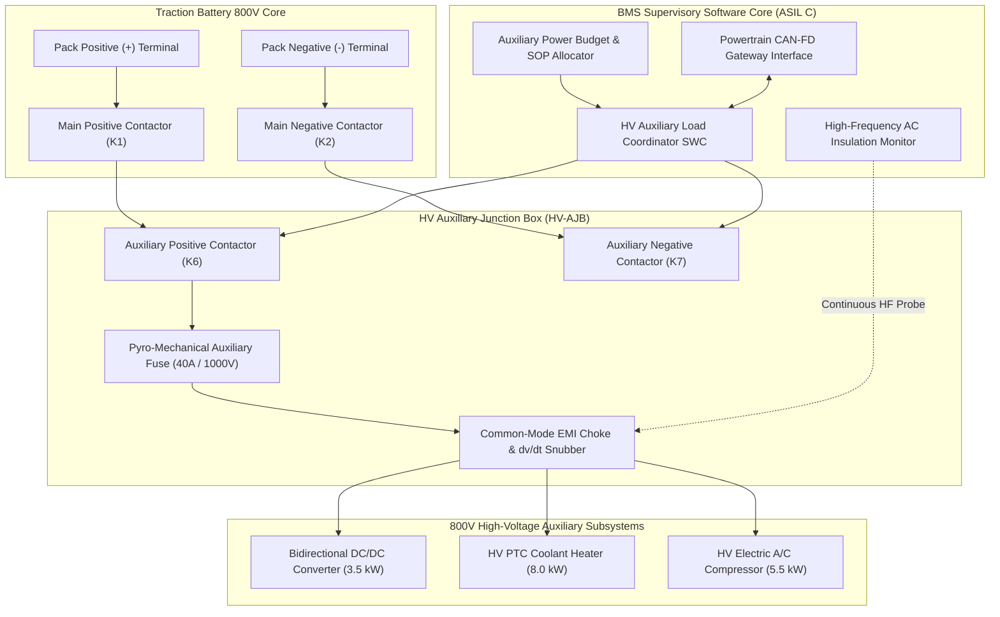
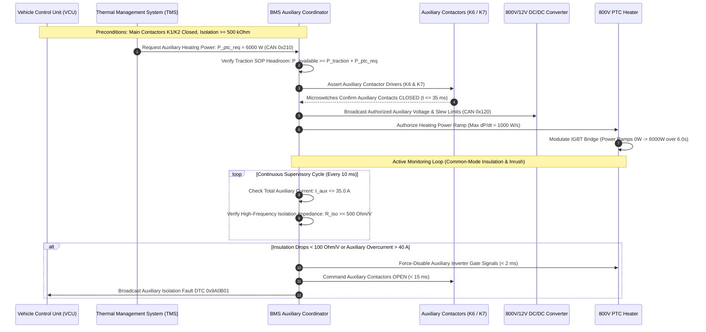

# BMS Software Requirements Specification: High-Voltage Auxiliary Loads & DC/DC Management

**Document ID:** BMS-SRS-16-AUX-DCDC  
**Version:** 2.4.0  
**Classification:** Automotive High-Voltage Powertrain (EV)  
**Safety & Electrical Compliance:** ISO 26262:2018 (ASIL C / ASIL D), UN ECE R100.03, ISO 6469-3:2021  
**Target Hardware:** Bidirectional 800V/12V DC/DC Converter ($3.5\text{ kW}$), High-Voltage PTC Cabin Coolant Heater ($8.0\text{ kW}$), Electric A/C Scroll Compressor ($5.5\text{ kW}$), High-Voltage Auxiliary Contactor/Fuse Box

---

## 1. Scope & Auxiliary High-Voltage Architecture

The High-Voltage Battery pack must supply and supervise auxiliary high-voltage loads in addition to the primary traction inverter. The auxiliary distribution network operates at $800\text{V}$ nominal and branches to:
1. **Bidirectional Low-Voltage DC/DC Converter (DCDC):** Converts $800\text{V}$ traction power to $13.8\text{V} - 14.4\text{V}$ for 12V auxiliary battery charging ($3.5\text{ kW}$ continuous); supports emergency reverse precharge ($12\text{V}$ to $800\text{V}$) under dead-battery conditions.
2. **High-Voltage Positive Temperature Coefficient (PTC) Coolant Heater:** $8.0\text{ kW}$ resistive heater used for battery pack thermal preconditioning in cold weather and passenger cabin heating.
3. **Electric Air Conditioning Compressor (e-Compressor):** $5.5\text{ kW}$ brushless DC scroll compressor for thermal chiller refrigerant circulation.

---

## 2. Auxiliary High-Voltage Power Authorization Sequence

---

## 3. Detailed Functional Requirements

### Requirement: BMS-REQ-AUX-1401
* **Title:** Auxiliary High-Voltage Power Authorization & Interlock Permissive
* **ASIL Level:** ASIL C
* **Verification Method:** Test
* **Traceability:** ISO 26262-4:2018; ISO 6469-3:2021 Clause 6.2
* **Inputs:**
  * `BMS_Operational_State` (Data Type: `uint8_t`, Unit: `enum`, Values: `ST_01..ST_10`, Source: FSM)
  * `Pack_Isolation_Resistance` (Data Type: `uint32_t`, Unit: `kOhm`, Range: `0..10000`, Source: Isolation Monitor)
  * `VCU_Aux_HV_Enable_Request` (Data Type: `boolean`, Unit: `bool`, Values: `{FALSE, TRUE}`, Source: CAN-FD `0x0C0`)
  * `Aux_Contactor_Feedback_K6` (Data Type: `boolean`, Unit: `discrete`, Values: `{OPEN, CLOSED}`, Source: Microswitch Pin)
  * `Aux_Contactor_Feedback_K7` (Data Type: `boolean`, Unit: `discrete`, Values: `{OPEN, CLOSED}`, Source: Microswitch Pin)
  * `Main_Contactors_Closed_Status` (Data Type: `boolean`, Unit: `bool`, Source: Contactor State Manager)
* **Outputs:**
  * `Cmd_Contactor_Aux_Pos_K6` (Data Type: `boolean`, Unit: `discrete`, Destination: High-Side Driver K6)
  * `Cmd_Contactor_Aux_Neg_K7` (Data Type: `boolean`, Unit: `discrete`, Destination: Low-Side Driver K7)
  * `Aux_HV_Bus_Energized_Status` (Data Type: `boolean`, Unit: `bool`, Destination: CAN-FD `0x100`)
  * `DTC_Aux_Contactor_Engagement_Failure` (Data Type: `uint32_t`, Value: `0x9A0B10`, Destination: Dem)
* **Timing & Debounce:** Supervisory cycle: $10\text{ ms} \pm 0.5\text{ ms}$. Contactor engagement confirmation timeout: $40\text{ ms}$. DTC qualification: $\le 50\text{ ms}$.
* **Description:**  
  The BMS software shall authorize auxiliary high-voltage branch energization if and only if main traction bus precharge is complete and high-voltage isolation is verified nominal:
  1. Upon receiving `VCU_Aux_HV_Enable_Request == TRUE`:
     * If `Pack_Isolation_Resistance >= 500 kOhm` AND `BMS_Operational_State` is within authorized operating states (`ST_04_DRIVE_READY`, `ST_05_AC_CHARGE`, or `ST_06_DC_FAST_CHARGE`) AND `Main_Contactors_Closed_Status == TRUE`:
       * Assert `Cmd_Contactor_Aux_Neg_K7 = TRUE` (close K7 negative).
       * Wait $15\text{ ms} \pm 1.0\text{ ms}$ for contact bounce stabilization.
       * Assert `Cmd_Contactor_Aux_Pos_K6 = TRUE` (close K6 positive).
  2. If `Aux_Contactor_Feedback_K6` or `K7` fails to confirm `CLOSED` within $40\text{ ms}$ of command:
     * Immediately de-assert drivers K6 and K7 (`Cmd = FALSE`).
     * Set `Aux_HV_Bus_Energized_Status = FALSE`.
     * Qualify DTC `0x9A0B10` within $\le 50\text{ ms}$.
  3. If `Pack_Isolation_Resistance < 200 kOhm`, all auxiliary contactor closure requests shall be rejected with `Cmd = FALSE`.
* **Rationale:** Auxiliary HV branches contain multi-drop harnesses; energizing without prior isolation verification risks electrical arcing to vehicle chassis.
* **Acceptance Criteria:**  
  1. Auxiliary contactor commands K7 and K6 shall only be asserted when `Pack_Isolation_Resistance` is $\ge 500\text{ k}\Omega$ and the main traction bus is energized in an authorized operating state.
  2. When closure is authorized, positive contactor K6 command shall lag negative contactor K7 command by $15.0\text{ ms} \pm 1.5\text{ ms}$.
  3. If either auxiliary contactor feedback switch fails to confirm `CLOSED` within $40\text{ ms}$ of actuation, both auxiliary contactor commands shall de-assert within $\le 10\text{ ms}$ and DTC `0x9A0B10` shall be qualified within $\le 50\text{ ms}$.

---

### Requirement: BMS-REQ-AUX-1402
* **Title:** DC/DC Bidirectional Converter Power Allocation & Slew-Rate Envelope
* **ASIL Level:** ASIL C
* **Verification Method:** Test
* **Traceability:** ISO 26262-4; SAE J1798
* **Inputs:**
  * `Pack_Voltage_Bus` (Data Type: `uint32_t`, Unit: `mV`, Range: `600000..900000`, Source: Terminal Sensor)
  * `BMS_Max_Discharge_Power_Cont` (Data Type: `uint16_t`, Unit: `0.1 kW`, Range: `0..5000`, Source: SOP Engine)
  * `Traction_Inverter_Actual_Power` (Data Type: `int16_t`, Unit: `0.1 kW`, Range: `-3000..5000`, Source: Inverter CAN-FD `0x0A0`)
  * `DCDC_Requested_Power` (Data Type: `uint16_t`, Unit: `10 W`, Range: `0..400`, Source: DCDC CAN-FD `0x120`)
  * `KL30_Voltage` (Data Type: `uint16_t`, Unit: `mV`, Range: `0..18000`, Source: Low-Voltage ADC)
* **Outputs:**
  * `DCDC_Authorized_Power_Limit` (Data Type: `uint16_t`, Unit: `10 W`, Range: `0..400`, Destination: DCDC CAN-FD `0x121`)
  * `DCDC_Power_Slew_Rate_Clamp` (Data Type: `uint16_t`, Unit: `W/s`, Value: `5000`, Destination: DCDC CAN-FD `0x121`)
* **Timing & Debounce:** Power arbitration cycle: $10\text{ ms} \pm 0.5\text{ ms}$.
* **Description:**  
  The BMS shall dynamically arbitrate and clamp the power allocated to the bidirectional low-voltage DC/DC converter:
  1. The software shall compute residual auxiliary power headroom:
     $$P_{\text{aux,headroom}} = P_{\text{battery,SOP\_max}} - P_{\text{traction\_inverter\_draw}}$$
  2. The authorized DC/DC power limit shall be evaluated every $10\text{ ms}$:
     $$P_{\text{DCDC,authorized}} = \min(P_{\text{DCDC,requested}}, P_{\text{aux,headroom}}, 3500\text{ W})$$
  3. **Low Voltage Priority Exception:** If the 12V auxiliary rail drops below $11.8\text{ V}$ (`KL30_Voltage < 11800 mV`), the DC/DC converter shall receive non-derated baseline priority of at least $1500\text{ W}$, even if it requires throttling traction motor power output.
  4. Slew-rate limiter: Positive power change requested by the DC/DC converter shall be clamped to $\le +5000\text{ W/s}$ to prevent sudden voltage dips across the battery terminals.
* **Rationale:** Unconstrained power draws by the DC/DC converter during maximum traction acceleration could drive individual battery cells below critical undervoltage limits ($2700\text{ mV}$).
* **Acceptance Criteria:**  
  1. The authorized DC/DC power limit `DCDC_Authorized_Power_Limit` shall not exceed available SOP headroom $P_{\text{aux,headroom}}$, bounded by the maximum converter rating of $3500\text{ W}$.
  2. When `KL30_Voltage` is below $11.8\text{ V}$, `DCDC_Authorized_Power_Limit` shall be maintained at $\ge 1500\text{ W}$ within $\le 20\text{ ms}$.
  3. The positive slew rate of `DCDC_Authorized_Power_Limit` on CAN-FD ID `0x121` shall not exceed $5000\text{ W/s}$.

---

### Requirement: BMS-REQ-AUX-1403
* **Title:** High-Voltage PTC Heater Load Transient Supervision & Common-Mode Noise Filter
* **ASIL Level:** ASIL C
* **Verification Method:** Test
* **Traceability:** ISO 26262-4; ISO 16750-2
* **Inputs:**
  * `Pack_Current_Validated` (Data Type: `int32_t`, Unit: `mA`, Source: Shunt Sensor)
  * `PTC_Actual_Current_Sense` (Data Type: `uint16_t`, Unit: `0.1 A`, Range: `0..200`, Source: PTC Transceiver via CAN-FD `0x211`)
  * `Pack_Isolation_Resistance` (Data Type: `uint32_t`, Unit: `kOhm`, Source: Insulation Monitor)
* **Outputs:**
  * `PTC_Inhibit_Interlock_Cmd` (Data Type: `boolean`, Unit: `discrete`, Values: `{ALLOW, SHUTDOWN}`, Destination: Dedicated HW Line)
  * `DTC_Aux_PTC_Overcurrent` (Data Type: `uint32_t`, Value: `0x9A0B20`, Destination: Dem)
* **Timing & Debounce:** Supervisory cycle: $5\text{ ms} \pm 0.2\text{ ms}$; overcurrent debounce: $10\text{ ms} \pm 0.5\text{ ms}$; filter moving-average window: $50\text{ ms}$.
* **Description:**  
  The BMS software shall supervise the electrical load and common-mode interference generated by the $800\text{V}$ PTC coolant heater:
  1. The software shall enforce an auxiliary branch current ceiling:
     $$I_{\text{PTC,max}} = 15.0\text{ A} \quad (12.0\text{ kW peak})$$
  2. If `PTC_Actual_Current_Sense > 15.0 A` continuously for $\ge 10\text{ ms}$:
     * Assert `PTC_Inhibit_Interlock_Cmd = SHUTDOWN` via discrete hardware pin directly de-biasing the PTC gate driver.
     * Qualify DTC `0x9A0B20` within $\le 15\text{ ms}$.
     * Open auxiliary contactors K6 and K7 within $25\text{ ms}$.
  3. **Common-Mode Switching Immunity:** High-frequency PWM ripple produced by the PTC heater ($10\text{ kHz}$ to $20\text{ kHz}$) shall be filtered using a digital moving-average window. Spurious insulation drops lasting $< 50\text{ ms}$ synchronous with PTC edge transitions shall be rejected by the isolation monitor without asserting false insulation alarms.
* **Rationale:** A shorted PTC heating element could draw excessive current from the 800V rail, rapidly melting the auxiliary wiring harness before the main pack fuse blows.
* **Acceptance Criteria:**  
  1. The BMS software shall assert `PTC_Inhibit_Interlock_Cmd = SHUTDOWN` and qualify DTC `0x9A0B20` within $10\text{ ms} \pm 1.0\text{ ms}$ of PTC current exceeding $15.0\text{ A}$.
  2. Auxiliary contactor commands K6 and K7 shall open within $\le 25\text{ ms}$ following confirmed PTC overcurrent.
  3. Continuous common-mode switching noise pulses synchronous with PTC PWM operation lasting $< 50\text{ ms}$ shall not cause `Pack_Isolation_Resistance` to report false insulation drops below $500\text{ k}\Omega$.

---

### Requirement: BMS-REQ-AUX-1404
* **Title:** Electric A/C Compressor Inrush Current Clamping & Soft-Start Coordination
* **ASIL Level:** ASIL B
* **Verification Method:** Test
* **Traceability:** ISO 6469-3; ISO 26262-4
* **Inputs:**
  * `Pack_Voltage_Bus` (Data Type: `uint32_t`, Unit: `mV`, Source: Terminal Sensor)
  * `Compressor_Phase_Current_Peak` (Data Type: `uint16_t`, Unit: `0.1 A`, Range: `0..1000`, Source: Inverter Sensor via CAN-FD `0x220`)
  * `Compressor_Speed_RPM` (Data Type: `uint16_t`, Unit: `RPM`, Range: `0..10000`, Source: Compressor CAN-FD `0x220`)
* **Outputs:**
  * `Compressor_Max_Ramp_Rate_Limit` (Data Type: `uint16_t`, Unit: `RPM/s`, Value: `500`, Destination: CAN-FD `0x221`)
  * `DTC_Compressor_Inrush_Excessive` (Data Type: `uint32_t`, Value: `0x9A0B30`, Destination: Dem)
* **Timing & Debounce:** Supervisory sample rate: $2\text{ ms} \pm 0.1\text{ ms}$; fault qualification time: $\le 10\text{ ms}$.
* **Description:**  
  The BMS software shall enforce soft-start current envelopes for the electric air conditioning scroll compressor to protect auxiliary bus capacitors:
  1. Upon receiving compressor start request, broadcast `Compressor_Max_Ramp_Rate_Limit = 500 RPM/s` ($0$ to $6000\text{ RPM}$ acceleration over $12.0\text{ s}$).
  2. Maximum peak transient current during compressor startup rotor synchronization ($t \le 500\text{ ms}$) shall **NOT exceed $18.0\text{ A}$** ($180 \times 0.1\text{ A}$).
  3. If `Compressor_Phase_Current_Peak > 25.0 A` during startup:
     * Broadcast emergency shutdown request to compressor inverter (`CAN-FD 0x221`).
     * Qualify DTC `0x9A0B30` within $\le 10\text{ ms}$.
* **Rationale:** Direct full-voltage starting of a scroll compressor against high head pressure generates severe motor locked-rotor inrush currents that can weld auxiliary contactor contacts.
* **Acceptance Criteria:**  
  1. The commanded compressor ramp rate limit broadcast on CAN-FD ID `0x221` shall not exceed $500\text{ RPM/s} \pm 25\text{ RPM/s}$.
  2. If compressor phase current exceeds $25.0\text{ A}$ during startup, an emergency shutdown request shall be transmitted and DTC `0x9A0B30` qualified within $\le 10.0\text{ ms}$.

---

### Requirement: BMS-REQ-AUX-1405
* **Title:** Auxiliary High-Voltage Fuse Integrity & Terminal Desolder Protection
* **ASIL Level:** ASIL D
* **Verification Method:** Test
* **Traceability:** ISO 26262-5:2018 Clause 8; UN ECE R100.03
* **Inputs:**
  * `Aux_Branch_Current` (Data Type: `int32_t`, Unit: `mA`, Range: `-50000..50000`, Source: Dedicated Aux Hall Sensor)
  * `Aux_Junction_Box_Temp` (Data Type: `int16_t`, Unit: `0.1 °C`, Range: `-400..1250`, Source: AJB NTC Thermistor)
  * `Aux_Branch_Voltage` (Data Type: `uint32_t`, Unit: `mV`, Source: Downstream Bus Sense ADC)
  * `Pack_Voltage_Bus` (Data Type: `uint32_t`, Unit: `mV`, Source: Terminal Sensor)
* **Outputs:**
  * `Aux_Fuse_Thermal_Load_Percent` (Data Type: `uint16_t`, Unit: `0.01 %`, Range: `0..20000`, Destination: Protection Core)
  * `DTC_Aux_Fuse_Blown` (Data Type: `uint32_t`, Value: `0x9A0B40`, Destination: Dem)
* **Timing & Debounce:** Thermal integration cycle: $5\text{ ms} \pm 0.2\text{ ms}$. Blown fuse diagnostic qualification: $\le 50\text{ ms}$.
* **Description:**  
  The BMS software shall track cumulative thermal energy dissipation ($I^2t$) in the auxiliary branch fuse ($40\text{ A} / 1000\text{ V}$ rating, $I^2t_{\text{melting}} = 1600\text{ A}^2\text{s}$):
  1. The software shall integrate thermal stress:
     $$E_{\text{fuse}}(k) = E_{\text{fuse}}(k-1) \cdot \exp\left(-\frac{\Delta t}{\tau_{\text{fuse}}}\right) + I_{\text{aux}}^2(k) \cdot \Delta t \quad (\tau_{\text{fuse}} = 8.5\text{ s})$$
  2. If `Aux_Fuse_Thermal_Load_Percent >= 85.0%` ($E_{\text{fuse}} \ge 1360\text{ A}^2\text{s}$):
     * Command VCU to gracefully ramp down all auxiliary loads to $0\text{ kW}$ within $200\text{ ms}$ to prevent fuse melting.
  3. **Blown Fuse Detection:** If auxiliary voltage drops to $0\text{ V}$ while auxiliary contactors K6/K7 are confirmed closed and main pack voltage is $\ge 700\text{ V}$:
     * Qualify DTC `0x9A0B40` (Auxiliary Fuse Blown).
     * Lock auxiliary contactors OPEN until manual service clear.
* **Rationale:** Preventing unnecessary fuse blowing avoids costly high-voltage junction box replacement and roadside vehicle towing.
* **Acceptance Criteria:**  
  1. The BMS software shall initiate auxiliary load derating when computed fuse thermal stress reaches $\ge 85.0\%$ of rated melting energy.
  2. If downstream auxiliary voltage drops to $0\text{ V}$ while auxiliary contactors are confirmed closed and pack voltage is $\ge 700\text{ V}$, DTC `0x9A0B40` shall be qualified within $\le 50\text{ ms}$ and auxiliary contactors locked open.

---

### Requirement: BMS-REQ-AUX-1406
* **Title:** Auxiliary Branch Isolation Fault Localization (Symmetric vs. Asymmetric)
* **ASIL Level:** ASIL D
* **Verification Method:** Test
* **Traceability:** ISO 6469-1:2019; UN ECE R100.03
* **Inputs:**
  * `Pack_Isolation_Resistance` (Data Type: `uint32_t`, Unit: `kOhm`, Source: Insulation Monitor)
  * `Cmd_Contactor_Aux_Pos_K6` (Data Type: `boolean`, Unit: `discrete`, Source: Driver K6)
  * `Cmd_Contactor_Aux_Neg_K7` (Data Type: `boolean`, Unit: `discrete`, Source: Driver K7)
* **Outputs:**
  * `Aux_Branch_Isolation_Fault_Flag` (Data Type: `boolean`, Unit: `bool`, Values: `{FALSE, TRUE}`, Destination: Safety Monitor)
  * `DTC_Aux_Branch_Isolation_Drop` (Data Type: `uint32_t`, Value: `0x9A0B50`, Destination: Dem)
* **Timing & Debounce:** Correlation window: $2000\text{ ms}$; fault trip latency: $\le 20\text{ ms}$.
* **Description:**  
  The BMS software shall localize whether an insulation breakdown resides in the primary traction core or within the auxiliary branch:
  1. During power-up sequencing, record baseline isolation resistance $R_{\text{iso,base}}$ before closing auxiliary contactors K6/K7.
  2. Upon closing K6/K7:
     * If measured isolation drops by $\Delta R_{\text{iso}} \ge 300\text{ k}\Omega$ within $2000\text{ ms}$ of auxiliary contactor closure:
        * Attribute the insulation degradation to the **Auxiliary High-Voltage Branch**.
        * Set `Aux_Branch_Isolation_Fault_Flag = TRUE`.
        * Store DTC `0x9A0B50` (Isolation Fault in Auxiliary High-Voltage Branch).
     * If $R_{\text{iso}} < 100\,\Omega/\text{V}$ ($< 80\text{ k}\Omega$):
        * Immediately open auxiliary contactors K6 and K7 within $\le 20\text{ ms}$.
        * Retain main traction contactors K1 and K2 closed, permitting vehicle limp-home mobility while isolating the hazardous auxiliary circuit.
* **Rationale:** Localizing an insulation loss to the auxiliary branch allows the BMS to disconnect only the faulted heater or A/C compressor, preventing complete vehicle stranding.
* **Acceptance Criteria:**  
  1. When an insulation drop below $100\,\Omega/\text{V}$ occurs within $2000\text{ ms}$ of auxiliary contactor closure, the auxiliary contactors K6 and K7 shall open within $\le 20\text{ ms}$ while traction contactors K1 and K2 remain closed.
  2. In this fault condition, DTC `0x9A0B50` shall be qualified and traction-level lockout DTC `0x9A0400` shall be suppressed.
