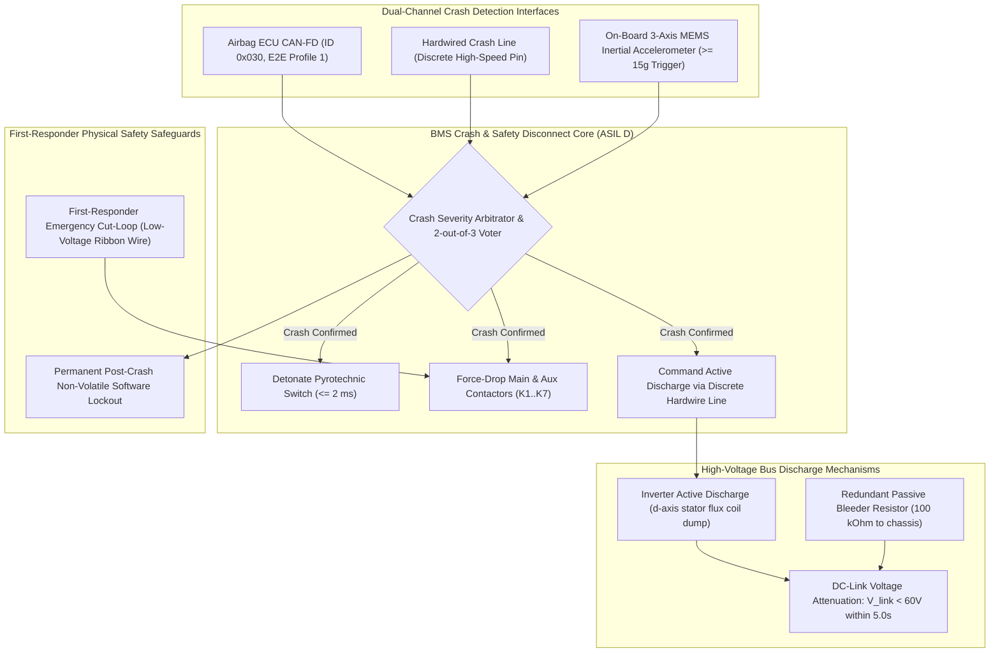
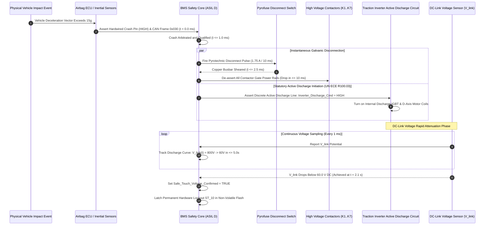

# BMS Software Requirements Specification: Active Discharge & Post-Crash Isolation

**Document ID:** BMS-SRS-17-CRASH-DISCHARGE  
**Version:** 2.4.0  
**Classification:** Automotive High-Voltage Powertrain (EV)  
**Safety & Crash Compliance:** UN ECE R100.03 Clause 5.1.1.4, FMVSS 305, ISO 6469-4:2022 (Post-Crash Electrical Safety), ISO 26262:2018 (ASIL D)  
**Target Hardware:** Inverter Active Discharge IGBT & Stator Shorting Circuit, Passive DC-Link Bleeder Resistors ($100\text{ k}\Omega$), First-Responder Emergency Cut-Loop, Inertial Crash Accelerometer Interface

---

## 1. Scope & Post-Crash Safety Topography

In the event of a severe vehicular collision, the high-voltage direct current (DC) bus connecting the traction battery to external inverters, chargers, and compressors can rupture, exposing first responders and occupants to life-threatening electric shock hazards.

International safety regulations (UN ECE R100.03, FMVSS 305) mandate that following a crash:
1. The traction battery core must be galvanically disconnected within **$< 10\text{ ms}$**.
2. All exposed high-voltage DC-link capacitors ($C_{\text{link}} \approx 1200\,\mu\text{F}$ charged to $800\text{V}$) must be actively discharged below the statutory touch-voltage threshold of **$60.0\text{ V DC}$** (or energy $< 0.2\text{ J}$) within **$\le 5.0\text{ seconds}$**.

---

## 2. Crash Detection, Active Discharge & Safe Voltage Timing Sequence

---

## 3. Detailed Functional Requirements

### Requirement: BMS-REQ-DSC-1501
* **Title:** Dual-Channel Crash Deceleration Evaluation & Impact Severity Classification
* **ASIL Level:** ASIL D
* **Verification Method:** Test
* **Traceability:** UN ECE R100.03 Section 5.1.1; ISO 26262-4:2018; FMVSS 305
* **Inputs:**
  * `Hardwired_Crash_Discrete_Pin` (Data Type: `boolean`, Unit: `discrete`, Values: `{LOW_NORMAL, HIGH_CRASH}`, Source: Airbag Pin)
  * `CAN_Crash_Severity_Status` (Data Type: `uint8_t`, Unit: `enum`, Values: `{NO_CRASH, LOW_SEVERITY, SEVERE_CRASH}`, Source: CAN-FD `0x030`)
  * `CAN_Crash_E2E_Status` (Data Type: `uint8_t`, Unit: `enum`, Values: `{VALID, CRC_ERROR, COUNTER_ERROR}`, Source: E2E Library)
  * `Internal_Accel_Magnitude_G` (Data Type: `uint16_t`, Unit: `0.1 g`, Range: `0..1000`, Source: BMU On-Board MEMS)
* **Outputs:**
  * `Crash_Confirmed_Safety_Flag` (Data Type: `boolean`, Unit: `bool`, Values: `{FALSE, TRUE}`, Destination: Safety Disconnect Core)
  * `DTC_Crash_Event_Recorded` (Data Type: `uint32_t`, Value: `0x9A0C10`, Destination: Dem)
* **Timing & Debounce:** Evaluation cycle: Sub-millisecond interrupt; Hardwire filter: $0.5\text{ ms}$; Accelerometer threshold debounce: $5.0\text{ ms}$; Total reaction time: $\le 1.0\text{ ms}$.
* **Description:**  
  The BMS software shall evaluate crash signals using a 2-out-of-3 voting architecture:
  1. A crash event is confirmed if any of the following logical conditions evaluate to `TRUE`:
     * Condition A: `Hardwired_Crash_Discrete_Pin == HIGH_CRASH` continuously for $\ge 0.5\text{ ms}$.
     * Condition B: `CAN_Crash_Severity_Status == SEVERE_CRASH` with `CAN_Crash_E2E_Status == VALID`.
     * Condition C: `Internal_Accel_Magnitude_G >= 15.0 g` ($150 \times 0.1\text{ g}$) sustained for $\ge 5\text{ ms}$.
  2. Upon confirmation of any valid crash condition:
     * Assert `Crash_Confirmed_Safety_Flag = TRUE` within $\le 1.0\text{ ms}$.
     * Immediately trigger the pyrofuse firing bridge (`Pyrofuse_Fire_Command = FIRE`).
     * De-energize all contactor coil drivers.
     * Commit permanent non-erasable DTC `0x9A0C10` to non-volatile Flash.
* **Rationale:** In a high-speed collision, communication wiring harnesses may be severed within milliseconds. Diverse hardwired, CAN-FD, and on-board sensor triggering guarantees crash detection.
* **Acceptance Criteria:**  
  1. The BMS software shall assert `Crash_Confirmed_Safety_Flag = TRUE` within $\le 1.0\text{ ms}$ upon validation of the crash input trigger.
  2. Noise spikes on `Hardwired_Crash_Discrete_Pin` of duration $< 0.5\text{ ms}$ shall be filtered out without triggering a crash qualification.
  3. A CAN crash message failing E2E CRC validation shall be discarded and shall not trigger crash qualification unless confirmed by the hardwired line or accelerometer.

---

### Requirement: BMS-REQ-DSC-1502
* **Title:** Inverter Active DC-Link Discharge Initiation & 5-Second 60V Attenuation
* **ASIL Level:** ASIL D
* **Verification Method:** Test
* **Traceability:** UN ECE R100.03 Clause 5.1.1.4; FMVSS 305; ISO 6469-4:2022
* **Inputs:**
  * `Crash_Confirmed_Safety_Flag` (Data Type: `boolean`, Unit: `bool`, Source: Crash Evaluator)
  * `Link_Voltage_Bus` (Data Type: `uint32_t`, Unit: `mV`, Range: `0..1000000`, Source: DC-Link Sensor)
* **Outputs:**
  * `Inverter_Active_Discharge_Discrete_Cmd` (Data Type: `boolean`, Unit: `discrete`, Values: `{INACTIVE, DISCHARGE_ACTIVE}`, Destination: Inverter Dedicated Pin)
  * `Safe_Touch_Voltage_Confirmed` (Data Type: `boolean`, Unit: `bool`, Destination: Crash Telemetry CAN-FD `0x020`)
  * `DTC_Active_Discharge_Timeout` (Data Type: `uint32_t`, Value: `0x9A0C20`, Destination: Dem)
* **Timing & Debounce:** Command latency: $\le 2.0\text{ ms}$ from crash flag; Voltage tracking period: $1\text{ ms} \pm 0.05\text{ ms}$; Discharge statutory deadline: $\le 5.0\text{ s}$ ($5000\text{ ms}$).
* **Description:**  
  The BMS software shall command active energy attenuation of the inverter DC-link capacitor ($C_{\text{link}} = 1200\,\mu\text{F}$):
  1. Within $\le 2\text{ ms}$ of `Crash_Confirmed_Safety_Flag == TRUE`, the BMS shall drive:
     `Inverter_Active_Discharge_Discrete_Cmd = DISCHARGE_ACTIVE` (asserting hardwired logic high to inverter driver board).
  2. The software shall track $V_{\text{link}}$ decay rate:
     $$V_{\text{link}}(t) = V_0 \cdot \exp\left(-\frac{t}{R_{\text{active}} \cdot C_{\text{link}}}\right)$$
  3. The voltage must attenuate below statutory safe touch potential:
     $$V_{\text{link}} < 60.0\text{ V DC} \quad (60000\text{ mV}) \text{ within } t \le 5.0\text{ seconds}$$
  4. Once $V_{\text{link}} < 60.0\text{ V}$, assert `Safe_Touch_Voltage_Confirmed = TRUE`.
  5. If $V_{\text{link}} \ge 60.0\text{ V}$ after $5000\text{ ms}$ from assertion:
     * Set `Safe_Touch_Voltage_Confirmed = FALSE`.
     * Qualify DTC `0x9A0C20` (Active Discharge Execution Timeout / Hardware Failure).
* **Rationale:** A charged 800V 1200 uF capacitor stores $384\text{ Joules}$ of electrical energy (1900 times greater than the $0.2\text{ J}$ lethal shock threshold).
* **Acceptance Criteria:**  
  1. `Inverter_Active_Discharge_Discrete_Cmd` shall transition to `DISCHARGE_ACTIVE` within $\le 2.0\text{ ms}$ after `Crash_Confirmed_Safety_Flag` transitions to `TRUE`.
  2. `Safe_Touch_Voltage_Confirmed` shall be asserted as soon as `Link_Voltage_Bus` drops below $60.0\text{ V DC}$.
  3. If `Link_Voltage_Bus` remains $\ge 60.0\text{ V DC}$ after $5000\text{ ms}$ from discharge initiation, DTC `0x9A0C20` shall be qualified within $\le 50\text{ ms}$.

---

### Requirement: BMS-REQ-DSC-1503
* **Title:** Redundant Passive Bleeder Resistance Discharge Supervision
* **ASIL Level:** ASIL C
* **Verification Method:** Test
* **Traceability:** UN ECE R100.03 Section 5.1.1.4; ISO 6469-4
* **Inputs:**
  * `Link_Voltage_Bus` (Data Type: `uint32_t`, Unit: `mV`, Source: DC-Link Sensor)
  * `Inverter_Active_Discharge_Discrete_Cmd` (Data Type: `boolean`, Unit: `discrete`, Source: BMS Driver)
* **Outputs:**
  * `Passive_Discharge_Slope_Valid` (Data Type: `boolean`, Unit: `bool`, Destination: Safety Monitor)
  * `DTC_Passive_Bleeder_Open_Circuit` (Data Type: `uint32_t`, Value: `0x9A0C30`, Destination: Dem)
* **Timing & Debounce:** Passive slope observation window: $10.0\text{ s} \pm 0.5\text{ s}$; Total passive decay tracking: $60.0\text{ s}$.
* **Description:**  
  In the event that the inverter active discharge circuit fails or in normal non-crash key-off:
  1. The BMS software shall supervise the passive discharge of $C_{\text{link}}$ across the internal high-voltage bleeder resistors ($R_{\text{bleed}} = 100\text{ k}\Omega \pm 5\%$):
     $$\tau_{\text{bleed}} = R_{\text{bleed}} \cdot C_{\text{link}} = 100\text{ k}\Omega \times 1200\,\mu\text{F} = 120.0\text{ s}$$
  2. The software shall sample $V_{\text{link}}$ at $t = 60\text{ s}$:
     $$V_{\text{link}}(60\text{ s}) \le V_0 \cdot \exp\left(-\frac{60\text{ s}}{120\text{ s}}\right) = 0.606 \cdot V_0 \approx 485.0\text{ V}$$
  3. If $V_{\text{link}}$ exhibits zero negative slope ($\frac{dV}{dt} > -1.0\text{ V/s}$) across a $10.0\text{ s}$ observation window when contactors are open and active discharge is inactive:
     * Qualify DTC `0x9A0C30` (Passive Bleeder Resistor Circuit Open).
* **Rationale:** Passive bleeders provide a fail-safe hardware backup ensuring vehicle high-voltage capacitors cannot retain hazardous charges indefinitely if the active discharge circuit is damaged.
* **Acceptance Criteria:**  
  1. Under conditions where contactors are open and active discharge is inactive, the passive discharge rate $\frac{dV}{dt}$ shall be negative with magnitude $\ge 1.0\text{ V/s}$ when initial bus voltage is $> 500\text{ V}$.
  2. If $\frac{dV}{dt}$ remains $> -1.0\text{ V/s}$ over a $10.0\text{ s}$ window at high voltage, DTC `0x9A0C30` shall be qualified within $\le 10.0\text{ s}$.

---

### Requirement: BMS-REQ-DSC-1504
* **Title:** First-Responder Physical Cut-Loop Emergency Disconnect
* **ASIL Level:** ASIL D
* **Verification Method:** Test
* **Traceability:** NFPA 1858; ISO 6469-4:2022
* **Inputs:**
  * `Cut_Loop_Continuity_Pin` (Data Type: `boolean`, Unit: `discrete`, Values: `{CONTINUOUS, CUT}`, Source: Dedicated Hardware Interlock Loop)
* **Outputs:**
  * `Pyrofuse_Fire_Immediate_Req` (Data Type: `boolean`, Unit: `discrete`, Destination: Firing Bridge)
  * `Cmd_Contactor_All_Force_Open` (Data Type: `boolean`, Unit: `discrete`, Destination: Contactor Driver Rails)
  * `DTC_First_Responder_Loop_Severed` (Data Type: `uint32_t`, Value: `0x9A0C40`, Destination: Dem)
* **Timing & Debounce:** Hardware de-bias latency: $\le 1.0\text{ ms}$; Microcontroller command latency: $\le 5.0\text{ ms}$; Debounce filter: None (immediate hardwired response).
* **Description:**  
  The BMS shall monitor a dedicated low-voltage ribbon loop routed beneath the front hood/frunk marked with high-visibility first-responder tags:
  1. The loop conducts a supervised low-power current ($20\text{ mA} \pm 2\text{ mA}$).
  2. If rescue personnel physically sever the loop (`Cut_Loop_Continuity_Pin == CUT`):
     * Hardware interlock circuitry shall de-bias contactor low-side gate drivers immediately ($\le 1.0\text{ ms}$).
     * Microcontroller software shall assert `Cmd_Contactor_All_Force_Open = TRUE` within $\le 5.0\text{ ms}$.
     * Command active discharge of the DC-link bus.
     * Qualify permanent DTC `0x9A0C40`.
* **Rationale:** Enables emergency firefighting personnel to manually guarantee galvanic isolation of the high-voltage battery before performing vehicle extrication (cutting pillars with hydraulic shears).
* **Acceptance Criteria:**  
  1. Contactor driver gate commands shall drop to $0\text{ V}$ within $\le 5.0\text{ ms}$ upon detection of `Cut_Loop_Continuity_Pin == CUT`.
  2. While the cut loop is severed, all contactor closing requests shall be unconditionally rejected and locked open.

---

### Requirement: BMS-REQ-DSC-1505
* **Title:** Post-Crash Isolation Resistance Assessment & Vehicle Chassis Lockout
* **ASIL Level:** ASIL D
* **Verification Method:** Test
* **Traceability:** UN ECE R100.03 Section 5.1.3; ISO 6469-1:2019
* **Inputs:**
  * `Crash_Confirmed_Safety_Flag` (Data Type: `boolean`, Unit: `bool`, Source: Crash Evaluator)
  * `Pack_Isolation_Resistance` (Data Type: `uint32_t`, Unit: `kOhm`, Source: Insulation Monitor)
* **Outputs:**
  * `Post_Crash_Chassis_Safe_Flag` (Data Type: `boolean`, Unit: `bool`, Values: `{FALSE, TRUE}`, Destination: Telematics CAN-FD `0x020`)
  * `DTC_Post_Crash_Chassis_Isolation_Loss` (Data Type: `uint32_t`, Value: `0x9A0C50`, Destination: Dem)
* **Timing & Debounce:** Evaluation cycle: $1000\text{ ms} \pm 50\text{ ms}$; Post-discharge broadcast deadline: $\le 3000\text{ ms}$.
* **Description:**  
  Following a crash event, the BMS shall perform a post-impact electrical isolation evaluation:
  1. The software shall execute an insulation resistance measurement between the isolated battery core and vehicle body chassis.
  2. Classification:
     * If $R_{\text{iso}} \ge 500\,\Omega/\text{V}$ ($400\text{ k}\Omega$): Set `Post_Crash_Chassis_Safe_Flag = TRUE` (chassis is electrically safe to touch).
     * If $R_{\text{iso}} < 100\,\Omega/\text{V}$ ($< 80\text{ k}\Omega$):
       * Set `Post_Crash_Chassis_Safe_Flag = FALSE`.
       * Store critical DTC `0x9A0C50` (Post-Crash Battery-to-Chassis Short).
       * Broadcast emergency chassis warning telegram over telematics gateway to warn rescue workers of potential live vehicle body panels.
* **Rationale:** Structural deformation during side or underbody impacts can crush cell casings against the aluminum chassis frame, creating hazardous body potential.
* **Acceptance Criteria:**  
  1. The BMS software shall broadcast `Post_Crash_Chassis_Safe_Flag` on CAN-FD ID `0x020` within $\le 3000\text{ ms}$ after active discharge is confirmed complete.
  2. If post-crash isolation resistance drops below $100\,\Omega/\text{V}$, `Post_Crash_Chassis_Safe_Flag` shall be set to `FALSE` and DTC `0x9A0C50` shall be qualified.

---

### Requirement: BMS-REQ-DSC-1506
* **Title:** Residual Capacitive Energy Black-Box Telemetry Recording
* **ASIL Level:** ASIL B
* **Verification Method:** Test
* **Traceability:** UN ECE R100.03; ISO 14229-1:2020
* **Inputs:**
  * `Crash_Confirmed_Safety_Flag` (Data Type: `boolean`, Unit: `bool`, Source: Crash Evaluator)
  * `Link_Voltage_Bus` (Data Type: `uint32_t`, Unit: `mV`, Source: DC-Link Sensor)
  * `Pack_Current_Validated` (Data Type: `int32_t`, Unit: `mA`, Source: Shunt)
* **Outputs:**
  * `Crash_Freeze_Frame_Sector` (Data Type: `uint8_t[128]`, Destination: Encrypted NvM Partition)
* **Timing & Debounce:** Capture rate: High-speed snapshot every $10\text{ ms}$ over the first $5.0\text{ seconds}$ post-crash (500 data points).
* **Description:**  
  Upon `Crash_Confirmed_Safety_Flag == TRUE`, the BMS shall record a high-frequency black-box telemetry trace:
  1. Record $V_{\text{link}}$ voltage, pack current, and pyrofuse continuity status every $10\text{ ms}$ for exactly $5000\text{ ms}$.
  2. Compute and log residual energy:
     $$E_{\text{link}}(t) = \frac{1}{2} C_{\text{link}} V_{\text{link}}^2(t)$$
  3. Commit the 128-byte compressed trajectory into dedicated crash Flash memory sector `$0x005F0000`.
  4. The crash record shall be protected against overwriting and accessible via UDS Service `$19 $04` using DID `0x4250`.
* **Rationale:** Provides unequivocal legal and forensic proof for regulatory accident investigators that the vehicle complied with UN ECE R100.03 post-crash discharge mandates.
* **Acceptance Criteria:**  
  1. The BMS software shall record 500 contiguous voltage points sampled at $10\text{ ms}$ intervals following crash confirmation.
  2. The crash freeze frame sector shall be committed to non-volatile Flash and made retrievable via UDS Service `$19 $04` (DID `0x4250`) with write-protection enabled.
