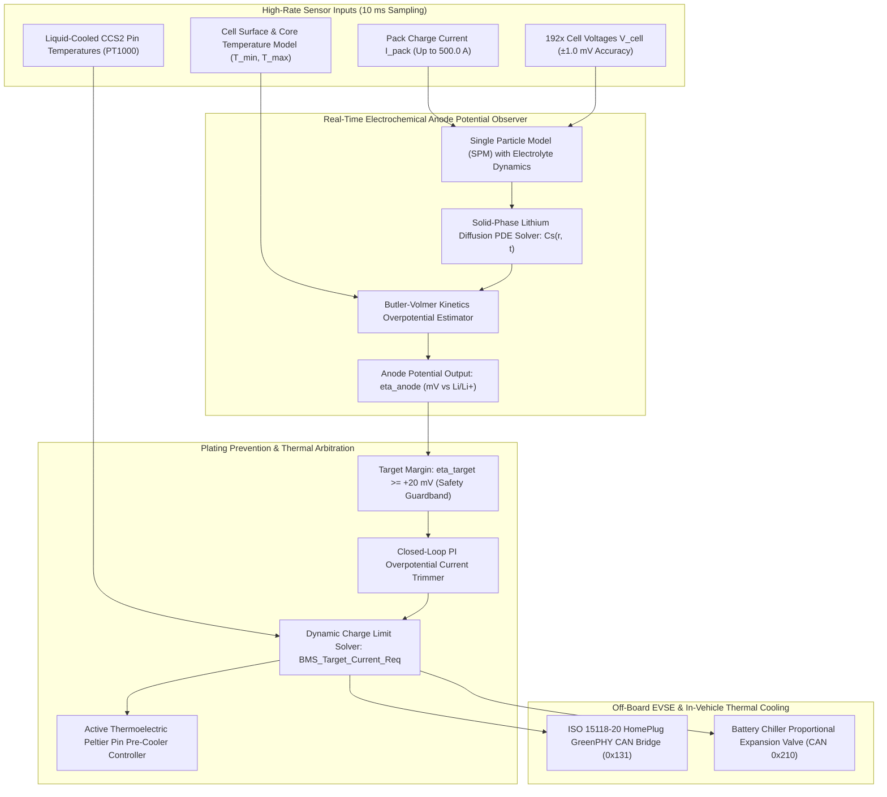
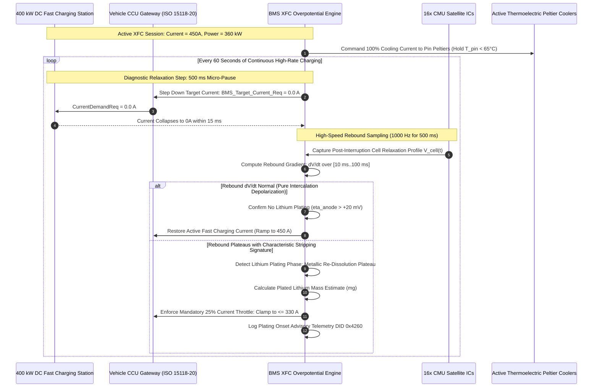

# BMS Software Requirements Specification: Extreme Fast Charging (XFC) & Lithium Plating Prevention

**Document ID:** BMS-SRS-18-XFC-PLATING  
**Version:** 2.4.0  
**Classification:** Automotive High-Voltage Powertrain (EV)  
**Fast-Charging & Safety Compliance:** ISO 15118-20:2022, IEC 61851-23, SAE J1772 / CharIN HPC, ISO 26262:2018 (ASIL C / ASIL D)  
**Target Hardware:** High Power Charging (HPC up to 400 kW / 800V / 500A), Liquid-Cooled CCS2 Inlets with PT1000 Temp Sensors, Active Thermoelectric Peltier Pin Coolers, 192s1p NMC811 Battery Cells

---

## 1. Scope & Electrochemical Plating Physics

During Extreme Fast Charging (XFC at rates up to $3.5\text{C}$ to $4.0\text{C}$, drawing $500.0\text{ A}$ continuous), the rate of lithium ion diffusion into the graphite host crystal lattice can lag behind the rate of electrochemical charge transfer. When the local electrical potential at the graphite anode interface drops below the thermodynamic lithium reduction equilibrium:
$$\eta_{\text{anode}} = \Phi_{\text{solid}} - \Phi_{\text{electrolyte}} - U_{\text{eq}} < 0.0\text{ V vs. } Li/Li^+$$
metallic lithium plates irreversibly onto the anode surface rather than intercalating into graphite.

Lithium plating causes rapid permanent capacity loss and forms metallic dendrites that can penetrate the ceramic-coated separator, resulting in catastrophic internal cell short circuits and thermal runaway.

---

## 2. Pulse Relaxation Pause & Rebound Voltage Extraction Sequence

---

## 3. Detailed Functional Requirements

### Requirement: BMS-REQ-XFC-1601
* **Title:** Physics-Based Anode Overpotential ($\eta_{\text{anode}}$) Real-Time Observer
* **ASIL Level:** ASIL C
* **Verification Method:** Test
* **Traceability:** ISO 26262-4:2018; SAE J1798
* **Inputs:**
  * `Pack_Current_Validated` (Data Type: `int32_t`, Unit: `mA`, Source: Shunt Sensor)
  * `Cell_V_Min` (Data Type: `uint16_t`, Unit: `mV`, Source: AFE)
  * `Pack_T_Min` (Data Type: `int16_t`, Unit: `0.1 °C`, Source: AFE NTC Array)
  * `BMS_Pack_SOC` (Data Type: `uint16_t`, Unit: `0.01 %`, Source: AEKF)
* **Outputs:**
  * `Anode_Overpotential_Eta_Min` (Data Type: `int16_t`, Unit: `0.1 mV`, Range: `-5000..5000`, Destination: Plating Controller & CAN-FD `0x133`)
  * `Plating_Risk_Severity` (Data Type: `uint8_t`, Unit: `enum`, Values: `{SAFE_GREEN, MARGINAL_YELLOW, ACTIVE_PLATING_RED}`, Destination: FSM)
* **Timing & Debounce:** Execution task cycle: $10\text{ ms} \pm 0.2\text{ ms}$. State transition debounce: $20\text{ ms}$.
* **Description:**  
  The BMS software shall execute a discrete-time electrochemical Single Particle Model (SPM) with electrolyte polarization to compute local graphite anode overpotential:
  1. The software shall solve the solid-state lithium diffusion equation inside spherical graphite particles:
     $$\frac{\partial c_s}{\partial t} = \frac{D_s(T)}{r^2} \frac{\partial}{\partial r}\left(r^2 \frac{\partial c_s}{\partial r}\right)$$
     where $D_s(T) = D_0 \cdot \exp\left(-\frac{E_a}{R \cdot T}\right)$ is temperature-dependent solid diffusivity.
  2. The software shall compute the surface concentration $c_{s, \text{surf}}$ and apply the inverse Butler-Volmer equation to estimate the electrical potential difference at the anode/electrolyte interface:
     $$\eta_{\text{anode}} = \frac{2RT}{F} \operatorname{arcsinh}\left(\frac{I_{\text{cell}}}{2 A_{\text{geo}} i_0(c_{s, \text{surf}}, c_e, T)}\right)$$
  3. Classification:
     * **SAFE_GREEN:** $\eta_{\text{anode}} \ge +20.0\text{ mV}$ ($+200 \times 0.1\text{ mV}$).
     * **MARGINAL_YELLOW:** $0.0\text{ mV} \le \eta_{\text{anode}} < +20.0\text{ mV}$.
     * **ACTIVE_PLATING_RED:** $\eta_{\text{anode}} < 0.0\text{ mV}$ (metallic lithium plating actively occurring).
* **Rationale:** Direct cell terminal voltage does not reveal when the graphite surface is saturated; electrochemical overpotential tracking provides the fundamental physical metric for non-destructive fast charging.
* **Acceptance Criteria:**  
  1. The observer shall update `Anode_Overpotential_Eta_Min` at a deterministic period of $10\text{ ms} \pm 0.2\text{ ms}$ during DC fast charging.
  2. If the estimated anode overpotential drops below $0.0\text{ mV}$, `Plating_Risk_Severity` shall transition to `ACTIVE_PLATING_RED` within $\le 20.0\text{ ms}$.

---

### Requirement: BMS-REQ-XFC-1602
* **Title:** Closed-Loop Dynamic Lithium Plating Avoidance Current Regulator
* **ASIL Level:** ASIL C
* **Verification Method:** Test
* **Traceability:** ISO 26262-4; SAE J1798
* **Inputs:**
  * `Anode_Overpotential_Eta_Min` (Data Type: `int16_t`, Unit: `0.1 mV`, Source: Physics Observer)
  * `BMS_Target_Current_Req` (Data Type: `uint16_t`, Unit: `0.1 A`, Source: Nominal Charging Map)
* **Outputs:**
  * `BMS_Target_Current_Req` (Data Type: `uint16_t`, Unit: `0.1 A`, Range: `0..5000`, Destination: CCU CAN-FD `0x131`)
  * `Plating_Prevention_Derate_Active` (Data Type: `boolean`, Unit: `bool`, Destination: Telemetry CAN-FD `0x133`)
* **Timing & Debounce:** Regulator task loop: $20\text{ ms} \pm 1.0\text{ ms}$; Step response latency: $\le 20\text{ ms}$.
* **Description:**  
  The BMS shall execute a closed-loop PI current trimming regulator that dynamically modulates the fast-charging current demand broadcast to the off-board EVSE:
  1. The target overpotential setpoint is calibrated to:
     $$\eta_{\text{target}} = +20.0\text{ mV} \quad (\text{safety buffer above zero})$$
  2. The error signal is computed as:
     $$e_{\eta}(k) = \eta_{\text{target}} - \eta_{\text{anode}}(k)$$
  3. If $e_{\eta}(k) > 0$ (anode overpotential has dropped below $+20.0\text{ mV}$):
     * Set `Plating_Prevention_Derate_Active = TRUE`.
     * Compute current trim correction:
       $$\Delta I_{\text{trim}}(k) = K_{p, \text{plat}} \cdot e_{\eta}(k) + K_{i, \text{plat}} \sum e_{\eta}(k) \Delta t$$
       $$(K_{p, \text{plat}} = 2.5\text{ A/mV}, K_{i, \text{plat}} = 0.5\text{ A/mV}\cdot\text{s})$$
     * Output clamped current request:
       $$I_{\text{target}}(k) = \max(20.0\text{ A}, I_{\text{target}}(k-1) - \Delta I_{\text{trim}}(k))$$
  4. If $\eta_{\text{anode}} < 0.0\text{ mV}$ (hard plating breach):
     * Immediately step down current request by an instantaneous $-50.0\text{ A}$ delta within $\le 20\text{ ms}$.
* **Rationale:** Dynamically riding the $+20\text{ mV}$ boundary maximizes charging speed while guaranteeing that metallic lithium does not deposit on the anode.
* **Acceptance Criteria:**  
  1. When `Anode_Overpotential_Eta_Min` is less than $+20.0\text{ mV}$, `Plating_Prevention_Derate_Active` shall be set to `TRUE` and charging current request shall be reduced via the PI trimming law.
  2. If `Anode_Overpotential_Eta_Min` drops below $0.0\text{ mV}$, `BMS_Target_Current_Req` shall decrease by at least $50.0\text{ A}$ within $\le 20\text{ ms}$.

---

### Requirement: BMS-REQ-XFC-1603
* **Title:** Pulse Charging Relaxation Pauses & $dV/dt$ Rebound Detection
* **ASIL Level:** ASIL B
* **Verification Method:** Test
* **Traceability:** SAE J1798; ISO 15118-20
* **Inputs:**
  * `Pack_Current_Validated` (Data Type: `int32_t`, Unit: `mA`, Source: Shunt Sensor)
  * `Filt_Cell_Voltage[1..192]` (Data Type: `uint16_t[192]`, Unit: `mV`, Source: AFE)
  * `Cumulative_XFC_Charge_Duration_s` (Data Type: `uint16_t`, Unit: `s`, Source: Timer)
* **Outputs:**
  * `XFC_Diagnostic_Pause_Active` (Data Type: `boolean`, Unit: `bool`, Destination: CCU CAN-FD `0x131`)
  * `Lithium_Stripping_Plateau_Detected` (Data Type: `boolean`, Unit: `bool`, Destination: Diagnostics)
  * `DTC_Micro_Plating_Detected` (Data Type: `uint32_t`, Value: `0x9A0E10`, Destination: Dem)
* **Timing & Debounce:** Pause periodicity: Every $60.0\text{ s} \pm 1.0\text{ s}$; Pause duration: $500\text{ ms} \pm 10\text{ ms}$; High-speed voltage sampling rate: $1\text{ ms}$ ($1000\text{ Hz}$).
* **Description:**  
  The BMS software shall command periodic diagnostic micro-pauses during extreme fast charging to detect the electrochemical signature of lithium stripping:
  1. Every $60.0\text{ s}$ of continuous charging at $I > 300\text{ A}$, the BMS shall:
     * Broadcast `BMS_Target_Current_Req = 0.0 A` and set `XFC_Diagnostic_Pause_Active = TRUE` for exactly $500\text{ ms} \pm 10\text{ ms}$.
  2. During the pause, sample all cell voltages at $1\text{ ms}$ intervals and calculate the differential relaxation derivative:
     $$\frac{dV_i}{dt} \text{ over time window } t \in [20\text{ ms}, 200\text{ ms}]$$
  3. **Stripping Detection Algorithm:**
     * In a healthy cell, $V_i(t)$ decays exponentially as concentration polarization relaxes ($\frac{dV}{dt} < 0$).
     * If metallic lithium plated during the preceding charging burst, the reversible chemical dissolution of plated lithium back into ions creates a distinctive flat voltage plateau ($\frac{dV}{dt} \approx 0.0\text{ mV/s}$ sustained for $> 40\text{ ms}$).
  4. If a plateau signature is confirmed on any cell:
     * Set `Lithium_Stripping_Plateau_Detected = TRUE`.
     * Enforce a permanent $20\%$ derating clamp on all subsequent charging current for the remainder of the session.
     * Qualify advisory DTC `0x9A0E10`.
* **Rationale:** A 500 ms pause adds negligible total charging time (< 1%) but provides in-situ electrochemical confirmation of whether plating occurred.
* **Acceptance Criteria:**  
  1. Commanded zero-current pause duration broadcast on CAN-FD ID `0x131` shall be $500\text{ ms} \pm 15\text{ ms}$ at recurring intervals of $60.0\text{ s} \pm 1.0\text{ s}$ during sustained high-current charging ($> 300\text{ A}$).
  2. If a voltage plateau with $|\frac{dV}{dt}| < 0.2\text{ mV/s}$ is sustained for $\ge 40\text{ ms}$ during relaxation, `Lithium_Stripping_Plateau_Detected` shall be asserted, DTC `0x9A0E10` qualified, and charging current derated by at least $20\%$.

---

### Requirement: BMS-REQ-XFC-1604
* **Title:** Liquid-Cooled CCS2 Cable Temperature Feedback & Pin Thermal Throttling
* **ASIL Level:** ASIL C
* **Verification Method:** Test
* **Traceability:** IEC 62196-3-1 (Liquid-Cooled DC Couplers); ISO 15118-20
* **Inputs:**
  * `CCS_Inlet_Temp_DC_Pos` (Data Type: `int16_t`, Unit: `0.1 °C`, Range: `-400..1500`, Source: Port PT1000)
  * `CCS_Inlet_Temp_DC_Neg` (Data Type: `int16_t`, Unit: `0.1 °C`, Range: `-400..1500`, Source: Port PT1000)
  * `EVSE_Cooling_Unit_Status` (Data Type: `uint8_t`, Unit: `enum`, Values: `{COOLING_NOMINAL, COOLING_DEGRADED, COOLING_FAILED}`, Source: CCU CAN-FD `0x130`)
* **Outputs:**
  * `BMS_Target_Current_Req` (Data Type: `uint16_t`, Unit: `0.1 A`, Destination: CCU CAN-FD `0x131`)
  * `Inlet_Thermal_Throttling_Active` (Data Type: `boolean`, Unit: `bool`, Destination: CAN-FD `0x133`)
* **Timing & Debounce:** Evaluation loop: $50\text{ ms} \pm 2\text{ ms}$; Emergency stop reaction time: $\le 50\text{ ms}$.
* **Description:**  
  The BMS software shall continuously govern fast-charging current as a function of physical charge port pin temperatures:
  1. Let $T_{\text{pin,max}} = \max(T_{\text{pos}}, T_{\text{neg}})$.
  2. Thermal boundaries conforming to IEC 62196-3-1:
     * **Nominal Zone ($T_{\text{pin,max}} \le 70.0^\circ\text{C}$):** Full current up to $500.0\text{ A}$ authorized.
     * **Linear Throttle Zone ($70.0^\circ\text{C} < T_{\text{pin,max}} \le 85.0^\circ\text{C}$):**
       $$I_{\text{pin,limit}} = 500.0\text{ A} - \left(\frac{T_{\text{pin,max}} - 70.0^\circ\text{C}}{85.0^\circ\text{C} - 70.0^\circ\text{C}}\right) \times 300.0\text{ A}$$
       (Current throttles linearly from $500\text{ A}$ down to $200\text{ A}$).
     * **Critical Temperature Zone ($85.0^\circ\text{C} < T_{\text{pin,max}} \le 90.0^\circ\text{C}$):**
       $$I_{\text{pin,limit}} = 100.0\text{ A}$$
     * **Emergency Cutoff Zone ($T_{\text{pin,max}} > 90.0^\circ\text{C}$):**
       * Set `BMS_Target_Current_Req = 0.0 A`.
       * Abort session via ISO 15118 `SessionStopReq`.
       * Open contactors K4/K5 once current is $< 5.0\text{ A}$.
  3. If `EVSE_Cooling_Unit_Status == COOLING_FAILED`:
     * Immediately clamp maximum charging current to $\le 200.0\text{ A}$ regardless of present temperature.
* **Rationale:** A failure in the off-board chiller pump of a liquid-cooled CCS cable can cause cable pins to reach $100^\circ\text{C}$ within 60 seconds at 500A.
* **Acceptance Criteria:**  
  1. In the temperature range between $70.0^\circ\text{C}$ and $85.0^\circ\text{C}$, `BMS_Target_Current_Req` shall be clamped according to the linear throttle function within $\le 100\text{ ms}$.
  2. If pin temperature exceeds $90.0^\circ\text{C}$, `BMS_Target_Current_Req` shall be set to $0.0\text{ A}$ within $\le 50.0\text{ ms}$.
  3. If `EVSE_Cooling_Unit_Status` indicates `COOLING_FAILED`, charging current request shall not exceed $200.0\text{ A}$.

---

### Requirement: BMS-REQ-XFC-1605
* **Title:** Thermoelectric Peltier Booster Pin Active Pre-Cooling Coordination
* **ASIL Level:** ASIL B
* **Verification Method:** Test
* **Traceability:** ISO 15118-20; ISO 26262-4
* **Inputs:**
  * `CCS_Inlet_Temp_DC_Pos` (Data Type: `int16_t`, Unit: `0.1 °C`, Source: Port Sensor)
  * `CCS_Inlet_Temp_DC_Neg` (Data Type: `int16_t`, Unit: `0.1 °C`, Source: Port Sensor)
  * `Peltier_Heatsink_Temp` (Data Type: `int16_t`, Unit: `0.1 °C`, Source: Heat Sink Sensor)
  * `Navigation_Pre_Arrival_Flag` (Data Type: `boolean`, Unit: `bool`, Source: CAN-FD)
  * `Pack_Current_Validated` (Data Type: `int32_t`, Unit: `mA`, Source: Shunt Sensor)
* **Outputs:**
  * `Peltier_Cooler_PWM_Duty` (Data Type: `uint8_t`, Unit: `0.1 %`, Range: `0..1000`, Destination: Low-Side Peltier Driver)
  * `Peltier_Heatsink_Fan_Speed` (Data Type: `uint8_t`, Unit: `0.1 %`, Range: `0..1000`, Destination: LIN Bus)
* **Timing & Debounce:** Control task rate: $100\text{ ms} \pm 5\text{ ms}$; Overheat shutdown latency: $\le 100\text{ ms}$.
* **Description:**  
  The BMS software shall command active thermoelectric Peltier cooling elements integrated into the vehicle DC+ and DC- charge port terminal housings:
  1. **Pre-Cooling Phase:** When navigation confirms vehicle is within $5.0\text{ minutes}$ of arriving at a DC fast charger (`Navigation_Pre_Arrival_Flag == TRUE`), command `Peltier_Cooler_PWM_Duty = 50.0%` to pre-cool contact receptacles to $< 20.0^\circ\text{C}$.
  2. **Active Charging Control:**
     * If charging current magnitude is $\ge 300.0\text{ A}$ OR $T_{\text{pin}} \ge 50.0^\circ\text{C}$:
       $$\text{DutyCycle} = \min\left(100.0\%, 50.0\% + 2.5\% \cdot (T_{\text{pin}} - 50.0^\circ\text{C})\right)$$
     * Command heatsink exhaust fan speed proportional to Peltier heat dissipation.
  3. If Peltier heatsink overtemperature is detected (`Peltier_Heatsink_Temp > 80.0 °C`):
     * Disable Peltier cooler (`Duty = 0.0%`) to avoid reverse heat conduction into inlet pins.
* **Rationale:** Active localized thermoelectric cooling removes heat directly at the terminal mating interface, permitting prolonged 400 kW charging without thermal derating.
* **Acceptance Criteria:**  
  1. Assertion of `Navigation_Pre_Arrival_Flag` shall activate `Peltier_Cooler_PWM_Duty` to $50.0\% \pm 1.0\%$ within $\le 200\text{ ms}$.
  2. If `Peltier_Heatsink_Temp` reaches $> 80.0^\circ\text{C}$, `Peltier_Cooler_PWM_Duty` shall drop to $0.0\%$ within $\le 100\text{ ms}$.

---

### Requirement: BMS-REQ-XFC-1606
* **Title:** High-Frequency Electrochemical Impedance Spectroscopy (EIS) Micro-Plating Diagnostic
* **ASIL Level:** ASIL C
* **Verification Method:** Test
* **Traceability:** SAE J1798; ISO 26262-5:2018
* **Inputs:**
  * `AFE_Fast_Voltage_Buffer[1..16]` (Data Type: `uint16_t[16]`, Unit: `0.1 mV`, Source: CMU 10 kHz ADC Mode)
  * `Shunt_AC_Perturbation_Current` (Data Type: `int32_t`, Unit: `mA`, Source: Shunt Sensor)
* **Outputs:**
  * `Real_Impedance_Z_Real_mOhm` (Data Type: `uint16_t`, Unit: `0.01 mOhm`, Destination: Diagnostics)
  * `Imag_Impedance_Z_Imag_mOhm` (Data Type: `int16_t`, Unit: `0.01 mOhm`, Destination: Diagnostics)
  * `DTC_Anode_Micro_Dendrite_Warning` (Data Type: `uint32_t`, Value: `0x9A0E20`, Destination: Dem)
* **Timing & Debounce:** Diagnostic execution window: $2000\text{ ms} \pm 50\text{ ms}$ upon session rest or termination; Confirmation debounce: 3 consecutive test cycles.
* **Description:**  
  The BMS software shall perform on-board High-Frequency Electrochemical Impedance Spectroscopy (EIS) to detect sub-surface metallic dendrite growth:
  1. The software shall command the on-board charger or traction inverter to inject a sinusoidal current perturbation of $1.0\text{ A}_{\text{rms}}$ at $100\text{ Hz}$ and $1000\text{ Hz}$.
  2. The software shall compute the complex impedance via Discrete Fourier Transform (DFT):
     $$Z(j\omega) = \frac{\mathcal{F}\{\Delta V_{\text{cell}}(t)\}}{\mathcal{F}\{\Delta I(t)\}} = Z_{\text{real}}(\omega) + j Z_{\text{imag}}(\omega)$$
  3. **Dendrite Detection Metric:**
     * Formation of metallic dendrites alters the charge-transfer resistance $R_{\text{ct}}$ and introduces an abnormal low-frequency inductive loop ($Z_{\text{imag}} > 0$ at frequencies below $200\text{ Hz}$).
     * If $Z_{\text{imag}}(100\text{ Hz}) > 0.15\text{ m}\Omega$ continuously across 3 consecutive tests:
        * Qualify DTC `0x9A0E20` (Anode Micro-Dendrite Internal Short Risk).
        * Permanently clamp maximum charging C-rate to $\le 1.0\text{C}$ ($135.0\text{ A}$) to prevent dendrite growth.
* **Rationale:** Detecting micro-dendrites before they bridge the separator allows proactive pack servicing before internal short circuits trigger thermal runaway.
* **Acceptance Criteria:**  
  1. The complex impedance components `Real_Impedance_Z_Real_mOhm` and `Imag_Impedance_Z_Imag_mOhm` shall be computed via DFT at $100\text{ Hz}$ and $1000\text{ Hz}$.
  2. If inductive reactance $Z_{\text{imag}}(100\text{ Hz})$ exceeds $+0.15\text{ m}\Omega$ across 3 consecutive evaluation cycles, DTC `0x9A0E20` shall be qualified and maximum charging current clamped to $\le 1.0\text{C}$.
