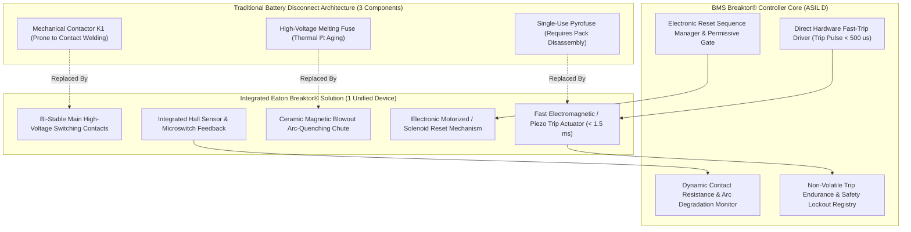
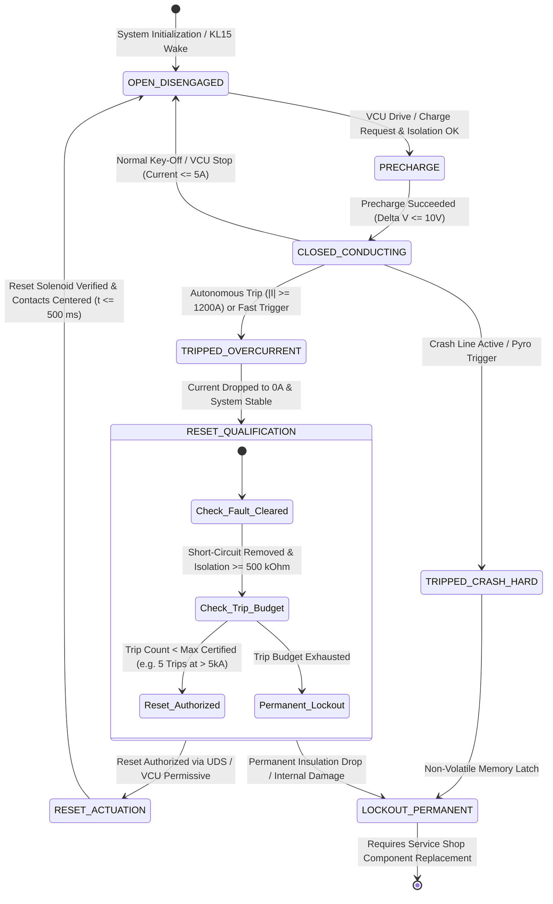
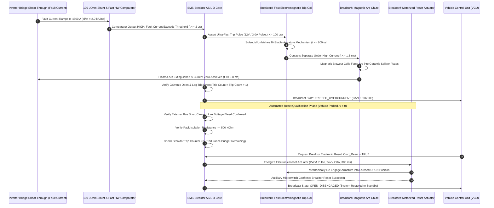

# BMS Software Requirements Specification: Eaton Breaktor® Advanced Circuit Protection

**Document ID:** BMS-SRS-19-EATON-BREAKTOR  
**Version:** 2.4.0  
**Classification:** Automotive High-Voltage Powertrain (EV)  
**Safety & Device Compliance:** ISO 26262:2018 (ASIL D), UN ECE R100.03, UL 2580, Eaton Breaktor® Technical Specification  
**Target Hardware:** Eaton Breaktor® Advanced Circuit Protection Device (Combined Contactor + Resettable Pyrofuse + High-Breaking Fuse), Bi-Stable Actuator, Magnetic Blowout Arc Chute, Dual Fast-Trip Trigger Coil, Integrated Reset Solenoid

---

## 1. Scope & Device Topography Overview

The **Eaton Breaktor®** integrates the functionalities of three traditional high-voltage components into a single compact, resettable advanced circuit protection unit:
1. **Mechanical High-Voltage Contactor:** Switching operational traction and fast-charging current ($500\text{ A}$ continuous at $800\text{V} - 1000\text{V}$).
2. **Pyrotechnic Disconnect (Pyrofuse):** Delivering sub-millisecond electronic forced tripping during vehicle crashes or severe overcurrents.
3. **High-Voltage Melting Fuse:** Capable of clearing fault currents up to **$25,000\text{ A}$ at $900\text{ V DC}$** within **$< 4.0\text{ ms}$** without plasma venting.

Unlike conventional single-use pyrofuses (which require physical battery pack disassembly and replacement after any tripping event), the Eaton Breaktor® is **electronically resettable** up to its certified trip endurance limit, enabling vehicle recovery after cleared overcurrent transients.

---

## 2. Breaktor® Operational State Machine

---

## 3. Breaktor® Interruption & Automated Electronic Reset Timing Sequence

---

## 4. Detailed Functional Requirements

### Requirement: BMS-REQ-BRK-1701
* **Title:** Eaton Breaktor® Device Architecture & Multi-Function Topography Integration
* **ASIL Level:** ASIL D
* **Verification Method:** Test
* **Traceability:** ISO 26262-4:2018; UN ECE R100.03; UL 2580
* **Inputs:**
  * `Breaktor_Aux_Contact_Feedback` (Data Type: `uint8_t`, Unit: `enum`, Values: `{FEEDBACK_OPEN, FEEDBACK_CLOSED, FEEDBACK_TRIPPED}`, Source: Dual Microswitches)
  * `Breaktor_Coil_Continuity_State` (Data Type: `boolean`, Unit: `bool`, Values: `{HEALTHY, OPEN_CIRCUIT}`, Source: Hardware Loop ADC)
  * `BMS_Operational_State` (Data Type: `uint8_t`, Unit: `enum`, Source: FSM)
* **Outputs:**
  * `Cmd_Breaktor_Main_Actuation` (Data Type: `uint8_t`, Unit: `enum`, Values: `{COMMAND_OPEN, COMMAND_CLOSE, COMMAND_TRIP, COMMAND_RESET}`, Destination: Breaktor Driver Stage)
  * `Breaktor_Device_Status` (Data Type: `uint8_t`, Unit: `enum`, Values: `{STATE_OPEN, STATE_CLOSED, STATE_TRIPPED, STATE_FAULT}`, Destination: CAN-FD `0x100`)
  * `DTC_Breaktor_Mechanism_Inconsistency` (Data Type: `uint32_t`, Value: `0x9A1001`, Destination: Dem)
* **Timing & Debounce:** Control task cycle: $10\text{ ms} \pm 0.5\text{ ms}$; Discrepancy debounce timeout: $50\text{ ms} \pm 2\text{ ms}$.
* **Description:**  
  The BMS software shall supervise and control the Eaton Breaktor® device replacing conventional contactors, pyrofuses, and melting fuses on the battery pack positive rail:
  1. **Nominal Switching:**
     * To close: Assert `Cmd_Breaktor_Main_Actuation = COMMAND_CLOSE` after precharge delta is verified ($\Delta V \le 10\text{ V}$).
     * To open: Assert `Cmd_Breaktor_Main_Actuation = COMMAND_OPEN` when current is verified $\le 5.0\text{ A}$.
  2. **Feedback Supervision:**
     * The Breaktor contains dual-redundant auxiliary feedback switches.
     * When `COMMAND_CLOSE` is dispatched, `Breaktor_Aux_Contact_Feedback` must report `FEEDBACK_CLOSED` within $\le 45\text{ ms}$.
     * When `COMMAND_OPEN` is dispatched, `Breaktor_Aux_Contact_Feedback` must report `FEEDBACK_OPEN` within $\le 30\text{ ms}$.
  3. **Discrepancy Fault:**
     * If feedback mismatches commanded state for $> 50\text{ ms}$, set `Breaktor_Device_Status = STATE_FAULT`, qualify DTC `0x9A1001`, and transition FSM to `ST_10_EMERGENCY_LOCKOUT`.
* **Rationale:** A mechanical jam in the Breaktor drive armature prevents safe high-voltage disconnection, creating catastrophic electrical hazards.
* **Acceptance Criteria:**  
  1. `Breaktor_Aux_Contact_Feedback` shall transition to `FEEDBACK_CLOSED` within $\le 45\text{ ms}$ following a `COMMAND_CLOSE` assertion under nominal operation.
  2. If auxiliary contact feedback fails to match the commanded position within $50\text{ ms} \pm 2\text{ ms}$, DTC `0x9A1001` shall be qualified and `Breaktor_Device_Status` set to `STATE_FAULT`.

---

### Requirement: BMS-REQ-BRK-1702
* **Title:** Ultra-Fast Electronic Trip Actuation & Arc Suppression Coordination
* **ASIL Level:** ASIL D
* **Verification Method:** Test
* **Traceability:** ISO 26262-5:2018 Clause 8; UN ECE R100.03
* **Inputs:**
  * `Pack_Current_Validated` (Data Type: `int32_t`, Unit: `mA`, Source: Shunt Sensor)
  * `HW_Fast_Comparator_Trip_Line` (Data Type: `boolean`, Unit: `discrete`, Source: Hardware Shunt Comparator)
  * `Crash_Confirmed_Safety_Flag` (Data Type: `boolean`, Unit: `bool`, Source: Crash Evaluator)
* **Outputs:**
  * `Breaktor_Electronic_Trip_Pulse` (Data Type: `boolean`, Unit: `discrete`, Values: `{INACTIVE, FIRE_TRIP}`, Destination: Breaktor Trip Driver Bridge)
  * `Breaktor_Arc_Quenched_Status` (Data Type: `boolean`, Unit: `bool`, Destination: Safety Telemetry CAN-FD `0x020`)
  * `DTC_Breaktor_Trip_Executed` (Data Type: `uint32_t`, Value: `0x9A1010`, Destination: Dem)
* **Timing & Debounce:** Hardware comparator response latency: $\le 2\,\mu\text{s}$; Trip pulse assertion delay: $\le 100\,\mu\text{s}$; Complete current interruption time: $\le 4.0\text{ ms}$.
* **Description:**  
  The BMS shall execute an ultra-fast electronic trip command to the Breaktor upon severe overcurrent or vehicle collision:
  1. An electronic trip is commanded if:
     * `HW_Fast_Comparator_Trip_Line == TRUE` (Current $|I| \ge 2000.0\text{ A}$), OR
     * `Crash_Confirmed_Safety_Flag == TRUE` (Crash detected).
  2. The BMS driver shall assert a high-energy trip pulse:
     `Breaktor_Electronic_Trip_Pulse = FIRE_TRIP` ($12.0\text{ V} \pm 0.5\text{ V}$, peak pulse current $\ge 3.0\text{ A}$, pulse width $15.0\text{ ms} \pm 0.5\text{ ms}$).
  3. **Current Interruption Timeline:**
     * Trip pulse assertion: $t \le 100\,\mu\text{s}$ from comparator trip.
     * Armature unlatch and mechanical separation: $t \le 1.5\text{ ms}$.
     * Complete plasma arc extinction across magnetic blowout chute: $t \le 4.0\text{ ms}$ ($4000\,\mu\text{s}$).
  4. Post-interruption verification: Measured current $|I_{\text{pack}}|$ must fall to $\le 500\text{ mA}$ within $4.0\text{ ms}$. If verified, set `Breaktor_Arc_Quenched_Status = TRUE` and log DTC `0x9A1010`.
* **Rationale:** Conventional contactors take 20 ms to 40 ms to open and cannot interrupt currents above 2000 A without contact welding. The Breaktor clears 25,000 A faults in < 4 ms without destroying the device.
* **Acceptance Criteria:**  
  1. The rising edge of `Breaktor_Electronic_Trip_Pulse` shall occur within $\le 100\,\mu\text{s}$ of `HW_Fast_Comparator_Trip_Line` asserting `TRUE`.
  2. Pack current through the Breaktor shall fall below $500\text{ mA}$ within $\le 4.0\text{ ms}$ after trip pulse assertion for fault currents up to $25,000\text{ A}$ at $900\text{ V DC}$.
  3. Following confirmed arc extinction, `Breaktor_Arc_Quenched_Status` shall be asserted and DTC `0x9A1010` qualified within $\le 5.0\text{ ms}$.

---

### Requirement: BMS-REQ-BRK-1703
* **Title:** Autonomous Electromagnetic Overcurrent Self-Trip Sensing Thresholds
* **ASIL Level:** ASIL D
* **Verification Method:** Test
* **Traceability:** UL 2580; ISO 26262-5:2018
* **Inputs:**
  * `Pack_Current_Validated` (Data Type: `int32_t`, Unit: `mA`, Source: Shunt Sensor)
  * `Breaktor_Aux_Contact_Feedback` (Data Type: `uint8_t`, Unit: `enum`, Source: Microswitches)
* **Outputs:**
  * `Breaktor_Self_Trip_Detected` (Data Type: `boolean`, Unit: `bool`, Destination: FSM)
  * `DTC_Breaktor_Autonomous_Self_Trip` (Data Type: `uint32_t`, Value: `0x9A1020`, Destination: Dem)
* **Timing & Debounce:** Detection latency: $\le 2\text{ ms}$; Non-volatile DTC storage: $\le 50\text{ ms}$.
* **Description:**  
  The Eaton Breaktor® incorporates an internal autonomous electromagnetic passive trip mechanism (solenoid unlatch) that mechanically trips the contacts without requiring external software command:
  1. **Passive Electromagnetic Trip Thresholds:**
     * $I_{\text{trip,passive}} \ge 1200.0\text{ A}$ continuous for $\ge 10.0\text{ ms}$, OR
     * $I_{\text{trip,passive}} \ge 2500.0\text{ A}$ instantaneous within $\le 1.0\text{ ms}$.
  2. **Software Detection of Passive Self-Trip:**
     * If `Breaktor_Aux_Contact_Feedback` transitions from `FEEDBACK_CLOSED` to `FEEDBACK_TRIPPED` while `Breaktor_Electronic_Trip_Pulse == INACTIVE`:
       * Set `Breaktor_Self_Trip_Detected = TRUE` within $\le 2.0\text{ ms}$.
       * Qualify DTC `0x9A1020` (Breaktor Autonomous Mechanical Overcurrent Self-Trip).
       * Transition operating state machine to `ST_08_DEGRADED` or `ST_10_EMERGENCY_LOCKOUT`.
* **Rationale:** Passive electromagnetic tripping guarantees catastrophic short-circuit interruption even if the BMS microcontroller is unpowered or clock-frozen.
* **Acceptance Criteria:**  
  1. If `Breaktor_Aux_Contact_Feedback` transitions to `FEEDBACK_TRIPPED` without a preceding software trip command, `Breaktor_Self_Trip_Detected` shall assert within $\le 2.0\text{ ms}$.
  2. DTC `0x9A1020` shall be stored in non-volatile memory and the operating state machine transitioned to a degraded or lockout state within $\le 50\text{ ms}$.

---

### Requirement: BMS-REQ-BRK-1704
* **Title:** Automated Electronic Reset Sequence & Inrush Permissive Checks
* **ASIL Level:** ASIL C
* **Verification Method:** Test
* **Traceability:** ISO 26262-4; Eaton Breaktor Application Manual
* **Inputs:**
  * `Breaktor_Device_Status` (Data Type: `uint8_t`, Unit: `enum`, Source: Internal State)
  * `Pack_Isolation_Resistance` (Data Type: `uint32_t`, Unit: `kOhm`, Source: Insulation Monitor)
  * `Link_Voltage_Bus` (Data Type: `uint32_t`, Unit: `mV`, Source: DC-Link Sensor)
  * `Breaktor_Trip_Count_Remaining` (Data Type: `uint8_t`, Range: `0..50`, Source: NVM Counter)
  * `VCU_Reset_Authorization_Cmd` (Data Type: `boolean`, Unit: `bool`, Source: CAN-FD `0x0C0`)
  * `Vehicle_Speed` (Data Type: `uint16_t`, Unit: `0.1 km/h`, Source: CAN-FD)
* **Outputs:**
  * `Breaktor_Reset_Solenoid_Driver` (Data Type: `boolean`, Unit: `discrete`, Destination: Breaktor Motorized Reset Pin)
  * `Breaktor_Reset_Success_Flag` (Data Type: `boolean`, Unit: `bool`, Destination: FSM & CAN-FD `0x100`)
  * `DTC_Breaktor_Reset_Inhibited` (Data Type: `uint32_t`, Value: `0x9A1030`, Destination: Dem)
* **Timing & Debounce:** Cooldown dwell time: $5.0\text{ s}$; Reset pulse duration: $300\text{ ms} \pm 10\text{ ms}$; Reset sequence confirmation timeout: $1000\text{ ms}$.
* **Description:**  
  Following an overcurrent tripping event, the BMS software shall govern the electronic re-engagement (reset) of the Breaktor contacts:
  1. **Reset Permissive Gates:** The electronic reset sequence is authorized if and only if **ALL** of the following conditions are confirmed:
     * Vehicle speed is $0.0\text{ km/h}$.
     * `Breaktor_Trip_Count_Remaining > 0` (lifetime certified trip budget not exhausted).
     * `Pack_Isolation_Resistance >= 500 kOhm` (no lingering ground short).
     * DC-Link voltage is zeroed or bleeder confirms passive discharge ($V_{\text{link}} < 30.0\text{ V}$).
     * A minimum cooldown dwell time of $5.0\text{ seconds}$ has elapsed since the trip event.
  2. **Reset Actuation:**
     * Assert `Breaktor_Reset_Solenoid_Driver = TRUE` ($24\text{ V}$ step-up pulse, current $2.0\text{ A}$, duration $300\text{ ms}$).
     * The motorized solenoid pushes the armature over-center back into the latched OPEN position.
     * Verify `Breaktor_Aux_Contact_Feedback == FEEDBACK_OPEN` within $1000\text{ ms}$.
  3. If all checks pass:
     * Set `Breaktor_Reset_Success_Flag = TRUE`.
     * Set `Breaktor_Device_Status = STATE_OPEN`.
  4. If any permissive condition fails:
     * Inhibit reset (`Driver = FALSE`).
     * Qualify DTC `0x9A1030` within $\le 50\text{ ms}$.
* **Rationale:** Attempting to reset the Breaktor into an uncleared dead short circuit damages the mechanical reset motor and risks high-energy plasma arcing.
* **Acceptance Criteria:**  
  1. `Breaktor_Reset_Solenoid_Driver` shall remain de-asserted (`FALSE`) and DTC `0x9A1030` qualified if any reset permissive condition (speed, isolation, DC-link residual voltage, or trip budget) is not satisfied.
  2. When all permissives are satisfied, the reset driver pulse shall be asserted for $300\text{ ms} \pm 10\text{ ms}$, and `Breaktor_Reset_Success_Flag` shall be asserted upon confirmation of `FEEDBACK_OPEN`.

---

### Requirement: BMS-REQ-BRK-1705
* **Title:** Breaktor® Health, Dynamic Contact Resistance & Trip Endurance Registry
* **ASIL Level:** ASIL C
* **Verification Method:** Test
* **Traceability:** ISO 26262-5:2018; SAE J1798
* **Inputs:**
  * `Pack_Current_Validated` (Data Type: `int32_t`, Unit: `mA`, Source: Shunt Sensor)
  * `Breaktor_Upstream_Voltage` (Data Type: `uint32_t`, Unit: `mV`, Source: Terminal Divider)
  * `Breaktor_Downstream_Voltage` (Data Type: `uint32_t`, Unit: `mV`, Source: Link Divider)
  * `Breaktor_Trip_Event_Trigger` (Data Type: `boolean`, Unit: `bool`, Source: Trip Engine)
* **Outputs:**
  * `Breaktor_Contact_Resistance_uOhm` (Data Type: `uint16_t`, Unit: `uOhm`, Range: `0..5000`, Destination: Diagnostics DID `0x4270`)
  * `Breaktor_Cumulative_Trip_Counter` (Data Type: `uint8_t`, Range: `0..50`, Destination: Non-Volatile Flash)
  * `DTC_Breaktor_Service_Life_Exhausted` (Data Type: `uint32_t`, Value: `0x9A1040`, Destination: Dem)
* **Timing & Debounce:** Resistance calculation update rate: $1000\text{ ms} \pm 50\text{ ms}$ under steady current ($|I| \ge 100.0\text{ A}$). Counter persistence: Immediate on trip confirmation.
* **Description:**  
  The BMS software shall evaluate the mechanical and electrical health of the Eaton Breaktor® over its operating lifespan:
  1. **Dynamic Contact Resistance Tracking:**
     * While closed and carrying current $|I| \ge 100.0\text{ A}$, compute millivolt drop across the Breaktor terminals:
       $$\Delta V_{\text{brk}} = |V_{\text{upstream}} - V_{\text{downstream}}|$$
       $$R_{\text{contact}} = \frac{\Delta V_{\text{brk}}}{|I_{\text{pack}}|}$$
     * Nominal contact resistance: $R_{\text{contact,nom}} \approx 150\,\mu\Omega \pm 30\,\mu\Omega$.
     * If $R_{\text{contact}} \ge 400\,\mu\Omega$ (indicating contact erosion or pitting from repeated arcs), set service warning flag and log DID `0x4270`.
  2. **Trip Endurance Registry (Weighted by Interrupted Current):**
     * Each trip event increments the non-volatile counter weighted by interrupted current magnitude:
       * Trip at $|I| < 2000\text{ A}$: Weight $= +1$ equivalent trip.
       * Trip at $2000\text{ A} \le |I| < 10000\text{ A}$: Weight $= +3$ equivalent trips.
       * Trip at $|I| \ge 10000\text{ A}$ (Extreme short-circuit): Weight $= +5$ equivalent trips.
     * Maximum certified lifetime budget: $20$ equivalent weighted trips.
  3. If `Breaktor_Cumulative_Trip_Counter >= 20`:
     * Qualify DTC `0x9A1040` (Breaktor Device Service Life Exhausted).
     * Inhibit further electronic resets, requiring physical device replacement.
* **Rationale:** Breaking severe multi-kiloampere short circuits erodes contact mass and deposits carbon in the ceramic splitter plates; tracking weighted trip history prevents operating a degraded device.
* **Acceptance Criteria:**  
  1. Contact resistance `Breaktor_Contact_Resistance_uOhm` shall be continuously computed as $\frac{\Delta V_{\text{brk}}}{|I_{\text{pack}}|}$ whenever current is $\ge 100.0\text{ A}$.
  2. The non-volatile trip counter shall increment by $+1$, $+3$, or $+5$ based on the magnitude of the interrupted current at each trip event.
  3. If `Breaktor_Cumulative_Trip_Counter` reaches 20, further electronic resets shall be permanently inhibited and DTC `0x9A1040` qualified.

---

### Requirement: BMS-REQ-BRK-1706
* **Title:** Breaktor® Weld-Immunity Verification & Arc Chute Erosion Diagnostic
* **ASIL Level:** ASIL D
* **Verification Method:** Test
* **Traceability:** ISO 26262-5:2018 Clause 7; UN ECE R100.03
* **Inputs:**
  * `Breaktor_Device_Status` (Data Type: `uint8_t`, Unit: `enum`, Source: Internal State)
  * `Breaktor_Upstream_Voltage` (Data Type: `uint32_t`, Unit: `mV`, Source: Terminal Divider)
  * `Breaktor_Downstream_Voltage` (Data Type: `uint32_t`, Unit: `mV`, Source: Link Divider)
* **Outputs:**
  * `Breaktor_Weld_Integrity_Status` (Data Type: `uint8_t`, Unit: `enum`, Values: `{CONTACTS_CLEAR, CONTACTS_WELDED}`, Destination: Safety Monitor)
  * `DTC_Breaktor_Contact_Weld_Critical` (Data Type: `uint32_t`, Value: `0x9A1050`, Destination: Dem)
* **Timing & Debounce:** Diagnostic confirmation window: $200\text{ ms} \pm 10\text{ ms}$ post-open command.
* **Description:**  
  Although the Eaton Breaktor® features magnetic blowout arc chutes designed to prevent contact welding:
  1. The BMS software shall verify galvanic separation whenever the Breaktor is commanded `OPEN` or `TRIPPED`:
     * Discharge the downstream capacitor $C_{\text{link}}$ through the internal bleeder circuit.
     * Sample voltage differential across the Breaktor:
       $$\Delta V_{\text{sep}} = |V_{\text{upstream}} - V_{\text{downstream}}|$$
  2. If $\Delta V_{\text{sep}} < 50.0\text{ V}$ after $200\text{ ms}$ while $V_{\text{upstream}} \ge 600.0\text{ V}$:
     * The Breaktor is classified as **WELDED SHUT**.
     * Set `Breaktor_Weld_Integrity_Status = CONTACTS_WELDED`.
     * Store permanent non-erasable DTC `0x9A1050`.
     * Immediately detonate secondary safety disconnect or command main negative contactor K2 permanent open.
* **Rationale:** Dual safety verification ensures that even in extreme off-nominal cases where breaking energy exceeds device ratings, welded contacts are detected before human exposure.
* **Acceptance Criteria:**  
  1. If downstream voltage fails to collapse, resulting in $\Delta V_{\text{sep}} < 50.0\text{ V}$ at $200\text{ ms}$ after an OPEN or TRIP command while upstream voltage is $\ge 600.0\text{ V}$, `Breaktor_Weld_Integrity_Status` shall transition to `CONTACTS_WELDED`.
  2. Upon confirmation of a welded contact condition, DTC `0x9A1050` shall be committed to non-volatile memory and all subsequent close commands permanently locked out.
