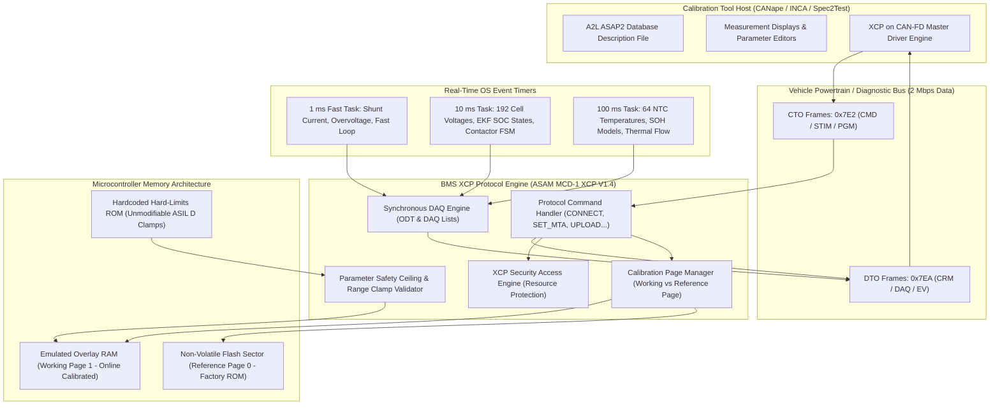
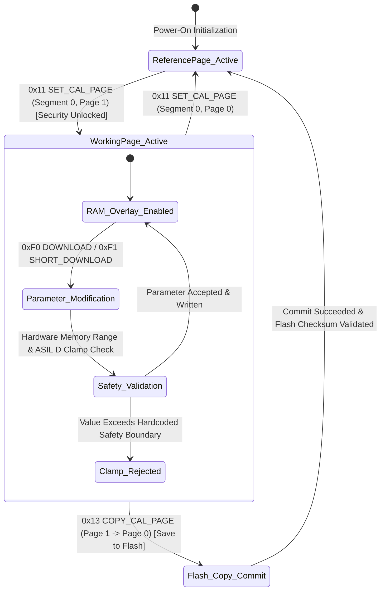
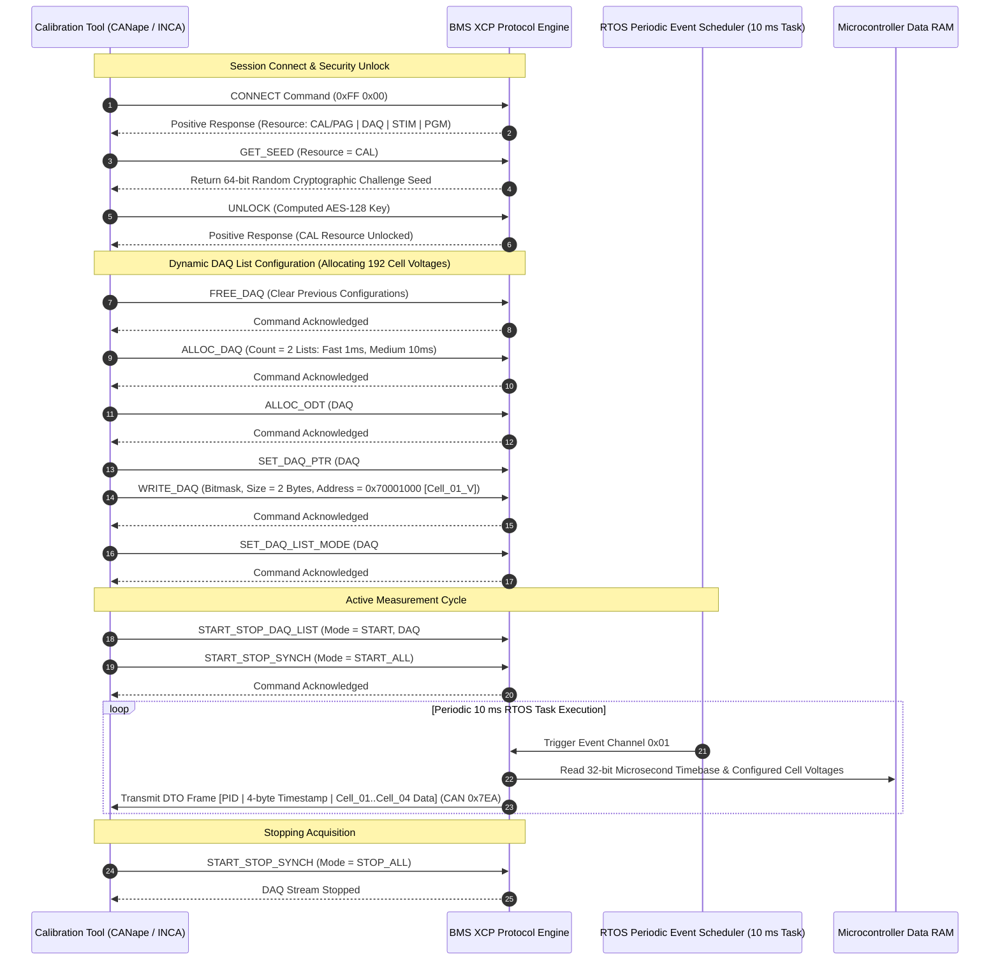

# BMS Software Requirements Specification: XCP Calibration, Measurement & DAQ Protocol

**Document ID:** BMS-SRS-20-XCP-CALIB  
**Version:** 2.4.0  
**Classification:** Automotive High-Voltage Powertrain (EV)  
**Protocol Compliance:** ASAM MCD-1 XCP V1.4 (Universal Measurement and Calibration Protocol), ASAM MCD-2 MC (A2L / ASAP2), XCP on CAN-FD, ISO 26262:2018 (ASIL B / QM)  
**Target Architecture:** Dual-Core Lockstep MCU, Microcontroller RAM Calibration Working Page, Hardware True Random Number Generator (TRNG), High-Resolution 32-bit Free-Running Microsecond Timer

---

## 1. Scope & Protocol Topography

The Universal Measurement and Calibration Protocol (XCP) enables internal microcontroller memory inspection, high-frequency synchronous data acquisition (DAQ), online parameter calibration, and flash programming during BMS development, HiL regression testing, and vehicle winter/summer testing campaigns.

The BMS XCP transport layer operates over **CAN-FD** using dedicated diagnostic identifiers:
* **Master Request (Command Transfer Object - CTO):** CAN-FD ID `0x7E2` (Client to BMS)
* **Slave Response (Data Transfer Object - DTO / CRM / Ev):** CAN-FD ID `0x7EA` (BMS to Client)

---

## 2. Two-Page Calibration Strategy (Working vs. Reference Page)

---

## 3. Synchronous DAQ Configuration & High-Rate Acquisition Sequence

---

## 4. Detailed Functional Requirements

### Requirement: BMS-REQ-XCP-1801
* **Title:** XCP on CAN-FD Connection Management & Transport Layer Protocol Engine
* **ASIL Level:** ASIL B
* **Verification Method:** Test
* **Traceability:** ASAM MCD-1 XCP V1.4; ISO 11898-1:2015
* **Inputs:**
  * `XCP_CTO_Frame` (Data Type: `uint8_t[64]`, Source: CAN-FD ID `0x7E2`)
* **Outputs:**
  * `XCP_DTO_Frame` (Data Type: `uint8_t[64]`, Destination: CAN-FD ID `0x7EA`)
  * `XCP_Connection_State` (Data Type: `uint8_t`, Unit: `enum`, Values: `{DISCONNECTED, CONNECTED}`, Destination: Core)
* **Timing & Debounce:** Command response latency: $T_{\text{response}} \le 2.0\text{ ms}$; Timeout: $1000\text{ ms}$.
* **Description:**  
  The BMS software shall implement a fully compliant ASAM MCD-1 XCP V1.4 slave protocol engine over CAN-FD:
  1. The engine shall process incoming Command Transfer Objects (CTO) on CAN-FD ID `0x7E2` and transmit Command Response Messages (CRM) on CAN-FD ID `0x7EA`.
  2. Maximum CTO size: $64\text{ bytes}$; Maximum DTO size: $64\text{ bytes}$.
  3. **Standard Mandatory Command Set Supported:**
     * `CONNECT (0xFF)`: Returns protocol version (`0x0104`), max CTO/DTO length, byte order (Intel Little-Endian), and supported resource mask (`0x1F`: CAL/PAG, DAQ, STIM, PGM).
     * `DISCONNECT (0xFE)`: Terminates active XCP session, halts all DAQ lists, and locks security resources.
     * `GET_STATUS (0xFD)`: Reports current session status, active calibration page, and resource protection state.
     * `SYNCH (0xFC)`: Synchronizes client/server sequence counters after a timeout.
  4. If an unsupported command or invalid parameter is received:
     * Transmit error response: `0xFE [ErrorCode]` within $\le 2.0\text{ ms}$.
* **Rationale:** Adherence to ASAM MCD-1 XCP V1.4 guarantees compatibility with global automotive calibration suites (Vector CANape, ETAS INCA, dSPACE ControlDesk).
* **Acceptance Criteria:**  
  1. Receipt of a valid `CONNECT` command (`0xFF 0x00`) on CAN-FD ID `0x7E2` shall elicit a positive CRM response on CAN-FD ID `0x7EA` within $\le 2.0\text{ ms}$ reporting protocol version `0x0104` and little-endian byte ordering.
  2. Any unrecognized command code shall elicit an error response containing `0xFE 0x20` (`ERR_CMD_UNKNOWN`) within $\le 2.0\text{ ms}$.

---

### Requirement: BMS-REQ-XCP-1802
* **Title:** Synchronous High-Rate DAQ Engine & Microsecond Timestamping
* **ASIL Level:** ASIL B
* **Verification Method:** Test
* **Traceability:** ASAM MCD-1 XCP V1.4 Clause 2.4; ASAM MCD-2 MC
* **Inputs:**
  * `RTOS_Timer_1ms_Tick` (Data Type: `event`, Event Channel: `0x00`)
  * `RTOS_Timer_10ms_Tick` (Data Type: `event`, Event Channel: `0x01`)
  * `RTOS_Timer_100ms_Tick` (Data Type: `event`, Event Channel: `0x02`)
  * `Free_Running_Microsecond_Counter` (Data Type: `uint32_t`, Unit: `us`, Source: Hardware Free-Running Timer)
* **Outputs:**
  * `XCP_DAQ_DTO_Stream` (Data Type: `uint8_t[64]`, Destination: CAN-FD ID `0x7EA`)
  * `DAQ_Overload_Warning_Flag` (Data Type: `boolean`, Unit: `bool`, Destination: Diagnostics)
* **Timing & Debounce:** Sampling period jitter: $\le \pm 50\,\mu\text{s}$ at $10\text{ ms}$ task; Timestamp resolution: $1.0\,\mu\text{s}/\text{bit}$.
* **Description:**  
  The BMS software shall support synchronous Data Acquisition (DAQ) lists with microsecond time resolution:
  1. The software shall support at least **16 independent DAQ lists** and up to **64 Object Description Tables (ODTs)** with dynamic memory allocation (`ALLOC_DAQ`, `ALLOC_ODT`, `WRITE_DAQ`).
  2. Supported Event Channels:
     * **Channel `0x00` ($1\text{ ms}$ fast loop):** Dedicated to high-speed current shunt samples and contactor fast-trip lines.
     * **Channel `0x01` ($10\text{ ms}$ loop):** Dedicated to 192 individual cell voltages, pack voltage, and EKF SOC estimation states.
     * **Channel `0x02` ($100\text{ ms}$ slow loop):** Dedicated to 64 module temperatures, insulation resistance, and SOH capacity models.
  3. **32-Bit Timestamping:**
     * Every DAQ packet configured with timestamping shall prepend a 4-byte microsecond timestamp derived from `Free_Running_Microsecond_Counter`.
     * Timestamp resolution: exactly $1.0\,\mu\text{s}/\text{bit}$.
  4. **Overflow Protection:**
     * If the CAN-FD transmit mailbox is full when a new DAQ sample is generated:
       * Set the DAQ list overload flag bit in the DTO header.
       * Set `DAQ_Overload_Warning_Flag = TRUE`.
       * Discard the sample to prevent delaying the real-time RTOS task execution.
* **Rationale:** Precise microsecond-correlated measurements of cell voltages and current pulses are essential for offline electrochemical battery model parameter identification.
* **Acceptance Criteria:**  
  1. DAQ DTO frames associated with Event Channel `0x01` shall be dispatched at the nominal $10.0\text{ ms}$ task rate with jitter $\le \pm 50\,\mu\text{s}$.
  2. If the transmit buffer overflows, the DAQ overload flag shall be asserted and task execution shall continue without blocking.

---

### Requirement: BMS-REQ-XCP-1803
* **Title:** Online Two-Page Calibration Strategy (Working vs. Reference Page)
* **ASIL Level:** ASIL B
* **Verification Method:** Test
* **Traceability:** ASAM MCD-1 XCP V1.4 Clause 2.3
* **Inputs:**
  * `XCP_CTO_Command` (Commands: `SET_CAL_PAGE (0x11)`, `GET_CAL_PAGE (0x12)`, `COPY_CAL_PAGE (0x13)`)
  * `Vehicle_Speed` (Data Type: `uint16_t`, Unit: `0.1 km/h`, Source: CAN-FD)
  * `Main_Contactors_Closed_Status` (Data Type: `boolean`, Unit: `bool`, Source: Contactor State Manager)
* **Outputs:**
  * `Active_Calibration_Page` (Data Type: `uint8_t`, Values: `{PAGE_0_REFERENCE, PAGE_1_WORKING}`, Destination: Memory Manager)
  * `RAM_Overlay_Active` (Data Type: `boolean`, Unit: `bool`, Destination: Microcontroller Bus Controller)
* **Timing & Debounce:** Page switch transition latency: $\le 1.0\text{ ms}$; Task execution jitter during switch: $\le 100\,\mu\text{s}$.
* **Description:**  
  The BMS software shall support dual-page memory management to enable bumpless real-time parameter tuning:
  1. Memory Segments:
     * **Page 0 (Reference Page):** Resides in non-volatile Flash ROM; contains factory-certified default calibration tables (read-only during drive).
     * **Page 1 (Working Page):** Resides in high-speed overlay SRAM; permits real-time read and write access (`DOWNLOAD`, `SHORT_DOWNLOAD`).
  2. **Page Switching:**
     * Upon receiving `SET_CAL_PAGE (0x11)` targeting Page 1:
       * Microcontroller address translation logic shall remap calibration read requests from Flash ROM to the overlay SRAM (`RAM_Overlay_Active = TRUE`).
       * The transition must occur within $\le 1.0\text{ ms}$ without resetting the ECU or introducing task jitter $> 100\,\mu\text{s}$.
  3. **Page Copying:**
     * Upon receiving `COPY_CAL_PAGE (0x13, Src=0x01, Dst=0x00)`:
       * The BMS shall verify that vehicle speed is $0.0\text{ km/h}$ and contactors are open (`Main_Contactors_Closed_Status == FALSE`).
       * The modified RAM calibration parameters shall be programmed into the Flash ROM sector with CRC32 verification.
* **Rationale:** Two-page overlay calibration permits vehicle calibration engineers to tweak filter time constants and derating curves dynamically without stopping the vehicle or reflashing the ECU.
* **Acceptance Criteria:**  
  1. `SET_CAL_PAGE` targeting Page 1 shall execute within $\le 1.0\text{ ms}$ and activate overlay RAM without causing task overrun or ECU reset.
  2. `COPY_CAL_PAGE` shall return error `0xFE 0x22` (`ERR_CONDITIONS_NOT_CORRECT`) if vehicle speed is $> 0.0\text{ km/h}$ or contactors are closed.

---

### Requirement: BMS-REQ-XCP-1804
* **Title:** Parameter Modification Range Checking & Hardcoded ASIL D Safety Clamps
* **ASIL Level:** ASIL D
* **Verification Method:** Test
* **Traceability:** ISO 26262-4:2018; ISO 26262-5:2018
* **Inputs:**
  * `Target_Calibration_Address` (Data Type: `uint32_t`, Source: XCP SET_MTA)
  * `New_Parameter_Payload` (Data Type: `uint8_t[]`, Source: XCP DOWNLOAD / SHORT_DOWNLOAD)
* **Outputs:**
  * `Parameter_Write_Status` (Data Type: `enum`, Values: `{ACCEPTED, REJECTED_OUT_OF_BOUNDS, REJECTED_SAFETY_CLAMP}`)
  * `XCP_Error_Response` (Value: `0xFE 0x23` for `ERR_OUT_OF_RANGE`)
* **Timing & Debounce:** Range check execution latency: $\le 1.0\text{ ms}$ upon download command.
* **Description:**  
  The BMS software shall validate all calibration parameter modifications submitted via XCP before committing them to overlay RAM:
  1. For every calibration variable, the software shall check:
     $$\text{Val}_{\text{min,calib}} \le \text{Val}_{\text{new}} \le \text{Val}_{\text{max,calib}}$$
  2. **Hardcoded ASIL D Safety Ceilings:**
     * Cell Overvoltage Trip Threshold ($V_{\text{OV}}$): Hard clamp ceiling $\le 4220\text{ mV}$ (Unmodifiable ROM constant).
     * Cell Undervoltage Trip Threshold ($V_{\text{UV}}$): Hard clamp floor $\ge 2700\text{ mV}$.
     * Maximum Discharge Temperature ($T_{\text{max}}$): Hard clamp ceiling $\le 55.0^\circ\text{C}$.
     * Maximum Fast Charge Current ($I_{\text{max}}$): Hard clamp ceiling $\le 500.0\text{ A}$.
  3. If a calibration tool attempts to download a parameter value violating the hardcoded safety bounds:
     * Reject the write command immediately.
     * Retain the existing safe parameter value in RAM.
     * Transmit error response `0xFE 0x23` (`ERR_OUT_OF_RANGE`).
* **Rationale:** Prevents development engineers or tuning tools from inadvertently modifying safety-critical thresholds to unsafe levels that could cause battery fires or thermal runaway.
* **Acceptance Criteria:**  
  1. Any download command specifying a value beyond the parameter min/max calibration bounds or violating ASIL D safety ceilings shall be rejected with `ERR_OUT_OF_RANGE` (`0xFE 0x23`).
  2. Active operational parameters in memory shall remain unmodified when an out-of-range write is rejected.

---

### Requirement: BMS-REQ-XCP-1805
* **Title:** XCP Seed-and-Key Resource Protection & Cryptographic Authentication
* **ASIL Level:** ASIL B
* **Verification Method:** Test
* **Traceability:** ASAM MCD-1 XCP V1.4 Clause 2.8; ISO/SAE 21434:2021
* **Inputs:**
  * `XCP_Command_GET_SEED` (Payload: `{0xF8, Mode, Resource}`, Resource: `{0x01=CAL/PAG, 0x04=DAQ, 0x10=PGM}`)
  * `XCP_Command_UNLOCK` (Payload: `{0xF7, KeyLength, KeyBytes...}`)
* **Outputs:**
  * `Unlocked_Resource_Mask` (Data Type: `uint8_t`, Unit: `bitfield`, Destination: XCP Security Core)
  * `XCP_Response_Seed` (Payload: `{0xFF, SeedLength, SeedBytes...}`)
* **Timing & Debounce:** Seed validity window: $5000\text{ ms} \pm 100\text{ ms}$. Anti-brute force delay: $600.0\text{ s}$ after 3 failed attempts.
* **Description:**  
  Access to calibration (`CAL/PAG`) and flash reprogramming (`PGM`) resources shall be protected by an authenticated challenge-response mechanism:
  1. Upon receiving `GET_SEED (0xF8)`:
     * The BMS shall generate a 64-bit random challenge using the microcontroller hardware True Random Number Generator (TRNG).
     * The seed must be cryptographically unpredictable and refresh on every request.
  2. The client must submit the matching 128-bit AES-CMAC key via `UNLOCK (0xF7)` within $5000\text{ ms}$.
  3. If key matches:
     * Grant access to the requested resource (`Unlocked_Resource_Mask |= Resource`).
     * Reset the invalid attempt counter.
  4. If key is incorrect:
     * Transmit error response `0xFE 0x29` (`ERR_ACCESS_LOCKED`).
     * Increment the invalid attempt counter; if count $\ge 3$, enforce a $600\text{ s}$ security lockout.
* **Rationale:** Protects proprietary electrochemical model coefficients and prevents unauthorized modification of vehicle powertrain calibrations.
* **Acceptance Criteria:**  
  1. `DOWNLOAD` or `SET_CAL_PAGE` commands sent while the calibration resource is locked shall be rejected with `ERR_ACCESS_DENIED` (`0xFE 0x24`).
  2. Submitting a verified AES-128 key matching the TRNG seed shall unlock the requested resource within $\le 2.0\text{ ms}$.
  3. Three consecutive invalid unlock attempts shall lock security access for a mandatory timeout of $600\text{ s}$.

---

### Requirement: BMS-REQ-XCP-1806
* **Title:** DAQ Busload Monitoring & Automatic Overload Throttling
* **ASIL Level:** ASIL B
* **Verification Method:** Test
* **Traceability:** ASAM MCD-1 XCP V1.4; ISO 11898-1:2015
* **Inputs:**
  * `CAN_FD_Tx_Mailbox_Pending_Count` (Data Type: `uint8_t`, Range: `0..32`, Source: CAN Driver)
  * `CAN_FD_Busload_Percent` (Data Type: `uint8_t`, Unit: `1 %`, Range: `0..100`, Source: CAN Controller)
* **Outputs:**
  * `DAQ_Prescaler_Factor` (Data Type: `uint8_t`, Range: `1..255`, Destination: DAQ Scheduler)
  * `DAQ_Throttling_Active` (Data Type: `boolean`, Unit: `bool`, Destination: Diagnostics)
* **Timing & Debounce:** Busload evaluation period: $50\text{ ms} \pm 2\text{ ms}$. Throttling reaction: immediate ($\le 10\text{ ms}$). Recovery hold time: $3000\text{ ms}$.
* **Description:**  
  The BMS software shall continuously supervise CAN-FD bus utilization to guarantee that XCP measurement traffic never starves critical powertrain safety frames:
  1. The software shall evaluate total CAN-FD bus utilization:
     * Normal DAQ Operation: Permitted while `CAN_FD_Busload_Percent <= 70%`.
     * If `CAN_FD_Busload_Percent > 75%` OR `CAN_FD_Tx_Mailbox_Pending_Count >= 6` for $> 50\text{ ms}$:
       * Assert `DAQ_Throttling_Active = TRUE`.
       * Automatically increase the DAQ event prescaler:
         $$\text{Prescaler} = \text{Prescaler} \times 2$$
         (Halving DAQ message transmission frequency).
  2. Under no circumstances shall XCP DAQ frames delay or preempt ASIL D cyclic safety frames (`0x100`, `0x101`, `0x103`, `0x110`).
  3. Once busload drops below $60\%$ for $\ge 3000\text{ ms}$, restore the original client-configured DAQ prescaler.
* **Rationale:** Excessive DAQ measurement lists configured by a tester could saturate the CAN-FD bus, delaying traction motor torque requests or emergency thermal alarm frames.
* **Acceptance Criteria:**  
  1. If `CAN_FD_Busload_Percent` exceeds $75\%$ for $> 50\text{ ms}$, the DAQ prescaler shall double within $\le 10\text{ ms}$ and `DAQ_Throttling_Active` shall be set to `TRUE`.
  2. Cyclic safety frames on CAN-FD shall maintain their transmission schedule with latency jitter $\le \pm 1.0\text{ ms}$ regardless of active XCP DAQ load.
