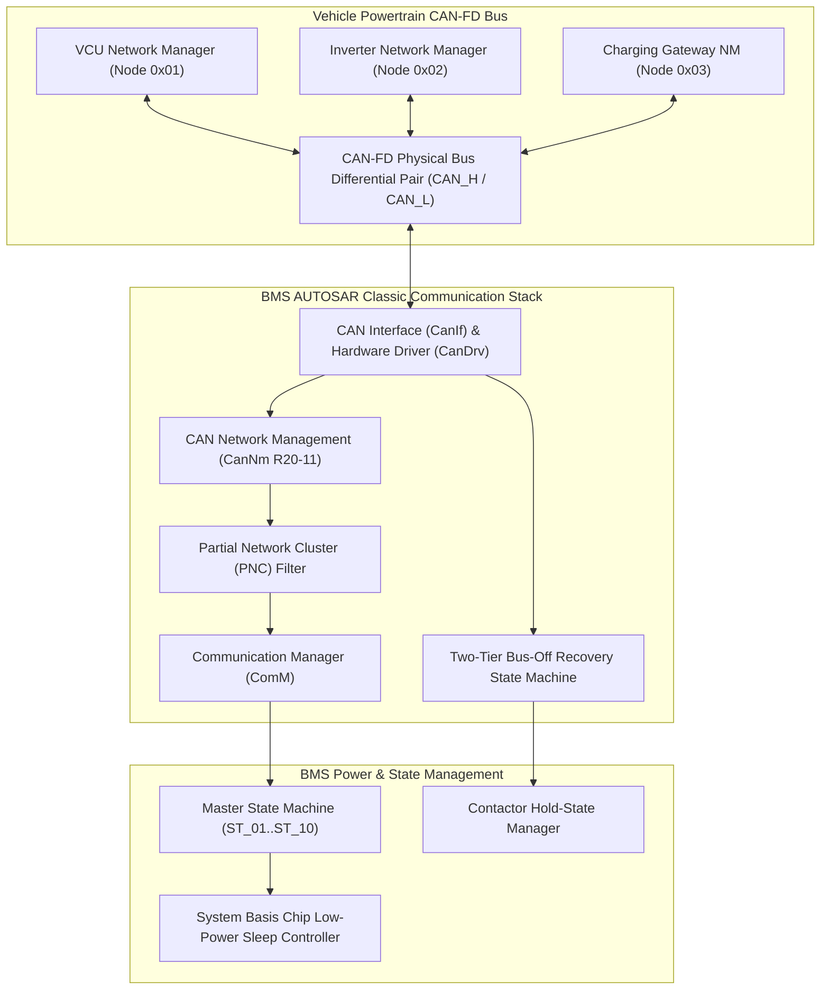
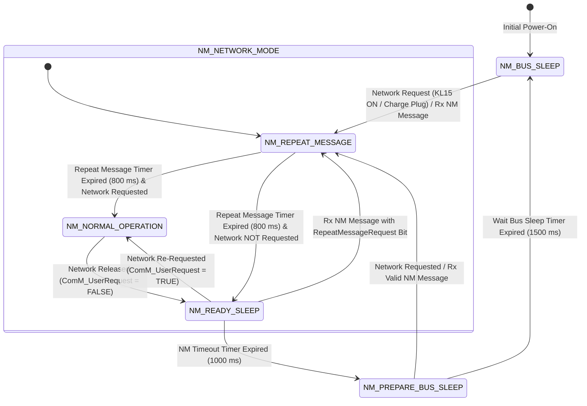

# BMS Software Requirements Specification: AUTOSAR Network Management & Bus-Off Recovery

**Document ID:** BMS-SRS-21-CAN-NM  
**Version:** 2.4.0  
**Classification:** Automotive High-Voltage Powertrain (EV)  
**Network & Safety Compliance:** AUTOSAR Classic R20-11 SWS CAN Network Management (CanNm), AUTOSAR SWS Communication Manager (ComM), ISO 11898-1:2015 (CAN-FD Physical & Data Link), ISO 26262:2018 (ASIL C)  
**Addressing & Bitrate:** Powertrain CAN-FD NM Base ID `0x600` (Node ID `0x10`), Arbitration 500 kbps, Data 2000 kbps

---

## 1. Scope & Network Architecture Overview

The AUTOSAR CAN Network Management (CanNm) software module coordinates distributed ECU sleep/wake transitions across the vehicle CAN-FD network. In an electric vehicle powertrain, the BMS must:
1. Synchronize power states with the Vehicle Control Unit (VCU) and Inverter without keeping the vehicle bus awake unnecessarily.
2. Implement **Partial Networking (PNC)** to wake up only for relevant clusters (e.g., wake up for DC fast charging without activating the entire chassis/infotainment bus).
3. Detect physical bus short circuits and execute a two-stage **Fast/Slow Bus-Off Recovery** sequence conforming to ISO 11898-1, maintaining contactor safety during transient bus faults.



---

## 2. AUTOSAR CanNm State Machine



---

## 3. CAN-FD Bus-Off Recovery State Machine

```mermaid
sequenceDiagram
    autonumber
    participant CAN_CTRL as CAN-FD Hardware Controller
    participant BUS_OFF as BMS Bus-Off Recovery Engine
    participant HVC as Contactor Gate Drivers
    participant DEM as AUTOSAR Dem (Diagnostics)
    participant VCU as Vehicle Control Unit (VCU)

    Note over CAN_CTRL,BUS_OFF: Normal Driving Phase (Contactors Closed)
    CAN_CTRL->>CAN_CTRL: Severe Bus EMI: Transmit Error Counter (TEC) > 255
    CAN_CTRL->>BUS_OFF: Interrupt: CAN_CONTROLLER_BUS_OFF Asserted
    
    Note over BUS_OFF,HVC: Fast Recovery Phase (Attempts 1 to 5, Interval = 50 ms)
    BUS_OFF->>HVC: Command Contactor State HOLD (Hold Closed for max 500 ms)
    BUS_OFF->>BUS_OFF: Reset TEC/REC Registers; Start Fast Timer (50 ms)
    BUS_OFF->>CAN_CTRL: Attempt Fast Re-Initialization #1
    
    alt Re-Initialization Succeeded (Bus Nominal)
        CAN_CTRL-->>BUS_OFF: 128 x 11 Recessive Bits Verified (Bus-Off Cleared)
        BUS_OFF->>HVC: Resume Normal Closed-Loop Control
        BUS_OFF->>BUS_OFF: Reset Bus-Off Error Counter to 0
    else Bus Fault Persists (e.g. Physical Short to Ground)
        CAN_CTRL-->>BUS_OFF: Controller Immediately Returns to Bus-Off
        BUS_OFF->>BUS_OFF: Increment Fast Retry Counter (Retries 2..5)
        
        Note over BUS_OFF,HVC: Transition to Slow Recovery Phase (t > 500 ms)
        BUS_OFF->>HVC: Safe State Trigger: 500 ms Guard Expired -> Graceful Torque Rampdown
        BUS_OFF->>HVC: Command Main Contactors OPEN (< 15 ms)
        BUS_OFF->>DEM: Qualify DTC 0x9A0A10 (CAN-FD Bus-Off Latch)
        
        loop Slow Recovery Phase (Every 1000 ms)
            BUS_OFF->>CAN_CTRL: Slow Re-Initialization Attempt (1000 ms Interval)
        end
    end
```

---

## 4. Detailed Functional Requirements

### Requirement: BMS-REQ-NM-1901
* **Title:** AUTOSAR CanNm State Machine Transition Flow Control
* **ASIL Level:** ASIL B
* **Verification Method:** Test
* **Traceability:** AUTOSAR Classic SWS CAN Network Management R20-11 Clause 7.2; ISO 26262-4
* **Inputs:**
  * `ComM_Network_Requested` (Data Type: `boolean`, Unit: `bool`, Values: `{FALSE, TRUE}`, Source: ComM)
  * `Rx_NM_PDU_Received` (Data Type: `boolean`, Unit: `bool`, Source: CAN-FD ID `0x600..0x63F`)
  * `NM_Timeout_Timer` (Data Type: `uint16_t`, Unit: `ms`, Range: `0..5000`, Source: OS Timer)
* **Outputs:**
  * `CanNm_Active_State` (Data Type: `uint8_t`, Unit: `enum`, Values: `{BUS_SLEEP, PREPARE_BUS_SLEEP, READY_SLEEP, NORMAL_OPERATION, REPEAT_MESSAGE}`, Destination: ComM)
  * `Tx_NM_PDU_Enabled` (Data Type: `boolean`, Unit: `bool`, Destination: CanIf)
* **Timing & Debounce:** NM cycle period: $100\text{ ms} \pm 2\text{ ms}$; First frame latency: $\le 10\text{ ms}$; Repeat message duration: $800\text{ ms} \pm 10\text{ ms}$; NM timeout: $1000\text{ ms}$; Wait bus sleep: $1500\text{ ms}$.
* **Description:**  
  The BMS software shall execute the standardized AUTOSAR Classic CanNm state machine:
  1. **Transition from `BUS_SLEEP` to `REPEAT_MESSAGE`:**
     * Triggered by `ComM_Network_Requested == TRUE` OR reception of any valid NM frame (`0x600..0x63F`).
     * The BMS shall immediately transmit its first NM PDU (`CAN ID 0x610`) within $\le 10\text{ ms}$ (immediate transmit).
     * Start the Repeat Message Timer ($t_{\text{repeat\_message}} = 800\text{ ms} \pm 10\text{ ms}$).
  2. **Transition from `REPEAT_MESSAGE` to `NORMAL_OPERATION`:**
     * Upon expiration of $t_{\text{repeat\_message}}$ while `ComM_Network_Requested == TRUE`.
     * Transmit cyclic NM PDUs every $100\text{ ms} \pm 2\text{ ms}$.
  3. **Transition from `NORMAL_OPERATION` to `READY_SLEEP`:**
     * Occurs when application requests network release (`ComM_Network_Requested == FALSE`).
     * In `READY_SLEEP`, the BMS shall cease transmitting its own NM PDUs, but start the NM Timeout Timer ($t_{\text{nm\_timeout}} = 1000\text{ ms}$).
  4. **Transition to `PREPARE_BUS_SLEEP`:**
     * If no NM PDUs are received on the bus for $1000\text{ ms}$ while in `READY_SLEEP`.
     * Start the Wait Bus Sleep Timer ($t_{\text{wait\_bus\_sleep}} = 1500\text{ ms}$).
  5. **Transition to `BUS_SLEEP`:**
     * Upon expiration of $t_{\text{wait\_bus\_sleep}}$ ($1500\text{ ms}$) with zero bus activity.
     * Disable CAN transceivers and authorize ECU low-power sleep mode.
* **Rationale:** Predictable network management sequencing ensures all ECUs enter and exit sleep mode synchronously, preventing battery drain from solitary awake controllers.
* **Acceptance Criteria:**  
  1. The first NM frame on CAN ID `0x610` shall be dispatched within $\le 10.0\text{ ms}$ upon network request assertion (`ComM_Network_Requested == TRUE`).
  2. In `NORMAL_OPERATION`, NM frames shall be transmitted at cyclic intervals of $100.0\text{ ms} \pm 2.0\text{ ms}$.
  3. Following network release and cessation of bus traffic, `CanNm_Active_State` shall transition through `READY_SLEEP` and `PREPARE_BUS_SLEEP` to `BUS_SLEEP` within $2500\text{ ms} \pm 50\text{ ms}$.

---

### Requirement: BMS-REQ-NM-1902
* **Title:** Partial Networking (PNC) Cluster Filtering & Wakeup Selectivity
* **ASIL Level:** ASIL B
* **Verification Method:** Test
* **Traceability:** AUTOSAR Classic SWS CAN Network Management R20-11 Clause 7.12
* **Inputs:**
  * `Rx_NM_PDU_Payload` (Data Type: `uint8_t[8]`, Source: CAN-FD ID `0x600..0x63F`)
* **Outputs:**
  * `PNC_Cluster_Active_Bitmap` (Data Type: `uint16_t`, Unit: `bitfield`, Destination: ComM)
  * `PNC_Wakeup_Valid_Flag` (Data Type: `boolean`, Unit: `bool`, Destination: ComM)
* **Timing & Debounce:** Frame decoding and filter response latency: $\le 5\text{ ms}$.
* **Description:**  
  The BMS shall implement Partial Network Cluster (PNC) filtering to prevent unnecessary wakeups:
  1. The BMS is assigned to two specific Partial Network Clusters:
     * **PNC 16 (Powertrain Domain):** Mapped to Byte 3, Bit 0 of the NM payload.
     * **PNC 32 (Charging Domain):** Mapped to Byte 5, Bit 0 of the NM payload.
  2. When an NM frame is received on the bus while in sleep:
     * If the Partial Network Info (PNI) bit in Byte 0 (CBV) is $0$: Ignore frame (legacy frame).
     * If PNI bit is $1$: Inspect the Partial Network Info byte mask.
  3. **Wakeup Filtering Rules:**
     * If PNC 16 OR PNC 32 bit is set (`1`): Set `PNC_Wakeup_Valid_Flag = TRUE`. Wake up the BMS application layer and transition to `NM_REPEAT_MESSAGE`.
     * If NEITHER PNC 16 nor PNC 32 is set (e.g., frame requests only Infotainment PNC 48 or Comfort PNC 64):
       * Discard the frame.
       * Maintain `PNC_Wakeup_Valid_Flag = FALSE`.
       * The BMS shall **REMAIN IN SLEEP**, ignoring network traffic.
* **Rationale:** In modern EVs, preconditioning cabin air or charging does not require waking unrelated ECUs; partial networking reduces standby energy consumption by up to $60\%$.
* **Acceptance Criteria:**  
  1. Reception of an NM frame with PNC 16 or PNC 32 asserted shall set `PNC_Wakeup_Valid_Flag = TRUE` and transition the BMS to `NM_REPEAT_MESSAGE` within $\le 5.0\text{ ms}$.
  2. Reception of an NM frame without PNC 16 or PNC 32 asserted shall not wake the BMS application and the BMS shall remain in low-power sleep without transmitting frames.

---

### Requirement: BMS-REQ-NM-1903
* **Title:** CAN-FD Fast & Slow Bus-Off Recovery Algorithm
* **ASIL Level:** ASIL C
* **Verification Method:** Test
* **Traceability:** ISO 11898-1:2015 Clause 12.1.4.4; AUTOSAR SWS CanSM Clause 7.3
* **Inputs:**
  * `CAN_Controller_Bus_Off_Interrupt` (Data Type: `boolean`, Unit: `discrete`, Source: CAN Controller Core)
* **Outputs:**
  * `Bus_Off_Recovery_Phase` (Data Type: `uint8_t`, Unit: `enum`, Values: `{PHASE_NOMINAL, PHASE_FAST_RECOVERY, PHASE_SLOW_RECOVERY}`, Destination: CanSM)
  * `CAN_Controller_Reinit_Trigger` (Data Type: `boolean`, Unit: `discrete`, Destination: CanDrv)
  * `DTC_CAN_Bus_Off_Fault` (Data Type: `uint32_t`, Value: `0x9A0A10`, Destination: Dem)
* **Timing & Debounce:** Fast recovery interval: $50\text{ ms} \pm 2\text{ ms}$ (max 5 retries); Slow recovery interval: $1000\text{ ms} \pm 10\text{ ms}$; Fault confirmation: $\le 300\text{ ms}$.
* **Description:**  
  Upon detection of a CAN controller hardware Bus-Off condition ($TEC > 255$):
  1. The software shall immediately enter `PHASE_FAST_RECOVERY`:
     * Increment the cumulative Bus-Off counter.
     * Execute up to **5 consecutive fast recovery attempts** with a retry interval of $t_{\text{fast}} = 50\text{ ms} \pm 2\text{ ms}$.
     * Each attempt commands `CanIf` to reinitialize the controller registers and listen for $128$ sequences of $11$ consecutive recessive bits.
  2. If the bus recovers during fast recovery (transceiver re-synchronizes):
     * Return to `PHASE_NOMINAL`.
     * Reset the fast retry counter to 0.
  3. If all 5 fast attempts fail (bus-off persists for $> 250\text{ ms}$):
     * Transition to `PHASE_SLOW_RECOVERY`.
     * Retransmit recovery pulses at an extended interval of $t_{\text{slow}} = 1000\text{ ms} \pm 10\text{ ms}$.
     * Qualify confirmed DTC `0x9A0A10` within $\le 300\text{ ms}$.
* **Rationale:** Fast recovery clears transient electromagnetic disturbances (e.g., high-current contactor arcing) without noticeable delay, while slow recovery prevents bus flooding during permanent wiring harness cuts.
* **Acceptance Criteria:**  
  1. Following a bus-off interrupt, the first reinitialization attempt shall execute within $50.0\text{ ms} \pm 2.0\text{ ms}$ in `PHASE_FAST_RECOVERY`.
  2. If 5 fast recovery attempts fail to restore communication, `Bus_Off_Recovery_Phase` shall transition to `PHASE_SLOW_RECOVERY` with subsequent attempts spaced by $1000\text{ ms} \pm 10\text{ ms}$, and DTC `0x9A0A10` qualified.

---

### Requirement: BMS-REQ-NM-1904
* **Title:** Transient Bus-Off Contactor State Hold & Fail-Safe Derating
* **ASIL Level:** ASIL D
* **Verification Method:** Test
* **Traceability:** ISO 26262-4:2018; ISO 6469-3
* **Inputs:**
  * `Bus_Off_Recovery_Phase` (Data Type: `uint8_t`, Unit: `enum`, Source: Bus-Off FSM)
  * `Bus_Off_Active_Duration_ms` (Data Type: `uint16_t`, Unit: `ms`, Range: `0..10000`, Source: OS Timer)
  * `Vehicle_Speed` (Data Type: `uint16_t`, Unit: `0.1 km/h`, Source: Last Valid ESP Frame)
* **Outputs:**
  * `Contactor_Hold_State_Active` (Data Type: `boolean`, Unit: `bool`, Destination: Contactor Driver)
  * `Emergency_Contactor_Open_Cmd` (Data Type: `boolean`, Unit: `discrete`, Destination: Contactor Driver)
* **Timing & Debounce:** Hold-state guard timeout: $500\text{ ms} \pm 10\text{ ms}$; Stationary emergency open latency: $\le 20\text{ ms}$.
* **Description:**  
  To prevent dangerous loss of propulsion on highways caused by momentary communication glitches:
  1. While in `PHASE_FAST_RECOVERY` ($t \le 500\text{ ms}$):
     * The BMS shall **HOLD ALL HIGH-VOLTAGE CONTACTORS CLOSED** (`Contactor_Hold_State_Active = TRUE`).
     * Continue autonomous cell voltage, current, and temperature supervision.
     * Freeze the last valid power limits for up to $500\text{ ms}$.
  2. **Extended Bus-Off Safe State:**
     * If `Bus_Off_Active_Duration_ms > 500 ms`:
       * If vehicle is in motion ($v > 5.0\text{ km/h}$): Enter Limp-Home power hold for $10.0\text{ s}$, then gracefully ramp current to zero.
       * If vehicle is stationary ($v \le 5.0\text{ km/h}$) OR in charging state: Force `Emergency_Contactor_Open_Cmd = TRUE` within $\le 20\text{ ms}$ to guarantee electrical safety.
* **Rationale:** Instantly opening contactors at 100 km/h due to a 100 ms EMI glitch would cut traction and power steering, posing an extreme hazard to occupants.
* **Acceptance Criteria:**  
  1. For bus-off conditions lasting $\le 500\text{ ms}$, contactor commands shall remain asserted (`Contactor_Hold_State_Active == TRUE`).
  2. If bus-off duration exceeds $500\text{ ms}$ while stationary or charging, `Emergency_Contactor_Open_Cmd` shall assert within $\le 20\text{ ms}$.

---

### Requirement: BMS-REQ-NM-1905
* **Title:** Network Management Message Synchronization & Timeout Supervision
* **ASIL Level:** ASIL B
* **Verification Method:** Test
* **Traceability:** AUTOSAR Classic SWS CanNm R20-11 Clause 7.3
* **Inputs:**
  * `Rx_NM_PDU_Timestamp` (Data Type: `uint32_t`, Unit: `ms`, Source: CanIf)
* **Outputs:**
  * `Partner_ECU_Dropout_Detected` (Data Type: `boolean`, Unit: `bool`, Destination: Diagnostics)
  * `DTC_Network_Node_Missing` (Data Type: `uint32_t`, Value: `0x9A0A20`, Destination: Dem)
* **Timing & Debounce:** Timeout threshold: $1000\text{ ms} \pm 20\text{ ms}$; Fault confirmation: $\le 50\text{ ms}$.
* **Description:**  
  The BMS software shall supervise the cyclic presence of peer powertrain nodes via their NM frames:
  1. The software shall track individual NM message reception timers for:
     * Node `0x01` (VCU Master Gateway)
     * Node `0x02` (Traction Motor Inverter)
  2. If valid NM PDUs from Node `0x01` fail to arrive within $t_{\text{timeout}} = 1000\text{ ms}$:
     * Set `Partner_ECU_Dropout_Detected = TRUE`.
     * Qualify DTC `0x9A0A20` within $\le 50\text{ ms}$.
     * Transition application state machine to Safe Degraded Mode (`ST_08_DEGRADED`).
* **Rationale:** A missing VCU heartbeat indicates controller failure or severed wiring harness, requiring the BMS to restrict charging/discharging power.
* **Acceptance Criteria:**  
  1. If no valid NM frame from Node `0x01` is received within $1000\text{ ms} \pm 20\text{ ms}$, `Partner_ECU_Dropout_Detected` shall be asserted.
  2. DTC `0x9A0A20` shall be qualified and the system transitioned to degraded mode within $\le 50\text{ ms}$ of timeout confirmation.

---

### Requirement: BMS-REQ-NM-1906
* **Title:** Passive Network Management Mode for Non-Intrusive Charging Surveillance
* **ASIL Level:** ASIL B
* **Verification Method:** Test
* **Traceability:** AUTOSAR Classic SWS CanNm R20-11 Clause 7.10
* **Inputs:**
  * `BMS_Operational_State` (Data Type: `uint8_t`, Unit: `enum`, Source: FSM)
  * `Passive_NM_Mode_Requested` (Data Type: `boolean`, Unit: `bool`, Source: Charging Manager)
* **Outputs:**
  * `CanNm_Passive_Mode_Active` (Data Type: `boolean`, Unit: `bool`, Destination: CanNm)
  * `CAN_Tx_Silent_State` (Data Type: `boolean`, Unit: `bool`, Destination: CanDrv)
* **Timing & Debounce:** Mode switch latency: $\le 10\text{ ms}$.
* **Description:**  
  The BMS software shall support Passive Network Management mode conforming to AUTOSAR CanNm:
  1. In Passive NM Mode (`CanNm_Passive_Mode_Active == TRUE`):
     * The BMS shall receive and parse all incoming NM and application frames.
     * The BMS shall **NEVER transmit its own NM messages** (`0x610` suppressed).
     * The BMS shall not keep the vehicle network awake if external ECUs command bus sleep.
  2. **Application Use Case:** Used during prolonged AC overnight charging or stationary 12V trickle charging: the BMS passively listens for OBC or VCU commands while keeping auxiliary power draw minimal.
* **Rationale:** Prevents the BMS from forcing the entire vehicle network to stay active when only quiet overnight charge management is required.
* **Acceptance Criteria:**  
  1. While in Passive Mode, the BMS shall transmit zero NM frames on CAN ID `0x610`.
  2. Incoming frames shall continue to be processed and evaluated normally within $\le 10\text{ ms}$.
