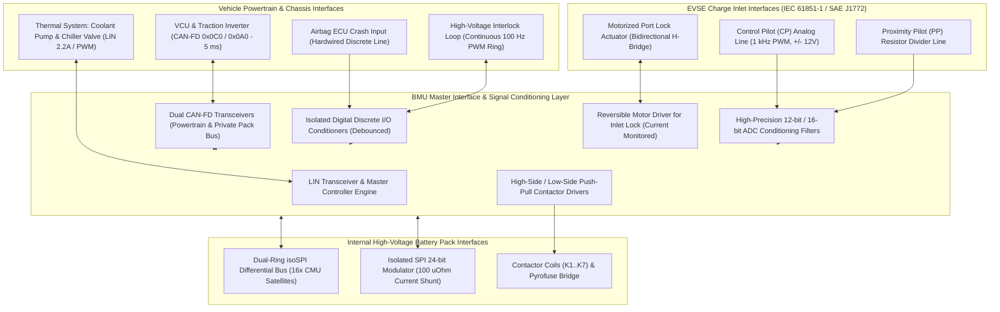

# BMS Software Requirements Specification: Hardware & Software Interface Specifications

**Document ID:** BMS-SRS-22-INTERFACES  
**Version:** 2.4.0  
**Classification:** Automotive High-Voltage Powertrain (EV)  
**Interface & Safety Compliance:** ISO 26262:2018 (ASIL D), IEC 61851-1 (EV Conductive Charging), LIN 2.2A / SAE J2602, ISO 11898-1:2015 (CAN-FD), ISO 6469-3:2021  
**Target Hardware:** Isolated SPI Transceivers (CMTI $> 100\text{ kV}/\mu\text{s}$), Dedicated LIN Transceiver, Low-Side/High-Side Contactor Driver ICs, Charge Port Inlet Actuator Bridge

---

## 1. Scope & System Interface Topography

The Battery Management System (BMS) bridges high-voltage physical sensors, battery cell satellites, off-board charging stations, and vehicle powertrain domain controllers. This specification establishes the electrical, protocol, timing, and fault-tolerance requirements for all external and internal interfaces of the BMS.



---

## 2. Charge Port Interface State Transition Sequence (IEC 61851-1)

```mermaid
sequenceDiagram
    autonumber
    participant EVSE as EVSE Charging Station
    participant PP as Proximity Pin (PP) Interface
    participant CP as Control Pilot (CP) Interface
    participant BMS as BMS Charge Interface Core
    participant LOCK as Motorized Inlet Lock H-Bridge

    Note over EVSE,BMS: Phase 1: Cable Insertion & Mechanical Detection
    EVSE->>PP: User Plugs Connector into Vehicle Inlet
    PP->>BMS: Voltage Drops from 5.0V to 1.5V (PP Resistor = 220 Ohm [32A Cable])
    BMS->>BMS: PP Validated: Cable Mechanically Connected & Rated for 32A

    Note over EVSE,BMS: Phase 2: Pilot Signal Detection (State A -> State B)
    EVSE->>CP: EVSE Generates +12.0V DC Static Pilot (State A)
    CP->>BMS: BMS Measures +12.0V (+/- 0.5V)
    BMS->>CP: Connect Internal Diode & Resistor R2 = 2.74 kOhm
    CP->>EVSE: Pilot Voltage Attenuates from +12.0V to +9.0V (State B)
    EVSE-->>BMS: EVSE Detects State B (Vehicle Connected)

    Note over EVSE,BMS: Phase 3: PWM Duty Cycle & Mechanical Port Locking
    EVSE->>CP: EVSE Starts 1000 Hz PWM Oscillator (+9V to -12V, Duty = 53.3% [32A])
    BMS->>BMS: Measure CP Frequency: 1000 Hz +/- 10 Hz; Decode Duty Cycle -> 32.0 A Limit
    BMS->>LOCK: Drive H-Bridge: Pulse Lock Actuator Motor (12V / 500 ms)
    LOCK-->>BMS: Microswitch Confirms: Charge Plug Deadlocked in Inlet

    Note over EVSE,BMS: Phase 4: Charge Readiness Assertion (State B -> State C)
    BMS->>CP: Switch Resistor R3 = 1.3 kOhm in Parallel (Combined R = 882 Ohm)
    CP->>EVSE: Pilot Voltage Attenuates to +6.0V (State C: Charging Authorized)
    EVSE->>BMS: EVSE Closes Mains Contactor & Energizes AC/DC Power Lines
```

---

## 3. Detailed Functional Requirements

### Requirement: BMS-REQ-IF-2001
* **Title:** Daisy-Chain isoSPI Differential Physical Layer & CMTI Robustness
* **ASIL Level:** ASIL D
* **Verification Method:** Test
* **Traceability:** ISO 26262-5:2018 Clause 8; UN ECE R100.03
* **Inputs:**
  * `isoSPI_Port_A_Rx_Differential` (Data Type: `analog`, Unit: `V`, Range: `-2.0..2.0`, Source: Primary Daisy Chain)
  * `isoSPI_Port_B_Rx_Differential` (Data Type: `analog`, Unit: `V`, Range: `-2.0..2.0`, Source: Redundant Ring Return)
* **Outputs:**
  * `isoSPI_Link_Integrity_Status` (Data Type: `uint8_t`, Unit: `enum`, Values: `{RING_HEALTHY, PORT_A_FAULT, PORT_B_FAULT, TOTAL_LOSS}`, Destination: AFE Driver)
  * `DTC_isoSPI_Communication_Degraded` (Data Type: `uint32_t`, Value: `0x9A0E01`, Destination: Dem)
* **Timing & Debounce:** Frame interrogation rate: $10\text{ ms} \pm 0.2\text{ ms}$; Ring reversal timeout: $\le 5.0\text{ ms}$; Diagnostic debounce: $50\text{ ms}$.
* **Description:**  
  The BMS software and hardware shall maintain error-free differential serial communication over the isolated SPI (isoSPI) bus across the 16 CMU satellites:
  1. **Physical Signaling Parameters:**
     * Differential voltage swing: $V_{\text{diff}} = V_{\text{pos}} - V_{\text{neg}} = 1.2\text{ V} \pm 0.2\text{ V}$ into a $100\,\Omega$ termination.
     * Pulse duration: $10.0\text{ ns} \pm 2.0\text{ ns}$ (high-speed bi-phase pulse scheme).
     * Galvanic isolation rating: $2500\text{ V}_{\text{RMS}}$ dielectric withstand for $60\text{ seconds}$.
  2. **Noise Immunity & Packet Error Rate (PER):**
     * The link shall maintain a Packet Error Rate (PER) $\le 10^{-6}$ during active traction inverter switching with common-mode slews up to $100\text{ kV}/\mu\text{s}$.
  3. **Ring Reversal on Cable Break:**
     * If Port A experiences 3 consecutive missing frames ($30\text{ ms}$):
       * Reverse transmitter direction to Port B within $\le 5.0\text{ ms}$.
       * Set `isoSPI_Link_Integrity_Status = PORT_A_FAULT`.
       * Qualify DTC `0x9A0E01` within $\le 50\text{ ms}$.
* **Rationale:** Motor inverter switching generates extreme dv/dt capacitive displacement currents through the battery chassis; isoSPI transceivers must reject this noise to prevent false cell overvoltage trips.
* **Acceptance Criteria:**  
  1. The isoSPI physical layer shall operate with a packet error rate $\le 10^{-6}$ under common-mode transients up to $100\text{ kV}/\mu\text{s}$.
  2. If Port A reception fails for 3 consecutive frames, communication shall switch over to Port B within $\le 5.0\text{ ms}$ and DTC `0x9A0E01` shall be qualified.

---

### Requirement: BMS-REQ-IF-2002
* **Title:** Powertrain VCU & Inverter Real-Time Fast-Loop Interface (5 ms)
* **ASIL Level:** ASIL D
* **Verification Method:** Test
* **Traceability:** ISO 26262-4:2018; ISO 11898-1:2015
* **Inputs:**
  * `VCU_Torque_Request_Percent` (Data Type: `int16_t`, Unit: `0.1 %`, Range: `-1000..1000`, Source: CAN-FD ID `0x0C0`)
  * `VCU_E2E_Alive_Counter` (Data Type: `uint8_t`, Range: `0..15`, Source: CAN-FD ID `0x0C0`)
  * `Cell_V_Min` (Data Type: `uint16_t`, Unit: `mV`, Source: AFE)
* **Outputs:**
  * `BMS_Allowed_Discharge_Power` (Data Type: `uint16_t`, Unit: `0.1 kW`, Range: `0..5000`, Destination: CAN-FD ID `0x112`)
  * `BMS_Allowed_Regen_Power` (Data Type: `uint16_t`, Unit: `0.1 kW`, Range: `0..3000`, Destination: CAN-FD ID `0x112`)
  * `BMS_Power_Limits_E2E_CRC` (Data Type: `uint8_t`, Polynomial: `0x1D`, Destination: CAN-FD ID `0x112`)
* **Timing & Debounce:** Cyclic transmission period: $5.0\text{ ms} \pm 0.5\text{ ms}$; Fast derating reaction latency: $\le 10.0\text{ ms}$; VCU frame loss timeout: $25\text{ ms}$.
* **Description:**  
  The BMS shall execute an ultra-low-latency power limiting interface to the Vehicle Control Unit (VCU) and traction motor inverter:
  1. The BMS shall compute and broadcast dynamic discharge and regenerative power limits every $5.0\text{ ms} \pm 0.5\text{ ms}$ on CAN-FD ID `0x112`.
  2. Every frame shall be protected by AUTOSAR E2E Profile 1 (4-bit rolling alive counter and 8-bit CRC with polynomial `0x1D`).
  3. **Fast Reaction Limit Derating:**
     * If any cell drops within $50\text{ mV}$ of the cutoff threshold ($V_{\text{cell}} \le 2750\text{ mV}$), `BMS_Allowed_Discharge_Power` must be throttled down to match available current within $\le 10.0\text{ ms}$ from ADC sampling.
  4. **Timeout Reaction:**
     * If valid frames from VCU (`0x0C0`) fail to arrive for $> 25\text{ ms}$ (5 missing cycles):
       * Freeze last power limits for $100\text{ ms}$, then ramp power linearly to $0.0\text{ kW}$ within $400\text{ ms}$.
* **Rationale:** Inverter torque loops operate at high dynamic bandwidth; slow BMS power limit updates (> 50 ms) could allow the motor to pull peak current from a depleted cell, causing destructive cell reversal.
* **Acceptance Criteria:**  
  1. Power limit messages on CAN-FD ID `0x112` shall be transmitted at a deterministic period of $5.0\text{ ms} \pm 0.5\text{ ms}$ with valid E2E CRC8 and rolling counter.
  2. Upon detection of any cell voltage $\le 2750\text{ mV}$, the discharge power limit broadcast on CAN-FD ID `0x112` shall be throttled down within $\le 10.0\text{ ms}$.
  3. In the event of missing VCU frames for $> 25\text{ ms}$, power limits shall ramp down to $0.0\text{ kW}$ within $500\text{ ms}$.

---

### Requirement: BMS-REQ-IF-2003
* **Title:** Thermal Management System (TMS) LIN / PWM Coolant Interface
* **ASIL Level:** ASIL B
* **Verification Method:** Test
* **Traceability:** LIN 2.2A Specification; SAE J2602
* **Inputs:**
  * `Pack_T_Max` (Data Type: `int16_t`, Unit: `0.1 °C`, Source: AFE)
  * `Coolant_Pump_Actual_Speed_RPM` (Data Type: `uint16_t`, Unit: `RPM`, Range: `0..6000`, Source: LIN Frame `0x24`)
  * `Chiller_Valve_Position_Feedback` (Data Type: `uint8_t`, Unit: `0.5 %`, Range: `0..200`, Source: LIN Frame `0x25`)
* **Outputs:**
  * `LIN_Command_Coolant_Pump_RPM` (Data Type: `uint16_t`, Unit: `RPM`, Range: `0..6000`, Destination: LIN Frame `0x20`)
  * `LIN_Command_Chiller_Valve_Pos` (Data Type: `uint8_t`, Unit: `0.5 %`, Range: `0..200`, Destination: LIN Frame `0x21`)
  * `DTC_Coolant_Pump_Communication_Loss` (Data Type: `uint32_t`, Value: `0x9A0E30`, Destination: Dem)
* **Timing & Debounce:** LIN schedule table cycle: $20\text{ ms} \pm 1.0\text{ ms}$; Actuator loss timeout: $500\text{ ms} \pm 20\text{ ms}$.
* **Description:**  
  The BMS software shall operate as a LIN 2.2A Master controller supervising the dedicated battery thermal liquid cooling loop:
  1. The LIN schedule table shall allocate periodic slots every $20\text{ ms}$ for:
     * Frame `0x20` (Pump Target Speed, $0..5500\text{ RPM}$)
     * Frame `0x21` (Chiller Proportional Valve Target Position, $0..100\%$)
     * Frame `0x24` (Pump Diagnostic & Actual Speed Feedback)
     * Frame `0x25` (Valve Status & Stall Diagnostic Feedback)
  2. **Control Law Execution:**
     * When $T_{\text{max}} > 35.0^\circ\text{C}$, command pump speed:
       $$\text{RPM}_{\text{target}} = \min\left(5500, 1500 + 400 \cdot (T_{\text{max}} - 35.0^\circ\text{C})\right)$$
  3. **Actuator Failure Diagnosis:**
     * If Frame `0x24` fails to receive valid response for $\ge 500\text{ ms}$:
       * Qualify DTC `0x9A0E30` (Coolant Pump LIN Communication Timeout).
       * Request VCU power derating by $30\%$ to compensate for lost liquid cooling throughput.
* **Rationale:** A dedicated LIN bus isolates thermal actuators from vehicle powertrain CAN traffic while providing deterministic feedback on pump impeller speed.
* **Acceptance Criteria:**  
  1. LIN master frame `0x20` shall be transmitted at intervals of $20.0\text{ ms} \pm 1.0\text{ ms}$.
  2. If the pump response frame `0x24` is absent for $\ge 500\text{ ms}$, DTC `0x9A0E30` shall be qualified and power derating initiated.

---

### Requirement: BMS-REQ-IF-2004
* **Title:** IEC 61851-1 Charge Port Control Pilot (CP) & Proximity (PP) Interface
* **ASIL Level:** ASIL C
* **Verification Method:** Test
* **Traceability:** IEC 61851-1:2019 Section 6.4; SAE J1772; ISO 26262-4
* **Inputs:**
  * `CP_Analog_Voltage_Sense` (Data Type: `int16_t`, Unit: `mV`, Range: `-14000..14000`, Source: Analog Input Pin)
  * `CP_PWM_Frequency_Hz` (Data Type: `uint16_t`, Unit: `Hz`, Range: `0..2000`, Source: Input Capture Timer)
  * `CP_PWM_Duty_Cycle` (Data Type: `uint16_t`, Unit: `0.1 %`, Range: `0..1000`, Source: Input Capture Timer)
  * `PP_Analog_Voltage_Sense` (Data Type: `uint16_t`, Unit: `mV`, Range: `0..5000`, Source: Analog Input Pin)
* **Outputs:**
  * `EVSE_Max_AC_Current_Authorized` (Data Type: `uint16_t`, Unit: `0.1 A`, Range: `0..800`, Destination: Charging FSM)
  * `Inlet_Lock_Actuator_Command` (Data Type: `uint8_t`, Unit: `enum`, Values: `{HOLD, LOCK, UNLOCK}`, Destination: H-Bridge Driver)
  * `DTC_Control_Pilot_Out_Of_Range` (Data Type: `uint32_t`, Value: `0x9A0E40`, Destination: Dem)
* **Timing & Debounce:** Decoding response time: $\le 50\text{ ms}$; Frequency validity window: $1000\text{ Hz} \pm 10\text{ Hz}$; Lock pulse duration: $500\text{ ms}$.
* **Description:**  
  The BMS software shall decode the analog Control Pilot (CP) and Proximity Pilot (PP) interface lines according to IEC 61851-1:
  1. **Proximity Pilot (PP) Resistor Ladder:**
     * $R_{\text{cable}} = 1500\,\Omega$ ($V_{\text{pp}} \approx 2.76\text{V}$): Max cable capacity $= 13.0\text{ A}$.
     * $R_{\text{cable}} = 680\,\Omega$ ($V_{\text{pp}} \approx 2.05\text{V}$): Max cable capacity $= 20.0\text{ A}$.
     * $R_{\text{cable}} = 220\,\Omega$ ($V_{\text{pp}} \approx 1.50\text{V}$): Max cable capacity $= 32.0\text{ A}$.
     * $R_{\text{cable}} = 100\,\Omega$ ($V_{\text{pp}} \approx 0.90\text{V}$): Max cable capacity $= 63.0\text{ A}$.
  2. **Control Pilot (CP) PWM Decoding:**
     * Carrier frequency must be $1000\text{ Hz} \pm 10\text{ Hz}$ (reject outside $900\text{ Hz}..1100\text{ Hz}$).
     * If $10.0\% \le \text{Duty} \le 85.0\%$:
       $$I_{\text{max}} = \text{Duty} \times 0.6\text{ A/\%}$$
       (Example: $40.0\% \rightarrow 24.0\text{ A}$).
     * If $85.0\% < \text{Duty} \le 96.0\%$:
       $$I_{\text{max}} = (\text{Duty} - 64) \times 2.5\text{ A/\%}$$
  3. **Port Deadlock Actuation:**
     * When CP State B is detected, command `Inlet_Lock_Actuator_Command = LOCK` via internal H-bridge driver ($12\text{ V} / 1.5\text{ A}$ pulse for $500\text{ ms}$). Verify microswitch feedback within $800\text{ ms}$.
* **Rationale:** Incorrect decoding of CP duty cycle could cause the On-Board Charger to draw current beyond the wall outlet breaker capacity, causing building wiring fires.
* **Acceptance Criteria:**  
  1. For valid $1000\text{ Hz} \pm 10\text{ Hz}$ PWM signals, `EVSE_Max_AC_Current_Authorized` shall be computed according to the IEC 61851-1 transfer functions within $\le 50\text{ ms}$.
  2. If the measured CP frequency falls outside $900\text{ Hz}..1100\text{ Hz}$, charging shall be inhibited and DTC `0x9A0E40` qualified within $\le 100\text{ ms}$.

---

### Requirement: BMS-REQ-IF-2005
* **Title:** Discrete Crash & High-Voltage Interlock Loop (HVIL) Hardware Interface
* **ASIL Level:** ASIL D
* **Verification Method:** Test
* **Traceability:** UN ECE R100.03 Section 5.1.1; ISO 26262-5:2018
* **Inputs:**
  * `Crash_Line_Optocoupler_State` (Data Type: `boolean`, Unit: `discrete`, Source: Direct Crash Pin via Optoisolator)
  * `HVIL_Return_PWM_Capture` (Data Type: `uint16_t`, Unit: `Hz`, Source: Input Capture Timer)
* **Outputs:**
  * `HVIL_PWM_Transmit_Output` (Data Type: `boolean`, Unit: `discrete`, Destination: Output Compare Timer)
  * `Hardware_Safe_State_Trigger` (Data Type: `boolean`, Unit: `discrete`, Destination: Contactor Driver Interlock Line)
* **Timing & Debounce:** HVIL PWM generation: $100\text{ Hz} \pm 2\text{ Hz}$, $50\%$ duty cycle; Disconnect detection latency: $\le 15\text{ ms}$; Crash trip latency: $\le 1.0\text{ ms}$.
* **Description:**  
  The BMS software shall govern the physical discrete safety interfaces:
  1. **HVIL Pulse Generator & Capture:**
     * The BMS shall generate a continuous $100\text{ Hz}$ square wave with $50\%$ duty cycle on pin `HVIL_TX`.
     * The return signal on pin `HVIL_RX` shall be measured using an input capture timer.
     * If pulses are missing or frequency deviates by $> \pm 10\text{ Hz}$ for $\ge 15\text{ ms}$:
       * De-assert `Hardware_Safe_State_Trigger = HIGH` (pull down contactor gate supplies).
       * Command contactors OPEN within $\le 15\text{ ms}$.
  2. **Optically Isolated Crash Input:**
     * The crash line shall be monitored via an optoisolated active-high input buffer.
     * When current is detected on the crash input ($I_{\text{pin}} \ge 10\text{ mA}$ for $\ge 0.5\text{ ms}$):
       * Instantly fire pyrofuse disconnect pulse within $\le 1.0\text{ ms}$.
       * Trip all contactors unconditionally.
* **Rationale:** Hardware PWM loopback prevents stuck-at-ground or stuck-at-12V shorts in the wiring harness from tricking the system into believing the interlock is closed.
* **Acceptance Criteria:**  
  1. An interruption of the HVIL return signal lasting $\ge 15\text{ ms}$ shall de-assert `Hardware_Safe_State_Trigger` and initiate contactor opening within $\le 15.0\text{ ms}$.
  2. Validation of an active-high crash line trigger for $\ge 0.5\text{ ms}$ shall initiate the pyrofuse firing command within $\le 1.0\text{ ms}$.

---

### Requirement: BMS-REQ-IF-2006
* **Title:** Contactor Coil Gate Driver & Inductive Flyback Diagnostic Interface
* **ASIL Level:** ASIL C
* **Verification Method:** Test
* **Traceability:** ISO 26262-5:2018 Clause 7; ISO 16750-2
* **Inputs:**
  * `Coil_Driver_Current_Feedback[1..7]` (Data Type: `uint16_t[7]`, Unit: `mA`, Source: Driver Diagnostic ADC)
  * `Coil_Driver_Fault_Flags[1..7]` (Data Type: `uint8_t[7]`, Unit: `bitfield`, Source: SPI Driver IC Register)
* **Outputs:**
  * `Coil_Driver_Enable_Bits[1..7]` (Data Type: `uint8_t`, Unit: `bitfield`, Destination: Push-Pull MOSFET Drivers)
  * `DTC_Coil_Driver_Short_To_Ground` (Data Type: `uint32_t`, Value: `0x9A0E50`, Destination: Dem)
  * `DTC_Coil_Driver_Open_Load` (Data Type: `uint32_t`, Value: `0x9A0E51`, Destination: Dem)
* **Timing & Debounce:** Open-load debounce in OFF state: $20\text{ ms} \pm 2\text{ ms}$; Hardware overcurrent shutdown: $\le 5\,\mu\text{s}$.
* **Description:**  
  The BMS software shall interface to smart high-side/low-side push-pull contactor coil drivers with integrated inductive flyback clamping:
  1. **Diagnostics in OFF State:**
     * While a contactor is commanded `OPEN`, the driver shall inject a diagnostic micro-current ($100\,\mu\text{A}$).
     * If feedback voltage indicates an open coil ($R_{\text{coil}} > 500\,\Omega$): Qualify `DTC_Coil_Driver_Open_Load` within $20\text{ ms}$.
  2. **Diagnostics in ON State (Pull-In & Holding):**
     * During $100\text{ ms}$ pull-in ($100\%$ duty): Expected current is $2.5\text{ A} \le I_{\text{coil}} \le 3.5\text{ A}$.
     * If $I_{\text{coil}} > 4.5\text{ A}$: Immediately disable gate drive within $\le 5\,\mu\text{s}$ (hardware overcurrent shutdown) and qualify `DTC_Coil_Driver_Short_To_Ground`.
     * During $20\text{ kHz}$ holding phase: Verify holding current remains $350\text{ mA} \pm 50\text{ mA}$.
* **Rationale:** High-energy flyback spikes during coil de-energization can destroy driver transistors if clamping diodes fail, leaving contactors permanently locked closed.
* **Acceptance Criteria:**  
  1. An open circuit condition detected during contactor OFF state shall qualify `DTC_Coil_Driver_Open_Load` within $20.0\text{ ms} \pm 2.0\text{ ms}$.
  2. If coil current exceeds $4.5\text{ A}$ during pull-in or holding, gate drive shall shut off within $\le 5\,\mu\text{s}$ and `DTC_Coil_Driver_Short_To_Ground` shall be qualified.
